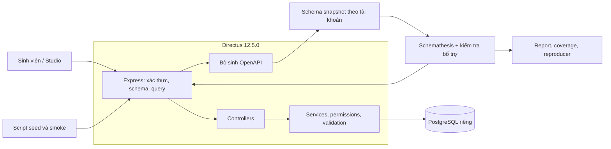

# Kế hoạch R06 + K05: kiểm thử API Directus bằng Schemathesis

## 1. Kết luận và hướng triển khai đề xuất

**Đề tài khả thi với nhóm 3–5 sinh viên mới tiếp cận, nếu giới hạn vào REST API quản lý nội dung, truy vấn và phân quyền.** Đề xuất dùng một mô hình bài viết–danh mục nhỏ để kiểm thử các cơ chế thật của Directus, chạy trong môi trường Docker riêng và giữ nguyên mã nguồn sản phẩm trong giai đoạn đầu.

Các quyết định chính:

| Nội dung | Quyết định đề xuất | Cơ sở |
|---|---|---|
| Phiên bản Directus | **12.5.0**, gắn với tag và commit cụ thể | Có release chính thức và tag trong repository đã clone |
| Môi trường chạy | Image Directus chính thức + PostgreSQL 16 riêng | Tránh chi phí build toàn bộ monorepo; vẫn kiểm thử API với DB thật |
| Công cụ | **Schemathesis 4.30.0 bằng Docker** | Có CLI, Python API, báo cáo, replay và schema coverage |
| Phạm vi chính | Hai collection, 10 operation CRUD; kiểm thử truy vấn và quyền trên các operation này | Đủ chiều sâu nhưng có thể quản lý được |
| Nguồn schema | OpenAPI xuất từ instance đã seed, theo từng tài khoản | Schema Directus phụ thuộc mô hình dữ liệu và quyền |
| Cách đánh giá | Schema conformance + invariant nghiệp vụ + khả năng tái hiện | Tránh xem mọi cảnh báo công cụ là lỗi sản phẩm |
| Quản lý đồ án | Repository kiểm thử riêng tại `DAMH`; mã Directus giữ riêng | Phân biệt phần nhóm thực hiện với mã upstream |
| Ưu tiên trước 20/10 | Môi trường tái lập, kiến trúc, ít nhất ba luồng demo và pilot Schemathesis | Bám đúng yêu cầu giữa kỳ |

Nhóm đã xác nhận: **đã đăng ký R06 + K05, chưa chốt phiên bản; nhóm 3–5 người mới tiếp cận; áp dụng mốc giữa kỳ 20/10 và cuối kỳ theo PDF.**

Đây là kết quả khảo sát và kế hoạch, **chưa phải kết quả kiểm thử**. Chưa cài phần mềm, chỉnh mã nguồn, khởi động dịch vụ hoặc thay đổi Git history.

## 2. Những gì đã xác minh và ảnh hưởng đến kế hoạch

**Yêu cầu môn học**

Theo [tài liệu giảng viên](/home/mlanh/projects/KTPM/DAMH/yeu_cau.pdf), sản phẩm cần đáp ứng cả phân tích hệ thống, thực nghiệm kiểm thử và quá trình làm việc nhóm:

| Yêu cầu | Sản phẩm cần chuẩn bị |
|---|---|
| A — Mục tiêu, actor, module, dependency, data flow | Tổng quan Directus và phân tích năm luồng được chọn |
| B — Ít nhất một sơ đồ kiến trúc; giải thích 3–5 module liên quan | Sơ đồ container/component và giải thích đường đi của request |
| C — Môi trường, phiên bản, seed; ít nhất ba luồng chạy được | Hướng dẫn dựng từ máy sạch, script seed, bằng chứng demo |
| D — Nguyên lý, phạm vi, giả định, rủi ro, pass/fail | Chiến lược K05 và cách phân biệt lỗi schema, lỗi sản phẩm, lỗi môi trường |
| E — Input, precondition, expected result/invariant | Ma trận scenario và mô hình dữ liệu kiểm thử |
| F — Automation/harness chạy lại được | Script điều phối, cấu hình Schemathesis, kiểm tra bổ trợ, README |
| G — Log, report, metrics, defect và phân tích nguyên nhân | Báo cáo thực nghiệm, reproducer và hồ sơ phân loại phát hiện |
| H — Pin phiên bản và tái lập trên máy mới | Manifest phiên bản, schema snapshot, cấu hình và quy trình replay |

PDF **không đặt số lượng lỗi tối thiểu, số request tối thiểu hay tỷ lệ code coverage bắt buộc cho K05**. Nếu không tìm thấy lỗi, nhóm phải chứng minh phạm vi và mức bao phủ đã đạt. Vì vậy, không đặt mục tiêu “phải tìm được X lỗi”.

Mốc giữa kỳ yêu cầu demo hệ thống, kiến trúc, on-boarding và kế hoạch kiểm thử. Báo cáo cuối kỳ phải nộp **trước bảo vệ một tuần**.

**Repository và môi trường**

| Nội dung | Đã xác minh | Ý nghĩa |
|---|---|---|
| Checkout Directus | Nhánh `main`, sạch; HEAD `d3c9a8bb0c0096148c4740ce908e76c24f2413a0` | Không có thay đổi người dùng cần xử lý |
| Release đề xuất | `v12.5.0` → `4f77933bf9551cac6b289576078783e189b8f4e3` | HEAD hiện tại đi sau release ba commit, không được đồng nhất hai bản |
| Runtime của monorepo | Node **22**, pnpm **10.27.0**; có `engine-strict=true` | Không nên dùng pnpm hoặc Node toàn cục một cách mặc định |
| NVM | Đã có Node **22.23.3** | Không cần đề xuất cài thêm Node để bắt đầu |
| Khác biệt shell | Shell công cụ dùng Node 26/Homebrew; Zsh tương tác dùng Node 22/NVM | Cần kiểm tra executable thực tế trong hướng dẫn tái lập |
| pnpm | Homebrew có pnpm 12.9.1; Zsh tương tác tìm thấy shim Corepack từ mise | Cần kiểm tra cả `command -v` và phiên bản, tránh trộn toolchain |
| Docker | Docker 29.8.1, Compose v5.5.1; daemon đang hoạt động | Có thể xây dựng phương án Docker sau khi được xác nhận |
| Tài nguyên | WSL khoảng 5,6 GiB RAM, 2 GiB swap | Ưu tiên image dựng sẵn và một worker kiểm thử |
| Dịch vụ hiện hữu | Có PostgreSQL, Redis, MinIO của dự án khác đang chạy | Phải dùng network, volume và tên Compose riêng |
| Thư mục đồ án | `DAMH` chưa là Git repository | Cần khởi tạo repository đồ án trong giai đoạn triển khai |
| Công cụ kiểm thử | Chưa tìm thấy Schemathesis trên PATH | Không coi harness đã sẵn sàng |

Yêu cầu runtime được ghi trong [manifest Directus](/home/mlanh/projects/KTPM/directus/package.json). Release 12.5.0 được xác nhận từ [trang phát hành chính thức](https://github.com/directus/directus/releases/tag/v12.5.0).

Repository là monorepo TypeScript/pnpm: API dùng Express và Knex; Studio dùng Vue; SDK và các package dùng chung nằm riêng. Bộ kiểm thử upstream dùng Vitest, có E2E và sandbox cho nhiều DB. Đây là nguồn tham khảo tốt, nhưng chạy toàn bộ suite không phải điều kiện cần để làm K05.

Dockerfile hiện tại xây dựng nhiều package và cấu hình Node heap tới 8 GiB. Điều này **không chứng minh build chắc chắn thất bại** trên máy hiện tại, nhưng đủ cơ sở để không chọn full build làm đường triển khai chính.

File license hiện tại là **MSCL-1.0-GPL**. Báo cáo cần ghi đúng license của phiên bản khảo sát; các hướng dẫn cũ nói về license hoặc runtime khác không nên được áp dụng nguyên trạng.

**Đặc điểm Directus quyết định thiết kế kiểm thử**

Directus có endpoint `GET /server/specs/oas`. Trong mã nguồn, endpoint gọi bộ sinh OpenAPI với `accountability` và schema của request. Bộ sinh tạo OpenAPI 3.0.1 và lọc collection, operation, field theo quyền. Có thể đối chiếu ở [bộ sinh specification](/home/mlanh/projects/KTPM/directus/api/src/services/specifications.ts:70) và [API reference chính thức](https://directus.com/docs/api/server).

Hệ quả:

- File OpenAPI tĩnh trong repository là nguyên liệu cho bộ sinh, chưa mô tả đầy đủ collection của đồ án.
- Phải seed collection, field, relation và policy **trước khi xuất schema**.
- Schema của admin, editor và reader có thể khác nhau.
- `info.version` của OpenAPI động là fingerprint; không dùng nó thay cho phiên bản Directus.
- Schema không thể thay thế toàn bộ oracle nghiệp vụ, đặc biệt với quyền theo bản ghi, ID đang tồn tại và ràng buộc quan hệ.

**Các giả thuyết đáng ưu tiên xác minh**

Đọc mã nguồn cho thấy một số điểm có thể tạo phát hiện hữu ích:

| Quan sát tĩnh | Thực nghiệm cần làm | Cách diễn giải ban đầu |
|---|---|---|
| Template DELETE khai báo 200; middleware trả 204 khi không có payload | Tạo rồi xóa một item và đối chiếu OpenAPI xuất thực tế | Ứng viên lỗi tài liệu/schema |
| Component item được dùng cho cả POST, PATCH và response; có danh sách `required` | PATCH một field, bỏ field bắt buộc khi tạo | Có thể là schema không phân biệt tạo mới và cập nhật một phần |
| Response tham chiếu component item, trong khi `fields` cho phép chọn một phần | GET chỉ `id` hoặc `title` | Có thể gây cảnh báo thiếu field dù projection hợp lệ |
| Ánh xạ field sang OpenAPI không thể hiện đầy đủ mọi validation nghiệp vụ | So sánh cấu hình field/policy với schema xuất ra | Giới hạn của bộ sinh và nguồn gây request “hợp schema nhưng sai nghiệp vụ” |

Các phần mã trực tiếp liên quan ở trên không khác giữa HEAD đã đọc và tag 12.5.0. Tuy nhiên, **chưa có giả thuyết nào được coi là defect đã tái hiện**.

## 3. Thiết kế kỹ thuật và chiến lược kiểm thử

**Kiến trúc phòng kiểm thử**

Năm nhóm module cần giải thích trong báo cáo: middleware xác thực/query; controllers; services xử lý item; permissions/validation; bộ sinh specification và lớp truy cập DB.

Luồng dữ liệu cần mô tả đến mức: token được chuyển thành danh tính/quyền; query được chuẩn hóa; controller gọi service; service áp quyền và validation; Knex thực hiện truy vấn/transaction; response hoặc lỗi được chuẩn hóa.

**Lựa chọn môi trường**

Dùng Compose riêng với tên dự án `r06-k05`:

- Directus 12.5.0, mở Studio/API tại `127.0.0.1:8055`.
- PostgreSQL 16, chỉ truy cập trong network Compose, không mở thêm cổng DB ra host.
- Runner Schemathesis 4.30.0 chạy theo yêu cầu, dùng hostname service `directus:8055`.
- Volume riêng cho DB, cache kiểm thử và báo cáo; không dùng lại DB của dự án khác.
- Bật OpenAPI; tắt cache ứng dụng và telemetry cho thí nghiệm; ghi rõ cấu hình rate limiter.
- Dùng health check và chờ seed thành công trước khi chạy kiểm thử.

Chọn PostgreSQL vì đề tài có ràng buộc dữ liệu và quan hệ, đồng thời máy đã có image PostgreSQL 16. SQLite ít dịch vụ hơn nhưng không được dùng làm DB đối chứng trong phạm vi chính. Redis, S3, email, GraphQL, WebSocket và frontend automation nằm ngoài phạm vi.

Directus khuyến nghị pin image theo phiên bản trong [hướng dẫn triển khai](https://directus.com/docs/self-hosting/deploying). Sau khi được phép triển khai, phải xác minh manifest và ghi digest của từng image trước khi khóa baseline; không dùng `latest`.

Schemathesis 4.30.0 đã được xác nhận trên [PyPI](https://pypi.org/project/schemathesis/4.30.0/). Chọn image chính thức để không cần thay Python của host. Image hỗ trợ hooks và báo cáo; Dockerfile của chính tag này đã tích hợp TraceCov. [Tài liệu Docker](https://schemathesis.readthedocs.io/en/stable/guides/docker/)

Đối với mã nguồn, tạo worktree riêng tại tag đã chốt để đọc và phân tích nguyên nhân; giữ checkout `main` hiện tại nguyên trạng. Chỉ chuẩn bị build từ source khi có nhu cầu debug hoặc xác minh một bản sửa cụ thể.

**Mô hình dữ liệu và tài khoản**

Dùng bài toán quản lý nội dung nhỏ, hoàn toàn qua API chuẩn của Directus:

| Thành phần | Thiết kế |
|---|---|
| `qa_categories` | ID số nguyên tự tăng, tên bắt buộc |
| `qa_articles` | ID tự tăng; title bắt buộc, tối đa 120 ký tự; status `draft/published`; score nguyên 0–5; thời điểm xuất bản nullable; metadata JSON; internal_notes; quan hệ nhiều–một tới category |
| Seed | Ba category, 12 article gồm draft/published, dữ liệu Unicode và giá trị nullable |
| Admin | Bootstrap, tạo schema/policy, kiểm tra trạng thái; không làm tài khoản fuzz mặc định |
| Editor | CRUD hai collection; không có quyền quản trị hệ thống |
| Reader | Đọc category và article đã published; không đọc `internal_notes`; không ghi |
| Anonymous | Không có quyền truy cập hai collection |

Editor và Reader là tài khoản API, không cần quyền Studio. Ràng buộc phải được thiết lập ở DB/field validation/policy phù hợp, không chỉ ở giao diện nhập liệu.

Dữ liệu mẫu là fixture để kiểm thử Directus, không phải xây dựng backend riêng hoặc mock thay sản phẩm.

**Năm luồng phân tích và demo**

1. Đăng nhập, lấy danh tính và kiểm tra token không hợp lệ.
2. Editor tạo → đọc → cập nhật → xóa bài viết.
3. Lọc, sắp xếp, phân trang và chọn field.
4. Đọc/ghi bài viết có liên kết category.
5. Reader đọc nội dung published, bị giới hạn field và không được sửa dữ liệu.

Đăng nhập và quản trị schema được kiểm tra bằng ca có kiểm soát. Campaign fuzz chính chỉ bao gồm:

- `GET`, `POST` trên `/items/qa_articles` và `/items/qa_categories`.
- `GET`, `PATCH`, `DELETE` trên đường dẫn item theo ID.

Tổng cộng **10 operation**, tính theo cặp method–path. Chưa đưa bulk PATCH/DELETE hoặc API quản trị vào campaign chính. POST vẫn có thể sinh mảng vì schema Directus hỗ trợ cả tạo một và nhiều item; harness phải nhận diện đúng dạng response và giới hạn kích thước batch trong profile có hướng dẫn.

**Ba lớp kiểm thử**

| Lớp | Mục đích | Cách thực hiện |
|---|---|---|
| Smoke và scenario cố định | Chứng minh môi trường, seed, quyền và nghiệp vụ hoạt động | Python/pytest với dữ liệu biết trước |
| Schema-based testing | Sinh input và phát hiện vi phạm hợp đồng | Schemathesis: examples, coverage, fuzzing |
| Chuỗi có trạng thái và invariant | Đi sâu vào tài nguyên thực, kiểm tra tác động dữ liệu | Chuỗi CRUD, ID từ response, hooks/links và kiểm tra bổ trợ |

Không chạy fuzzer toàn quyền trên toàn bộ schema admin.

Xuất và lưu schema gốc của admin/editor/reader. Campaign editor dùng schema editor; kiểm thử reader dùng schema reader. Các phép thử “reader gọi operation bị cấm” dùng request được xây dựng có chủ đích, vì operation đó có thể đã bị loại khỏi schema reader.

Tách hai profile thực nghiệm:

- **Raw:** giữ nguyên nội dung hợp đồng của các operation đã chọn; ghi rõ allowlist và base URL được dùng.
- **Guided:** thêm dữ liệu mẫu, ID hợp lệ, chiến lược sinh và links để tăng khả năng đi qua nghiệp vụ. Giới hạn truy vấn trọng tâm ở `fields`, `filter`, `sort`, `limit`, `offset`, `page`, `search`.

Schema gốc luôn được bảo toàn. Nếu cần sửa một mô tả schema đã xác minh là sai, lưu thành overlay riêng với lý do và reproducer; không sửa thầm rồi báo rằng schema gốc đã pass.

Schemathesis hiện hỗ trợ suy luận liên kết giữa operation; links thủ công vẫn hữu ích khi cần kiểm soát ID và chuỗi cụ thể. Không giả định rằng bật stateful tự động sẽ bao phủ đúng mọi quan hệ của Directus. [Cơ chế stateful](https://schemathesis.readthedocs.io/en/stable/explanations/stateful/)

**Oracle và cách phân loại kết quả**

Bật rõ ràng các check nền tảng: không có lỗi 5xx, status được khai báo, content type phù hợp và response đúng schema. Dùng check chấp nhận/từ chối dữ liệu với diễn giải theo precondition; dữ liệu hợp OpenAPI chưa chắc hợp ràng buộc DB. [Các check của Schemathesis](https://schemathesis.readthedocs.io/en/stable/reference/checks/)

Bổ sung các invariant:

- Tạo thành công thì đọc lại được những field đã ghi, có tính đến default và ép kiểu được tài liệu hóa.
- PATCH một field không làm mất các field không được cập nhật.
- Xóa thành công thì tài nguyên không còn truy cập được theo ngữ nghĩa Directus.
- Reader không nhận draft hoặc `internal_notes`, kể cả khi dùng filter hay projection.
- Request bị từ chối không làm thay đổi dữ liệu mục tiêu.
- Truy vấn trên seed cố định trả đúng tập kết quả và thứ tự; dùng `id` làm khóa phụ để tránh thứ tự không xác định.

Không gán cứng mọi trường hợp thiếu quyền hoặc ID không tồn tại phải trả 401/404; expected result phải dựa vào hành vi được tài liệu hóa và mã nguồn của bản đã pin.

Mỗi phát hiện được phân loại thành: lỗi sản phẩm, lỗi/thiếu sót schema, sai fixture/harness, lỗi môi trường, hoặc chưa kết luận. Một request vi phạm nhiều check không được tính thành nhiều defect độc lập.

## 4. Kế hoạch triển khai, quản lý công việc và đầu ra

**Lộ trình theo mốc đã xác nhận**

| Giai đoạn | Công việc chính | Điều kiện hoàn thành |
|---|---|---|
| 10–12/10 | Khóa baseline; tạo repository đồ án; Compose riêng; bootstrap và seed | Dựng được Directus, DB và tài khoản; ghi phiên bản/digest |
| 13–15/10 | Hoàn thành năm luồng khảo sát; sơ đồ kiến trúc; smoke; xuất schema | Ít nhất ba luồng demo ổn định, có bằng chứng |
| 16–18/10 | Pilot Schemathesis; kiểm tra giả thuyết schema; hoàn thiện kế hoạch K05 | Có campaign nhỏ, báo cáo mẫu và phân tích giới hạn |
| 19/10 | Tổng duyệt giữa kỳ và rehearsal theo README trên baseline local | README đủ để người khác có thể dựng lại, slide và demo sẵn sàng; không yêu cầu xác minh máy thứ hai |
| 20/10 | Báo cáo giữa kỳ | Trình bày kiến trúc, môi trường, nghiệp vụ và kế hoạch có căn cứ |
| 21/10–08/11 | Hoàn thiện profile raw/guided, hooks, invariant và metrics | Harness tự động, operation inventory rõ ràng |
| 09–22/11 | Chạy thực nghiệm nhiều seed; phân loại và tái hiện phát hiện | Có dữ liệu so sánh và hồ sơ root cause |
| Từ 23/11 | Triage/replay bổ sung; hoàn thiện báo cáo và demo | Đóng băng bộ artefact trước hạn nộp |
| Bảo vệ −7 ngày | Nộp báo cáo | Theo ngày bảo vệ chính thức khi có thông báo |

Đây là lịch mục tiêu. Nếu pilot gặp trở ngại, ưu tiên giữ vững môi trường, ba luồng demo và schema testing cơ bản; chưa mở rộng sang GraphQL, nhiều DB hoặc sửa Directus.

**Repository và giao diện sử dụng**

Repository đồ án chứa tài liệu A–H, cấu hình môi trường, seed, schema, harness, test bổ trợ, reproducer và báo cáo đã chọn lọc. Không sao chép toàn bộ mã Directus vào repository này.

Cung cấp một script Bash điều phối với các lệnh thống nhất:

| Lệnh dự kiến | Trách nhiệm |
|---|---|
| `./lab.sh doctor` | Kiểm tra Docker, Compose, port, image/version và quyền ghi artefact |
| `./lab.sh up` | Khởi động đúng stack của đồ án, chờ health |
| `./lab.sh seed` | Tạo/kiểm tra fixture, tài khoản và policy |
| `./lab.sh smoke` | Kiểm tra nghiệp vụ và precondition |
| `./lab.sh export-schema` | Xuất schema theo tài khoản, kiểm tra parse và reference |
| `./lab.sh test smoke\|raw\|guided` | Chạy profile đã cấu hình và lưu kết quả |
| `./lab.sh replay <case-id>` | Chuẩn bị trạng thái cần thiết và chạy reproducer |
| `./lab.sh reset` | Tái tạo riêng dữ liệu lab sau kiểm tra đúng project/volume |
| `./lab.sh down` | Dừng stack lab, mặc định giữ dữ liệu |

Trong kế hoạch gốc đây là giao diện dự kiến; theo phụ lục điều hành ngày
2026-10-11, các lệnh đã được triển khai và kiểm tra trong phạm vi có thể xác
minh. Không thay đổi public API hoặc kiểu dữ liệu của Directus.

Script phải trả mã lỗi khi setup/test thất bại; vẫn lưu artefact khi test phát hiện lỗi. Không dùng `|| true` để làm báo cáo trông thành công.

**Phân công và quản lý tiến độ**

Với ba người, chia ba trách nhiệm chính: môi trường và kiến trúc; harness và dữ liệu kiểm thử; scenario, metrics và phân tích lỗi. Nếu có người thứ tư hoặc thứ năm, tách phần quyền/invariant và tái lập/báo cáo. Mỗi phần phải có owner, đầu ra, provenance và kiểm tra phù hợp; review chéo thành viên là tùy chọn, không phải gate G1.

Đề xuất GitHub Projects để liên kết task–commit–PR trong cùng hệ thống. Mỗi task có yêu cầu A–H liên quan, người phụ trách, tiêu chí hoàn thành và bằng chứng. Dùng nhánh ngắn và PR nội bộ; giữ lịch sử đóng góp thật, không tạo commit hình thức để tăng số lượng.

CI được bổ sung sau khi chạy local ổn định: kiểm tra harness, smoke và một profile ngắn; campaign dài chạy thủ công. Không yêu cầu push, tạo board hay gửi issue upstream trong giai đoạn nghiên cứu này.

## 5. Tái lập, tiêu chí nghiệm thu và bước ưu tiên

**Thiết kế thực nghiệm**

Mặc định ban đầu:

- Một worker; giới hạn khoảng 5 request/giây; timeout request 10 giây.
- Pilot: tối đa 20 ví dụ fuzz/operation, ngân sách 5 phút.
- Campaign chính: tối đa 100 ví dụ fuzz/operation, ba seed cố định `101`, `202`, `303`; ngân sách 20 phút cho mỗi profile/seed.
- Raw và guided bắt đầu từ cùng baseline dữ liệu.
- Reset riêng lab giữa các campaign; không reset sau từng request của một chuỗi có trạng thái.
- Giữ shrinking; mọi giới hạn kích thước hoặc dữ liệu sinh phải được ghi trong cấu hình.

`max-examples` không đồng nghĩa với tổng request: các phase khác, shrinking và stateful có thể phát sinh thêm request. Nếu hết thời gian trước khi hoàn tất, báo cáo phải ghi run chưa hoàn tất, không tính là đạt coverage.

Seed giúp kiểm soát sinh dữ liệu nhưng **không bảo đảm tái lập độc lập** khi DB, dependency, cache hoặc thứ tự request khác nhau.

Mỗi run lưu: SHA Directus và harness, image digest, phiên bản dependency trong runner, cấu hình, schema hash, fixture version, seed, thời điểm, thời lượng, trạng thái kết thúc, log và report. Token/password không đưa vào Git; reproducer dùng biến môi trường.

Giữ bản sao artefact lỗi bên ngoài cache tự quản lý của công cụ. Replay một lỗi có trạng thái cần cả bước tạo dữ liệu và liên kết ID, không chỉ request cuối. Schemathesis có cơ chế lưu crash và replay, nhưng cache có thể được cập nhật hoặc xóa khi chạy lại. [Hướng dẫn replay](https://schemathesis.readthedocs.io/en/stable/guides/crash-reproduction/)

**Chỉ số cần báo cáo**

| Chỉ số | Ý nghĩa |
|---|---|
| Operation coverage | Số cặp method–path đã thực sự gọi / 10 operation trong phạm vi |
| Thành công có precondition hợp lệ | Chứng minh test đi qua nghiệp vụ, không chỉ gặp lỗi xác thực |
| Scenario/invariant coverage | Bao phủ các luồng, quyền và ràng buộc đã cam kết |
| Schema coverage | Operation, parameter, keyword, example và response theo công cụ |
| Phân bố status/check failure | Nhận biết campaign bị chi phối bởi 401/403, ID sai hoặc schema yếu |
| Defect đã phân loại | Đếm theo nguyên nhân, kèm khả năng tái hiện |
| Raw so với guided | So sánh khả năng tiếp cận nghiệp vụ và phát hiện sau khi triage |

TraceCov cung cấp schema coverage, **không phải line/branch coverage của mã Directus**. Ràng buộc không được mô tả trong schema sẽ không tự xuất hiện trong mẫu số coverage; phải có bảng ràng buộc nghiệp vụ riêng. [Tài liệu schema coverage](https://schemathesis.readthedocs.io/en/stable/guides/coverage/)

**Điều kiện nghiệm thu đề xuất của nhóm**

Các ngưỡng sau là đề xuất quản lý chất lượng, không phải yêu cầu định lượng do giảng viên đặt:

- README đủ để người khác có thể dựng lại trên máy mới; không yêu cầu một lần chạy xác minh trên máy thành viên thứ hai.
- Demo tối thiểu ba luồng; báo cáo phân tích đủ năm luồng đã chọn.
- Cả 10 operation đều được thực thi và có ít nhất một ca thành công với dữ liệu hợp lệ trong bộ kiểm thử.
- Có positive/negative case cho các ràng buộc áp dụng được và ma trận quyền đã định nghĩa.
- Ba seed hoàn tất; trường hợp bỏ qua hoặc không đạt có giải thích cụ thể.
- Mỗi phát hiện được giữ trong báo cáo có request/response, precondition, phiên bản, phân loại và reproducer.
- Defect được gọi là tái hiện ổn định phải lặp lại từ trạng thái chuẩn; trường hợp chập chờn được ghi riêng.
- Raw report được giữ kể cả khi có lỗi schema đã biết; không bắt buộc mọi campaign phải xanh để đồ án được coi là hoàn thành.
- Nếu không có defect: trình bày phạm vi đạt được, coverage thực đo và giới hạn suy luận; không kết luận Directus “không có lỗi”.

**Những điểm chưa thể xác minh tại thời điểm lập kế hoạch**

Chưa chạy instance nên chưa biết thời gian khởi động, mức RAM thực tế, tính tương thích runtime của toàn bộ stack, OpenAPI sau seed và các giả thuyết lỗi có tái hiện hay không. Digest image Directus/Schemathesis chưa được khóa; giới hạn Core tier với cấu hình tài khoản dự kiến cần được kiểm tra trong smoke. Ngày bảo vệ cuối kỳ chưa có.

Đây là các bước kiểm chứng của giai đoạn triển khai, không phải lý do để tự chuyển phiên bản, sửa license handling hoặc thay đổi môi trường hiện có. Nếu baseline gặp blocker, ghi lại bằng chứng và đề xuất điều chỉnh riêng.

**Bước tiếp theo nên ưu tiên trong bản kế hoạch gốc:** khóa baseline và dựng lab
tối thiểu. Phụ lục điều hành bên dưới đã cho phép triển khai ngay; bằng chứng
thực tế được ghi trong `evidence/runtime-verification-2026-10-11.md` và các
artifact run bị Git ignore.

Đoạn kế hoạch gốc này là lịch sử định hướng; trạng thái và phân công hiện hành
được quyết định bởi Phụ lục điều hành cập nhật — 2026-10-11.

## 6. Phụ lục điều hành cập nhật — 2026-10-11

Phụ lục này thay đổi cách tổ chức thực hiện cho giai đoạn nước rút và được ưu
tiên khi khác với phân công ban đầu.

### 6.1. Người thực hiện và thời hạn

- Lành là người thực hiện chính, tích hợp và chịu trách nhiệm chạy toàn bộ
  công việc trong repository.
- Nhân và Trâm chỉ được ghi `Co-authored-by` trong commit mới khi có đóng góp
  thực tế, xác định được ở mã nguồn, test, tài liệu hoặc review có nội dung.
  Phân công cũ không tự tạo ra co-author. Hiện tại chưa có đóng góp mới được
  xác nhận nên commit tiếp theo của Lành không thêm co-author.
- Không sửa author hoặc trailer của các commit đã tạo.
- Hạn hoàn tất và bàn giao: hết ngày 2026-10-11 để nộp ngày 2026-10-12.

### 6.2. Phạm vi hoàn tất trong ngày

Ưu tiên toàn bộ phạm vi đồ án: 10 operation, raw/guided, ba seed, invariant,
replay, artifact, báo cáo và hướng dẫn. Kết quả nào chưa chạy được phải ghi
đúng là `blocked`, `failed` hoặc `incomplete`; không đổi nhãn để đạt checklist.

Các quy tắc trong `AGENTS.md` vẫn có hiệu lực. Khi operation Reader bị lọc khỏi
schema, test ghi `blocked` và không gửi request quyền bị cấm. License Directus
không được bypass bằng database, Admin hoặc sửa assertion.

### 6.3. Đường găng thực hiện

1. Hoàn thiện positive acceptance cho đủ 10 method–path bằng Editor, lấy ID từ
   response, kiểm tra PATCH giữ field và DELETE không còn tài nguyên.
2. Chạy invariant/replay trong runner Docker đã pin; host không cần Python
   package hoặc runtime bổ sung.
3. License v2 đã được cấu hình cục bộ; seed lại policy Reader, export schema mới
   và chạy S4–S6 đã hoàn tất trong các run được ghi ở manifest.
4. Chạy tuần tự raw/guided cho seed `101`, `202`, `303`; giữ report, coverage,
   restore status và mã thoát của từng run.
5. Triage failure, cập nhật ma trận A–H, README, demo, metrics và báo cáo cuối.

### 6.4. Cổng kết thúc

G1 được ghi nhận khi có license, policy, schema và run chứng minh được baseline
kỹ thuật. Checkpoint hiện tại đạt baseline với findings: artifact sạch secret,
Reader và sáu scenario đạt, nhưng invariant aggregate và raw/guided vẫn giữ
failure/incomplete đúng thực tế. Không yêu cầu máy thứ hai hoặc review chéo để
đóng G1; README vẫn phải duy trì khả năng người khác dựng/chạy lại. Full
acceptance cuối kỳ tiếp tục cần báo cáo, metrics, reproducer, phân loại failure
và peer evaluation theo yêu cầu riêng của đề bài.
