# Báo cáo giữa kỳ — R06 Directus và K05 Schema-Based API / Fuzz Testing

**Môn học:** Kiểm thử phần mềm.  
**Ngày tổng hợp:** 13/10/2026, múi giờ Asia/Bangkok.  
**Mốc giữa kỳ:** 20/10/2026 theo [yêu cầu môn học](yeu_cau.pdf), trang 3.  
**Phạm vi:** REST API của hai collection thử nghiệm `qa_categories` và `qa_articles`.  
**Bằng chứng chính:** [Lần dựng lại trên Windows](../evidence/windows-recheck-2026-10-13.md).

Tài liệu này tổng hợp các mục 3–15 để dùng khi viết báo cáo hoặc chuẩn bị slide, bao gồm mục riêng về kết quả kiểm thử và giải thích. Kết quả runtime là những lần đã chạy trên máy Windows hiện tại; phần mô tả mã nguồn Directus kế thừa tài liệu khảo sát đã có trong repository. Kế hoạch và phân công không được dùng thay cho bằng chứng đóng góp thực tế của từng thành viên.

## 3. Tổng quan hệ thống Directus

### 3.1. Mục tiêu và vai trò

Directus là nền tảng quản lý dữ liệu và cung cấp API trên cơ sở dữ liệu SQL. Hệ thống có giao diện quản trị **Data Studio** để quản lý collection, nội dung, người dùng và quyền truy cập; ứng dụng bên ngoài có thể sử dụng dữ liệu thông qua API hoặc SDK.

Trong đồ án, Directus là **hệ thống được kiểm thử — SUT**. Repository `DAMH` chứa cấu hình môi trường, dữ liệu mẫu và mã kiểm thử; đây là bộ công cụ làm việc với Directus qua API. Hai collection bài viết/danh mục là fixture phục vụ thí nghiệm, không phải chức năng nghiệp vụ có sẵn trong mã nguồn upstream.

### 3.2. Chức năng chính

| Nhóm chức năng của Directus | Mô tả | Phạm vi đồ án hiện tại |
|---|---|---|
| Quản lý mô hình dữ liệu | Tạo collection, field và quan hệ | Admin tạo schema fixture cho hai collection |
| Quản lý nội dung | Tạo, đọc, sửa, xóa dữ liệu | CRUD article/category bằng REST API |
| Truy vấn dữ liệu | Filter, sort, fields, phân trang, search | Kiểm tra với bộ dữ liệu biết trước |
| Xác thực | Đăng nhập, token và phiên làm việc | Local login, token giả, anonymous |
| Phân quyền | Quyền theo policy, collection, field và item | Editor/Reader, published-only, field kín, cấm ghi |
| Quản lý tệp, GraphQL, WebSocket, Flows, extensions | Các khả năng mở rộng khác của nền tảng | Chưa được kiểm thử trong phạm vi K05 đã chọn |

### 3.3. Đối tượng sử dụng

Người quản trị dùng Studio để cấu hình hệ thống và kiểm soát dữ liệu. Người biên tập quản lý nội dung theo quyền được cấp. Lập trình viên dùng API/SDK để xây dựng ứng dụng. Người đọc hoặc client bên ngoài truy cập dữ liệu theo policy, có thể có hoặc không có tài khoản.

Các actor trong lab được giới hạn cụ thể:

| Actor | Quyền trong lab |
|---|---|
| Admin | Bootstrap, quản lý schema/policy, seed, snapshot và kiểm tra trạng thái |
| Editor | CRUD hai collection bằng API; không được cấp quyền Studio trong fixture |
| Reader | Đọc category và article `published`; không đọc `internal_notes`, không ghi |
| Anonymous | Không truy cập hai collection fixture |

### 3.4. Nghiệp vụ trọng tâm

Năm nghiệp vụ dùng để phân tích và kiểm thử là: đăng nhập/cấp token; CRUD bài viết và danh mục; truy vấn/phân trang; kiểm soát quyền Reader; xử lý quan hệ category–article khi xóa danh mục. Ba luồng demo giữa kỳ được chọn là CRUD Editor, query và quyền Reader.

## 4. Kiến trúc hệ thống

### 4.1. Các thành phần chính

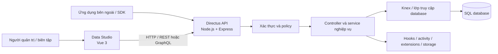

Đây là sơ đồ khái quát của Directus. Trong lab hiện tại, các request kiểm thử sử dụng REST, database là PostgreSQL và phạm vi dữ liệu chỉ gồm hai collection fixture. Các khả năng mở rộng trong sơ đồ chưa được coi là đã kiểm thử.

### 4.2. Kiến trúc môi trường kiểm thử

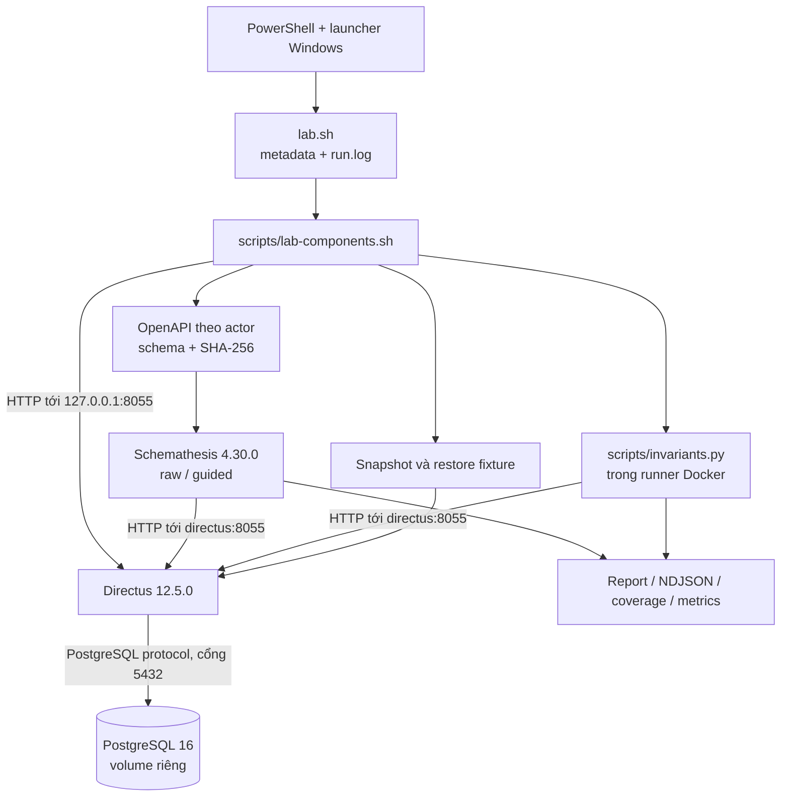

Compose project là `r06-k05`, network là `r06-k05_network` và volume database là `r06-k05_db_data`. Directus chỉ publish cổng `8055` trên địa chỉ loopback `127.0.0.1`; PostgreSQL không publish cổng ra host. Runner giao tiếp với API bằng hostname nội bộ `directus`.

Nguồn chi tiết: [Kiến trúc và luồng dữ liệu](phan1/02-kien-truc-va-luong-du-lieu.md), [Compose](../compose.yaml).

## 5. Cấu trúc mã nguồn

### 5.1. Cấu trúc Directus upstream

```text
directus/                    # repository upstream, mô hình tham khảo
├── directus/                # gói runtime và CLI
├── api/src/
│   ├── controllers/         # route và xử lý HTTP
│   ├── services/            # xử lý nghiệp vụ
│   ├── middleware/          # auth, schema, query, response
│   ├── permissions/         # kiểm tra policy, item và field
│   ├── database/            # Knex, migration, SQL và schema
│   ├── auth/                # các cơ chế xác thực
│   ├── extensions/          # cơ chế mở rộng
│   └── websocket/           # giao tiếp thời gian thực
├── app/src/                 # Data Studio
├── sdk/                     # SDK cho ứng dụng client
├── packages/                # types, utils, env, schema, storage...
└── tests/                   # kiểm thử upstream
```

Cây trên được tổng hợp từ [báo cáo khảo sát mã nguồn](phan1/01-phan-tich-he-thong.md). Thư mục upstream `../directus` hiện không có trong workspace Windows này. Lab sử dụng image dựng sẵn, không yêu cầu sao chép toàn bộ monorepo vào `DAMH`.

Báo cáo khảo sát cũ đọc checkout `d3c9a8bb0c0096148c4740ce908e76c24f2413a0`; baseline nguồn được ghi cho tag `v12.5.0` là `4f77933bf9551cac6b289576078783e189b8f4e3`. Bằng chứng runtime trong báo cáo này gắn với image digest, không khẳng định hai checkout nguồn đó giống nhau hoặc đã được build trên Windows.

### 5.2. Cấu trúc repository đồ án

```text
DAMH/
├── compose.yaml             # Directus, PostgreSQL và runner
├── lab.sh                   # giao diện lệnh, kiểm tra và provenance
├── config/
│   ├── lab.env.example      # cấu hình mẫu, image ghim bằng digest
│   └── lab.env              # credential/license riêng, Git ignore
├── scripts/
│   ├── lab-components.sh    # seed, schema, scenario, campaign, replay
│   └── invariants.py        # HTTP client và 11 oracle/case ổn định
├── manifest/baseline.yaml   # thông tin baseline
├── docs/                    # phân tích, kế hoạch và báo cáo
├── evidence/                # tổng hợp bằng chứng chọn lọc
├── runtime/                 # ID map/schema, Git ignore
└── artifacts/runs/          # metadata, log và report từng run, Git ignore

tmp/lab-tools/               # nằm ngoài DAMH, công cụ Windows cục bộ
├── run-lab.ps1              # gọi Git Bash với jq và runtime profile
├── verify-k05.ps1           # orchestrate pilot raw/guided
├── jq                      # wrapper bảo toàn LF và API path
└── jq.exe                  # executable portable
```

`runtime profile` chỉ tách các file ID map/schema; các profile vẫn dùng chung database lab. Vì vậy không chạy song song hai suite ghi/xóa dữ liệu.

### 5.3. Công nghệ sử dụng

| Thành phần | Công nghệ và vai trò |
|---|---|
| Backend Directus | TypeScript, Node.js, Express; controller/service/middleware |
| Data Studio | Vue 3, TypeScript, Pinia, Vue Router, Vite |
| Database | PostgreSQL; Directus truy cập qua Knex và driver database |
| Xác thực và quyền | Token/phiên, password hash, policy và validation |
| Harness | Bash, curl, jq; PowerShell hỗ trợ chạy trên Windows |
| Test bổ trợ | Python standard library trong runner Docker |
| K05 | Schemathesis, Hypothesis, OpenAPI |
| Cô lập và tái lập | Docker Compose, image digest, fixture, schema hash, metadata |

Node 22 và pnpm 10.27.0 là cấu hình build/debug source ghi trong tài liệu dự án. Chúng không phải dependency bắt buộc trên host khi chạy lab bằng Docker.

## 6. Luồng hoạt động của hệ thống

### 6.1. Đăng nhập và tạo ngữ cảnh quyền

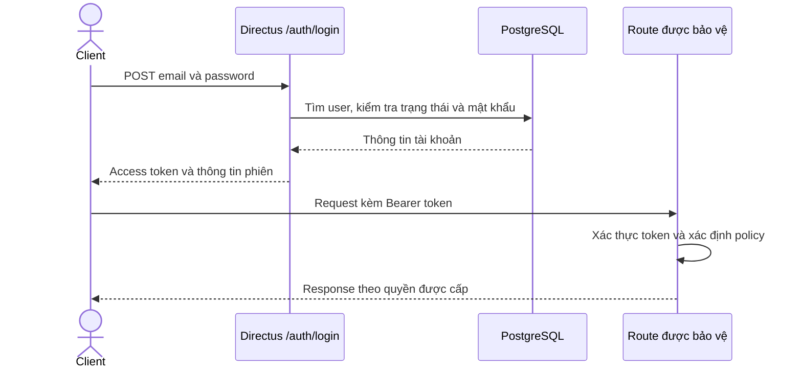

Admin dùng để thiết lập môi trường; Editor/Reader dùng credential riêng. Token không được ghi vào báo cáo. Một request hợp lệ về JSON vẫn có thể bị từ chối nếu actor thiếu quyền.

### 6.2. CRUD article bằng Editor

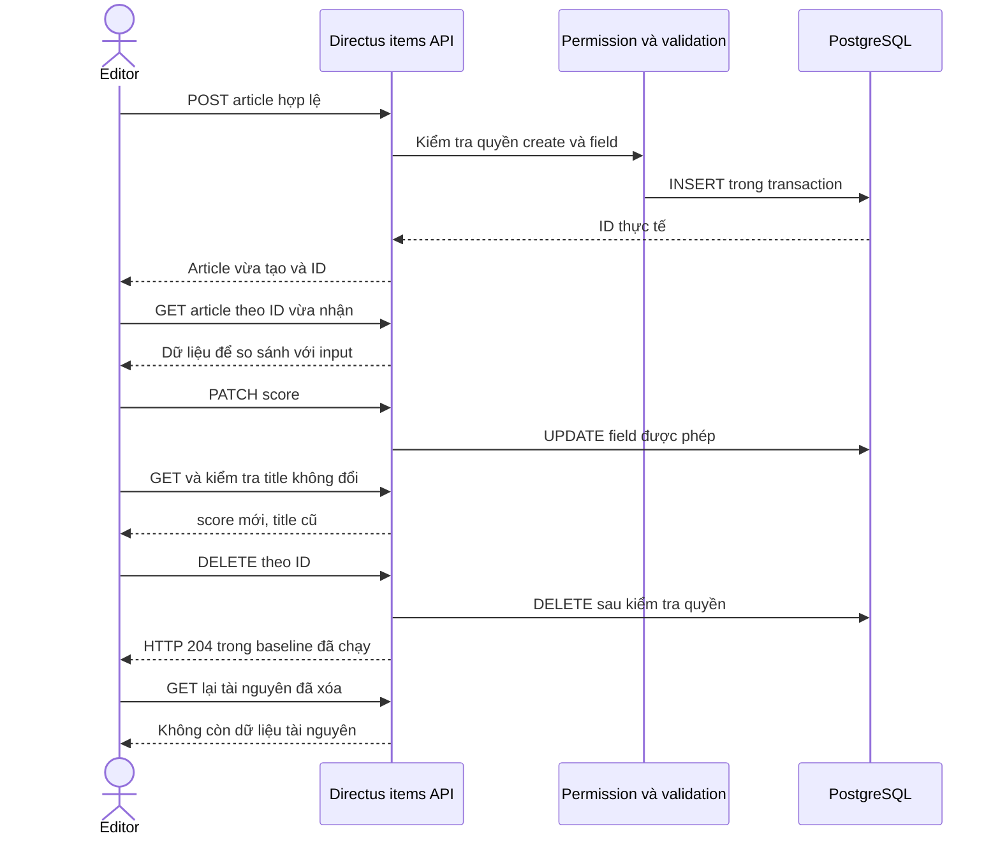

Invariant là tạo xong đọc lại được, PATCH giữ field không cập nhật và DELETE khiến tài nguyên không còn truy cập theo ngữ nghĩa baseline. Trong run đã lưu, GET sau DELETE trả `403`; test không mặc định tài nguyên đã xóa phải trả `404`.

### 6.3. Truy vấn và phân trang

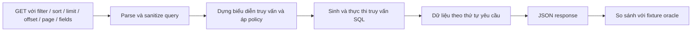

Fixture có sáu bài `published`, sáu bài `draft`. Kiểm thử so sánh tập ID, dùng `sort=title,id` để ổn định thứ tự, đối chiếu offset/page và kiểm tra search Unicode `spéciale`. Expected được tính từ dữ liệu fixture đã biết, không lấy chính response đang kiểm tra làm đáp án.

### 6.4. Quyền Reader

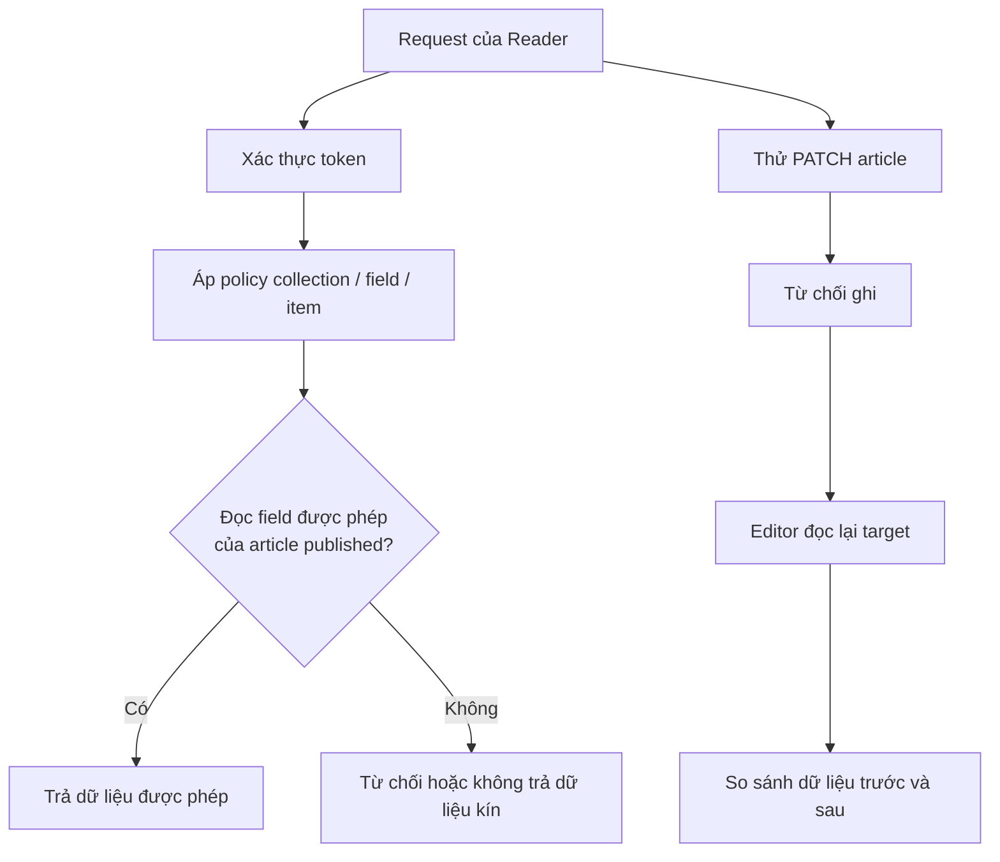

GET published hợp lệ trả `200`; projection chứa `internal_notes` và PATCH Reader bị từ chối với `403` trong lần chạy thực tế. Read-back bằng Editor xác nhận dữ liệu không đổi. Quyền tùy chỉnh cần entitlement `custom_permission_rules_enabled=true` của license trên baseline hiện tại.

## 7. Thiết lập môi trường

### 7.1. Công cụ và phiên bản

| Thành phần | Phiên bản/cấu hình đã dùng |
|---|---|
| Hệ điều hành host | Windows; shell PowerShell và Git Bash |
| Docker Desktop / Engine | 4.90.0 / 29.7.2 trong lần khảo sát môi trường Windows |
| Docker Compose | Plugin được `doctor` xác nhận khả dụng |
| Directus | `12.5.0`, ghim digest trong cấu hình |
| PostgreSQL | `16-alpine`, ghim digest; volume riêng |
| Schemathesis | `4.30.0`, runner Docker ghim digest |
| jq portable | `1.8.2`; wrapper dùng LF và giữ nguyên API path |
| curl | Công cụ HTTP dùng trong Git Bash |
| Fixture / runtime profile | `r06-k05-v2` / `windows-20261013-oig` |
| URL host / URL runner | `http://127.0.0.1:8055` / `http://directus:8055` |

Digest đã dùng:

```text
Directus:
sha256:7de5d6898b955dab1672619aed590035dcade4f8d7396d913e55543e114d1331
PostgreSQL:
sha256:721873c34ceb9f8d8fc265984940dc982404c105f19ad51be9fdc5970a6080ea
Schemathesis:
sha256:bb9cecfc9ac4058a15fcf9b505d9d9f972e2dde7c74c4e9289a35922f4cbc0a5
```

### 7.2. Cấu hình cần thiết

`config/lab.env` được tạo từ [file example](../config/lab.env.example). Các nhóm khóa gồm image; thông tin DB; key/secret của Directus; email/password Admin, Editor, Reader; license; URL; fixture version; seed và ngân sách kiểm thử.

Credential/license chỉ điền cục bộ và không commit. Windows dùng ACL riêng cho file cấu hình, Unix dùng `chmod 600`. License trên máy hiện tại đã active và bật custom rules. Lab đặt token TTL là `2h`, cache ứng dụng tắt; rate limiter ứng dụng tắt, còn runner giới hạn request `5/s`.

### 7.3. Các bước chạy trên máy Windows hiện tại

Các lệnh dưới đây chạy từ thư mục workspace `D:\DAMH-full-recovery-2026-10-12`, nơi có cả `DAMH` và `tmp/lab-tools`:

```powershell
# 1. Kiểm tra môi trường
& .\tmp\lab-tools\run-lab.ps1 doctor

# 2. Khởi động stack
& .\tmp\lab-tools\run-lab.ps1 up

# 3. Tạo/kiểm tra schema, fixture và actor/policy
& .\tmp\lab-tools\run-lab.ps1 seed

# 4. Kiểm tra nhanh các điều kiện nền
& .\tmp\lab-tools\run-lab.ps1 smoke

# 5. Xuất OpenAPI thực tế theo actor
& .\tmp\lab-tools\run-lab.ps1 export-schema

# 6. Chạy kịch bản chức năng và quyền
& .\tmp\lab-tools\run-lab.ps1 test scenarios

# 7. Chạy các invariant; exit 1 khi còn failure là kết quả thật
& .\tmp\lab-tools\run-lab.ps1 test invariants
```

Mở Studio tại <http://127.0.0.1:8055/admin>. Email Admin là `admin@example.com`; mật khẩu lấy từ `ADMIN_PASSWORD` trong cấu hình cục bộ. Editor/Reader của fixture dùng API, không dùng làm tài khoản demo Studio.

### 7.4. Quy trình dựng ở môi trường mới và giới hạn bàn giao

1. Cài Docker/Compose. Nếu dùng harness Bash, chuẩn bị Bash, curl và jq.
2. Clone repository, giữ đúng baseline/tag/digest.
3. Tạo `config/lab.env` từ example nếu file chưa tồn tại, điền credential và license riêng; giữ quyền truy cập riêng tư.
4. Tải image trước khi chạy `doctor`:

   ```bash
   cd DAMH
   docker compose --env-file config/lab.env --project-name r06-k05 -f compose.yaml pull
   bash lab.sh doctor
   bash lab.sh up
   bash lab.sh seed
   bash lab.sh smoke
   bash lab.sh export-schema
   bash lab.sh test scenarios
   ```

5. Trên Windows, cần kèm launcher và jq wrapper/portable như ở `tmp/lab-tools`, rồi chạy theo mục 7.3. Các công cụ này hiện nằm ngoài repository; đóng gói và lưu hướng dẫn tái lập Windows là công việc bàn giao còn lại.
6. Khi dùng môi trường/license mới, tạo runtime profile mới để giữ schema snapshot cũ bất biến. Profile không cách ly database.
7. Chỉ chạy campaign khi health, fixture/policy và schema đúng. Các suite ghi dữ liệu chạy tuần tự. `down` giữ volume; không reset giữa các bước stateful.

Hướng dẫn máy mới là quy trình cần tái lập, không phải khẳng định đã dựng thành công trên mọi máy. Kết quả trong tài liệu này chỉ chứng minh môi trường Windows đã kiểm tra.

## 8. Kết quả triển khai

### 8.1. Kết quả đã xác minh

| Hạng mục | Kết quả Windows | Run ID |
|---|---|---|
| Doctor, health và license | PASS; license active, custom rules bật | `20261012T191121Z-1148` |
| Seed lặp lại | PASS; giữ đúng 3 category + 12 article, không nhân bản | `20261012T185707Z-470` |
| Smoke | PASS; validation, SET NULL, Reader filter | `20261012T185726Z-446` |
| Schema theo actor | Admin/Editor/Reader/Anonymous: 14/14/6/0 operation | `20261012T185734Z-1667` |
| Sáu scenario | 6 PASS, 0 FAIL, 0 BLOCKED | `20261012T185849Z-1525` |
| Invariant | 9 PASS, 2 FAIL, 0 BLOCKED | `20261012T185934Z-1453` |
| Raw/guided pilot | Ba seed, mỗi seed chạm 10/10 operation; restore PASS | `20261012T185958Z-355`, `20261012T190350Z-1047` |
| Replay generated case | `j0ZjQ0` reproduced; restore PASS | `20261012T191034Z-777` |

Run ID dùng UTC; các run trên xảy ra ngày 13/10 theo Asia/Bangkok. HEAD harness là `2e44fe7558cb4e3fc12e19b7d44af2421f81ed72`, working tree dirty và các sửa Windows chưa commit/push. Các số liệu cũ ngày 11–12/10 được giữ trong báo cáo khác, không trộn với lượt Windows.

### 8.2. Hình ảnh minh chứng

Bốn ảnh dưới được dựng trực tiếp từ log/JSON report đã lưu, có run ID và nguồn. Chúng là hình trình bày kết quả thực thi, **không phải ảnh chụp giao diện Studio**. Hiện chưa có ảnh chụp Studio đã xác minh; nếu cần trình bày UI, bổ sung ảnh thật trong buổi tổng duyệt và che credential/license.

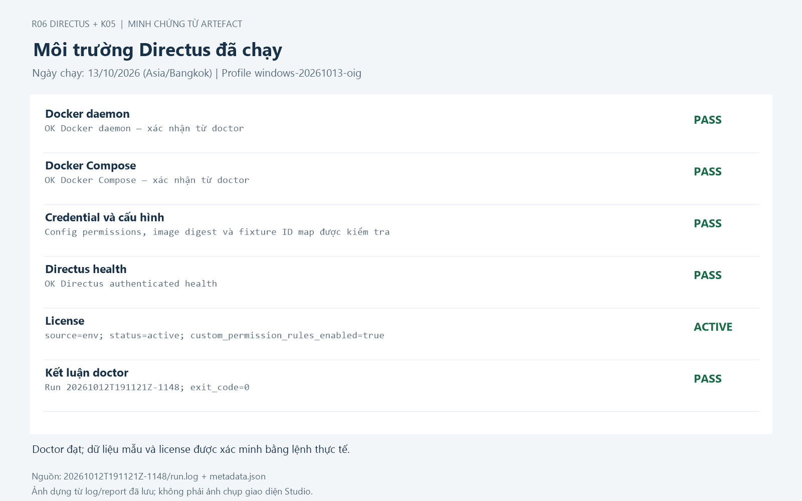

*Hình 1. Doctor đạt, health và license active. Nguồn: [run.log](../artifacts/runs/20261012T191121Z-1148/run.log) và [metadata](../artifacts/runs/20261012T191121Z-1148/metadata.json).*

### 8.3. Demo 1 — CRUD Editor

Tạo article bằng Editor, lấy ID từ response, đọc lại, PATCH `score`, kiểm tra `title` không đổi, DELETE và đọc lại để xác nhận không còn dữ liệu. Trong run đã lưu, POST/GET/PATCH trả `200`, DELETE trả `204`, GET sau DELETE trả `403` và không có data.

```powershell
& .\tmp\lab-tools\run-lab.ps1 replay editor-crud
```

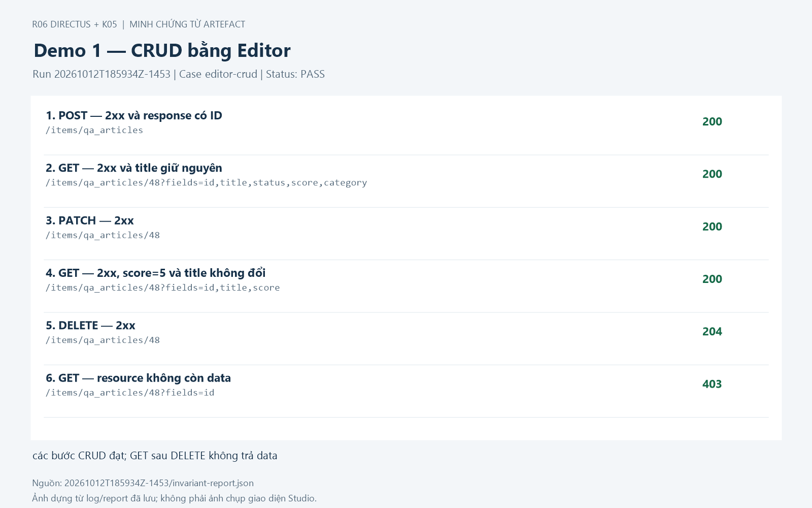

*Hình 2. Case `editor-crud` PASS trong [invariant report](../artifacts/runs/20261012T185934Z-1453/invariant-report.json). ID `48` là ID của lần chạy đó; demo mới lấy ID mới từ response, không hard-code.*

### 8.4. Demo 2 — Query, sort và phân trang

Editor lọc đúng sáu article `published`; sort `title,id`; lấy hai trang bằng `limit=3` và offset 0/3; đối chiếu `page=2`; search Unicode `spéciale` trả đúng một fixture. Các request đều trả `200` và dữ liệu khớp oracle.

```powershell
& .\tmp\lab-tools\run-lab.ps1 replay query-fixture
```

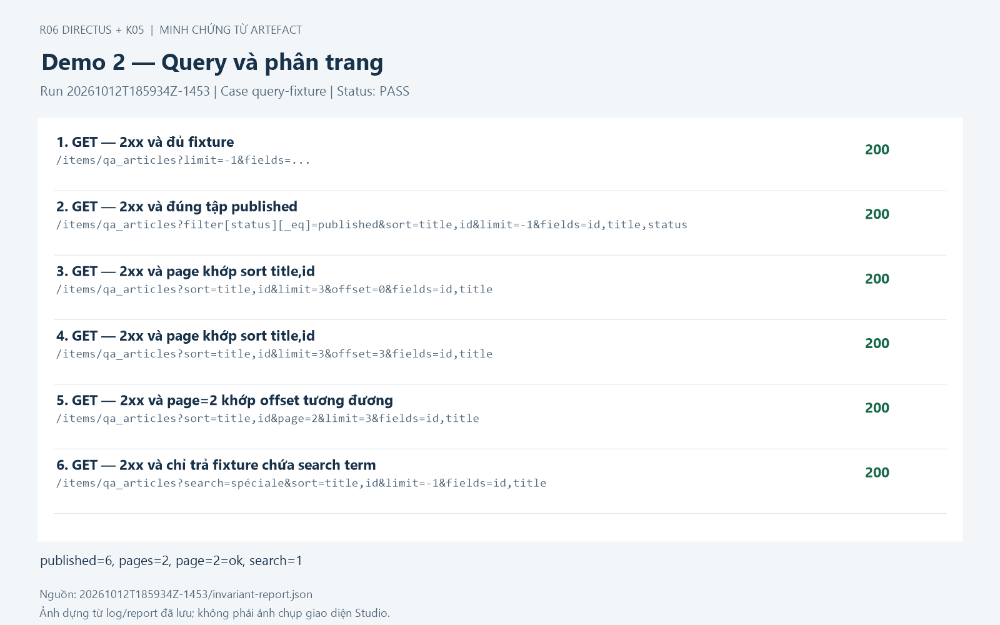

*Hình 3. Case `query-fixture` PASS. Chuỗi `fields=...` ở bước đầu giữ đúng cách rút gọn trong report nguồn.*

### 8.5. Demo 3 — Quyền Reader

Reader đọc được sáu bài published với field được phép. Projection có `internal_notes` bị từ chối. Trước khi thử Reader PATCH, Editor đọc target; sau khi PATCH bị từ chối, Editor đọc lại và so sánh dữ liệu trước/sau. Hai lần read-back là request của Editor, không phải dùng Admin thay Reader để vượt qua policy.

```powershell
& .\tmp\lab-tools\run-lab.ps1 replay reader-visibility
& .\tmp\lab-tools\run-lab.ps1 replay reader-write
```

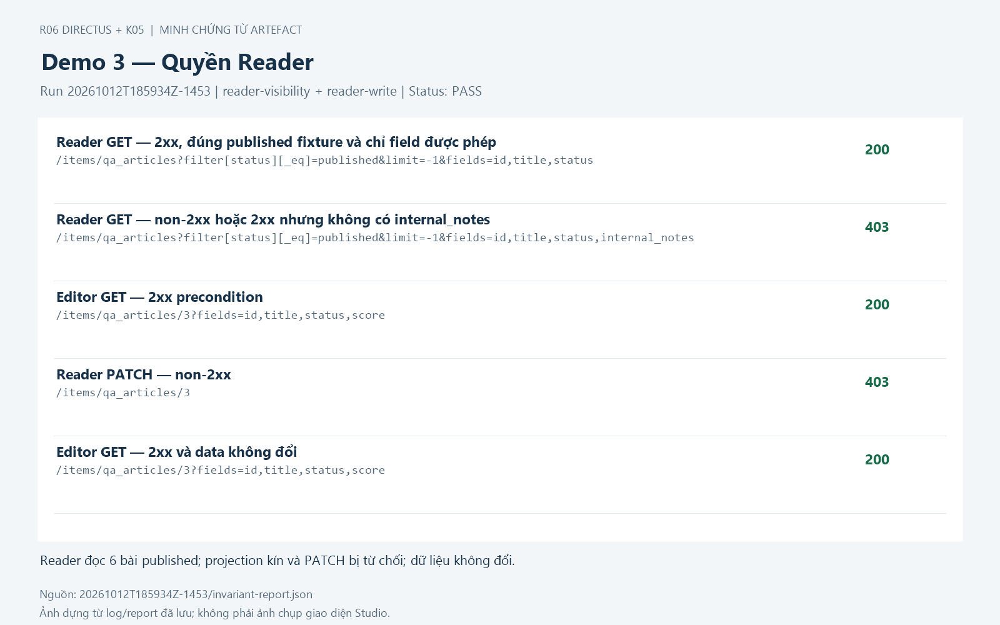

*Hình 4. `reader-visibility` và `reader-write` đều PASS. S4 của scenario suite còn xác minh Reader không đọc được draft. HTTP 403 ở negative case là kết quả mong đợi của ca kiểm thử, không phải ca thất bại.*

Ba nhóm case trên đã chạy trong suite invariant. Các lệnh replay là giao diện có sẵn để trình diễn lại từng luồng; run ID của lần replay mới sẽ khác.

### 8.6. Hai invariant failure và các lỗi Windows đã xử lý

`aggregate-query-robustness` quan sát `aggregate={"foo":1}` trả `500`, trong khi hai control trả `200`. `contract-schema-candidates` ghi bốn khác biệt: POST của hai collection trả object thay vì array mô tả trong schema, CSV ngoài media type JSON và DELETE `204` ngoài response map. Chúng vẫn là candidate cần phân tích; hai case FAIL không đồng nghĩa hai defect Directus đã được xác nhận.

Kết quả từng case, expected/actual, nguyên nhân cần khảo sát và cách đọc số liệu fuzzing được trình bày tập trung ở mục 13.

Lần dựng Windows đã sửa: truyền JSON qua stdin để bảo toàn Unicode; bind mount/đường dẫn Linux trong Docker; chuyển nhầm API path của jq; giới hạn argv khi xử lý coverage lớn; thư mục lưu Hypothesis; kiểm tra ACL và health trên Windows. Fixture hỏng/trùng do seed trước sửa được backup và khôi phục; seed lặp lại và post-campaign xác nhận bộ dữ liệu đúng.

Artefact thô nằm trong `artifacts/runs` bị Git ignore; các link artefact trong báo cáo dùng cho workspace này. Khi bàn giao cần kèm bằng chứng đã kiểm tra secret. Giữ file `.md` cùng thư mục `images/bao-cao-giua-ky` để ảnh hiển thị.

## 9. Giới thiệu kỹ thuật K05

### 9.1. Schema-Based API / Fuzz Testing là gì?

Schema-Based API Testing dùng mô tả API như OpenAPI để sinh request và kiểm tra response theo hợp đồng đã công bố. Fuzz testing tạo nhiều biến thể đầu vào, bao gồm dữ liệu hợp lệ, không hợp lệ và trường hợp khó dự đoán bằng test viết tay, nhằm phát hiện hành vi bất thường.

Trong đồ án, Schemathesis đọc OpenAPI xuất từ Directus, tạo request và thực thi trong lab local. Hypothesis hỗ trợ sinh dữ liệu và shrinking: thu gọn ca lỗi để có đầu vào dễ tái hiện hơn. K05 là kỹ thuật chính; scenario và invariant bổ sung các quy tắc nghiệp vụ mà schema chưa thể mô tả đầy đủ.

### 9.2. Nguyên lý hoạt động

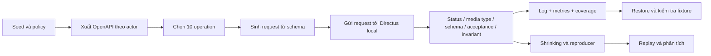

Schema theo actor rất quan trọng: OpenAPI Admin không đại diện cho Editor/Reader. Input hợp schema chưa chắc thỏa policy, foreign key hoặc quy tắc nghiệp vụ; do đó failure phải được đối chiếu với precondition.

### 9.3. Raw và guided

| Profile | Cách thực hiện | Ý nghĩa |
|---|---|---|
| Raw | Chọn operation từ schema gốc, giữ contract của operation | Đánh giá API với hợp đồng đang được công bố |
| Guided | Tạo overlay riêng, thêm fixture ID/example và bật stateful | Tăng khả năng đi vào luồng CRUD và chuỗi request |

Raw dùng phases examples, coverage, fuzzing. Guided thêm stateful. Schema gốc bất biến; overlay/diff/hash được lưu riêng. Guided không được dùng để thay thế kết quả raw.

## 10. Phạm vi kiểm thử

### 10.1. API được chọn

| STT | Method | Path | Chức năng |
|---:|---|---|---|
| 1 | GET | `/items/qa_categories` | Đọc danh sách category |
| 2 | POST | `/items/qa_categories` | Tạo category |
| 3 | GET | `/items/qa_categories/{id}` | Đọc category theo ID |
| 4 | PATCH | `/items/qa_categories/{id}` | Sửa category |
| 5 | DELETE | `/items/qa_categories/{id}` | Xóa category |
| 6 | GET | `/items/qa_articles` | Đọc danh sách article |
| 7 | POST | `/items/qa_articles` | Tạo article |
| 8 | GET | `/items/qa_articles/{id}` | Đọc article theo ID |
| 9 | PATCH | `/items/qa_articles/{id}` | Sửa article |
| 10 | DELETE | `/items/qa_articles/{id}` | Xóa article |

GET `/server/specs/oas` phục vụ chuẩn bị schema; `/auth/login`, health và license phục vụ precondition. Chúng không được cộng vào mười operation nghiệp vụ chính. Check unsupported method có thể gửi method không hỗ trợ vào path đã chọn; đây không phải mở rộng sang quét API quản trị.

### 10.2. Vì sao chọn phạm vi này?

Hai collection đủ nhỏ để có dữ liệu và đáp án biết trước, nhưng bao gồm CRUD, query, validation, quan hệ và phân quyền. OpenAPI có thể xuất tại runtime; các luồng có nguy cơ mất dữ liệu hoặc lộ nội dung có thể được kiểm chứng bằng read-back. Phạm vi này phù hợp để demo giữa kỳ và phát triển campaign cuối kỳ mà không cần kiểm thử toàn bộ Directus.

### 10.3. Rủi ro, giả định và giới hạn

| Nội dung | Cách xử lý/giới hạn |
|---|---|
| Schema thiếu hoặc sai response/validation | Giữ raw; phân loại schema candidate và bổ sung oracle |
| Request không đạt policy/foreign key | Xác minh actor và dữ liệu trước kết luận positive/negative |
| Fuzzing ghi/xóa fixture | Snapshot trước, restore sau, so sánh toàn bộ dữ liệu |
| Stateful phụ thuộc ID và bước trước | Lưu parent chain; thiếu mapping thì ghi giới hạn tái hiện |
| Token hết hạn | TTL lab 2h và refresh trước snapshot/restore |
| Hết budget | Giữ `max_time`/INCOMPLETE hoặc failure, không giả định phủ đủ |
| Môi trường mới khác schema/license | Profile/snapshot mới và metadata rõ ràng |
| Scope hẹp | Không suy kết quả hai collection thành chất lượng toàn bộ Directus |

Giả định trước campaign: đúng project/URL local, database lab riêng, license/policy sẵn sàng, seed thành công, schema đúng actor và không có suite mutation khác đang chạy. Bulk PATCH/DELETE, GraphQL, WebSocket, UI automation, tải/hiệu năng, concurrency và phục hồi DB chưa thuộc phạm vi hiện tại.

## 11. Kế hoạch và kịch bản kiểm thử

### 11.1. Dữ liệu đầu vào

| Dữ liệu | Ràng buộc/fixture |
|---|---|
| Category | ID integer tự sinh; `name` bắt buộc, giới hạn 80 ký tự trong schema DB |
| Article | ID tự sinh; `title` bắt buộc, tối đa 120 ký tự |
| Status | `draft` hoặc `published` |
| Score | Integer 0–5 |
| Nullable/JSON | `published_at`, `metadata`, `internal_notes`, `category` theo schema fixture |
| Quan hệ | Article nhiều–một tới category; xóa category đặt FK về null |
| Bộ seed | 3 category, 12 article; 6 draft/6 published, phân bố đều theo category |
| Dữ liệu đặc biệt | Tiếng Việt, `spéciale`, ký tự Hán, metadata null và timestamp null |
| Actor | Admin, Editor, Reader và Anonymous có quyền khác nhau |

Seed lặp lại không tạo bản ghi trùng. Test đọc ID từ `fixture-ids.json` hoặc response POST; không giả định ID ở máy khác giống máy hiện tại.

### 11.2. Sáu scenario đã triển khai

| ID | Input và precondition | Expected/oracle | Kết quả Windows |
|---|---|---|---|
| S1 CRUD | Editor, body article hợp lệ, ID từ POST | Tạo/đọc/sửa/xóa; field không PATCH giữ nguyên; sau xóa không còn data | PASS |
| S2 Filter | Fixture 6 published/6 draft; filter status | Trả đúng tập sáu published fixture ID | PASS |
| S3 Sort/page | `sort=title,id`, `limit=3`, offset 0/3 | Các trang đúng thứ tự, không sai dữ liệu | PASS |
| S4 Reader draft | Reader schema có detail GET; draft ID từ map | Không lộ payload draft | PASS, HTTP 403 |
| S5 Field kín | Published read đạt; projection `internal_notes` | Từ chối hoặc không trả field kín | PASS, HTTP 403 |
| S6 Reader write | Editor chụp target; Reader PATCH; Editor đọc lại | Ghi bị từ chối và dữ liệu target không đổi | PASS, PATCH 403 |

Nguồn: [scenario report](../artifacts/runs/20261012T185849Z-1525/scenario-report.json).

### 11.3. Các invariant bổ trợ

Mười một case là `auth-invalid-token`, `anonymous-denied`, `editor-crud`, `positive-operations`, `query-fixture`, `aggregate-query-robustness`, `contract-schema-candidates`, `relation-nullification`, `invalid-field-rejection`, `reader-visibility`, `reader-write`.

`positive-operations` kiểm tra đủ mười operation có đường đi thành công hợp lệ, khác với chỉ ghi nhận operation đã bị request chạm tới. `invalid-field-rejection` kiểm tra score/status sai và không tạo dữ liệu rác. `query-fixture` kiểm tra thêm page, search và projection. Kết quả hiện tại 9 PASS/2 FAIL/0 BLOCKED được giữ nguyên.

### 11.4. Tiêu chí đạt/không đạt

| Mức đánh giá | Đạt khi | Không đạt hoặc chưa hoàn tất khi |
|---|---|---|
| Môi trường | Đúng baseline, health, credential, fixture và policy | Thiếu dependency, sai URL/actor, seed/policy chưa đạt |
| Scenario/invariant | Actual thỏa expected và dữ liệu sau thao tác đúng | Assertion vi phạm; hoặc precondition không đủ thì BLOCKED |
| Response contract | Status, content type và body khớp schema | Response ngoài hợp đồng, lỗi 5xx hoặc acceptance không đúng |
| Reproducer | Gửi được request/chuỗi với provenance và đối chiếu expected/actual | Thiếu artifact/ID mapping, mismatch hoặc chỉ replay bước cuối |
| Campaign | Runner hoàn tất, check đạt, report/coverage có và restore đạt | Check failure, timeout/ngắt, thiếu artifact hoặc restore sai |

HTTP 403 có thể là PASS của ca Reader bị cấm ghi, nhưng là failure nếu một ca positive đã có precondition đúng lại không đọc được. DELETE 204 là thành công runtime; thiếu 204 trong OpenAPI là khác biệt contract. Không đổi expected sau khi nhìn actual chỉ để test PASS.

### 11.5. Ngân sách và kế hoạch tiếp tục

| Đợt | Seed | Budget | Trạng thái |
|---|---|---|---|
| Pilot Windows | 101, 202, 303 cho mỗi profile | 10 examples/operation, 60 giây/seed | Đã chạy raw/guided; có failure/max_time, restore PASS |
| Kiểm chứng sửa Windows | 101 cho mỗi profile | 10 examples/operation, 30 giây/seed | Đã chạy; inventory/metrics đầy đủ, restore PASS |
| Campaign chính theo kế hoạch nhóm | 101, 202, 303 cho mỗi profile | 100 examples/operation, 1.200 giây/profile/seed | Chưa chạy lại đầy đủ trên Windows |

Một worker, rate 5/s, request timeout 10 giây; giữ shrinking. Đây là ngân sách nhóm chốt, không phải số seed/examples bắt buộc nêu trong đề bài. `max-examples` không phải tổng số request/case.

Kế hoạch tiếp theo là phân tích finding đại diện, hoàn thiện reproducer stateful, chạy campaign chính khi điều kiện nền đạt và tổng hợp coverage cùng giới hạn. Bộ biên có chủ đích cho score/title có thể bổ sung ở cuối kỳ; hiện chưa tuyên bố đã thiết kế đầy đủ phân vùng tương đương, giá trị biên hoặc Pairwise.

## 12. Công cụ và phương pháp thực hiện

### 12.1. Công cụ

| Công cụ/file | Vai trò |
|---|---|
| Docker Compose | Cô lập API, DB, runner và pin image |
| `lab.sh` | Giao diện lệnh, doctor, metadata/run ID, mã thoát và redaction |
| `lab-components.sh` | Seed, schema, scenario, campaign, snapshot/restore và replay |
| curl + jq | Gửi HTTP, đọc/kiểm tra JSON và quản lý fixture map |
| Schemathesis + Hypothesis | Sinh request theo schema, fuzzing, stateful và shrinking |
| `invariants.py` | Expected nghiệp vụ, read-back, quyền, quan hệ và cleanup |
| PowerShell + Git Bash | Chạy harness trên Windows qua launcher cục bộ |
| Git | Lưu phiên bản mã và các thay đổi có ý nghĩa; chưa commit/push sửa Windows |

Các check Schemathesis bật tường minh: `not_a_server_error`, `status_code_conformance`, `content_type_conformance`, `response_schema_conformance`, `unsupported_method`, `negative_data_rejection`, `positive_data_acceptance`.

### 12.2. Cách tiếp cận và kỹ thuật

| Phương pháp/cách tổ chức | Áp dụng |
|---|---|
| Hộp đen ở mức API | Gửi request và kiểm tra output/trạng thái dữ liệu |
| Schema-based + fuzzing | Kỹ thuật K05 chính, hai profile raw/guided |
| Scenario chức năng | Sáu kịch bản có input, precondition và expected cụ thể |
| Positive/negative | Kiểm tra dữ liệu hợp lệ, dữ liệu sai và thiếu quyền |
| Stateful | Liên kết nhiều request và trạng thái trong guided |
| Invariant checking | Read-after-write, PATCH preservation, dữ liệu không đổi khi bị từ chối |
| Xác thực/phân quyền | Token giả, anonymous, Reader published/private field/write |
| Tích hợp | Thực thi với Directus và PostgreSQL thật trong Docker |
| Smoke | Kiểm tra nhanh trước campaign |
| Regression/replay | Chạy lại ca ổn định hoặc ca được lưu từ fuzzing |

Danh sách này gồm cách tiếp cận, kỹ thuật và cách tổ chức thực thi; các mục có thể giao nhau. Đồ án chưa có bộ hộp trắng cho Directus hoặc line/branch coverage. Đọc mã nguồn để phân tích failure không tự được tính là thực thi kiểm thử hộp trắng.

### 12.3. Đầu ra kiểm thử

Mỗi run lưu `metadata.json`, `run.log` và report tương ứng. Campaign lưu schema copy/hash/diff, operation inventory, report JSON/NDJSON, coverage, metrics, generation database, summary/index và snapshot/restore. File dữ liệu thô bị Git ignore; báo cáo chia sẻ chỉ dùng bằng chứng chọn lọc không chứa credential/license/token.

Kết quả được tổng hợp ở mục 13; các file report là căn cứ đối chiếu khi diễn giải PASS/FAIL và phân loại finding.

## 13. Kết quả kiểm thử và giải thích

### 13.1. Tổng hợp kết quả và ý nghĩa trạng thái

Các số liệu dưới đây thuộc lần dựng lại trên Windows ngày **13/10/2026 theo Asia/Bangkok**, với Directus `12.5.0`, PostgreSQL `16-alpine`, Schemathesis `4.30.0`, fixture `r06-k05-v2` và runtime profile `windows-20261013-oig`. Run ID ghi theo UTC. Đây là tổng hợp artefact đã lưu, không phải một lượt kiểm thử mới.

| Nhóm kiểm tra | Kết quả đã quan sát | Giải thích |
|---|---|---|
| Điều kiện môi trường | Doctor, seed lặp lại và smoke PASS | API/DB, license, fixture và policy đủ điều kiện cho các suite đã chạy; không chứng minh mọi chức năng Directus đúng |
| Kịch bản nghiệp vụ | **6 PASS / 0 FAIL / 0 BLOCKED** | Sáu luồng có input và expected cụ thể đều đạt, gồm ba nhóm demo CRUD, query và quyền Reader |
| Invariant bổ trợ | **9 PASS / 2 FAIL / 0 BLOCKED** trên 11 case | Các quy tắc dữ liệu/quyền đạt ở chín case; hai case phát hiện vấn đề robustness/contract, phân tích ở mục 13.4 |
| Fuzzing raw/guided | Mỗi profile chạy ba seed; mỗi seed tested 10/10 và covered 10/10 operation | Pipeline sinh/gửi request và lưu report hoạt động; cả sáu lượt còn check failure, runner exit `1` và dừng ở `max_time` |
| Phục hồi dữ liệu | Restore PASS ở sáu lượt pilot | Fixture được khôi phục sau request mutation; đây là kiểm tra phục hồi dữ liệu lab, không phải kiểm thử disaster recovery của toàn DB |
| Replay | Hai invariant failure tái hiện; case sinh `j0ZjQ0` tái hiện HTTP `204` | Có bằng chứng chạy lại finding đại diện; không khẳng định mọi failure đã được tái hiện hoặc phân tích nguyên nhân |

**PASS** nghĩa là actual thỏa expected của ca đã chạy. **FAIL** nghĩa là ít nhất một điều kiện kiểm tra bị vi phạm. **BLOCKED** nghĩa là chưa đủ precondition để đánh giá. `max_time` cho biết runner dừng khi hết ngân sách; một lượt có thể vừa có failure vừa dừng vì thời gian. Report được ghi xong không có nghĩa đã khảo sát hết các đầu vào hoặc hoàn tất campaign chính theo kế hoạch.

Nguồn: [báo cáo Windows](../evidence/windows-recheck-2026-10-13.md), [scenario report](../artifacts/runs/20261012T185849Z-1525/scenario-report.json) và [invariant report](../artifacts/runs/20261012T185934Z-1453/invariant-report.json).

### 13.2. Kết quả chi tiết của bộ invariant

| Case | Kết quả | Quan sát và giải thích |
|---|---|---|
| `auth-invalid-token` | PASS | Token giả bị từ chối với `401`; không truy cập được tài nguyên bằng token không hợp lệ |
| `anonymous-denied` | PASS | Hai request vào article/category đều non-2xx; không cấp quyền fixture cho anonymous |
| `editor-crud` | PASS | Tạo rồi đọc lại được; PATCH giữ field không sửa; DELETE thành công và GET sau xóa không có data |
| `positive-operations` | PASS | Hai collection, mỗi collection có năm operation đạt ca positive hợp lệ; chứng minh có đường đi thành công cho đủ 10 operation |
| `query-fixture` | PASS | Đúng sáu published; sort và hai trang khớp oracle; `page=2` khớp offset; search trả đúng một fixture và projection đạt |
| `aggregate-query-robustness` | **FAIL** | Aggregate `foo` trả `500`; aggregate rỗng/count trả `200`. Vi phạm expected không trả 5xx, cần khảo sát validation/xử lý query |
| `contract-schema-candidates` | **FAIL** | Bốn khác biệt giữa response thực tế và OpenAPI Editor; một case FAIL chứa nhiều finding contract |
| `relation-nullification` | PASS | Sau khi xóa category, article liên quan có `category=null`, đúng quy tắc SET NULL |
| `invalid-field-rejection` | PASS | POST có score/status sai bị từ chối với `400`; truy vấn lại không thấy row được tạo bởi request đó |
| `reader-visibility` | PASS | Reader đọc được sáu published; projection field kín bị `403`, không lộ `internal_notes` |
| `reader-write` | PASS | Reader PATCH bị `403`; Editor đọc lại xác nhận dữ liệu target không đổi |

HTTP `400`, `401` hoặc `403` có thể là kết quả đạt của ca negative. Ví dụ `reader-write` PASS vì request bị cấm ghi đúng như expected. Ngược lại, HTTP `200` cũng chưa đủ để PASS nếu body sai schema, sai tập dữ liệu hoặc lộ field kín.

Không cộng sáu scenario và 11 invariant thành 17 chức năng khác nhau: hai suite có phần trùng nhau, chẳng hạn CRUD và quyền Reader. Mỗi suite phục vụ một cách đối chiếu riêng với expected.

### 13.3. Kết quả Schema-Based API / Fuzz Testing

Pilot dùng actor **Editor**, một worker, rate `5/s`, request timeout 10 giây, tối đa **10 examples/operation và 60 giây/seed**. Các số liệu lấy từ `metrics.json` và `campaign-summary.json` của từng seed.

| Profile | Seed | Operation tested / covered | Case sinh | Case có failure | Unique check failure | Case errored | Restore | Kết thúc |
|---|---:|---|---:|---:|---:|---:|---|---|
| raw | 101 | 10/10 / 10/10 | 270 | 31 | 36 | 0 | PASS | `max_time`, exit 1 |
| raw | 202 | 10/10 / 10/10 | 266 | 30 | 35 | 0 | PASS | `max_time`, exit 1 |
| raw | 303 | 10/10 / 10/10 | 270 | 33 | 40 | 0 | PASS | `max_time`, exit 1 |
| guided | 101 | 10/10 / 10/10 | 276 | 29 | 32 | 1 | PASS | `max_time`, exit 1 |
| guided | 202 | 10/10 / 10/10 | 279 | 31 | 36 | 1 | PASS | `max_time`, exit 1 |
| guided | 303 | 10/10 / 10/10 | 278 | 30 | 36 | 3 | PASS | `max_time`, exit 1 |

Nguồn theo seed: raw [101](../artifacts/runs/20261012T185958Z-355/raw/seed-101/metrics.json), [202](../artifacts/runs/20261012T185958Z-355/raw/seed-202/metrics.json), [303](../artifacts/runs/20261012T185958Z-355/raw/seed-303/metrics.json); guided [101](../artifacts/runs/20261012T190350Z-1047/guided/seed-101/metrics.json), [202](../artifacts/runs/20261012T190350Z-1047/guided/seed-202/metrics.json), [303](../artifacts/runs/20261012T190350Z-1047/guided/seed-303/metrics.json).

**Cách đọc số liệu:** `generated` là số case công cụ ghi nhận, không phải số ví dụ cấu hình nhân đơn giản với số operation. `with_failures` là số case có check thất bại; một case có thể vi phạm nhiều check nên `unique_failures` có thể lớn hơn. `errored` là số case công cụ ghi nhận lỗi thực thi; cần xem event/log để phân loại, không tự coi là lỗi sản phẩm. Không cộng các unique failure của nhiều seed để suy ra số defect khác nhau.

Guided đã thực sự chạy stateful phase trên cả ba seed. Một số inventory ban đầu lỗi do giới hạn argv Windows và đã được dựng lại từ report/coverage gốc bằng hàm sửa; log lỗi ban đầu vẫn được giữ. Hai lượt bổ sung seed 101, budget 30 giây sau sửa ghi raw 61 case/22 unique failure và guided 134 case/26 unique failure; inventory/metrics đầy đủ, restore PASS, vẫn exit `1`. Không trộn số liệu lượt bổ sung vào bảng pilot 60 giây.

10/10 operation được chạm tới chỉ chứng minh bao phủ method–path đã chọn. Ca positive thành công cho đủ 10 operation có bằng chứng riêng ở `positive-operations`; không suy từ coverage rằng mọi request fuzz đều hợp lệ hoặc đạt. Hiện chưa có bao phủ đầy đủ tổ hợp tham số, đầu vào, toàn bộ chức năng hoặc line/branch coverage Directus. Số unique failure ít hơn trong một lượt guided cũng chưa chứng minh guided làm hệ thống tốt hơn: overlay, trạng thái, thứ tự request và budget ảnh hưởng kết quả.

Các nhóm check failure thực tế trong pilot được diễn giải như sau:

| Nhóm công cụ ghi nhận | Ý nghĩa | Điều cần kiểm tra trước khi kết luận |
|---|---|---|
| `ServerError` | API trả 5xx | Request tối thiểu, trạng thái DB, server log và xử lý input |
| `UndefinedStatusCode` | Status thực tế không có trong OpenAPI | Response map thiếu, hoặc status runtime sai; DELETE 204 là ví dụ contract candidate |
| `UndefinedContentType` | Media type thực tế chưa được khai báo | Tham số export, nội dung response và schema theo actor |
| `JsonSchemaError` | Body không khớp schema response | Object/array, field, nullable và kiểu dữ liệu thực tế |
| `RejectedPositiveData` | Dữ liệu hợp schema bị API từ chối | Policy, field validation, FK và ID còn tồn tại; hợp OpenAPI chưa bảo đảm hợp nghiệp vụ |
| `AcceptedNegativeData` | Dữ liệu công cụ đánh dấu vi phạm schema được chấp nhận | Schema có mô tả đúng runtime không, request vi phạm điểm nào và read-back có dữ liệu sai không |
| `UnsupportedMethodResponse` | Check method không hỗ trợ bị vi phạm | Route, method được gửi và phản hồi thực tế; không tự kết luận lỗi bảo mật |

Các tên trên là phân loại check của công cụ, chưa phải kết luận root cause. Campaign chính **100 examples/operation, 1.200 giây/profile/seed** chưa được chạy lại đầy đủ trên Windows.

### 13.4. Giải thích hai invariant failure

#### 13.4.1. Aggregate không hợp lệ dẫn tới HTTP 500

**Precondition:** fixture và schema Editor đã sẵn sàng, API healthy, cùng actor và endpoint cho probe/control. Probe chỉ đọc dữ liệu.

| Variant của `GET /items/qa_articles` | Expected | Actual |
|---|---|---|
| `fields=&aggregate={"foo":1}` | Không trả 5xx; nếu hàm aggregate không được hỗ trợ thì xử lý lỗi đầu vào có kiểm soát | **500**, code `INTERNAL_SERVER_ERROR` |
| `fields=&aggregate={}` | Control trả 2xx | **200**, data list có 12 phần tử |
| `fields=&aggregate={"count":["id"]}` | Control trả 2xx | **200**, data list có một phần tử |

Các giá trị query được viết dạng đã giải mã cho dễ đọc; request nguồn có URL encoding. `foo` không được coi là hàm aggregate hợp lệ về nghiệp vụ. Ca này kiểm tra độ vững của xử lý input: đầu vào không được hỗ trợ vẫn cần tránh lỗi máy chủ ngoài kiểm soát. Test FAIL vì probe trả 500 trong khi expected yêu cầu không 5xx; hai control 200 cho thấy API vẫn phản hồi bình thường với variant khác trong cùng lần chạy.

**Phân loại hiện tại:** robustness candidate, đã tái hiện. Có thể liên quan validation hoặc xử lý aggregate, nhưng chưa có phân tích source/server log đủ để khẳng định nguyên nhân gốc hay defect upstream. Schema cũng cần được đối chiếu xem ràng buộc nào chưa mô tả được. Không suy từ HTTP 500 rằng dữ liệu bị mất hoặc quyền truy cập bị vượt qua.

**Bằng chứng:** [report replay](../artifacts/runs/20261012T185942Z-1219/invariant-report.json), run `20261012T185942Z-1219`; probe vẫn 500, hai control 200, exit `1`.

#### 13.4.2. Response thực tế khác hợp đồng OpenAPI

**Precondition:** dùng OpenAPI actor Editor của baseline đã pin; request có chủ đích với fixture hợp lệ. Probe tạo tài nguyên tạm và cleanup sau kiểm tra.

| Finding | Expected theo OpenAPI đã xuất | Actual runtime | Giải thích |
|---|---|---|---|
| POST category với body object | `data` kiểu array | HTTP 200, `data` object | Tạo thành công về nghiệp vụ; hình dạng response khác mô tả schema |
| POST article với body object | `data` kiểu array | HTTP 200, `data` object | Cùng loại khác biệt, xuất hiện ở collection thứ hai |
| GET article với `export=csv` | Media type được khai báo là `application/json` | HTTP 200, `text/csv` | Export hoạt động; hợp đồng chưa mô tả response CSV của probe |
| DELETE category theo ID tạm | Response map có `200`, `401`, `404` | HTTP **204**, body rỗng | Xóa thành công runtime; status thành công này nằm ngoài response map |

Case `contract-schema-candidates` FAIL vì phát hiện **bốn khác biệt contract**, không phải vì các thao tác tạo/xuất/xóa đều không chạy được. Expected nghiệp vụ và expected schema là hai lớp kiểm tra: một thao tác có thể thành công ở lớp nghiệp vụ nhưng vi phạm hợp đồng được công bố.

**Phân loại hiện tại:** schema/contract candidate; đã tái hiện, cleanup đạt. Cần đối chiếu exporter và response implementation đúng baseline để xác định phần nào cần sửa. Không tự đổi raw schema hoặc bỏ check để làm PASS; nếu cần overlay thì phải lưu riêng cùng lý do/diff. Bốn finding trong một case không tự tương ứng bốn defect độc lập.

**Bằng chứng:** [report replay](../artifacts/runs/20261012T185950Z-1994/invariant-report.json), run `20261012T185950Z-1994`; vẫn `schema_candidates=4`, exit `1`.

### 13.5. Tái hiện finding và phân biệt lỗi harness

Case được sinh `j0ZjQ0` từ raw seed 101 thực hiện **DELETE `/items/qa_articles/1`** bằng Editor. Replay run `20261012T191034Z-777` trả `204`, khớp status của ca nguồn; ghi `reproduced`, restore exit `0` và lệnh exit `0`. Check nguồn `status_code_conformance` báo `UndefinedStatusCode` vì schema chỉ khai báo `200`, `401`, `404`.

Exit `0` của lệnh replay có nghĩa request tái hiện thành công theo điều kiện replay và phục hồi đạt, không có nghĩa finding contract đã được sửa. Helper replay đối chiếu HTTP status và lưu check nguồn; đây không phải một lượt chạy lại toàn bộ assertion Schemathesis. Case này có `replay_scope=single_request`, không chứng minh đã tái hiện đầy đủ mọi chuỗi stateful khác. Nguồn: [reproducer](../artifacts/runs/20261012T191034Z-777/reproducer-schemathesis-j0ZjQ0.json).

Các lỗi tương thích từng gặp trên Windows gồm JSON Unicode qua argv, jq chuyển nhầm API path, Docker mount, coverage quá lớn cho argv và Hypothesis storage. Chúng thuộc harness/môi trường, được xử lý trước khi chọn bằng chứng cuối. Ví dụ schema Reader từng bị jq xử lý sai khiến scenario BLOCKED; lượt scenario sau sửa mới là kết quả 6 PASS được dùng trong báo cáo. Không ghi các lỗi này thành defect Directus và không xóa artefact lỗi ban đầu.

### 13.6. Đánh giá kết quả và phần cần hoàn thiện

Kết quả đạt ở giữa kỳ là hệ thống chạy được, ba nhóm demo có expected/actual, sáu scenario đạt, các invariant dữ liệu/quyền có bằng chứng, K05 sinh request trên đủ mười operation, lưu report/metrics, tái hiện finding đại diện và restore fixture đạt. Hai invariant failure cùng các check failure fuzzing là đầu ra cần phân tích của hoạt động kiểm thử, được giữ đúng trạng thái.

Trước cuối kỳ cần ưu tiên phân tích probe 500 bằng request tối thiểu và log/source đúng baseline; đối chiếu các khác biệt OpenAPI; triage case errored và failure stateful theo đầy đủ chuỗi; gom finding theo nguyên nhân thay vì cộng check; bổ sung ca biên/oracle còn thiếu và chạy campaign chính theo kế hoạch. Chủ sở hữu, phụ thuộc và đầu ra nghiệm thu tiếp tục theo bảng phân công ở mục 14.3. Đến thời điểm báo cáo, **chưa xác nhận số lượng defect sản phẩm và chưa kết luận toàn bộ Directus đã được kiểm thử hoặc mọi test đều PASS**.

## 14. Tiến độ và phân công

### 14.1. Công việc đã hoàn thành ở mức sản phẩm

| Hạng mục | Trạng thái và bằng chứng |
|---|---|
| Môi trường Docker và license | Healthy, doctor PASS trên Windows |
| Phân tích hệ thống/kiến trúc | Có bộ tài liệu Phần 1 và các sơ đồ |
| Fixture/actor/policy | Seed lặp lại; Reader hoạt động; ID map mới |
| Kịch bản nghiệp vụ | Sáu scenario PASS; ba luồng demo có report |
| K05 automation | Export schema, raw/guided, invariant và replay chạy được |
| Pilot và metrics | Ba seed/profile, 10 operation/seed, restore PASS |
| Xử lý lỗi Windows | Unicode, jq/API path, Docker mount, inventory lớn, Hypothesis storage |
| Báo cáo giữa kỳ | Tài liệu này và bốn hình minh chứng từ artefact |

Đây là trạng thái đầu ra của dự án, không phải xác nhận rằng mọi thành viên đều trực tiếp thực hiện các hạng mục đó. Các lần dựng lại và sửa Windows có hỗ trợ Codex trong phiên làm việc này.

### 14.2. Phân công theo kế hoạch repository

| Thành viên | Trách nhiệm được ghi trong kế hoạch | Đầu ra phụ trách |
|---|---|---|
| Đinh Thị Mai Lành | Trưởng nhóm, môi trường, interface, tích hợp và nghiệm thu | Compose/script chung, manifest, README, kiến trúc và gói bàn giao |
| Trương Võ Trọng Nhân | Schema, Schemathesis, campaign, CRUD/stateful, replay | Exporter/allowlist, cấu hình sinh test, metrics và reproducer |
| Phan Thị Bảo Trâm | Fixture, policy, query, oracle nghiệp vụ | Seed/ID map, ma trận quyền, scenario và invariant dữ liệu |

Nguồn là [quyết định G0](g0-quyet-dinh-ky-thuat.md) và hướng dẫn local của repository. Nhóm cần xác nhận phân công còn phù hợp và bổ sung minh chứng đóng góp thật như task, commit, test log và phần trình bày. Không dùng lịch sử clone có sẵn hoặc kết quả AI để thay cho đóng góp/đánh giá của người chưa thực hiện.

### 14.3. Công việc tiếp theo đề xuất

| Công việc | Chủ sở hữu theo kế hoạch | Điều kiện/phụ thuộc | Đầu ra và tiêu chí nghiệm thu |
|---|---|---|---|
| Đóng gói Windows và lưu thay đổi đúng phạm vi | Lành | Các sửa đã qua kiểm tra, đã chọn artefact an toàn | Người nhận có launcher/dependency/hướng dẫn; lưu Git đúng file, không có secret |
| Phân tích aggregate/contract candidate và replay | Nhân | Baseline, schema, report và control đã lưu | Expected/actual, request/chuỗi, log, phạm vi root cause; finding chưa đủ chứng cứ giữ unresolved |
| Rà soát oracle dữ liệu/quyền và ca biên | Trâm | Fixture/policy/schema đã đạt | Test bổ sung có expected độc lập và cleanup; không nới assertion để PASS |
| Đồng bộ slide/báo cáo và tổng duyệt | Lành tích hợp, cả ba thành viên trình bày | Ba đầu ra trên và minh chứng đóng góp thực tế | Demo ba luồng, giải thích K05/failure; nội dung cập nhật đúng run Windows |
| Campaign chính và tổng kết cuối kỳ | Nhân, Trâm; Lành tích hợp | Điều kiện nền, ngân sách và phân loại rõ | Raw/guided theo kế hoạch, report/coverage/reproducer/restore; giữ failed/incomplete thật |

Phân công trên là kế hoạch đề xuất tiếp tục theo vai trò đã ghi, chưa phải xác nhận công việc đã được từng người thực hiện.

### 14.4. Lịch chuẩn bị giữa kỳ đề xuất

| Thời gian | Mục tiêu |
|---|---|
| 13–14/10 | Chốt tài liệu/bằng chứng Windows và danh sách finding |
| 15–16/10 | Phân tích failure đại diện, hoàn thiện cách giải thích và demo |
| 17/10 | Đóng gói mã/tài liệu, đồng bộ slide, chốt phạm vi giữa kỳ |
| 18/10 | Tổng duyệt theo vai trò, thử ba luồng nghiệp vụ |
| 19/10 | Sửa vấn đề cản demo, chuẩn bị phương án bằng log/report đã lưu |
| 20/10 | Báo cáo giữa kỳ theo lịch trong yêu cầu môn học |

Các ngày trước 20/10 là kế hoạch chuẩn bị, không phải minh chứng đã hoàn thành. Ngày bảo vệ cuối kỳ chưa được xác nhận trong báo cáo này.

## 15. Kết luận

### 15.1. Kết quả đạt được ở giữa kỳ

Dự án đã có môi trường Directus/PostgreSQL/runner chạy trên máy Windows, license active, fixture có thể seed lặp lại và schema theo actor. Có kiến trúc, phân tích năm nghiệp vụ, hướng dẫn vận hành và bằng chứng cho ít nhất ba luồng demo. Sáu scenario đều PASS; K05 đã có mã automation, pilot, metrics, invariant và replay.

Theo mốc giữa kỳ trong đề bài, đây là nền tảng kỹ thuật phù hợp để trình bày hệ thống chạy được, kiến trúc/onboarding và kế hoạch áp dụng kỹ thuật nâng cao. Trước khi nộp cần hoàn thiện gói công cụ Windows, lưu các thay đổi đúng phạm vi, cập nhật slide và xác minh đóng góp thực tế của nhóm.

### 15.2. Giới hạn và định hướng cuối kỳ

Không kết luận mọi test PASS: invariant có hai failure; pilot raw/guided có check failure và chạm giới hạn thời gian. Các khác biệt được giữ để phân tích; chưa xác nhận số lượng product defect Directus. Campaign chính 20 phút/profile/seed chưa chạy lại đầy đủ trên Windows. Đồ án không tuyên bố phủ toàn bộ Directus, toàn bộ input hay mã nguồn.

Hướng cuối kỳ là hoàn thiện triage/root cause và reproducer, giải thích coverage cùng ngưỡng đã chọn, bổ sung test có chủ đích cho rủi ro còn thiếu, thực thi campaign theo kế hoạch, cải thiện tái lập từ bản clone và tổng hợp đóng góp thật của nhóm. Failure có thể là kết quả có giá trị nếu được tái hiện, phân loại và giải thích bằng chứng; không cần đổi assertion để báo cáo đẹp hơn.

### 15.3. Tài liệu và bằng chứng tham khảo

- [Yêu cầu môn học](yeu_cau.pdf): Phần 1, Phần 2, mốc giữa kỳ và mô tả K05.
- [Phân tích hệ thống Directus](phan1/01-phan-tich-he-thong.md).
- [Kiến trúc và luồng dữ liệu](phan1/02-kien-truc-va-luong-du-lieu.md).
- [Cơ sở lý thuyết K05](phan2/01-co-so-ly-thuyet.md).
- [Test model/scenario/case](phan2/02-test-model-va-test-cases.md).
- [Triển khai automation](phan2/03-trien-khai-automation.md).
- [Ma trận kiểm thử](test-matrix.md) và [ma trận quyền](permissions.md).
- [Kịch bản demo](demo.md) và [replay/reproducer](replay-cases.md).
- [Báo cáo Windows hiện tại](../evidence/windows-recheck-2026-10-13.md).
- [README](../README.md), [Compose](../compose.yaml), [cấu hình mẫu](../config/lab.env.example).
- [Mã điều phối](../lab.sh), [shared component](../scripts/lab-components.sh), [invariant](../scripts/invariants.py).

Khi chia sẻ, kèm thư mục ảnh tương đối và artefact chọn lọc cần thiết. Không kèm `config/lab.env`, license, password, token hoặc dump database.
