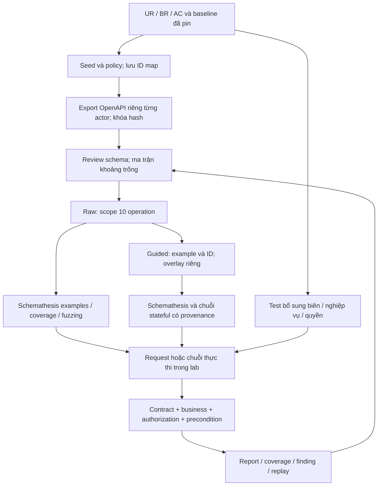

# Phase 2 — Review OpenAPI và thiết kế cách sinh test

**Ngày:** 18/10/2026. **Kết quả:** hoàn thành review tĩnh và thiết kế; chưa triển khai test/hook/link mới hoặc chạy lại lab. Người thực hiện là AI trong phiên làm việc, không gán thành review của thành viên.

Đã đối chiếu bốn schema theo actor, xác minh phạm vi 10 operation, rà ràng buộc của 26 BR và 6 TR, phân loại oracle, kiểm tra diff raw/guided, chọn bảy case sinh thật và thiết kế chuỗi/quyền cần bổ sung. Đây là đầu ra Phase 2; việc triển khai và chứng minh các test mới thuộc Phase 3–4.

**Điểm chính:** OpenAPI sinh từ Directus chưa biểu diễn đủ đặc tả của lab. Sinh test từ schema là phần tự động hóa chính của K05, nhưng cần oracle nghiệp vụ/quyền bổ sung để kiểm tra những điều schema không mô tả. Không sửa schema gốc để làm failure biến mất.

Tài liệu đi kèm:

- [Ma trận 26 BR và phần kiểm tra bổ sung](02-ma-tran-rang-buoc.md), [bản CSV](02-ma-tran-rang-buoc.csv).
- [Danh mục bảy case sinh đại diện](02-case-sinh-dai-dien.md).
- [Quy tắc overlay](02-quy-tac-overlay.md).
- [Inventory operation theo actor](02-operation-inventory.csv).
- [Kết quả audit máy đọc được](tai-lieu-bo-tro/phase2-20261018/schema-review.json), [manifest đầu vào](tai-lieu-bo-tro/phase2-20261018/source-manifest-before.json).

## 1. Nguồn và ranh giới kết luận

Đặc tả đầu vào là [Phase 1 v0.2](01-yeu-cau-va-dac-ta.md) và [đối chiếu baseline](01-doi-chieu-baseline-p1-05.md). Baseline source Directus `12.5.0` là commit `4f77933bf9551cac6b289576078783e189b8f4e3`; runner tham chiếu `Schemathesis 4.30.0`; PostgreSQL `16`. Image digest được giữ trong JSON audit và manifest baseline, không thay phiên bản.

Schema tham chiếu ở [windows-20261013-oig/schemas/r06-k05-v2](../../runtime/profiles/windows-20261013-oig/schemas/r06-k05-v2/). Bản sao trong run export [20261012T185734Z-1667](../../artifacts/runs/20261012T185734Z-1667/schema-manifest.json) có cùng hash. Tên profile chứa ngày 13/10 không được dùng thay thời điểm trong run ID/metadata.

| Actor | Operation toàn snapshot | Operation `qa_*` | SHA-256 snapshot |
|---|---:|---:|---|
| Admin | 143 | 14 | `993a95d245eedb6c7991bf646aac6f6ad3169f0a3c0846ea808d96d8203b017e` |
| Editor | 30 | 14 | `bd32aa69ff3e7330030c5f25e4c98fd1441a55c4b7465de25e3f42a4465a7d26` |
| Reader | 22 | 6 | `d7dc1393eb7e01514f0f8a4d3796ab71cf1f0fe70f5c8a3da5c0ae20259b47b8` |
| Anonymous | 10 | 0 | `2070c25c68193a4a42501935974bb3045697aceb1fe072bb3461f43c0a0342b3` |

Reader ở snapshot cũ `windows-20261013` chỉ có hai operation QA, hash khác. Không trộn hai snapshot khi mô tả quyền. Snapshot OAS `3.0.1`; `info.version` là giá trị sinh của spec, không dùng làm phiên bản Directus.

Fixture version là `r06-k05-v2`. [ID map hiện có](../../runtime/profiles/windows-20261013-oig/fixture-ids.json) có SHA-256 `df6a38444e4d8ea6bd2f9a4bdd31772d3889b6c06316d3cbea17902b51743673`, `seed_run_id=20261012T191100Z-757`. **Map này được cập nhật sau run export và pilot tham chiếu.** Metadata export chỉ trỏ tới đường dẫn map, chưa khóa hash map tại thời điểm export. Có seed PASS lịch sử `20261012T185707Z-470` trước export, nhưng chưa đủ để gán map hiện tại thành bản map của seed đó. Phase 4 cần lưu map/hash riêng theo run; không bổ sung ngược provenance lịch sử.

Phase này đọc schema/report/source và tính hash; không seed/export mới. Khi thực thi ở phase sau: xác minh lab → seed/precondition → lưu ID map bất biến → export đúng actor → lưu schema/hash/run. Không ghi đè snapshot hiện hữu.

## 2. Inventory và phạm vi sinh test

Mỗi collection có bảy operation QA trong Editor schema. Hai collection tạo thành 14; bỏ bốn bulk operation thì campaign chính còn 10.

| Path, áp dụng cho cả `qa_articles` và `qa_categories` | Giữ trong campaign | Loại khỏi campaign chính |
|---|---|---|
| `/items/<collection>` | GET list, POST | PATCH nhiều item, DELETE nhiều item |
| `/items/<collection>/{id}` | GET detail, PATCH detail, DELETE detail | Không có operation khác trong snapshot này |

POST vẫn có `oneOf` object/array. Loại bulk PATCH/DELETE không có nghĩa đã loại POST array. Không tự thêm `maxItems`, object-only hoặc sửa allowlist trong Phase 2.

Reader QA schema gồm GET list/detail của cả hai collection và PATCH list/detail của articles. PATCH hiện diện do cấu hình update với `fields=[]`; sự hiện diện này không chứng minh Reader được ghi field nghiệp vụ. Anonymous vắng mọi QA operation; vẫn phải chủ động gọi API để kiểm quyền cấm.

Phạm vi 10 operation là tập endpoint nghiệp vụ được chọn. Check `unsupported_method` còn sinh request phương thức ngoài mô tả: ví dụ TRACE nhận 404 trong pilot. Không cộng TRACE thành operation nghiệp vụ thứ 11, cũng không báo rằng mọi request của campaign đều chỉ dùng bốn method CRUD. Các query ngoài bảy query trọng tâm vẫn hiện trong schema và đã được sinh trong raw/guided hiện tại.

## 3. Review chi tiết hợp đồng

Nguồn máy đọc được là `editor_collection_schemas` và inventory trong JSON/CSV đi kèm. Đã dò toàn bộ `$ref` nội bộ của bốn snapshot: không gặp ref không phân giải được. Đây là kiểm tra cấu trúc/ref bằng script, **chưa phải kết quả một trình validator OAS đầy đủ**. Exporter hiện cũng chỉ kiểm OAS/paths cơ bản.

### 3.1. Field, required, null và kiểu

| Vị trí JSON Pointer | Snapshot hiện có | Điều thiếu/ảnh hưởng tới sinh test |
|---|---|---|
| `#/components/schemas/ItemsQaCategories/required` | `[name]` | Không mô tả đầy đủ khác biệt create/update |
| `…/ItemsQaCategories/properties/name` | string, nullable=false | Thiếu `maxLength=80`; không có nguồn để tự thêm `minLength=1` |
| `…/ItemsQaArticles/required` | `[title,score]` | Component dùng chung request/response/PATCH; không đồng nghĩa PATCH phải gửi lại cả hai field |
| `…/ItemsQaArticles/properties/title` | string, nullable=false | Thiếu `maxLength=120` |
| `…/ItemsQaArticles/properties/status` | string, nullable=false | Thiếu enum draft/published, default draft và maxLength 16 |
| `…/ItemsQaArticles/properties/score` | integer, nullable=false | Thiếu minimum 0/maximum 5; integer hợp schema có thể sai nghiệp vụ |
| `…/ItemsQaArticles/properties/published_at` | string, nullable=true, format=timestamp | Custom format; nhãn positive của generator chưa bảo đảm thời điểm hợp lệ |
| `…/ItemsQaArticles/properties/metadata` | chỉ nullable=true | Không có type/schema JSON nghiệp vụ; không sinh được oracle round-trip từ tên field |
| `…/ItemsQaArticles/properties/internal_notes` | string, nullable=true | Reader component đã bỏ field này; không biểu diễn đầy đủ chống truy cập field qua mọi query |
| `…/ItemsQaArticles/properties/category` | nullable=true, oneOf integer/category object | Không mô tả category tồn tại, FK hoặc ON DELETE SET NULL; nested object không tự là luồng đã kiểm thử |
| ID component/path | Component integer non-null; path oneOf integer/string | Không biểu diễn auto increment/readOnly/ID tồn tại; path string rộng hơn fixture ID integer |

Mỗi requestBody POST/PATCH được chọn đều thiếu `required: true`; thiếu body có thể được generator xem là hợp schema, dù luồng nghiệp vụ cần payload. `nullable=false`, thuộc danh sách `required`, body bắt buộc và default là bốn khái niệm khác nhau.

Trong OAS 3.0.1, `nullable` phụ thuộc `type` khai báo tại cùng Schema Object và `$ref` có quy tắc riêng về sibling. Vì metadata không có type và category dùng oneOf, không suy riêng cờ nullable đã bảo đảm mọi công cụ xử lý null đúng ý lab. Cần probe công cụ/null ở Phase 4, giữ kết quả raw. Nguồn quy tắc: [OAS 3.0.1 — Schema/Reference Object](https://spec.openapis.org/oas/v3.0.1.html#schema-object).

Nguồn phát sinh schema đúng pin: [specifications.ts](tai-lieu-bo-tro/phase2-20261018/baseline-source/api/src/services/specifications.ts), dòng 411–427 tính required từ nullable/default/generated; dòng 456–506 sinh type/relation; dòng 591–607 ánh xạ integer/json/timestamp. Nhánh này giải thích vì sao schema không tự mang mọi validation của fixture. [Manifest source](tai-lieu-bo-tro/phase2-20261018/baseline-source-manifest.json) ghi Git blob/SHA-256; không dùng source HEAD thay bản pin.

### 3.2. `format: timestamp` với runner đã pin

OAS cho phép format mở rộng; chuẩn liệt kê `date-time`, không định nghĩa `timestamp` thành một bảo đảm kiểm tra ngày giờ. Công cụ có thể xử lý format không biết như kiểu cơ sở. Nguồn: [OAS 3.0.1 — Data Types](https://spec.openapis.org/oas/v3.0.1.html#data-types).

**Bằng chứng đúng runner 4.30.0:** case [GEN-07](02-case-sinh-dai-dien.md) được ghi `generation.mode=positive`, POST article có `published_at=""`, thực tế HTTP 400. Đây là ví dụ công cụ đã sinh chuỗi không phải timestamp hữu ích trong dữ liệu gắn nhãn positive. Không quy lỗi 400 riêng cho field này vì payload còn nhiều field có thể sai BR.

Kết luận thiết kế: không dùng nhãn positive để xác nhận BR-06. Bộ test bổ sung phải có null, timestamp chuẩn với offset, chuẩn hóa round-trip và malformed/empty riêng. Chưa đọc được registry/implementation format của đúng source Schemathesis 4.30.0: truy cập source qua web không lấy được nội dung, tải source qua shell bị chặn mạng. Vì vậy chưa khẳng định nguyên nhân là “hoàn toàn không hỗ trợ timestamp”, hoặc mọi input ngày giờ đều bị bỏ kiểm tra. Mục xác minh VFY-01 bên dưới nêu phép kiểm chứng cần làm, không đổi format của raw thành date-time.

### 3.3. Status, content type và response shape

| Operation, áp dụng cho cả hai collection | Hợp đồng snapshot | Khoảng trống/candidate đã có |
|---|---|---|
| GET list | 200 application/json, data array; 401 | `export=csv/xml/yaml` tạo content type khác; filter/aggregate/projection có dạng kết quả khác; thiếu nhiều lỗi 400/403 |
| POST | body object hoặc array; 200 application/json với data **array**; 401 | Object create trả data object theo controller/source và GEN-04; thiếu response lỗi validation |
| GET detail | 200 application/json, data object; 401/404 | Directus có nhánh Forbidden/403 khi readOne không thấy kết quả; projection có thể thiếu field required của component |
| PATCH detail | body/response dùng component chung; 200 application/json, data object; 401/404 | Partial update có thể bị schema required mô tả sai; query fields có thể ảnh hưởng response; thiếu một số status |
| DELETE detail | 200 không content; 401/404 | GEN-05 nhận 204 gây status conformance failure; business delete và contract là hai kết luận riêng |

Response envelope thường chỉ có `properties`, không đánh dấu data bắt buộc. Vì thế “response_schema_conformance success” chưa bảo đảm data/id thực sự có; custom oracle cần kiểm tra điều này. Các check success trong recorder cũng có thể là không áp dụng cho status/case đó. Không suy mọi success đều là một assertion đã thực hiện có ý nghĩa.

### 3.4. Query

GET list có 15 query parameter; trọng tâm môn/lab là `fields/filter/sort/limit/offset/page/search`. Các tham số aggregate/groupBy/deep/alias/export/version/backlink/meta vẫn có thể được sinh. `query_focus` trong guided là metadata; chưa thấy harness đọc nó để giới hạn hoặc phân bố generator.

| Nhóm | Schema | Oracle còn phải bổ sung |
|---|---|---|
| fields/sort | array string, form/explode=false, ví dụ generic | Tên field hợp lệ theo fixture/policy; projection; thứ tự và khóa phụ ID |
| filter | object trong content application/json | Grammar/operator/field/value hợp lệ, đúng tập ID và không vượt row policy |
| limit | integer minimum=-1 | Biên -2/-1/0/1; ý nghĩa -1 và số row theo dữ liệu thật |
| offset/page | integer minimum=0 | Biên -1/0/1, safe integer/runtime; page ưu tiên offset; không tự suy page=0 phải bị từ chối |
| search | string và ví dụ generic | Expected từ seed/field searchable/quyền, không chỉ title; Unicode/collation cần căn cứ |

Đây là mô hình input, không phải bằng chứng đã phủ mọi query. Bộ expected phải lấy từ dữ liệu seed được lưu cùng run; GET nền chỉ hỗ trợ kiểm tra tiền điều kiện, không tự trở thành nguồn chuẩn cho chính sort/filter đang kiểm.

## 4. Thiết kế pipeline sinh test và oracle

| Oracle | Nguồn expected | Phần tự động từ schema | Phần cần thiết kế/viết thêm |
|---|---|---|---|
| Contract | Snapshot/hash đúng actor/profile | status, content type, response schema; sinh input positive/negative theo schema | So mismatch với source; giữ failure; không suy input hợp DB/policy từ nhãn positive |
| Business | BR/AC, seed có nguồn độc lập | Schema hỗ trợ type/required/nullable một phần | Biên name/title/score/status; default/null; CRUD read-back đầy đủ; quan hệ; expected query |
| Authorization | Policy actor/row/field, ma trận quyền | Có thể thấy operation/field bị lọc | Gửi request cấm còn lại hợp lệ; list/detail/projection; đọc lại bằng Editor để kiểm không đổi dữ liệu |
| Robustness | BR-25 và điều kiện lab | not_a_server_error | Control hợp lệ; phân biệt 5xx/network/setup với từ chối nghiệp vụ |
| Harness | Baseline/fixture/map/restore/metadata | Không có trong OpenAPI | Preflight, snapshot/restore, sequence provenance, secret handling và stop reason |

Bảy check hiện cấu hình: `not_a_server_error`, `status_code_conformance`, `content_type_conformance`, `response_schema_conformance`, `unsupported_method`, `negative_data_rejection`, `positive_data_acceptance`. Hai check acceptance phản ánh semantics công cụ và có điều kiện áp dụng; không thay business oracle. Không tắt chúng để giảm noise; triage tách schema thiếu, input không hợp BR, môi trường và product candidate.

Ma trận [26 BR](02-ma-tran-rang-buoc.md) cho biết đầy đủ: quy tắc nào schema thể hiện, generator có thể tạo gì, oracle bổ sung nào chịu trách nhiệm. Sáu TR được kiểm bằng manifest/preflight/replay/cleanup/tài liệu, không gán cho schema coverage.

## 5. Raw/guided và kiểm soát overlay

Raw seed 101 của run `20261012T185958Z-355` có hash `433cb61a51957e7852374f058b7c9ca79325e65ac898e1f071abfbe4afbe474e`. Đối chiếu JSON xác nhận **bằng Editor source sau khi chỉ lọc path/method**; components và các hợp đồng operation giữ nguyên.

Guided seed 101 của run `20261012T190350Z-1047` có hash `cc4c888d4dcc65a225215f250853b1e0385b90b7bdcd235658df3e3b27fca831`. So raw→guided có đúng **11 additions**: sáu parameter example ID, bốn media-type example POST/PATCH và một `x-r06-k05-guidance`. Không có thay đổi type/required/enum/range/response. [Diff JSON đầy đủ](tai-lieu-bo-tro/phase2-20261018/raw-guided-diff.json).

Raw hiện chạy examples/coverage/fuzzing; guided thêm stateful. Vì vậy so sánh hai profile chỉ mô tả hai chiến lược tổng thể, chưa tách riêng tác động example/ID khỏi stateful. Bộ raw không có hướng dẫn riêng của nhóm nhưng vẫn có các example do Directus sinh sẵn.

Không có explicit OpenAPI `links` trong paths của schema guided đã kiểm. Stateful đã có liên kết suy luận của công cụ; không ghi rằng harness đã cài link POST→GET→PATCH→DELETE. Quy trình cho overlay sửa hợp đồng hoặc bổ sung links tương lai được ghi ở [02-quy-tac-overlay.md](02-quy-tac-overlay.md).

## 6. Stateful: điều đã có và thiết kế phần thiếu

Audit toàn recorder của guided seed 101 đếm **276 case occurrence**, trong đó 235 thuộc phase stateful và **8 case có `is_transition_applied=true`**. Đây là số occurrence recorder của lượt được chọn, không phải số HTTP request và không suy thành coverage toàn bộ chuỗi.

Hai bằng chứng rõ:

- GEN-01/05: GET articles trả list ID → DELETE article ID=7, parent `MsrYGI` → `Z6yNal`, expression `$response.body#/data/*/id`, inferred=true; hai bước, status 200→204.
- GEN-06 và parent: POST categories dạng array → DELETE ID=6545, parent `EerNvl` → `5Ez1Ry`, expression cùng dạng, inferred=true; hai bước, status 200→204. ID lấy từ response, không phải ID chuẩn cần hard-code khi chạy lại.

Chưa đủ bằng chứng trong các mẫu này cho producer object POST→GET→PATCH→DELETE, bảo toàn toàn bộ field, hay cleanup từng case độc lập. Một DELETE success không tự chứng minh dữ liệu đã được đọc lại là không tồn tại. Không reset giữa các bước chuỗi; restore theo campaign khi kết thúc/fail/interruption.

Thiết kế cần triển khai ở Phase 4:

| Chuỗi | Dữ liệu phụ thuộc và oracle | Bằng chứng cần lưu |
|---|---|---|
| ST-01: POST category object → GET → PATCH name → GET → DELETE → GET | ID từ `data.id`; so name trước/sau; sau xóa không còn tài nguyên theo nhánh Directus đúng pin; loại 5xx khỏi PASS | Tối thiểu bảy request; parent/response expression/ID từng bước, actor, payload, checks, cleanup |
| ST-02: POST category → POST article → GET article → PATCH score → GET article → DELETE article → GET article → DELETE category | ID hai producer; score hợp lệ; mọi field không gửi được bảo toàn; cleanup category | Tối thiểu tám request; snapshot field nghiệp vụ và quan hệ; không lấy ID fixture làm kết quả producer |
| ST-03: POST category → POST article → DELETE category → GET article → DELETE article | Article vẫn tồn tại, category=null; các field khác bảo toàn | Tối thiểu năm request; trước/sau và cleanup; không suy từ chỉ status |

Các số trên là độ dài chuỗi thiết kế, không phải cấu hình stateful step limit đã xác minh. Replay phải lưu đầy đủ producer/consumer và map ID mới; object dùng `data.id`, array dùng `data[*].id` với cách chọn item rõ ràng. Với deterministic suite, có thể dùng orchestrator hiện có mở rộng thay vì buộc suy luận tự động. Nếu bổ sung OpenAPI links/hook thì lưu thành guidance version mới, kiểm request thật và parent mapping. Nhánh object-response đang lệch schema không được sửa raw để ép liên kết chạy.

## 7. Quyền: test chủ đích ngoài schema

Ma trận sau là **thiết kế cho tập 10 operation**, không tuyên bố đã thực thi 40 ô actor×operation. Admin chỉ bootstrap/control, không dùng fuzz mặc định. Luồng ngoài 10 operation như users/me được giữ thành probe xác thực riêng BR-19.

| Actor | GET list/detail cả hai collection | POST/PATCH detail/DELETE detail cả hai collection | Oracle và tiền điều kiện |
|---|---|---|---|
| Editor | Cho phép | Cho phép với input hợp BR | Có control đọc/ghi thành công, đúng ID; so read-back |
| Reader | Categories được đọc; articles chỉ published và field công khai | Cấm tất cả, kể cả PATCH hiện diện trong schema | Published/draft ID tách riêng; payload hợp lệ, một mutation/case; đọc trước/sau bằng Editor |
| Anonymous | Cấm | Cấm | Không gửi token; endpoint/ID/payload được control xác minh hợp lệ; kiểm lỗi quyền và absence/read-back |

Thiết kế assertion:

1. Xác minh control bằng Editor để tránh token/ID/input sai làm test quyền PASS giả. Token Reader phải truy cập được một tài nguyên công khai cho phép.
2. Reader article list không filter phải khớp **đúng set** published của fixture; thêm filter draft và detail draft chỉ dùng public fields. Không đưa `internal_notes` vào bài thử row-policy.
3. Bài thử field-policy riêng: list/detail với projection public, explicit internal_notes và wildcard/nested trong phạm vi đã định; không có giá trị private trong data. Nếu request bị từ chối, kiểm error theo nhánh nguồn; không xem error message chứa tên field là lộ giá trị field.
4. POST cấm: marker riêng và kiểm không có row được tạo. PATCH/DELETE cấm: snapshot đủ field nghiệp vụ + relation trước/sau, dùng Editor control; không chỉ kiểm status. Các error envelope phải hợp nguồn baseline, **5xx/network/parse error không phải PASS quyền**.
5. Không mặc định mọi lỗi là 401/404; source pin có Forbidden/403. Expected status/error cụ thể cần đối chiếu nhánh thực tế, không dùng một tập mọi non-2xx. Phần chưa rõ mang trạng thái OPEN/BLOCKED riêng.

Hiện đã có S4–S6, smoke và INV-10/11 làm nền; các giới hạn và ô chưa có bằng chứng giữ nguyên trong Phase 1. Không dùng thiết kế mới để nâng trạng thái test cũ.

## 8. Kiểm soát chi phí và thứ tự triển khai

Phase 2 giảm công thiết kế/triage bằng cách tái sử dụng schema, inventory, diff và danh mục mẫu; **chưa có số liệu tiết kiệm chi phí mới**. Để tránh chạy fuzz dài khi expected chưa rõ:

1. Phase 3 thiết kế ca phân vùng/biên từ ma trận BR, ưu tiên quyền, toàn vẹn dữ liệu và oracle không nhận nhầm 5xx; tái sử dụng probe score/status đã có.
2. Phase 4 củng cố preflight/manifest/oracle, chạy deterministic suite nhỏ trước; probe timestamp/null và chuỗi phụ thuộc để biết guidance có hiệu lực.
3. Chạy pilot giới hạn sau khi precondition đạt; chỉ tăng budget khi artifact/restore/positive acceptance có ích. Giữ cấu hình đã chốt; không đổi budget hoặc thêm filter âm thầm trong lượt review này.
4. Phase 6 đo query pairwise trên miền hữu hạn và đối chứng raw/guided theo cùng ngân sách; ghi riêng setup, runner, triage, incomplete. Pairwise không thay ca quyền/biên rủi ro cao.

Kết quả sinh được lưu tự động dưới NDJSON/report; chỉ chọn case đại diện để giải thích khi bảo vệ, tránh nhập tay toàn bộ generated suite. Deduplicate finding theo nguyên nhân sau triage; không dùng tổng check failure làm số defect.

## 9. Bàn giao, phần cần xác minh và trạng thái task

| ID bổ sung | Phần chưa có bằng chứng đủ | Nơi tiếp tục và tiêu chí đóng |
|---|---|---|
| VFY-01 | Registry/format validation và null handling của Schemathesis 4.30.0 | Phase 4, hỗ trợ Q-04/GAP-03/10: đọc đúng source/dependency hoặc probe tối thiểu kiểm được input sinh và response validation; lưu raw và không suy từ một status |
| VFY-02 | Hash ID map/fixture state cùng thời điểm export/pilot lịch sử | Phase 4/TR-02/GAP-11: run mới snapshot map/schema/config/source trước campaign; lịch sử giữ nhãn hạn chế |
| VFY-03 | Chuỗi POST object→GET→PATCH→DELETE đủ read-back/cleanup | Phase 4/TR-04/GAP-04/05/11: request chain/parent/ID/report thực tế, replay có remap ID |
| VFY-04 | Các ô quyền chưa kiểm và oracle non-2xx quá rộng | Phase 3–4/GAP-06/07/14: case tách row/field/write và chứng minh dữ liệu không đổi |
| VFY-05 | Empty/coercion/default/JSON/search/collation còn phụ thuộc runtime | Phase 3–4 theo Q-01…Q-07/GAP tương ứng: expected có căn cứ trước khi assertion cứng; observation không tự là BR mới |

P1-05 được ghi hoàn thành **ở mức đặc tả**: đã chốt hướng baseline, tách các lớp input và ghi expected có nguồn/câu hỏi OPEN. Không buộc Phase 1 chứng minh toàn bộ hành vi runtime. Các Q vẫn giữ ID và được chuyển qua công việc kỹ thuật Phase 2–4; không đồng nghĩa đã được trả lời hoặc PASS.

| Task | Kết quả Phase 2 | Bằng chứng |
|---|---|---|
| P2-01 | Chọn schema/actor/export/hash và nêu giới hạn map sau export; không export mới | Mục 1, manifest đầu vào |
| P2-02 | Đếm bốn actor, phân biệt 14 QA với 10 chính và bulk | Mục 2, operation CSV |
| P2-03 | Review required/null/type/enum/length/range/format/relation/status/content/shape | Mục 3, ma trận BR |
| P2-04 | Ghi khoảng trống và đặc tính timestamp qua case đúng runner; registry còn VFY-01 | Mục 3.2, GEN-07, source pin |
| P2-05 | Chia contract/business/authorization/robustness/precondition | Mục 4, 26 BR và 6 TR |
| P2-06 | Xác minh scope-only raw, 11 additions guidance; quy trình overlay riêng | Mục 5, diff JSON, quy tắc overlay |
| P2-07 | Có transition thật; thiết kế chuỗi đầy đủ, remap ID/cleanup và giới hạn | Mục 6, GEN-05/06 |
| P2-08 | Thiết kế quyền chủ đích ngoài schema, expected/read-back | Mục 7, VFY-04 |
| P2-09 | Lưu bảy mẫu sinh thật đủ seed/case/schema/request/check/source; biên có nhãn giới hạn | Danh mục case, JSON trích xuất |

**Hoàn thành Phase 2 ở phạm vi review và thiết kế.** Chưa sửa harness/fixture/policy/schema, chưa có test mới chạy, chưa xác nhận product defect mới hoặc hoàn thành campaign. Các giới hạn trên là đầu vào cụ thể cho phase sau, không bị xóa khi đánh dấu checklist tài liệu.

## 10. Kiểm tra đầu ra tài liệu

[Validation Phase 2](tai-lieu-bo-tro/phase2-20261018/validation.json) ghi kết quả kiểm tra cấu trúc/ref, inventory, truy vết 26 BR, bảy trích xuất đối chiếu event/seed/version/hash/checks gốc, bảng Markdown và liên kết tệp hiện hành. Đã đối chiếu 31 tệp đầu vào review cùng 177 tệp evidence gốc được Phase 0 chọn: nội dung/hash không đổi. Trích xuất case không giữ header xác thực hoặc key credential; đây không phải chứng nhận toàn bộ raw artifact đã sạch secret.

Các kiểm tra này xác nhận độ nhất quán của hồ sơ, không phải test API mới, full OAS validation hay nghiệm thu hệ thống. Không cài dependency, khởi động lab, sửa schema/harness hoặc commit/push trong Phase 2.
