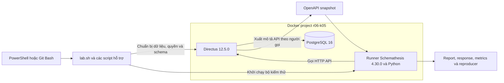

# BÁO CÁO CUỐI KỲ MÔN KIỂM THỬ PHẦN MỀM

## Kiểm thử API do Directus sinh ra bằng Schemathesis

**Trường Đại học Đà Lạt — Khoa Công nghệ Thông tin**  
**Giảng viên:** Nguyễn Thế Lâm  
**Tổ hợp đề tài:** R06 Directus + K05 Schema-Based API Testing/Fuzzing  
**Thành viên:** Đinh Thị Mai Lành, Trương Võ Trọng Nhân, Phan Thị Bảo Trâm  
**Ngày biên soạn:** 19/10/2026  
**Mốc kết quả nghiệm thu được dùng:** 18/10/2026

Báo cáo tổ chức theo phần A–H của mục 3 và đối chiếu các mốc, đầu ra ở mục 4 trong hướng dẫn môn học, trang 2–3. Những hướng dẫn bổ sung của giảng viên về đặc tả, sinh ca kiểm thử từ API và tối ưu chi phí được đưa vào các phần D, E và G.

Báo cáo trình bày thiết kế, phương pháp kiểm thử, dữ liệu đầu vào, kết quả và phân tích nguyên nhân (Root Cause Analysis). Các yêu cầu/phản hồi, phần đặc tả liên quan và số đo được trích ngay trong nội dung để làm căn cứ đánh giá kết luận. Số liệu thực tế được tổng hợp đến ngày 18/10/2026; ví dụ chỉ để giải thích được ghi rõ riêng.

## Tóm tắt đề tài

Directus là phần mềm cung cấp dịch vụ phía máy chủ cho ứng dụng. Khi có cơ sở dữ liệu và cấu hình phù hợp, Directus cung cấp API để ứng dụng tạo, đọc, cập nhật và xóa dữ liệu. API là giao diện cho phép chương trình gửi yêu cầu và nhận dữ liệu hoặc kết quả xử lý. Nhóm không viết lại các API đó. Nhiệm vụ của nhóm là kiểm tra chúng có hoạt động đúng trong phạm vi đã chọn hay không.

Collection là đơn vị tổ chức dữ liệu trong Directus; trong môi trường kiểm thử này, mỗi collection tương ứng với một bảng dữ liệu trong PostgreSQL. Nhóm xây dựng tình huống quản lý chuyên mục và bài viết bằng hai collection `qa_categories` và `qa_articles`. Công cụ Schemathesis đọc mô tả API do Directus xuất ra, sinh yêu cầu kiểm thử và kiểm tra phản hồi. Bên cạnh đó, nhóm viết các ca kiểm thử có chủ đích để kiểm tra quy tắc dữ liệu, phân quyền và kết quả nghiệp vụ mà mô tả API chưa thể hiện đầy đủ.

Báo cáo chọn 13 ca/kịch bản đại diện từ kết quả đã lưu: CRUD, truy vấn, quyền truy cập, biên score và một ca đối chiếu OpenAPI. Đối chiếu các ca nguồn ghi nhận 12 PASS, 1 FAIL về hợp đồng phản hồi; đây không phải một lượt chạy mới cả bộ 13. Bằng chứng nghiệm thu còn ghi nhận cả 10 thao tác API chính có ca nghiệp vụ thành công. Hệ thống vẫn có sai lệch OpenAPI và phản hồi lỗi máy chủ, nên nhóm không kết luận toàn bộ Directus đạt.

Nhóm cũng thực hiện thí nghiệm giảm số tổ hợp truy vấn từ 36 xuống 9 bằng pairwise, tức kiểm thử tổ hợp theo cặp. Trong mô hình nhỏ đã chọn, số yêu cầu mục tiêu giảm 75%, còn thời gian toàn lệnh giảm trung vị 19,54%. Đây là kết quả đo trong môi trường thử nghiệm của nhóm (lab), không phải cam kết giảm tương ứng mọi loại chi phí kiểm thử.

## Các khái niệm dùng trong báo cáo

Các khái niệm cốt lõi dưới đây giúp đọc phương pháp và kết quả kiểm thử. Thuật ngữ bổ sung được giải thích ở phụ lục; tên phép kiểm, trường dữ liệu và câu lệnh giữ nguyên để đối chiếu với công cụ.

| Thuật ngữ | Cách hiểu và cách dùng trong đề tài |
|---|---|
| API; request/response | API là giao diện để chương trình gửi yêu cầu (request) và nhận phản hồi (response). Phản hồi gồm mã trạng thái và dữ liệu nếu có |
| OpenAPI; schema | OpenAPI mô tả các thao tác, tham số và phản hồi API. Schema mô tả cấu trúc, kiểu hoặc ràng buộc dữ liệu; báo cáo gọi chung là đặc tả khi ngữ cảnh đã rõ |
| Schema-Based API Testing; Fuzzing | Kiểm thử dựa trên đặc tả API dùng mô tả API để sinh yêu cầu và kiểm tra phản hồi. Fuzzing sinh nhiều biến thể đầu vào để tìm hành vi không đúng hoặc xử lý lỗi chưa tốt |
| Schemathesis | Công cụ nhóm dùng để sinh và thực thi ca kiểm thử từ OpenAPI, kiểm tra phản hồi và lưu thông tin tái hiện thất bại |
| Test Case; Expected Result | Ca kiểm thử có điều kiện ban đầu, đầu vào, bước thực hiện và kết quả mong đợi. Kết quả mong đợi phải xác định trước khi đối chiếu với kết quả thực tế |
| Oracle; assertion | Oracle là căn cứ đánh giá đúng/sai, như quy tắc dữ liệu hoặc danh sách kết quả biết trước. Assertion là phép kiểm điều kiện dựa trên căn cứ đó |
| Invariant | Tính chất cần giữ đúng qua các thao tác, ví dụ yêu cầu bị từ chối không được đổi dữ liệu |
| Coverage | Độ bao phủ so với một phạm vi xác định, như thao tác API, tham số hoặc lớp dữ liệu. Các loại bao phủ không thay thế cho nhau |

---

## A. Mục tiêu, người dùng, mã nguồn và luồng dữ liệu

### A.1. Directus giải quyết việc gì?

Một ứng dụng quản lý nội dung thường cần lưu chuyên mục, bài viết và quyền truy cập. Nếu tự xây dựng, lập trình viên phải viết các API tương ứng. Directus cung cấp sẵn lớp API làm việc với cơ sở dữ liệu SQL, cùng chức năng xác thực, phân quyền và kiểm tra dữ liệu.

Khi tạo collection `qa_articles`, ứng dụng có thể gọi `GET /items/qa_articles` để đọc bài viết hoặc `POST /items/qa_articles` để tạo bài. API còn phụ thuộc vào cấu hình trường dữ liệu, quan hệ và quyền của người gọi. Collection thuộc mô hình dữ liệu Directus, bảng thuộc cơ sở dữ liệu, còn đối tượng JSON là dạng biểu diễn dữ liệu gửi hoặc nhận qua API.

Directus còn có giao diện quản trị Studio, SDK và nhiều chức năng khác. Đề tài giới hạn ở REST API của hai collection, phù hợp yêu cầu thu hẹp phạm vi của môn học. Hai collection này là dữ liệu lab do nhóm cấu hình, không phải thành phần bài viết được viết riêng trong mã nguồn Directus.

### A.2. Người dùng và nhu cầu chính

| Vai trò | Nhu cầu và quyền trong lab |
|---|---|
| Editor — người quản lý nội dung | Tạo, đọc, cập nhật và xóa chuyên mục, bài viết; làm việc với cả bài nháp và bài công khai |
| Reader — người đọc được cấp tài khoản | Đọc chuyên mục và bài đã công khai; không đọc bài nháp, không nhận ghi chú nội bộ và không được ghi dữ liệu |
| Anonymous — người chưa đăng nhập | Không được truy cập dữ liệu của hai collection |
| Admin — người thiết lập lab | Tạo dữ liệu, tài khoản và quyền; kiểm tra trạng thái, khôi phục dữ liệu. Không dùng làm người gọi mặc định trong đợt sinh ca kiểm thử |

Các yêu cầu người dùng được diễn giải từ phạm vi lab và cấu hình đã thống nhất, không phải kết quả phỏng vấn khách hàng thực tế. Những yêu cầu trọng tâm là quản lý nội dung đúng, đọc đúng dữ liệu theo truy vấn, ngăn thao tác ngoài quyền và phát hiện sai lệch giữa API với OpenAPI.

### A.3. Dữ liệu và quy tắc cần kiểm tra

| Collection/trường | Ý nghĩa và quy tắc chính |
|---|---|
| `qa_categories.id`, `name` | Mã chuyên mục tự tăng; tên chuyên mục không null, tối đa 80 ký tự theo cấu hình |
| `qa_articles.id`, `title` | Mã bài viết tự tăng; tiêu đề không null, tối đa 120 ký tự theo cấu hình |
| `status` | Trạng thái `draft` hoặc `published`; cấu hình mặc định là `draft` |
| `score` | Điểm đánh giá là số nguyên từ 0 đến 5 |
| `published_at` | Thời điểm xuất bản, cho phép null |
| `metadata` | Dữ liệu bổ sung dạng JSON, cho phép null |
| `internal_notes` | Ghi chú nội bộ; Reader không được nhận trường này |
| `category` | Tham chiếu chuyên mục hoặc null. Xóa chuyên mục thì bài viết còn lại và tham chiếu được đặt về null |

`null` nghĩa là không có giá trị. Không gửi một trường, gửi null và gửi chuỗi rỗng là các trường hợp khác nhau. Nhóm không tự đặt thêm quy tắc “chuỗi rỗng luôn sai” hoặc “bài công khai bắt buộc có thời điểm xuất bản” khi chưa có căn cứ từ cấu hình chuẩn.

### A.4. Cây thư mục và thư viện phụ thuộc chính

Directus tổ chức nhiều gói trong cùng một kho mã nguồn. Cấu trúc có liên quan tới đề tài:

```text
directus/
├── api/src/
│   ├── controllers/    Tiếp nhận yêu cầu REST
│   ├── middleware/     Xác thực, chuẩn hóa truy vấn, xử lý phản hồi
│   ├── services/       Xử lý dữ liệu và sinh đặc tả API
│   ├── permissions/    Kiểm tra quyền và dữ liệu được phép
│   └── database/       Kết nối, truy vấn và làm việc với cơ sở dữ liệu
├── app/                Giao diện quản trị Studio
├── sdk/                Thư viện giúp ứng dụng gọi Directus
├── packages/           Các gói dùng chung, gồm schema, validation và specs
├── tests/              Kiểm thử của dự án Directus
└── pnpm-workspace.yaml Danh sách gói và phiên bản dependency
```

Phần máy chủ sử dụng Node.js/TypeScript. Các thư viện phụ thuộc cung cấp chức năng cần cho phần mềm: Express xử lý HTTP, Knex xây dựng truy vấn cơ sở dữ liệu, trình kết nối `pg` làm việc với PostgreSQL, Joi và các gói của Directus hỗ trợ kiểm tra dữ liệu/đặc tả. Giao diện quản trị dùng Vue; phần này không được kiểm thử tự động trong đề tài.

Kho mã kiểm thử của nhóm nằm riêng trong `DAMH`: `lab.sh` là đầu vào lệnh, `scripts/` chứa mã chạy kiểm thử, `scripts/data/` chứa dữ liệu và danh mục ca, `tests/` kiểm tra bộ mã kiểm thử, `docs/` chứa tài liệu, còn `artifacts/runs/` lưu kết quả từng lượt.

Cấu trúc và thư viện phụ thuộc nêu trên được đối chiếu với mã nguồn Directus ở phiên bản đã cố định. Khi phân tích nguyên nhân, nhóm dùng đúng commit mã nguồn của bản chạy thay vì suy từ nhánh phát triển mới hơn.

### A.5. Bốn luồng dữ liệu trọng tâm

| Luồng | Đầu vào, đường đi và đầu ra |
|---|---|
| 1. Editor tạo và chỉnh sửa bài | Chương trình gọi API gửi token cùng JSON bài viết; Directus xác định người gọi, kiểm quyền và dữ liệu, ghi PostgreSQL rồi trả kết quả. Kiểm thử lấy ID trả về để đọc lại, cập nhật một trường, kiểm các trường khác còn nguyên và cuối cùng xóa bài tạm |
| 2. Lọc, sắp xếp và phân trang | Chương trình gọi API gửi truy vấn như status, sort, limit và offset; Directus xử lý truy vấn cùng quyền đọc, tạo truy vấn SQL rồi trả danh sách. Kiểm thử đối chiếu tập bài, thứ tự và lát cắt với dữ liệu mẫu biết trước |
| 3. Reader đọc/ghi dữ liệu | Token xác định Reader; Directus áp điều kiện bài công khai và giới hạn trường. Thao tác ngoài quyền phải bị từ chối. Với thử ghi, Editor đọc lại để xác minh dữ liệu không đổi |
| 4. Xóa chuyên mục có bài tham chiếu | Editor tạo chuyên mục và bài tạm, sau đó xóa chuyên mục. Quan hệ trong cơ sở dữ liệu đặt tham chiếu của bài về null; kiểm thử đọc lại bài để kiểm tra bài vẫn tồn tại và dữ liệu khác được giữ |

Đăng nhập là bước hỗ trợ các luồng: chương trình gọi API gửi thông tin tài khoản, nhận token rồi dùng token trong các yêu cầu sau. Token có thể hiểu là thông tin chứng minh người gọi đã được xác thực. Các nhóm xử lý bên trong được giải thích ở B; cách kiểm tra và kết quả thực tế được trình bày ở E và G.

## B. Kiến trúc hệ thống kiểm thử

### B.1. Sơ đồ container và kết nối

Container là một môi trường đóng gói để chạy dịch vụ với phiên bản và các thư viện cần thiết. Trong sơ đồ dưới, Directus, PostgreSQL và trình chạy kiểm thử là ba container riêng; trình chạy kiểm thử là nơi thực hiện bộ kiểm thử.



Directus là phần mềm được kiểm thử, PostgreSQL lưu dữ liệu thật và trình chạy kiểm thử thực hiện kiểm thử. Docker Compose mô tả cách chạy ba dịch vụ cùng nhau. Từ máy cá nhân, API được truy cập qua `http://127.0.0.1:8055`; từ trình chạy kiểm thử, địa chỉ là `http://directus:8055`. PostgreSQL không công bố cổng kết nối ra máy cá nhân.

### B.2. Năm nhóm thành phần liên quan trực tiếp

| Nhóm thành phần | Vai trò và liên hệ với kiểm thử |
|---|---|
| Middleware xác thực và truy vấn | Đọc token, xác định người gọi, chuẩn hóa truy vấn. Liên quan tới ca token sai và truy vấn bất thường |
| Bộ tiếp nhận yêu cầu REST `items.ts` | Chọn cách xử lý GET/POST/PATCH/DELETE, nhận một đối tượng hoặc mảng. Liên quan tới 10 thao tác API và bất thường POST |
| Dịch vụ dữ liệu và cơ sở dữ liệu | Đọc/ghi dữ liệu qua Knex, xử lý quan hệ. Liên quan tới CRUD, đọc lại, sắp xếp và khóa ngoại |
| Phân quyền và kiểm tra dữ liệu | Giới hạn thao tác, dòng dữ liệu, trường và giá trị. Liên quan tới Reader, score, status và yêu cầu bị từ chối |
| Sinh đặc tả và xử lý phản hồi | Sinh OpenAPI và tạo phản hồi thực tế. So sánh hai phía giúp giải thích sai lệch cấu trúc dữ liệu, mã trạng thái và kiểu nội dung |

Kiểm thử API thường đi qua nhiều nhóm thành phần trong một yêu cầu. Vì vậy, một phản hồi 400 hoặc 403 chưa đủ để kết luận đã kiểm tra đúng quy tắc: kiểm thử còn cần biết yêu cầu bị từ chối vì sai dữ liệu, thiếu quyền hay điều kiện ban đầu không đúng.

## C. Môi trường, cách chạy và bằng chứng hệ thống hoạt động

### C.1. Cấu hình đã dùng

| Thành phần | Cấu hình |
|---|---|
| Hệ thống | Directus 12.5.0, tag `v12.5.0`, commit mã nguồn `4f77933bf9551cac6b289576078783e189b8f4e3` |
| Công cụ K05 | Schemathesis 4.30.0, chạy bằng bản đóng gói Docker đã cố định phiên bản |
| Cơ sở dữ liệu | PostgreSQL 16; lượt xác minh ghi phiên bản thực thi 16.15 và quy tắc sắp xếp chuỗi `en_US.utf8` |
| Dữ liệu mẫu | Dữ liệu mẫu `r06-k05-v2`: 3 chuyên mục, 12 bài, gồm 6 draft và 6 published |
| Dự án Docker, vùng lưu dữ liệu | `r06-k05`, volume `r06-k05_db_data` |
| Cấu hình hỗ trợ | Tắt bộ nhớ đệm ứng dụng, gửi thông tin vận hành và giới hạn tần suất phía máy chủ; thời hạn token truy cập 2 giờ |
| Giới hạn trình chạy kiểm thử chính | Một worker (đơn vị thực thi), khoảng 5 yêu cầu/giây, thời gian chờ tối đa cho mỗi yêu cầu 10 giây |
| Công cụ trên Windows | Docker Desktop, Git Bash, PowerShell; jq 1.8.2 do mã lệnh chuẩn bị và kiểm mã băm đối chiếu |

Collation là quy tắc so sánh và sắp xếp chuỗi trong cơ sở dữ liệu. Nhóm lưu thông tin này để xác định thứ tự mong đợi của các tiêu đề khi kiểm tra sắp xếp.

Directus và trình chạy kiểm thử dùng image có sẵn, tức bản đóng gói dùng để tạo container. Nhóm không cần biên dịch toàn bộ mã nguồn để chạy bằng Docker. Nếu chọn biên dịch từ mã nguồn, bảng khai báo công cụ của bản đã cố định yêu cầu Node.js 22, pnpm 10 và phiên bản trình quản lý gói `pnpm@10.27.0`. Các lệnh là `pnpm install --frozen-lockfile` rồi `pnpm build`. Đường biên dịch từ mã nguồn này chưa được kiểm chứng trong nghiệm thu hiện tại.

### C.2. Các bước dựng và chạy bằng Docker

Các lệnh dưới mô tả cách người nhận vận hành hệ thống khi có bộ mã kiểm thử đi kèm. Chúng thực hiện từ thư mục `DAMH`. Kết quả đã chạy được trình bày riêng ở C.3 và G, để phân biệt hướng dẫn thực hiện với bằng chứng thực tế.

**Bước 1 — Chuẩn bị công cụ và cấu hình.** Mở Docker Desktop. Trên Windows, chạy `.\scripts\setup-windows.ps1` nếu chưa có jq đã cố định. Trên máy mới, sao chép `config/lab.env.example` thành `config/lab.env`; nếu file thật đã tồn tại thì giữ nguyên, không ghi đè bằng bản mẫu.

Điền các nhóm biến sau trực tiếp trên máy:

| Nhóm biến | Nội dung cần cấu hình |
|---|---|
| `DIRECTUS_IMAGE`, `POSTGRES_IMAGE`, `SCHEMATHESIS_IMAGE` | Giữ nguyên phiên bản và digest trong file mẫu |
| `DB_DATABASE`, `DB_USER`, `DB_PASSWORD` | Thông tin kết nối cơ sở dữ liệu của lab |
| `DIRECTUS_KEY`, `DIRECTUS_SECRET` | Giá trị riêng cho môi trường; thay toàn bộ giá trị `REPLACE_*` tương ứng |
| `ADMIN_*`, `EDITOR_*`, `READER_*` | Tài khoản và mật khẩu của ba vai trò |
| `LICENSE_KEY` | License hợp lệ đáp ứng điều kiện chính sách quyền tùy chỉnh của cấu hình chuẩn đã nghiệm thu |
| `API_URL`, `RUNNER_API_URL`, `LAB_FIXTURE_VERSION` | Giữ địa chỉ API trên máy cá nhân/trong runner và phiên bản dữ liệu mẫu theo bảng cấu hình |

File cấu hình thật chỉ được người dùng phù hợp truy cập. Nếu `doctor` báo lỗi quyền file thì cần sửa quyền trước khi chạy tiếp; trên Unix dùng quyền 600, trên Windows dùng ACL riêng cho tài khoản hiện tại, SYSTEM và nhóm quản trị. Không đưa mật khẩu, token hoặc giá trị license vào báo cáo và mã nguồn bàn giao.

Cấu hình chuẩn hiện có chạy với license ở trạng thái kích hoạt và quyền cấu hình cần thiết. Máy mới thiếu điều kiện này có thể không thiết lập được chính sách quyền Reader; trường hợp đó phải ghi chưa đủ điều kiện kiểm thử, không đổi chính sách quyền để tạo kết quả đạt.

**Bước 2 — Khởi động và chuẩn bị dữ liệu.**

```powershell
.\scripts\run-lab.ps1 up
.\scripts\run-lab.ps1 doctor
.\scripts\run-lab.ps1 seed
.\scripts\run-lab.ps1 export-schema
```

`up` chạy dịch vụ; `doctor` kiểm tra công cụ, cấu hình và trạng thái hệ thống; `seed` tạo/xác minh dữ liệu và quyền; `export-schema` xuất OpenAPI theo từng vai trò. Bước nạp dữ liệu có cơ chế chạy lại không nhân đôi dữ liệu mẫu. ID thực được lưu vào bảng ánh xạ ID và dùng khi kiểm thử, không giả định chúng luôn là 1, 2, 3.

**Bước 3 — Chạy kiểm thử ngắn và xem kết quả.**

```powershell
.\scripts\run-lab.ps1 test scenarios
.\scripts\run-lab.ps1 test designed --selection course
```

Hai lệnh chọn tổng cộng 13 ca/kịch bản. `test designed` không có tùy chọn cũng mặc định chọn `course`; các lựa chọn mở rộng giữ riêng. Ca đối chiếu OpenAPI vẫn trả thất bại nếu tái hiện sai lệch, không được bỏ khỏi bộ để có kết quả xanh. Linux hoặc Git Bash dùng `./lab.sh` với cùng tham số. Chạy các bộ kiểm thử ghi dữ liệu lần lượt trên cùng lab. Khi dùng xong, lệnh `down` dừng dịch vụ và giữ volume; không cần reset cơ sở dữ liệu để mở hệ thống hoặc minh họa.

### C.3. Bằng chứng chạy thành công và ba luồng nghiệp vụ

Đợt xác minh ngày 18/10/2026 hoàn tất kiểm tra môi trường, chuẩn bị dữ liệu và xuất OpenAPI trước khi chạy các bộ kiểm thử. Bản ghi kiểm môi trường ghi `command=doctor`, `status=passed`, `exit_code=0`. Bộ kiểm xác minh image của container khớp cấu hình, mã nhận diện Directus đúng commit đã cố định và API chỉ mở trên địa chỉ nội bộ máy cá nhân (loopback).

| Luồng nghiệp vụ | Kết quả thực tế được ghi | Cơ sở đánh giá |
|---|---|---|
| Editor CRUD | Tạo và cập nhật trả 2xx; xóa trả 204; S1 PASS | Đọc lại dữ liệu, kiểm trường không cập nhật được giữ và bài tạm được xóa |
| Truy vấn dữ liệu | S2 trả sáu bài published, ID lịch sử `[3,4,7,8,11,12]`; S3 PASS | Đối chiếu danh sách và thứ tự với dữ liệu mẫu biết trước, không lấy phản hồi đang thử làm đáp án |
| Quyền Reader | S4/S5/S6 đều ghi HTTP 403 và PASS | Không lộ draft/ghi chú nội bộ; Editor đọc lại xác nhận lần ghi bị từ chối không đổi dữ liệu |

Sáu kịch bản trong bảng kết quả gốc đều có trạng thái `passed`. HTTP 403 ở luồng Reader là kết quả đúng khi người đó yêu cầu thao tác ngoài quyền. Các ID trên thuộc lần chạy được trích; khi dựng mới, kiểm thử dùng ID từ bảng ánh xạ ID/phản hồi thay vì cố định các số này. Mã nhận diện các lượt chạy được liệt kê trong phụ lục truy vết cuối báo cáo.

## D. Nguyên lý K05, phạm vi và tiêu chí đánh giá

### D.1. K05 được áp dụng như thế nào?

Schema-Based API Testing dùng mô tả API làm đầu vào để tự động tạo yêu cầu và kiểm phản hồi. Fuzzing trong đề tài là sinh nhiều biến thể dữ liệu đầu vào để tìm hành vi không đúng hoặc xử lý lỗi chưa tốt.

Quy trình của nhóm gồm: chuẩn bị dữ liệu mẫu và quyền; xuất OpenAPI từ Directus; chọn các thao tác API cần kiểm tra; để Schemathesis sinh và gửi yêu cầu; thực hiện các phép kiểm tra; lưu kết quả và thông tin chạy lại. Một số yêu cầu có thể được rút gọn khi công cụ tìm lỗi để giúp xác định đầu vào nhỏ hơn vẫn gây hiện tượng.

Ví dụ, phần mô tả `score` trong OpenAPI xuất từ lab là:

```json
{"nullable": false, "type": "integer"}
```

Đoạn này chỉ yêu cầu số nguyên và không null, chưa có `minimum: 0` hoặc `maximum: 5`. Công cụ có thể sinh số 6 vì giá trị đó phù hợp mô tả kiểu nhưng lại sai quy tắc score của lab. Do đó, nhóm bổ sung kiểm thử có kết quả mong đợi lấy từ yêu cầu và cấu hình dữ liệu. Sự khác nhau giữa “hợp đặc tả” và “đúng nghiệp vụ” là lý do cần cả hai cách kiểm thử.

### D.2. Vì sao chọn phạm vi này?

Hai collection được chọn có cấu trúc đơn giản nhưng đủ thể hiện chuỗi, số, thời gian, JSON, quan hệ và phân quyền. Mỗi collection có năm thao tác API: GET danh sách, POST tạo, GET chi tiết, PATCH chi tiết và DELETE chi tiết, tổng cộng **10 cặp method–path** (phương thức–đường dẫn).

Phạm vi địa chỉ cụ thể như sau; `{id}` được thay bằng mã bản ghi thực tế:

| Thao tác | Chuyên mục | Bài viết |
|---|---|---|
| Đọc danh sách | `GET /items/qa_categories` | `GET /items/qa_articles` |
| Tạo | `POST /items/qa_categories` | `POST /items/qa_articles` |
| Đọc chi tiết | `GET /items/qa_categories/{id}` | `GET /items/qa_articles/{id}` |
| Cập nhật một phần | `PATCH /items/qa_categories/{id}` | `PATCH /items/qa_articles/{id}` |
| Xóa chi tiết | `DELETE /items/qa_categories/{id}` | `DELETE /items/qa_articles/{id}` |

Nhóm giữ cả POST một đối tượng và POST một mảng theo đặc tả. Các thao tác sửa/xóa nhiều bản ghi qua một yêu cầu, gọi là bulk PATCH/DELETE, không nằm trong đợt kiểm thử chính. Truy vấn trọng tâm là `fields`, `filter`, `sort`, `limit`, `offset`, `page`, `search`. Công cụ vẫn có thể sinh các truy vấn khác được đặc tả mô tả, như tổng hợp aggregate hoặc xuất dữ liệu export. Giao diện Studio, GraphQL, hiệu năng tải và API quản trị nằm ngoài phạm vi đã chọn.

### D.3. Bốn phép kiểm phản hồi nền tảng

| Phép kiểm | Câu hỏi cần trả lời |
|---|---|
| `not_a_server_error` | Máy chủ có trả 5xx hay không? |
| `status_code_conformance` | Mã trạng thái trả về có được khai báo trong OpenAPI không? |
| `content_type_conformance` | Kiểu nội dung thực tế có khớp mô tả, ví dụ JSON hay CSV không? |
| `response_schema_conformance` | Cấu trúc, kiểu dữ liệu phản hồi có khớp đặc tả không? |

Đợt kiểm thử tự động còn cấu hình các phép kiểm `unsupported_method`, `negative_data_rejection`, `positive_data_acceptance`. Chúng kiểm các phương thức không được mô tả và cách API xử lý dữ liệu được công cụ gắn nhãn hợp lệ/không hợp lệ. Nhãn này phụ thuộc đặc tả và điều kiện áp dụng của công cụ, không thay cho kiểm tra đúng nghiệp vụ.

HTTP 2xx thường biểu thị yêu cầu được xử lý thành công; 4xx thường biểu thị yêu cầu hoặc quyền truy cập không phù hợp; 5xx biểu thị lỗi phía máy chủ. Với kiểm thử dữ liệu sai hoặc thiếu quyền, một phản hồi 4xx đúng nguyên nhân có thể là kết quả PASS. Ngược lại, HTTP 200 có thể FAIL nếu dữ liệu trả về sai hoặc khác đặc tả.

### D.4. Giả định, rủi ro và nguyên tắc PASS/FAIL

Kiểm thử chỉ có ý nghĩa khi đúng phiên bản, đúng vai trò, dữ liệu mẫu và đặc tả đã chuẩn bị, không có lượt ghi khác làm thay đổi dữ liệu. Các điều kiện này được kiểm tra trước khi chạy. Lỗi kết nối hoặc thiếu dữ liệu mẫu không được tự coi là lỗi sản phẩm.

Một ca nghiệp vụ đạt khi kết quả và trạng thái dữ liệu đúng với kết quả mong đợi. Với ca ghi bị từ chối, cần kiểm dữ liệu không thay đổi. Với ca xóa, cần kiểm tài nguyên không còn được trả như bản ghi tồn tại. Một lỗi mạng hoặc 5xx không chứng minh thao tác xóa đã thành công.

| Trạng thái | Ý nghĩa trong báo cáo |
|---|---|
| PASS | Ca đã chạy, đủ điều kiện và các phép kiểm điều kiện thuộc phạm vi ca đó đạt |
| FAIL | Ca đã chạy nhưng kết quả khác với kết quả mong đợi đã xác định |
| OPEN | Với ca kiểm thử: còn chi tiết kết quả mong đợi chưa rõ. Với vấn đề đã ghi nhận: chưa đóng vì còn cần xác minh hoặc chưa được sửa |
| NOT_RUN | Ca thiết kế chưa được thực thi trong bảng tổng hợp |
| BLOCKED / INCOMPLETE | BLOCKED: thiếu điều kiện để kiểm. INCOMPLETE: lượt chạy dừng trước khi hoàn tất. Cả hai không được quy thành PASS |

Rủi ro chính là đặc tả thiếu ràng buộc, yêu cầu sai nhiều yếu tố làm khó xác định nguyên nhân, kiểm thử ghi làm thay đổi dữ liệu mẫu và việc nhầm số thất bại thành số lỗi phần mềm. Nhóm giảm rủi ro bằng mẫu kiểm chứng hợp lệ, thay riêng một yếu tố, dùng ID từ bảng ánh xạ ID/phản hồi, kiểm dữ liệu trước/sau và giữ nguyên báo cáo kết quả khi lỗi xảy ra.

## E. Đặc tả và thiết kế bộ kiểm thử

### E.1. Từ yêu cầu người dùng tới ca kiểm thử

Yêu cầu trọng tâm là CRUD đúng dữ liệu, truy vấn đúng kết quả, truy cập đúng quyền và phát hiện khác biệt giữa API với OpenAPI. Bộ 13 ca tại E.3 gắn từng yêu cầu này với đầu vào và kết quả mong đợi. Hồ sơ chi tiết dùng UR cho yêu cầu người dùng, BR cho quy tắc và AC cho tiêu chí chấp nhận; bảng sau minh họa một đường truy vết, không yêu cầu người đọc nhớ toàn bộ mã.

Ví dụ truy vết cụ thể:

| Bước | Nội dung |
|---|---|
| Yêu cầu người dùng | UR-07: dữ liệu bài viết phải tuân thủ ràng buộc đã cấu hình |
| Quy tắc | BR-05: score là số nguyên 0–5; BR-24: yêu cầu bị từ chối không được làm thay đổi dữ liệu |
| Tiêu chí chấp nhận | AC-05/AC-24: số ngoài miền bị từ chối, không tạo bản ghi mới |
| Khoảng trống OpenAPI | `score` có kiểu integer nhưng thiếu minimum/maximum |
| Kiểm thử bổ sung | `P3-SCORE-POST-6`: Editor tạo bài với score=6, các trường khác hợp lệ |
| Kết quả mong đợi | Từ chối đúng lỗi validation; dữ liệu nghiệp vụ không đổi |
| Kết quả thực tế đã lưu | HTTP 400; các kiểm tra của ca đạt và dọn dữ liệu đạt |

Dưới đây là yêu cầu thực tế của ca score=6; thông tin xác thực không đưa vào báo cáo. Các trường còn lại là dữ liệu kiểm thử hợp lệ:

```http
POST /items/qa_articles
Content-Type: application/json
```

```json
{
  "title": "Probe 6604d999d5a79f68cb95fc04",
  "status": "draft",
  "score": 6,
  "published_at": null,
  "metadata": {
    "probe": "6604d999d5a79f68cb95fc04"
  },
  "internal_notes": "Private 6604d999d5a79f68cb95fc04",
  "category": 1
}
```

Phản hồi thực tế có mã trạng thái HTTP 400:

```json
{
  "errors": [
    {
      "message": "Validation failed for field \"score\". Value has to be less than or equal to \"5\".",
      "extensions": {
        "field": "score",
        "path": [],
        "type": "lte",
        "valid": 5,
        "code": "FAILED_VALIDATION"
      }
    }
  ]
}
```

Thông điệp phản hồi cho biết score phải nhỏ hơn hoặc bằng 5; mã lỗi là `FAILED_VALIDATION`. Bộ kiểm thử còn so trạng thái dữ liệu trước/sau để xác nhận POST không tạo bài. Vì vậy, ca này PASS dù API trả 400. Giá trị category=1 là ID được xác minh từ bảng ánh xạ của lượt chạy đó; khi chạy mới, ID được lấy lại từ bảng ánh xạ.

Ca kiểm này đánh giá quy tắc dữ liệu và việc không trả 5xx. Phép kiểm hợp đồng phản hồi không được chạy trong chính ca này; không suy kết quả nghiệp vụ PASS thành toàn bộ OpenAPI PASS.

### E.2. Dữ liệu, điều kiện và dọn dẹp chung

Ba chuyên mục mẫu là Alpha, Beta và Gamma. Mỗi chuyên mục có bốn bài: hai draft và hai published. Các tiêu đề/score sau là dữ liệu mẫu thực tế, được định nghĩa trước khi chạy kiểm thử:

| Chuyên mục | Tiêu đề | Status | Score |
|---|---|---|---:|
| Alpha | Alpha 01 — bản nháp | draft | 1 |
| Alpha | Alpha 02 — bản nháp có Unicode | draft | 2 |
| Alpha | Alpha 03 — đã xuất bản | published | 4 |
| Alpha | Alpha 04 — xuất bản nullable metadata | published | 5 |
| Beta | Beta 01 — bản nháp | draft | 0 |
| Beta | Beta 02 — bản nháp & rỗng thời điểm | draft | 3 |
| Beta | Beta 03 — đã xuất bản | published | 3 |
| Beta | Beta 04 — publication spéciale | published | 4 |
| Gamma | Gamma 01 — bản nháp | draft | 2 |
| Gamma | Gamma 02 — bản nháp Unicode 漢字 | draft | 5 |
| Gamma | Gamma 03 — đã xuất bản | published | 1 |
| Gamma | Gamma 04 — đã xuất bản cuối | published | 5 |

Ví dụ, lọc published phải trả đúng các bài Alpha 03/04, Beta 03/04 và Gamma 03/04. Với thứ tự `title,id` và limit=3, trang đầu phải có Alpha 01/02/03; trang kế tiếp có Alpha 04, Beta 01/02 theo chuẩn sắp xếp đã xác minh trong cơ sở dữ liệu. Đây là đáp án độc lập được xây từ dữ liệu mẫu, không phải chép lại phản hồi rồi dùng nó tự kiểm chính nó.

Các bài mẫu có thêm thời điểm xuất bản, JSON chứa Unicode, metadata null và ghi chú nội bộ để kiểm các dạng dữ liệu và quyền. Tên hiển thị Alpha/Beta/Gamma trong bảng viết gọn tên chuyên mục; ID số được gắn theo bảng ánh xạ ID khi nạp dữ liệu mẫu.

Với mỗi ca kiểm thử cần ghi, nhóm tạo dữ liệu tạm hoặc chụp trạng thái cần bảo vệ. Các trường ngoài yếu tố đang thử được giữ hợp lệ để tránh lẫn nguyên nhân. Kết quả được kiểm trước khi dọn dẹp: đọc lại bản ghi tạo/cập nhật, kiểm dữ liệu không đổi nếu bị từ chối hoặc kiểm quan hệ sau xóa. Trình chạy kiểm thử sau đó xóa dữ liệu tạm và khôi phục trạng thái cuối bộ kiểm thử; kết quả khôi phục được ghi riêng.

### E.3. Bộ 13 ca/kịch bản đại diện

Bộ đại diện gồm sáu scenario S1–S6 đang có và bảy ca bổ sung được chọn bằng `--selection course`. Một kịch bản CRUD gồm nhiều bước và nhiều request. Nhóm chọn tập này để giải thích phương pháp; không đổi tên hoặc cộng lại các lần chạy thành ca mới.

| Ca và ID nguồn | Đầu vào và tiền điều kiện | Kết quả mong đợi | Kết quả nguồn |
|---|---|---|---|
| 1. CRUD chuyên mục — `P3-ST-01` | Editor; chuyên mục tạm; ID từ phản hồi | Tạo/đọc/sửa đúng tên; xóa đúng bản ghi và kiểm không còn tài nguyên | PASS |
| 2. CRUD bài viết — S1 | Editor; title, status, score và quan hệ hợp lệ | Tạo/đọc đúng; PATCH giữ trường không gửi; xóa bài tạm | PASS |
| 3. Lọc trạng thái — S2 | Dữ liệu mẫu chuẩn; lọc published | Đúng sáu bài published theo bảng ánh xạ | PASS |
| 4. Sắp xếp/phân trang — S3 | Dữ liệu mẫu; `sort=title,id`, limit/offset | Đúng thứ tự và bản ghi của từng trang theo dữ liệu mẫu/cơ sở dữ liệu | PASS |
| 5. Reader đọc draft — S4 | Có bài draft; Reader đọc được published; chỉ yêu cầu trường công khai | HTTP 403/FORBIDDEN, không trả bài nháp | PASS |
| 6. Reader yêu cầu ghi chú — S5 | GET chi tiết có trong schema Reader; đọc published bằng `fields=id,title,status`, rồi cùng bài với `fields=id,title,internal_notes` | HTTP 403/FORBIDDEN, không trả nội dung ghi chú | PASS |
| 7. Reader ghi — S6 | Bài tồn tại; PATCH hợp lệ nếu Editor gửi, có giá trị thay đổi thật | Bị từ chối; Editor đọc lại thấy dữ liệu không đổi | PASS |
| 8. Chưa đăng nhập đọc danh sách — `P3-AUTHZ-DR-047` | Anonymous; danh sách bài tồn tại và các trường công khai | HTTP 403/FORBIDDEN, không trả danh sách | PASS |
| 9. Score dưới miền — `P3-SCORE-POST-MINUS1` | Editor tạo bài với score=-1; các trường khác hợp lệ | Từ chối đúng lỗi validation, không tạo bài | PASS |
| 10. Biên dưới hợp lệ — `P3-SCORE-POST-0` | Editor tạo bài với score=0; các trường khác hợp lệ | Tạo được và đọc lại đúng score | PASS |
| 11. Biên trên hợp lệ — `P3-SCORE-POST-5` | Editor tạo bài với score=5; các trường khác hợp lệ | Tạo được và đọc lại đúng score | PASS |
| 12. Score trên miền — `P3-SCORE-POST-6` | Editor tạo bài với score=6; các trường khác hợp lệ | Từ chối đúng lỗi validation, không tạo bài | PASS |
| 13. POST đối chiếu OpenAPI — `P3-CONTRACT-QA_ARTICLES-OBJECT` | Editor; tạo một bài hợp lệ bằng đối tượng JSON; đặc tả gốc của lượt chạy | Phản hồi tuân thủ OpenAPI; kiểm riêng nghiệp vụ và hợp đồng | FAIL hợp đồng: data là đối tượng, đặc tả yêu cầu mảng |

Kết quả cột cuối được trích từ các lượt nghiệm thu 18/10: S1–S6 từ `p8-20261018-scenarios`; các ca P3 từ `p8-20261018-assertable`, riêng Anonymous từ `p8-20261018-short-r2`. Lựa chọn `course` được bổ sung sau mốc này; bảng không giả làm kết quả một lượt chạy mới của cả bộ 13.

**Căn cứ S5:** policy Reader chỉ cho đọc published và các trường công khai, không có `internal_notes`. Mã nguồn Directus đúng commit ở H.1 kiểm quyền các trường được yêu cầu và phát sinh `ForbiddenError` với HTTP 403 khi yêu cầu trường ngoài quyền. Mẫu kiểm chứng ở `http-15.json` của lượt scenario đọc được published; `http-16.json` trả `FORBIDDEN` và chỉ rõ trường `internal_notes` ngoài quyền, phù hợp expected 403. Assertion hiện có còn chấp nhận nhánh 2xx loại trường kín; đây là giới hạn của mã kiểm thử cần xử lý riêng, không phải bằng chứng mọi lần PASS đều đã kiểm chặt mã 403. Lần thu gọn không thay assertion hoặc kết quả gốc.

### E.4. Kỹ thuật thiết kế được minh họa

Phân vùng tương đương chia score thành miền hợp lệ (số nguyên 0–5), dưới miền và trên miền. Bốn ca -1, 0, 5, 6 tại E.3 minh họa kiểm thử biên: ngay ngoài và ngay tại hai đầu miền. Các trường còn lại hợp lệ để không nhầm lỗi của score với lỗi dữ liệu khác; ca bị từ chối còn kiểm không tạo bài.

Các ca Reader minh họa chọn tình huống theo quyền: đọc nội dung công khai làm mẫu kiểm chứng, sau đó thử đọc draft, yêu cầu trường kín hoặc ghi dữ liệu. Tách từng yếu tố giúp biết nguyên nhân từ chối. Kết quả không chứng minh mọi giá trị, mọi tổ hợp quyền hoặc mọi thao tác đều đã được kiểm đầy đủ.

### E.5. Kiểm thử sinh từ OpenAPI và kiểm thử có chủ đích bổ sung nhau

| Điều cần kiểm | OpenAPI đã thể hiện gì? | Cách nhóm xử lý phần còn thiếu |
|---|---|---|
| Title/name | Kiểu chuỗi, thông tin cho phép null/bắt buộc có trường | Thử riêng các độ dài sát và vượt giới hạn |
| Status | Kiểu chuỗi, chưa đủ tập giá trị hợp lệ và giá trị mặc định | Thử draft/published/archived và những trường hợp đủ kết quả mong đợi |
| Score | Kiểu số nguyên, thiếu miền 0–5 | Kiểm biên và từ chối ngoài miền |
| Quyền Reader | Một phần thao tác/trường có thể bị lọc | Gửi yêu cầu có chủ đích, dùng mẫu kiểm chứng và kiểm dữ liệu |
| Truy vấn | Mô tả tham số | So tập bản ghi, thứ tự, phân trang và trường trả về với dữ liệu chuẩn |
| Quan hệ | Có tham chiếu kiểu dữ liệu | Kiểm FK tồn tại, SET NULL và dữ liệu sau thao tác |

Một ví dụ do Schemathesis thực thi là ca `qfqspn`, cấu hình guided với giá trị khởi tạo 101. Ca này dùng ví dụ POST một bài viết có title “Guided Schemathesis article”, status=draft, score=3. API trả 200 với `data` là một đối tượng, nhưng phép kiểm đặc tả FAIL vì phần mô tả yêu cầu một mảng. Đây là ca được công cụ thực thi từ đặc tả/ví dụ đầu vào, không phải ca biên do nhóm viết riêng. Phần G.5 trình bày phân tích và kết quả chạy lại của cùng nhóm sai lệch.

Các danh mục và ma trận mở rộng được giữ để tra cứu ở phụ lục kết quả mở rộng. Bộ đại diện giúp trình bày các yêu cầu trọng tâm; không thay bằng chứng Schemathesis thực sự sinh và thực thi ca từ OpenAPI.

## F. Tự động hóa kiểm thử và cách đọc kết quả

### F.1. Các thành phần của bộ kiểm thử

Bộ tự động hóa được chia theo trách nhiệm để thực hiện kiểm thử và lưu bằng chứng theo cùng một quy trình.

**Bảng: trách nhiệm của các tệp và thư mục kiểm thử.**

| Tệp/thư mục | Công việc |
|---|---|
| lab.sh | Nhận lệnh, kiểm tra cấu hình, tạo mã lượt chạy và điều phối các bước |
| scripts/lab-components.sh | Chuẩn bị dữ liệu/quyền, xuất OpenAPI, chạy đợt kiểm thử và quản lý khôi phục dữ liệu |
| scripts/invariants.py | Kiểm tra nghiệp vụ, phân quyền và tính chất cần giữ đúng; chạy lại các phép thử được thiết kế sẵn |
| scripts/designed_cases.py | Chọn và thực hiện các ca có chủ đích theo từng ca, nhóm hoặc bộ ngắn |
| scripts/contract_checks.py | Áp dụng các phép kiểm phản hồi của Schemathesis vào những ca đã được tích hợp chức năng này |
| scripts/replay_cases.py | Chạy lại ca Schemathesis; khôi phục quan hệ với bước trước và ánh xạ ID nếu có đủ dữ liệu gốc |
| scripts/cost_query.py | Thực hiện và đo chi phí hai tập truy vấn 36/9 |
| scripts/data | Lưu danh mục ca, dữ liệu mẫu làm chuẩn và mô hình thí nghiệm |
| tests | Kiểm tra logic bộ mã kiểm thử mà không gọi API thật; không thay thế kiểm thử hệ thống |

Trên Windows, `run-lab.ps1` chuyển lệnh sang Git Bash và giữ mã thoát của `lab.sh`; `setup-windows.ps1` chuẩn bị jq. Bảng trên giải thích trách nhiệm từng thành phần. Mã giả dưới đây mô tả quy trình chung; nó không phải bản sao toàn bộ chương trình:

```text
Kiểm tra đúng phiên bản, tài khoản, dữ liệu và schema
Nếu thiếu điều kiện: ghi chưa kiểm được, không kết luận PASS
Lưu trạng thái dữ liệu cần bảo vệ
Với mỗi ca được chọn:
    Chuẩn bị bản ghi tạm và ID thực nếu cần
    Gửi request bằng đúng vai trò
    So status, dữ liệu và trạng thái sau request với expected
    Nếu ca có check OpenAPI: kiểm thêm status/content type/schema
    Ghi riêng kết quả nghiệp vụ và kết quả hợp đồng
    Dọn dữ liệu tạm, ghi nhận cả lỗi kiểm thử lẫn lỗi dọn dẹp
Khôi phục trạng thái cuối suite và ghi kết quả khôi phục riêng
Xuất report và mã thoát phản ánh kết quả thật
```

Ví dụ, ca Reader bị cấm ghi chỉ đạt khi phản hồi từ chối đúng quyền và dữ liệu không đổi. Chỉ quan sát mã 403 chưa đủ. Nếu xảy ra ngoại lệ trong quá trình thực hiện, trình chạy vẫn cố ghi báo cáo và dọn dữ liệu ở bước xử lý cuối. Cơ chế này không bảo đảm khôi phục nếu mất điện hoặc toàn bộ Docker bị dừng cưỡng bức.

Bộ mã nguồn bàn giao đi kèm README hướng dẫn chạy và danh sách thư viện/công cụ phụ thuộc. Phần C.2 trình bày cấu hình cần thiết; F.3 cho biết lệnh nào dùng cho từng mục đích.

### F.2. Hai cấu hình sinh ca kiểm thử: raw và guided

Cấu hình raw giữ nguyên mô tả hợp đồng của các thao tác được chọn sau khi giới hạn phạm vi. Cấu hình guided dùng một bản đặc tả riêng, bổ sung ví dụ và ID hợp lệ để hỗ trợ công cụ tiếp cận các đường xử lý. Guided còn chạy chuỗi yêu cầu có phụ thuộc dữ liệu: chẳng hạn GET lấy ID rồi DELETE sử dụng chính ID đó. Đây là hai cấu hình sinh ca kiểm thử của cùng kỹ thuật K05.

Nhóm giữ nguyên đặc tả raw và các phép kiểm đã xác định; không nới điều kiện đánh giá hoặc tắt phép kiểm để đổi thất bại thành đạt. Raw và guided khác cả dữ liệu hướng dẫn lẫn chế độ chạy chuỗi. Vì vậy, kết quả so sánh phản ánh hai cấu hình tổng thể, chưa tách riêng được tác dụng của từng thay đổi.

### F.3. Các lệnh chính

```powershell
# Bộ đại diện: sáu scenario và bảy ca bổ sung
.\scripts\run-lab.ps1 test scenarios
.\scripts\run-lab.ps1 test designed --selection course
```

Các lệnh `test raw` và `test guided` chạy đợt kiểm thử tự động theo cấu hình đã chốt trong tệp mẫu: giá trị khởi tạo ngẫu nhiên 101/202/303, tối đa 1.200 giây cho mỗi giá trị/cấu hình, max-examples 100, một worker. Khi đọc báo cáo hoặc minh họa, không cần chạy lại hai đợt dài. `max-examples` không phải tổng số yêu cầu của một đợt vì còn các giai đoạn sinh dữ liệu, rút gọn ca lỗi và chuỗi yêu cầu.

Mỗi lượt lưu kết quả tại `artifacts/runs/<run_id>/`. Người đọc bắt đầu từ `metadata.json` để biết phiên bản, cấu hình và trạng thái lượt chạy; xem `designed-report.json` hoặc `scenario-report.json` để biết từng ca đạt hay không đạt. `component-outcomes.json` ghi riêng mã thoát của bước kiểm thử và bước khôi phục. Các tệp phản hồi và thông tin tái hiện cung cấp căn cứ kiểm tra thêm. Tập tệp có thể khác nhau theo loại lượt chạy.

Các ca thất bại và lượt hết thời gian vẫn được lưu đầy đủ. Khi chạy lại ca đã lưu, kết quả `reproduced` xác nhận hiện tượng cũ được tái hiện, không xác nhận lỗi đã sửa. Do đó, cần đọc trạng thái và nội dung báo cáo; chỉ nhìn mã thoát 0 có thể dẫn tới kết luận sai.

## G. Kết quả kiểm thử, phân tích nguyên nhân và tối ưu chi phí

### G.1. Các đợt kiểm thử được tổng hợp

Báo cáo tổng hợp ba nhóm kết quả: đợt kiểm thử chính với cấu hình raw/guided ngày 11/10/2026, thí nghiệm chi phí ngày 18/10 và kiểm thử nghiệm thu ngày 18/10. Trong đợt nghiệm thu, nhóm chạy các ca nghiệp vụ, ca có chủ đích, chạy lại ca đã lưu và hai lượt sinh ca kiểm thử ngắn. Hai lượt ngắn chỉ kiểm tra bộ công cụ hiện hành còn hoạt động; không thay thế đợt kiểm thử chính.

Các bảng và trích đoạn được lấy từ báo cáo kết quả đã lưu. Mỗi lượt có mã nhận diện gắn với thời điểm, phiên bản và cấu hình; phụ lục liệt kê các mã cần truy vết. Một ca có thể được chạy nhiều lần để kiểm tra tính lặp lại, nhưng vẫn chỉ được tính là một ca thiết kế.

### G.2. Kết quả của bộ đại diện

Bảng dưới đối chiếu các ID đã chọn với kết quả nguồn ngày 18/10, không phải báo cáo một lượt chạy mới sau thay đổi lựa chọn. Sáu scenario và bảy ca bổ sung có report riêng; không cộng số request hoặc các lần chạy lặp thành số ca mới.

| Phạm vi | Kết quả nguồn | Ý nghĩa |
|---|---|---|
| S1–S6 | 6 PASS | CRUD bài viết, query và quyền Reader có bằng chứng hoạt động |
| Bảy ca bổ sung cho môn học | 6 PASS, 1 FAIL | CRUD chuyên mục, Anonymous, bốn biên score đạt; POST không khớp OpenAPI |
| Tổng 13 ca/kịch bản được chọn | 12 PASS, 1 FAIL | Tổng hợp theo các ID đã chọn qua các lượt nguồn, chưa phải một lượt chạy chung |
| Bằng chứng thao tác API, giữ riêng | 10/10 thao tác có ca nghiệp vụ thành công | Lấy từ bộ positive operation đã chạy; không suy từ tên hai kịch bản CRUD hoặc cộng vào tổng 13 |

Ca FAIL được giữ để phân tích cách K05 phát hiện sai lệch. POST vẫn tạo và đọc được dữ liệu, nhưng cấu trúc phản hồi khác OpenAPI. Một ca nghiệp vụ đạt có thể đồng thời không đạt phép kiểm hợp đồng; không xem HTTP 200 là đủ chứng minh API đúng.

Danh sách các nhóm bất thường vẫn công bố ở G.4. Kết quả bộ 58/118 ca, danh mục 257 ID và ma trận coverage nằm trong phụ lục kết quả mở rộng; chúng là bằng chứng bổ sung, không là khối lượng phải hoàn thành thêm.

### G.3. Kết quả kiểm thử dựa trên đặc tả API và giới hạn so sánh

Hai đợt kiểm thử chính gồm raw `20261011T085034Z-76481` và guided `20261011T095117Z-89079`. Mỗi cấu hình dùng cùng ba giá trị khởi tạo ngẫu nhiên, với giới hạn 20 phút cho mỗi giá trị/cấu hình. Từng lượt đã thực hiện yêu cầu tới 10/10 thao tác API và dừng khi hết thời gian. Mã thoát của trình chạy là 1, của bước khôi phục là 0: lượt kiểm thử có thất bại hoặc chưa hoàn tất, còn bước khôi phục đã hoàn tất thành công. Quá trình tìm kiếm vẫn được ghi INCOMPLETE.

**Bảng: chỉ số của các lượt sinh ca kiểm thử chính.**

| Cấu hình/giá trị khởi tạo | Ca đã sinh (generated) | Lượt HTTP được ghi | Thất bại phân biệt theo công cụ (unique check failure) | Ca có lỗi xử lý (case errored) |
|---|---:|---:|---:|---:|
| Raw 101 | 59 | 59 | 20 | 0 |
| Raw 202 | 65 | 65 | 18 | 0 |
| Raw 303 | 51 | 51 | 19 | 0 |
| Guided 101 | 5.770 | 5.659 | 63 | 111 |
| Guided 202 | 5.864 | 5.688 | 65 | 176 |
| Guided 303 | 5.894 | 5.694 | 62 | 200 |

**Cách đọc các chỉ số:** Generated cases là số ca công cụ ghi nhận đã sinh; HTTP interactions là số lượt trao đổi yêu cầu–phản hồi được ghi lại. Sinh được ca không đồng nghĩa đã gửi và ghi được một lượt HTTP tương ứng, nên hai cột có thể khác nhau. Một ca còn được đánh giá bằng nhiều phép kiểm, như mã trạng thái, kiểu nội dung và cấu trúc phản hồi. Unique check failures là các thất bại được công cụ phân biệt theo quy tắc của nó, chưa phải số lỗi phần mềm độc lập. Case errored là ca gặp lỗi trong quá trình xử lý; cần xem chi tiết để xác định nguyên nhân trước khi quy cho sản phẩm, bộ kiểm thử hoặc môi trường.

*Ví dụ giả định, không phải số liệu thực nghiệm:* một ca gửi một yêu cầu, nhận một phản hồi và chạy bốn phép kiểm. Nếu hai phép kiểm cùng thất bại do một nguyên nhân làm phản hồi không khớp đặc tả, không thể suy ra có hai lỗi phần mềm độc lập. Các cột trong bảng đo những đối tượng khác nhau; không cộng thất bại giữa các giá trị khởi tạo để suy ra số lỗi, cũng không coi nhiều ca đã sinh hơn là chắc chắn kiểm thử hiệu quả hơn.

Trong các lượt trên, raw phủ 28/48 tham số; guided phủ 41/48 hoặc 42/48 tùy giá trị khởi tạo. Mẫu số 48 là tập tham số trong mô hình đặc tả được đo. Cả hai có độ bao phủ phản hồi 8/26, nghĩa là đã chạm 8 trong 26 mục phản hồi theo chỉ số công cụ; không phải 8/26 phản hồi HTTP hoặc tỷ lệ mã nguồn đúng. Guided tiếp cận nhiều phần mô tả hơn nhưng cũng có ca gặp lỗi xử lý. Kết quả chỉ cho phép mô tả mức tiếp cận trong các lượt này, chưa đủ kết luận guided luôn tốt hơn.

Hai lượt sinh ca kiểm thử ngắn dùng giá trị khởi tạo 101, giới hạn 60 giây và max-examples 10. Cả hai thực hiện yêu cầu tới 10/10 thao tác API. Với raw, số ca đã sinh là 61, thất bại phân biệt theo công cụ là 22 và ca có lỗi xử lý là 0. Với guided, các giá trị tương ứng là 278, 32 và 2. Hai lượt đều hết thời gian, có mã thoát trình chạy 1/khôi phục 0. Kết quả xác minh bộ công cụ hiện hành thực hiện được quy trình, không thay thế số đo của đợt kiểm thử chính.

Nhóm đã đối chiếu các hàm chạy đợt kiểm thử với mã trước đó. Tuy nhiên, toàn bộ phần mã chưa commit của các lượt cũ chưa được lưu đầy đủ theo nội dung. Vì vậy, sáu lượt cũ được ghi đúng thời điểm đã chạy; không coi chúng là sáu lượt đã thực hiện lại trên bản mã nghiệm thu 18/10.

### G.4. Danh sách nhóm bất thường

Các mã P5/P8 trong bảng là mã hồ sơ nội bộ dùng để truy vết. Cột mô tả và kết luận thể hiện bản chất của từng nhóm bất thường.

| Mã | Quan sát thực tế | Kết luận và trạng thái |
|---|---|---|
| P5-F01 — aggregate | Đầu vào `aggregate={"foo":1}` trả 500; hai mẫu kiểm chứng empty/count trả 200 | Nghi vấn lỗi xử lý đầu vào bất thường. Phân tích mã nguồn chỉ ra nguyên nhân có thể xảy ra, nhưng chưa xác nhận chính xác vị trí phát sinh lỗi trong lượt kiểm thử; OPEN |
| P5-F02 — POST đối tượng | Trường `data` trong phản hồi POST là đối tượng, đặc tả raw khai báo mảng | Đã đối chiếu sai lệch bằng kết quả thực thi và mã nguồn. Chưa có bằng chứng thao tác tạo sai nghiệp vụ; vấn đề đặc tả vẫn OPEN |
| P5-F03 — DELETE | Xóa thành công trả 204, đặc tả raw không khai báo mã trạng thái này | Sai lệch giữa mã phản hồi thực tế và hợp đồng API; OPEN |
| P5-F04 — export | Xuất CSV/XML/YAML trả kiểu nội dung tương ứng, khác JSON trong mô tả | Sai lệch kiểu nội dung phản hồi; chưa kết luận nội dung các tệp xuất bị sai; OPEN |
| P8-F05 — projection | `fields=title` chỉ trả title, trong khi đặc tả dùng chung vẫn bắt buộc score | Sai lệch đặc tả khi chọn một phần trường trả về; đã chạy lại để kiểm chứng, vấn đề vẫn OPEN |

Ngoài năm nhóm trên, lượt sinh ca kiểm thử ngắn guided ghi 27 phản hồi 500: 22 từ POST categories và 5 từ GET articles trong quá trình sinh, rút gọn và lặp dữ liệu lỗi. Công cụ phân biệt hai ServerError, nhưng nhóm chưa cô lập đủ nguyên nhân để xác nhận số lỗi độc lập. Những quan sát này vẫn chưa có kết luận; không gộp mọi phản hồi 500 vào P5-F01 hoặc tính 27 phản hồi thành 27 lỗi sản phẩm.

Hai phân tích dưới là đại diện, không thay thế việc công bố các nhóm còn lại.

### G.5. Phân tích đại diện 1: POST thành công nhưng không khớp OpenAPI

**Mục đích và điều kiện:** kiểm tra phản hồi POST với một đối tượng dữ liệu hợp lệ có khớp OpenAPI hay không. Người gửi là Editor hợp lệ. Hai collection của lab là loại thông thường; chúng không phải singleton, tức loại được cấu hình chỉ có một bản ghi nội dung.

Trong ca `P3-CONTRACT-QA_CATEGORIES-OBJECT`, yêu cầu và phản hồi thực tế được lưu như sau:

```http
POST /items/qa_categories
Content-Type: application/json

{"name":"Probe b2a4eb6af9c9b1a23696a7e0"}
```

```json
{"data":{"id":6592,"name":"Probe b2a4eb6af9c9b1a23696a7e0"}}
```

Mã trạng thái HTTP là 200, đọc lại đúng chuyên mục, nhưng `data` là một đối tượng, thể hiện bằng cặp dấu `{...}`. Trong khi đó, phần OpenAPI mô tả phản hồi POST của collection này như sau; trích đoạn chỉ giữ nhánh cần đối chiếu:

```json
{
  "type": "object",
  "properties": {
    "data": {
      "type": "array",
      "items": {"$ref": "#/components/schemas/ItemsQaCategories"}
    }
  }
}
```

`type: array` yêu cầu `data` là danh sách, tức được bọc bằng dấu `[...]`; `$ref` trỏ tới kiểu của một chuyên mục. Vì phản hồi thực tế chứa một đối tượng thay cho mảng, hai bên không khớp dù thao tác tạo/đọc lại thành công. ID 6592 là ID lịch sử của lượt trích, không phải ID phải dùng khi chạy mới.

| Cách API xử lý khi thực thi | Cách sinh đặc tả | Nguyên nhân sai lệch |
|---|---|---|
| Bộ tiếp nhận yêu cầu chọn `createOne/readOne` nếu phần dữ liệu gửi là đối tượng, chọn `createMany/readMany` nếu là mảng | Bộ sinh đặc tả chọn phản hồi đối tượng/mảng theo cấu hình singleton của collection | Với collection thông thường, đặc tả khai báo mảng trong khi API có nhánh POST đối tượng trả đối tượng |

Logic của hai nhánh có thể viết gọn bằng mã giả:

```text
Khi chạy API:
    Body là một object  -> tạo một bản ghi -> trả data object
    Body là một array   -> tạo nhiều bản ghi -> trả data array

Khi sinh OpenAPI:
    Collection singleton -> mô tả data object
    Collection thường    -> mô tả data array
```

Hai phía dùng điều kiện lựa chọn khác nhau: API dựa trên dạng dữ liệu gửi, còn bộ sinh đặc tả dựa trên loại collection. Với hai collection thông thường của lab, POST một đối tượng trả về một đối tượng, khác mô tả mảng. Nhóm đối chiếu bộ tiếp nhận yêu cầu `items.ts` và dịch vụ sinh đặc tả của đúng commit đã cố định. Hai ca FAIL có chung cơ chế này nên được gom vào một nhóm nguyên nhân.

Ca Schemathesis `qfqspn` cũng ghi nhận POST bài viết trả về một đối tượng. Ngày 18/10, nhóm chạy lại yêu cầu với thông tin xác thực hiện tại để kiểm tra có tái hiện cùng sai lệch hay không. Trích đoạn sau lấy từ kết quả đã lưu, không phải kết quả một lượt mới khi biên soạn báo cáo:

```json
{
  "case_id": "qfqspn",
  "status": "reproduced",
  "replay_scope": "single_request",
  "source_status": 200,
  "actual_status": 200,
  "reproduced": true
}
```

Các phép kiểm lỗi máy chủ, mã trạng thái và kiểu nội dung đều đạt; riêng `response_schema_conformance` FAIL với `JsonSchemaError`. Như vậy, lần chạy lại tái hiện đúng loại sai lệch cấu trúc phản hồi. Kết quả chỉ áp dụng cho một yêu cầu đã lưu, không phải toàn bộ đợt kiểm thử. `reproduced=true` xác nhận tái hiện được hiện tượng, không xác nhận sản phẩm đã được sửa.

**Kết luận và đề xuất:** sai lệch hợp đồng API đã được tái hiện và có giải thích từ mã nguồn. Bộ sinh đặc tả chưa được sửa nên vấn đề vẫn OPEN. Hướng xử lý đề xuất là mô tả đầy đủ các dạng phản hồi hợp lệ, sau đó kiểm tra lại cả POST đối tượng/mảng. Báo cáo chưa ghi nhận việc triển khai bản sửa này.

### G.6. Ví dụ bổ sung: truy vấn tổng hợp gây HTTP 500

Aggregate là truy vấn tổng hợp, chẳng hạn đếm số bài. Nhóm kiểm một đầu vào bất thường cùng hai mẫu kiểm chứng, dùng cùng vai trò và dữ liệu mẫu. Ba yêu cầu đã lưu được trình bày ở dạng dễ đọc; khi gửi thực tế, JSON được mã hóa URL:

```text
GET /items/qa_articles?fields=&aggregate={"foo":1}        => 500
GET /items/qa_articles?fields=&aggregate={}               => 200
GET /items/qa_articles?fields=&aggregate={"count":["id"]} => 200
```

Kết quả mong đợi là xử lý đầu vào không phù hợp có kiểm soát, không trả 5xx; không yêu cầu API thực hiện phép tính tên foo và chưa đặt mã 4xx cụ thể cho một bản sửa. Hai mẫu kiểm chứng trả 200 giúp loại bớt khả năng toàn API ngừng hoạt động hoặc thông tin xác thực sai.

Đọc mã nguồn đúng phiên bản cho thấy giá trị số có thể qua bước kiểm aggregate dạng đối tượng rồi tới đoạn xử lý danh sách, tạo khả năng phát sinh ngoại lệ. Nhóm chưa có ngăn xếp lỗi máy chủ của đúng lượt để xác nhận vị trí đầu tiên, nên đây vẫn là nghi vấn xử lý đầu vào bất thường, trạng thái OPEN. Chưa sửa Directus và chưa có bằng chứng mất dữ liệu hoặc vượt quyền. Ví dụ này là finding bổ sung, không cộng vào 13 ca đại diện; hồ sơ nguồn giữ phân tích chi tiết để tra cứu.

### G.7. Thí nghiệm tối ưu chi phí kiểm thử

#### Mô hình và cách đo

Nhóm chọn truy vấn GET articles với bốn yếu tố hữu hạn:

| Yếu tố | Các giá trị được chọn |
|---|---|
| Filter | Không filter, draft, published |
| Sort | `id`, `title,id`, `-score,id` |
| Fields | `id,title` hoặc `id,title,status,score` |
| Phân trang | `limit=3&offset=3` hoặc `limit=3&page=2` |

Có `3 × 3 × 2 × 2 = 36` tổ hợp. Pairwise chọn 9 ca sao cho mọi cặp giá trị thuộc hai yếu tố khác nhau đều xuất hiện ít nhất một lần. Tập này phủ đủ 37/37 cặp khả thi của mô hình; không phải phủ mọi đầu vào API.

Phương án thí nghiệm được chốt trước khi đo. Nhóm chạy ba cặp so sánh giữa tập đầy đủ và tập pairwise, đổi thứ tự hai tập giữa các lượt, giữ cùng môi trường, dữ liệu mẫu và căn cứ đánh giá. Cả sáu lượt đều PASS; không có lượt lỗi bị loại khỏi phân tích. Tổng cộng thực hiện 135 yêu cầu mục tiêu, tương ứng 36 ID thiết kế duy nhất được chạy lặp.

#### Kết quả đo

**Bảng: chi phí thực hiện và độ bao phủ cặp của hai tập truy vấn.**

| Chỉ số | Tập đủ 36 ca | Tập pairwise 9 ca | Mức giảm |
|---|---:|---:|---:|
| Yêu cầu truy vấn mục tiêu mỗi lượt | 36 | 9 | 75,00% |
| Tổng yêu cầu tới hệ thống được kiểm thử mỗi lượt | 79 | 52 | 34,18% |
| Thời gian thực hiện nhóm truy vấn mục tiêu, trung vị | 7,200 giây | 1,797 giây | 75,04% theo cặp |
| Thời gian toàn lệnh, trung vị | 26,893 giây | 21,638 giây | 19,54% theo cặp |
| Phủ cặp giá trị | 37/37 | 37/37 | Giữ mức phủ cặp trong mô hình |

Số đo thời gian toàn lệnh của ba cặp lượt:

| Cặp đo | Thứ tự chạy | Tập 36 ca | Tập 9 ca | Mức giảm theo cặp |
|---|---|---:|---:|---:|
| 1 | 36 ca trước, 9 ca sau | 26,893 giây | 21,638 giây | 19,54% |
| 2 | 9 ca trước, 36 ca sau | 26,827 giây | 21,645 giây | 19,31% |
| 3 | 36 ca trước, 9 ca sau | 27,200 giây | 21,438 giây | 21,18% |

Với mỗi cặp lượt chạy, mức giảm được tính bằng `(1 - pairwise/full) × 100`. Sau đó lấy trung vị của ba tỷ lệ, được 19,54%. Trung vị là giá trị ở giữa khi sắp xếp ba tỷ lệ theo thứ tự. Thời gian trong bảng đã làm tròn để dễ đọc. Thời gian truy vấn mục tiêu bao gồm khoảng chờ theo giới hạn 5 yêu cầu/giây và xử lý của bộ kiểm thử, không phải độ trễ thuần của Directus.

Mỗi lượt còn có 43 yêu cầu ngoài nhóm truy vấn mục tiêu để đăng nhập, chuẩn bị, xác minh và khôi phục. Trong toàn lượt có 15 PATCH phục vụ khôi phục dữ liệu, dù các yêu cầu mục tiêu chỉ dùng GET. Những công việc cố định này vẫn phải thực hiện khi giảm số ca, nên giảm 75% số ca không làm thời gian toàn lệnh giảm 75%.

**Nhận xét:** với nhóm truy vấn hữu hạn này, pairwise giảm số yêu cầu và thời gian thực hiện trong khi giữ mức phủ cặp đã xác định. Khi cần kiểm chứng một hiện tượng đã biết, chạy lại ca đã lưu cũng giúp tránh việc luôn phải thực hiện lại đợt kiểm thử dài.

**Giới hạn:** thí nghiệm chỉ có ba cặp trên một máy, không ngẫu nhiên hóa thứ tự và không phát hiện lỗi mới. Vì vậy, chưa chứng minh hai tập có khả năng tìm lỗi ngang nhau hoặc phủ được tương tác ba/bốn yếu tố. Nhóm chưa đo công thiết kế, bảo trì, phân loại/xác minh lỗi hay chi phí tiền. Mức giảm thời gian chạy không đại diện cho mức giảm mọi chi phí kiểm thử.

### G.8. Giới hạn và kết luận trong phạm vi môn học

Bộ 13 ca minh họa các luồng chính, kiểm thử quyền, biên và đối chiếu OpenAPI. Nó không bao phủ mọi trường dữ liệu, mọi giá trị hay mọi tổ hợp truy vấn. Những trường hợp chuỗi rỗng, ép kiểu, Unicode, JSON lồng nhau và một số dạng thời gian vẫn có giới hạn; phần chưa rõ expected không được tự gán PASS.

Bằng chứng 10/10 thao tác nghiệp vụ và các chỉ số bao phủ đặc tả được trình bày riêng. Nhóm chưa đo độ bao phủ dòng lệnh hoặc nhánh mã nguồn Directus. Không cộng các mẫu số hoặc suy một ca đại diện đạt thành toàn bộ quy tắc đã được kiểm đầy đủ. Các số liệu chi tiết được giữ ở phụ lục để tra cứu khi cần.

Các luồng đã thử có bằng chứng hoạt động, đồng thời còn sai lệch đặc tả và phản hồi 5xx cần xác minh. Nhóm giữ các finding OPEN, công bố FAIL và giới hạn; chưa kết luận toàn Directus đúng. Đây là kết quả áp dụng phương pháp kiểm thử trong phạm vi đã chọn.

## H. Cố định phiên bản và khả năng chạy lại

### H.1. Phiên bản và dữ liệu nhận diện đã cố định

**Bảng: phiên bản và mã nhận diện đầu vào nghiệm thu.**

| Thành phần | Mã nhận diện |
|---|---|
| Mã nguồn Directus | `v12.5.0`, commit `4f77933bf9551cac6b289576078783e189b8f4e3` |
| Directus image | `sha256:7de5d6898b955dab1672619aed590035dcade4f8d7396d913e55543e114d1331` |
| Schemathesis image 4.30.0 | `sha256:bb9cecfc9ac4058a15fcf9b505d9d9f972e2dde7c74c4e9289a35922f4cbc0a5` |
| PostgreSQL image 16-alpine | `sha256:721873c34ceb9f8d8fc265984940dc982404c105f19ad51be9fdc5970a6080ea` |
| Mã bộ kiểm thử tại nghiệm thu | Git HEAD `2e44fe7558cb4e3fc12e19b7d44af2421f81ed72`, còn thay đổi chưa commit |
| Dữ liệu mẫu | `r06-k05-v2`, bảng ánh xạ ID lưu cùng đầu vào lượt chạy |
| Đặc tả raw của Editor | SHA-256 `bd32aa69ff3e7330030c5f25e4c98fd1441a55c4b7465de25e3f42a4465a7d26` |

Cố định phiên bản giúp hạn chế việc thay đổi phần mềm làm thay đổi kết quả giữa các lần chạy. Digest/SHA-256 là mã nhận diện theo nội dung; raw và guided được lưu riêng để biết mỗi kết quả dùng đầu vào nào. Mốc mã ở bảng trên thuộc nghiệm thu 18/10, gồm cả phần chưa commit. Lựa chọn `course` được bổ sung sau đó và mới kiểm tra không gọi API; chưa có bằng chứng chạy mới cả bộ 13 sau thay đổi này.

### H.2. Điều kiện và trình tự tái lập

Để chạy lại, người nhận cần các mã lệnh ở F, Docker, công cụ trên máy cá nhân ở C.1 và cấu hình phù hợp. Trình tự gồm khởi động dịch vụ, kiểm tra môi trường, nạp dữ liệu mẫu, xuất OpenAPI theo vai trò rồi chạy các kịch bản và bộ ngắn. Phần C.2 nêu các lệnh cụ thể và các nhóm biến cần cấu hình.

Khi tạo cơ sở dữ liệu mới, phải dùng bảng ánh xạ ID của lần nạp dữ liệu mới. OpenAPI được xuất sau bước này theo đúng vai trò; đặc tả Admin không thay cho Editor/Reader. Để tái hiện một ca, cần giữ yêu cầu, đặc tả gốc, vai trò và trạng thái dữ liệu phù hợp. Nếu ca gồm nhiều bước, cần chuẩn bị dữ liệu và lấy ID từ bước trước. Chỉ giữ giá trị khởi tạo ngẫu nhiên hoặc yêu cầu cuối chưa đủ tái hiện chuỗi.

Bản mã kiểm thử ở H.1 gồm HEAD Git và phần thay đổi chưa commit. Vì vậy, bản bàn giao cần có đủ nội dung đã dùng trong nghiệm thu, kể cả phần chưa commit. Đặc tả, bảng ánh xạ ID và cấu hình được lưu cùng kết quả từng lượt để phân biệt đầu vào.

### H.3. Mức độ đã xác minh

Tại mốc nghiệm thu 18/10, hai lượt bộ ngắn 58 ca có kết luận nhất quán và các ca đại diện có bằng chứng đã chạy. Lần thu gọn hiện tại mới kiểm tra bộ chọn và mã hỗ trợ không gọi API, chưa chạy mới cả bộ 13. Chưa có bằng chứng đã dựng toàn bộ môi trường từ đầu trên máy thứ hai. Các thư mục runtime profile chỉ tách các tệp cấu hình/kết quả, vẫn dùng chung cơ sở dữ liệu; chúng không phải các môi trường độc lập.

Kết quả hiện có xác minh việc chạy và tái hiện trong môi trường đã nêu. Chuyển sang máy mới còn cần thiết lập các điều kiện tương ứng và kiểm tra lại. Hướng dẫn các bước dựng mới là tài liệu tái lập, chưa phải bằng chứng đã dựng mới thành công.

Bộ bàn giao đầy đủ gồm mã kiểm thử, README, danh sách công cụ/thư viện phụ thuộc, cấu hình mẫu, bảng phiên bản, đặc tả API, báo cáo kết quả và thông tin tái hiện. Tài khoản, mật khẩu và license thật được cấu hình riêng. Báo cáo trình bày căn cứ đánh giá chuyên môn; toàn bộ mã nguồn vẫn là đầu ra nộp riêng theo yêu cầu môn học.

## I. Lịch trình và phương án bảo vệ theo yêu cầu môn học

### I.1. Các mốc và sản phẩm tương ứng

| Mốc theo đề bài | Nội dung cần trình bày hoặc nộp | Đầu ra liên quan của đề tài |
|---|---|---|
| 18/9 — đăng ký | Thành viên, repo/kỹ thuật, cố định SHA/tag và công cụ quản lý công việc | Tổ hợp R06/K05, thành viên ở trang đầu, phiên bản cố định tại H. Hồ sơ này không xác nhận thời điểm gửi đăng ký hoặc thiết lập công cụ quản lý công việc |
| 20/10 — giữa kỳ | Hệ thống chạy được, kiến trúc, tài liệu cài đặt, phạm vi và kế hoạch kiểm thử | Các phần A–F và ba luồng đã có bằng chứng chạy ở C.3 |
| Cuối kỳ theo lịch nhà trường | Thuyết trình, minh họa tự động hóa kiểm thử, nộp toàn bộ mã kiểm thử và báo cáo, đánh giá chéo | Phương pháp/kết quả tại D–G, tái lập tại H, kịch bản minh họa tại I.2; mã nguồn và phiếu đánh giá là đầu ra riêng |
| Trước bảo vệ một tuần | Nộp báo cáo tổng kết | Hạn cụ thể tính theo lịch bảo vệ chính thức. Ngày bảo vệ chưa được xác nhận trong hồ sơ này |

Các kết quả kỹ thuật được hình thành qua đợt kiểm thử tự động ngày 11/10, xác minh môi trường và các bước phân tích trong tháng 10, thí nghiệm/kiểm thử bổ sung ngày 18/10 và tổng hợp báo cáo ngày 19/10. Đây là các mốc của bằng chứng kỹ thuật; không dùng chúng thay cho xác nhận đóng góp cá nhân hoặc biên bản báo cáo trước giảng viên.

### I.2. Nội dung minh họa khi bảo vệ

Buổi trình bày bắt đầu từ tình huống quản lý bài viết: giới thiệu Directus, hai collection, bốn vai trò và sơ đồ kiến trúc. Ví dụ score 0–5 minh họa cách xác định kết quả mong đợi và giới hạn của OpenAPI. Tiếp đó, nhóm giải thích một ca do Schemathesis thực thi từ đặc tả/ví dụ đầu vào và các phép kiểm phản hồi tương ứng.

Phần chạy thử minh họa ba luồng: Editor CRUD, truy vấn và quyền Reader. Lệnh `test scenarios` chạy cả sáu kịch bản; nhóm giải thích kết quả theo đầu vào, kết quả mong đợi và kết quả thực tế tại E.3. Với sai lệch POST, cần đối chiếu phản hồi thực tế, phần đặc tả yêu cầu mảng và kết quả chạy lại tại G.5. Bảy ca bổ sung dùng `test designed --selection course`; không cần chạy suite 58/118 ca khi bảo vệ. Các đợt kiểm thử tự động dài được minh họa bằng kết quả đã lưu, không chờ chạy hết trong buổi trình bày.

Phần cuối nêu số đo 36/9, giải thích chi phí cố định khiến thời gian toàn lệnh chỉ giảm khoảng 19,54%, rồi công bố vấn đề đã ghi nhận còn mở và phần chưa phủ. Cách trình bày này nối yêu cầu, phương pháp, kết quả và giới hạn trong cùng một lập luận.

### I.3. Nguyên tắc hoàn tất hồ sơ nộp

Báo cáo tổng kết, mã nguồn kiểm thử và tài liệu chạy lại là các đầu ra cần thống nhất phiên bản/kết quả khi nộp. Slide và demo dùng cùng số liệu trong báo cáo. Kết quả cũ được dùng minh họa phải ghi đúng thời điểm; không trình bày thành một lượt chạy trực tiếp vừa thành công.

Đánh giá chéo do các thành viên ghi nhận theo mức tham gia thực tế, kèm lịch sử công việc, commit và phần bàn giao. Phiếu đánh giá, trạng thái nộp hồ sơ và biên bản bảo vệ được ghi nhận riêng khi thực hiện; báo cáo này tổng hợp kết quả kỹ thuật tại mốc biên soạn 19/10/2026.

## Kết luận

Đề tài đã thiết lập môi trường Directus với dữ liệu và quyền rõ ràng, áp dụng Schemathesis sinh ca kiểm thử từ OpenAPI và bổ sung các ca nghiệp vụ có kết quả mong đợi xác định trước. Các luồng chính hoạt động trong phạm vi đã thử. Đồng thời, nhóm ghi nhận sai lệch giữa API với đặc tả và hiện tượng xử lý đầu vào còn cần xác minh; các vấn đề này được giữ trạng thái mở.

Giá trị chính của đề tài là nối được yêu cầu, đặc tả, kiểm thử, bằng chứng và phân tích nguyên nhân. Thí nghiệm pairwise bổ sung một ví dụ tối ưu chi phí có mô hình và số đo cụ thể. Những kết quả này được trình bày cùng phạm vi chưa phủ, thay vì suy số kiểm thử lớn hoặc mã 200 thành bảo đảm toàn bộ sản phẩm đúng.

## Phụ lục: kết quả mở rộng đã lưu

Các bảng sau giữ nguyên số liệu nghiệm thu ngày 18/10. Chúng không phải chỉ tiêu bổ sung cho bộ 13, không bị quy lại mẫu số 13 và không được dùng làm kết quả của một lượt chạy mới. Chín truy vấn pairwise là tập con của 36 truy vấn tham chiếu trong danh mục 257 ID, không cộng thêm thành 266.

### Kết quả các bộ mở rộng

**Bảng: kết quả theo phạm vi kiểm thử.**

| Phạm vi | Kết quả | Cách hiểu |
|---|---|---|
| Sáu kịch bản nghiệp vụ | 6/6 PASS | Các luồng đã mô tả ở C/E chạy đạt trong môi trường thử nghiệm |
| Bộ ngắn chạy hai lượt | Mỗi lượt 58/58 PASS | Các ca có kết luận nhất quán giữa hai lượt; không cộng thành 116 ID khác nhau |
| Nghiệp vụ với dữ liệu hợp lệ | 10/10 thao tác API | Mỗi thao tác có ca thành công và đã kiểm dữ liệu sau xử lý; phản hồi vẫn có thể không khớp OpenAPI |
| Bộ 118 ca có kết quả mong đợi xác định rõ | 111 PASS, 7 FAIL | Đã chạy đủ tập này; các ca không đạt vẫn giữ nguyên kết quả |
| Kiểm tra tính chất cần giữ đúng | 9 PASS, 2 FAIL | Hai nhóm không đạt liên quan tới xử lý aggregate bất thường và sai lệch hợp đồng API |
| Toàn danh mục 257 ID | 184 PASS, 7 FAIL, 1 OPEN, 65 NOT_RUN | Tổng hợp theo mã ca qua nhiều lượt; không phải kết quả của một lượt chạy toàn bộ 257 ca |

Trong tám ca kiểm tra hợp đồng thuộc bộ 118 ca, công cụ thực hiện tổng cộng 32 phép kiểm phản hồi nền tảng: 26 PASS, 6 FAIL. Một ca có thể gồm nhiều phép kiểm và một ca nghiệp vụ khác có thể không thực hiện các phép kiểm hợp đồng này. Vì vậy, cần đọc phạm vi của từng bộ trước khi so sánh các kết quả PASS.

Bảy ca thiết kế không đạt gồm một ca aggregate trả 500; hai ca POST đối tượng ở hai collection; ba ca xuất CSV/XML/YAML; một ca chỉ lấy trường title. Đây là số ca kiểm thử thất bại, chưa phải số lỗi phần mềm độc lập. Nhiều ca có thể phát hiện cùng một nguyên nhân; việc xác nhận lỗi cần xem thêm yêu cầu, điều kiện thực hiện và bằng chứng phân tích.

### Phạm vi bao phủ mở rộng

**Bảng: tổng hợp các phạm vi đánh giá tại mốc nghiệm thu.**

| Hạng mục đánh giá | Số đạt hoặc đã được kiểm tra | Tổng số trong phạm vi | Phần chưa đạt hoặc chưa thực hiện | Ý nghĩa và giới hạn |
|---|---|---|---|---|
| Danh mục ca kiểm thử | 184 PASS, 7 FAIL; một ca còn OPEN | 257 ID thiết kế | 65 NOT_RUN; 1 OPEN là ca search chuỗi chỉ có khoảng trắng, chưa chốt đủ kết quả mong đợi | Tổng hợp theo ID qua nhiều lượt; OPEN và NOT_RUN không được tính là đạt |
| Trường hợp biên | 33 điểm PASS | 34 điểm biên | 1 NOT_RUN: `page=0` | Chỉ kết luận cho các điểm biên đã thiết kế và chạy |
| Ma trận quyền | 54 luật có ca được chỉ định PASS | 69 luật | 15 luật NOT_RUN qua các ID được chỉ định | Số luật có ca đạt, không phải đã kiểm mọi tình huống của từng luật |
| Phân vùng tương đương | 25 lớp có ca đại diện PASS tập trung đúng trường cần thử | 48 lớp | 23 lớp chưa có đại diện đạt đáp ứng tiêu chí này | Không tự gán cả 23 lớp là NOT_RUN; một đại diện đạt không chứng minh mọi giá trị trong lớp đều đúng |
| Truy vết quy tắc BR | 26 BR có ít nhất một ca đã chạy | 26 BR | Vẫn có tình huống chưa kiểm và ca FAIL trong các BR; không kết luận mọi BR đều PASS | Có thực thi một ca liên quan không đồng nghĩa kiểm đầy đủ quy tắc |
| Thao tác API với dữ liệu hợp lệ | 10 thao tác có ca nghiệp vụ thành công | 10 cặp method–path | Không còn thao tác thiếu ca thành công; vẫn có sai lệch hợp đồng ở một số phản hồi | Đạt về nghiệp vụ của ca đại diện, không phải mọi đầu vào/phản hồi của thao tác đều đạt |
| Mã nguồn Directus | Chưa đo | Chưa xác định tập dòng/nhánh để đo | Chưa có số đo độ bao phủ dòng lệnh hoặc nhánh | Không suy từ độ bao phủ thao tác API hay đặc tả thành độ bao phủ mã nguồn |

Các luồng chính và mọi thao tác API trong phạm vi đã có ca thực thi, nhưng danh mục vẫn còn ca chưa chạy và kết quả chưa chốt. Những trường hợp chuỗi rỗng, ép kiểu, Unicode, dữ liệu lồng nhau và một số dạng thời gian vẫn còn giới hạn. Mỗi hàng dùng một đơn vị và mẫu số riêng; không cộng các chỉ số thành một tỷ lệ bao phủ chung, cũng không suy ca đại diện đạt thành toàn bộ quy tắc đã được kiểm đầy đủ.

Tại mốc nghiệm thu 18/10, bộ mã kiểm thử có 18 kiểm thử đơn vị đạt trên máy cá nhân và trong trình chạy dùng phiên bản đã cố định; con số này không phải kết quả chạy sau thay đổi lựa chọn `course`. Kết quả này kiểm tra logic lập báo cáo, đánh giá và chạy lại ca; không thay thế kiểm thử API thật. Những lỗi của chính bộ kiểm thử, như yêu cầu category dùng nhầm trường của article, đã được ghi và sửa; không tính thành lỗi Directus.

## Phụ lục: thuật ngữ bổ sung

Các thuật ngữ sau dùng khi mô tả công cụ và đọc hồ sơ kỹ thuật; có thể tra cứu theo nhu cầu.

| Thuật ngữ | Cách hiểu trong đề tài |
|---|---|
| Endpoint; operation | Endpoint là địa chỉ API. Operation là một cặp phương thức và địa chỉ, ví dụ `GET /items/qa_articles` |
| CRUD | Bốn nhóm thao tác: tạo, đọc, cập nhật và xóa |
| Fixture; seed dữ liệu | Fixture là bộ dữ liệu mẫu biết trước; seed là bước nạp hoặc xác minh dữ liệu mẫu trong môi trường |
| Random seed | Giá trị khởi đầu của bộ sinh giả ngẫu nhiên, ví dụ 101/202/303. Khác với bước seed dữ liệu; cùng giá trị khởi tạo chưa bảo đảm tái lập nếu trạng thái cơ sở dữ liệu khác |
| JSON; object/array | JSON biểu diễn dữ liệu theo tên trường và giá trị. Object là một đối tượng trong dấu `{...}`; array là mảng trong dấu `[...]`, không phải collection hay bảng cơ sở dữ liệu |
| Harness; runner | Harness là bộ mã chuẩn bị, điều phối, đánh giá và lưu kết quả kiểm thử. Runner là thành phần thực hiện kiểm thử trong môi trường đã chuẩn bị |
| Campaign; request budget | Campaign là đợt công cụ tự sinh ca kiểm thử và thực hiện chúng. Ngân sách thực thi giới hạn thời gian hoặc mức sinh dữ liệu; hết ngân sách không có nghĩa đã kiểm hết đầu vào |
| Positive control | Mẫu kiểm chứng hợp lệ, dùng để xác nhận tài khoản, dữ liệu hoặc đường xử lý đang hoạt động trước khi kết luận về ca bị từ chối |
| Finding; defect; triage | Finding là lỗi hoặc bất thường được ghi nhận; defect là lỗi phần mềm. Triage là phân loại và xác minh nguyên nhân trước khi coi nhiều thất bại là các lỗi độc lập |
| Candidate robustness | Hiện tượng nghi vấn liên quan tới khả năng xử lý đầu vào bất thường. Đã quan sát phản hồi lỗi nhưng nguyên nhân có thể chưa được xác nhận đầy đủ |
| Reproducer; replay | Reproducer lưu thông tin cần để tái hiện hiện tượng. Replay là chạy lại ca hoặc chuỗi đã lưu để kiểm chứng; tái hiện được lỗi chưa có nghĩa lỗi đã sửa |
| Contract mismatch; schema conformance | Hợp đồng API là mô tả đầu vào/đầu ra đã công bố. Sai lệch hợp đồng là khác biệt giữa mô tả và thực tế; schema conformance là việc kiểm phản hồi có tuân thủ đặc tả dữ liệu không |

## Phụ lục: thông tin nhận diện bằng chứng

Các mã dưới đây giúp đối chiếu với hồ sơ gốc nếu cần kiểm tra thêm. Những dữ kiện cần cho lập luận đã được trích trực tiếp vào nội dung; phụ lục không yêu cầu người đọc mở các tệp mới hiểu được kết quả.

| Nội dung đã trích | Lượt hoặc nguồn nhận diện | Kết quả/ý nghĩa |
|---|---|---|
| Kiểm môi trường 18/10 | `20261018T102730Z-1869` | Doctor PASS, exit 0 |
| Chuẩn bị dữ liệu và đặc tả 18/10 | Nạp dữ liệu `20261018T102856Z-1123`, xuất đặc tả `20261018T102912Z-1456` | Hoàn tất trước các bộ kiểm thử nghiệm thu |
| Sáu kịch bản | `p8-20261018-scenarios` | S1–S6 PASS |
| Hai lần bộ ngắn | `p8-20261018-short-r1`, `p8-20261018-short-r2` | Mỗi lượt 58/58 PASS |
| Bộ ca có kết quả mong đợi rõ | `p8-20261018-assertable` | 111 PASS, 7 FAIL trên 118 ca |
| Ví dụ score=6 | `P3-SCORE-POST-6` trong bộ kiểm thử trên | 400/FAILED_VALIDATION, không tạo bản ghi; PASS nghiệp vụ |
| Ví dụ POST một chuyên mục | `P3-CONTRACT-QA_CATEGORIES-OBJECT` trong bộ kiểm thử trên | 200, data là đối tượng; nghiệp vụ PASS, hợp đồng API FAIL |
| Chạy lại ca do Schemathesis thực thi | `p8-20261018-replay-qfqspn` | Một yêu cầu; tái hiện JsonSchemaError |
| Đợt kiểm thử tự động raw/guided | `20261011T085034Z-76481`, `20261011T095117Z-89079` | Mỗi cấu hình đủ ba giá trị khởi tạo, hết ngân sách, khôi phục đạt |
| Thí nghiệm chi phí | `p6-query-20261018-r1/r2/r3-all/pw` | Cách viết gộp của sáu lượt; mỗi cặp gồm một lượt 36 ca và một lượt 9 ca |

Mã P3/P5/P8 là quy ước đánh số hồ sơ của nhóm, không phải phân loại lỗi của Directus. Tổng hợp 257 ID và các phạm vi tính độ bao phủ trong báo cáo lấy từ bảng kết quả khóa ngày 18/10. Những trích đoạn JSON chỉ giữ trường cần giải thích được ghi rõ; không thay cho toàn bộ log gốc.

## Tài liệu tham khảo

1. Nguyễn Thế Lâm, *Hướng dẫn thực hiện đề tài môn Kiểm thử phần mềm*, Trường Đại học Đà Lạt: mục 3 A–H, mục 4 các mốc và K05 tại phụ lục danh sách kỹ thuật.
2. Tài liệu bài giảng môn Kiểm thử phần mềm: nhập môn và chi phí kiểm thử; kiểm thử hộp đen (phân vùng, biên, bảng quyết định, pairwise); kiểm thử tĩnh; kiểm thử hộp trắng. Phần hộp trắng hỗ trợ đọc luồng mã nguồn, không phải số liệu độ bao phủ mã nguồn đã đo.
3. Mã nguồn Directus tại tag `v12.5.0`, commit `4f77933bf9551cac6b289576078783e189b8f4e3`: khai báo gói/thư viện phụ thuộc, bộ tiếp nhận yêu cầu REST, dịch vụ sinh đặc tả, kiểm tra truy vấn và xử lý phản hồi.
4. Báo cáo kết quả thực thi của Schemathesis 4.30.0 và bộ kiểm thử R06–K05: các lượt định danh trong phụ lục, đặc tả và cấu hình đầu vào đã lưu.
5. Hồ sơ đặc tả, ma trận kiểm thử, truy vết kết quả, phân tích nguyên nhân và thí nghiệm chi phí của nhóm, tổng hợp đến 18/10/2026.
