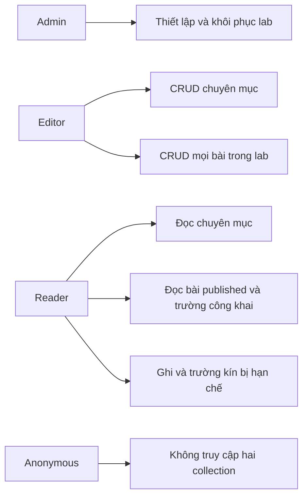
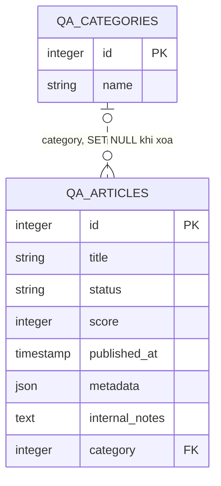
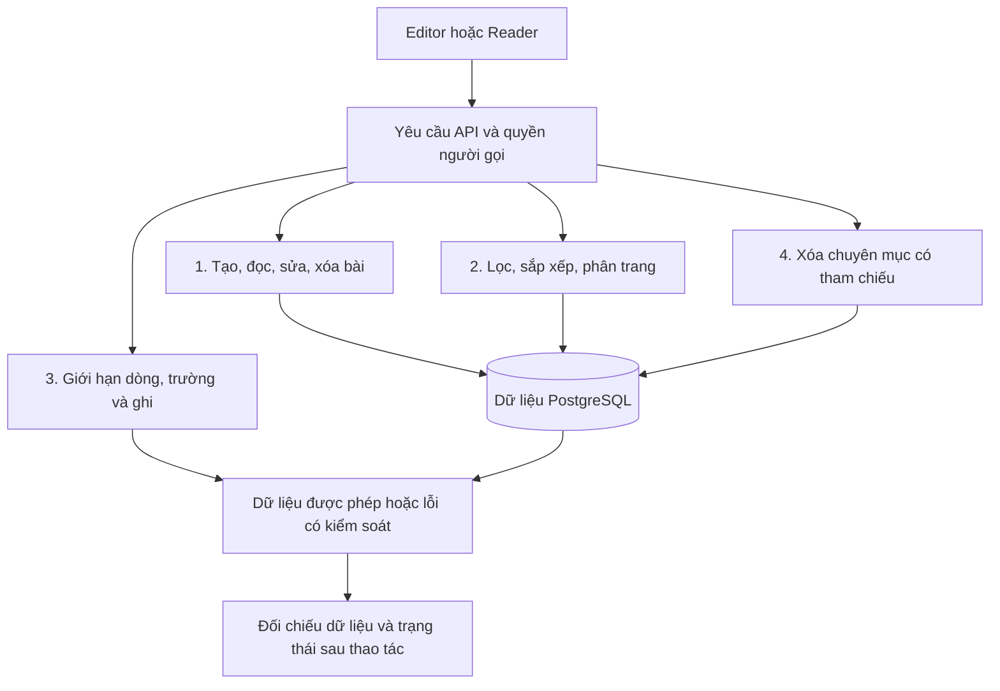
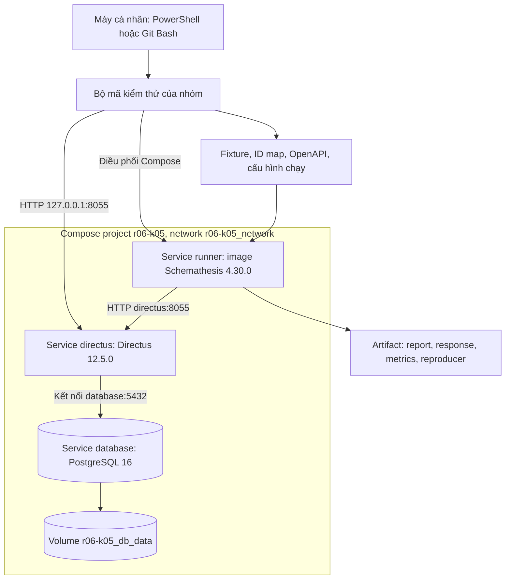
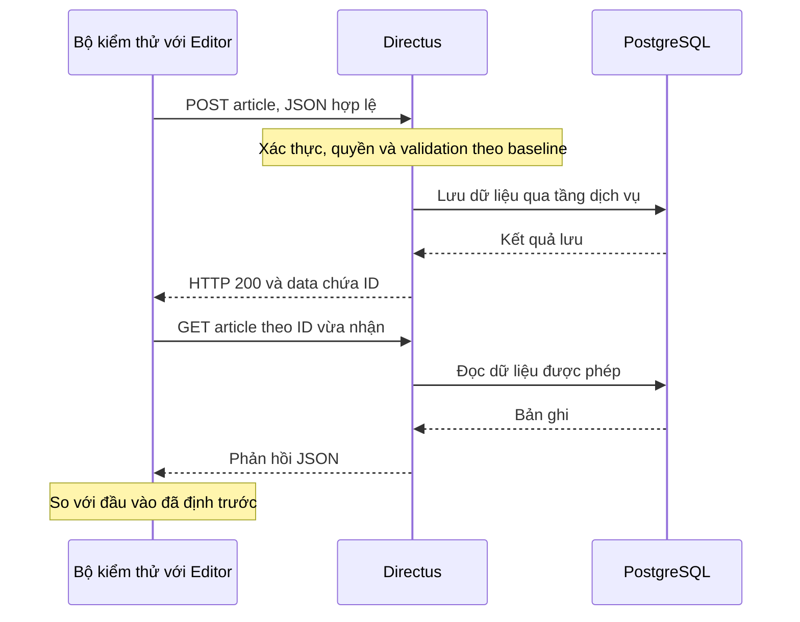
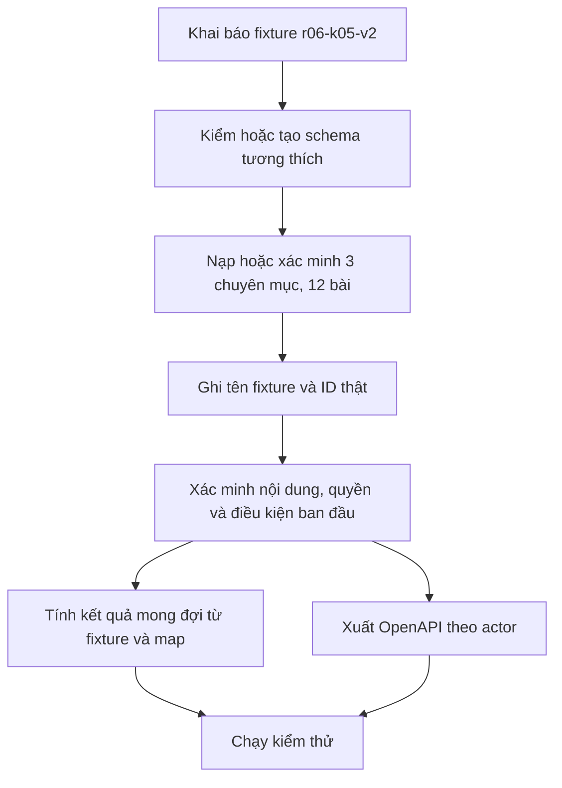
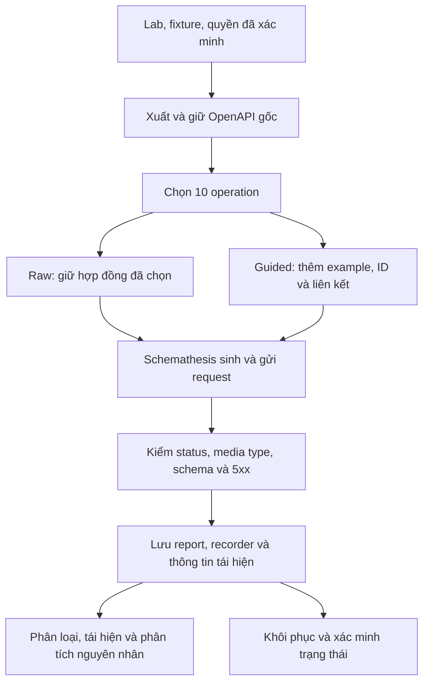
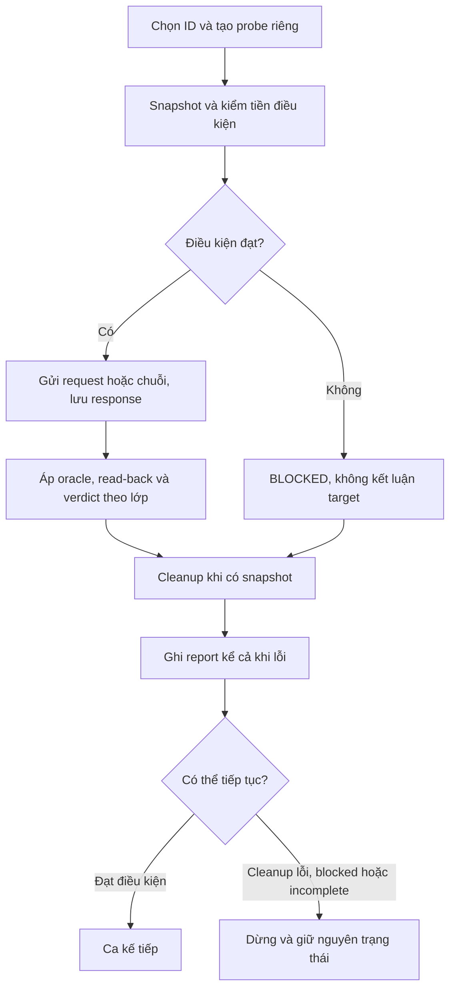
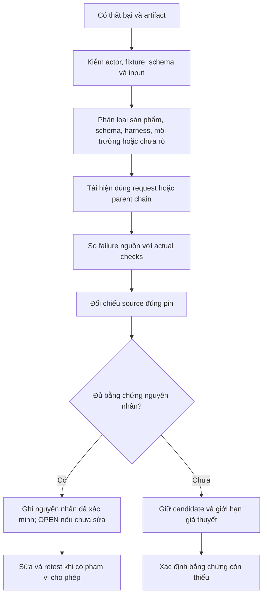
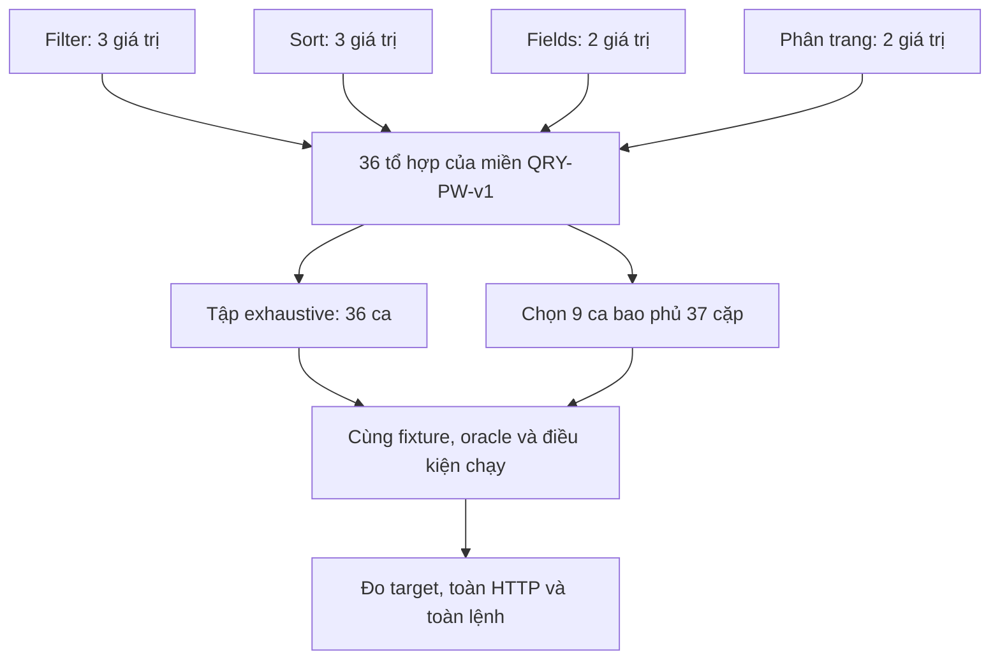

# BÁO CÁO CUỐI KỲ MÔN KIỂM THỬ PHẦN MỀM

## R06 DIRECTUS + K05 SCHEMA-BASED API TESTING/FUZZING

**Trường Đại học Đà Lạt — Khoa Công nghệ Thông tin**  
**Giảng viên:** Nguyễn Thế Lâm  
**Nhóm 11:** Đinh Thị Mai Lành, Trương Võ Trọng Nhân, Phan Thị Bảo Trâm  
**Ngày biên soạn:** 19/10/2026  
**Mốc bằng chứng nghiệm thu:** 18/10/2026

### Tóm tắt

Directus là phần mềm cung cấp dịch vụ phía máy chủ, trong đó có API tạo, đọc, cập nhật và xóa dữ liệu từ cơ sở dữ liệu SQL. Nhóm cấu hình một tình huống quản lý chuyên mục và bài viết, rồi kiểm thử API do Directus cung cấp. Nhóm không xây dựng lại phần mềm Directus.

Kỹ thuật chính là K05: kiểm thử API dựa trên đặc tả và sinh biến thể dữ liệu đầu vào. Công cụ Schemathesis đọc bản mô tả API theo chuẩn OpenAPI do Directus xuất ra, tạo yêu cầu và đối chiếu phản hồi với đặc tả. Nhóm bổ sung ca có chủ đích để kiểm tra dữ liệu, phân quyền và trạng thái sau thao tác, vì OpenAPI chưa mô tả đầy đủ các quy tắc này. Hợp đồng API trong báo cáo là mô tả đầu vào và đầu ra đã công bố đó.

Báo cáo trình bày sâu bộ 13 ca/kịch bản đại diện. Đối chiếu kết quả nguồn của bộ này ghi nhận **12 PASS, 1 FAIL về hợp đồng phản hồi**; đây là tổng hợp từ nhiều lượt đã lưu, không phải một lượt chạy mới cả 13 ca. Riêng bằng chứng K05 được trình bày qua các đợt Schemathesis và một ca do công cụ thực thi, có yêu cầu, phản hồi và kết quả tái hiện cụ thể. Cả 10 thao tác API chính đã có ca nghiệp vụ thành công, nhưng vẫn tồn tại sai lệch OpenAPI và phản hồi HTTP 500. Vì vậy, báo cáo không kết luận toàn bộ Directus đạt.

Thí nghiệm bổ trợ về chi phí so sánh 36 tổ hợp truy vấn với 9 ca bao phủ theo cặp. Trong mô hình đã chọn, số yêu cầu mục tiêu giảm 75%, tổng yêu cầu toàn lượt giảm 34,18% và thời gian toàn lệnh giảm trung vị 19,54%. Kết quả này chỉ áp dụng cho phép đo của nhóm; chưa chứng minh mức giảm tương tự về công lao động hoặc khả năng tìm lỗi.

### Mục lục

- [Mở đầu](#mo-dau)
- [A. Phân tích hệ thống Directus](#phan-a)
- [B. Kiến trúc hệ thống](#phan-b)
- [C. Thiết lập môi trường và vận hành](#phan-c)
- [D. Cơ sở lý thuyết và phương pháp K05](#phan-d)
- [E. Phân tích và thiết kế kiểm thử](#phan-e)
- [F. Triển khai kiểm thử tự động](#phan-f)
- [G. Kết quả kiểm thử và phân tích](#phan-g)
- [H. Cố định phiên bản và khả năng tái lập](#phan-h)
- [Kết luận](#ket-luan)
- [Tài liệu tham khảo](#tai-lieu-tham-khao)
- [Phụ lục](#phu-luc)

<a id="mo-dau"></a>
## MỞ ĐẦU

### Bối cảnh và lý do lựa chọn

Một API có thể trả mã thành công nhưng trả sai cấu trúc; cũng có thể từ chối đúng một yêu cầu không hợp lệ. Do đó, kiểm thử API cần xem đồng thời yêu cầu đầu vào, đặc tả, dữ liệu trả về và trạng thái hệ thống sau xử lý. Chỉ đếm số phản hồi thành công chưa đủ đánh giá chất lượng.

Directus phù hợp với đề tài vì API phụ thuộc vào mô hình dữ liệu và quyền được cấu hình. Cùng một đường dẫn, Editor và Reader có thể được phép nhận những dữ liệu khác nhau. Hệ thống cũng xuất OpenAPI để chương trình khác đọc được mô tả API. Điều này tạo điều kiện áp dụng K05 theo chuỗi: cấu hình hệ thống → xuất đặc tả → sinh ca kiểm thử → kiểm tra phản hồi → phân tích thất bại.

### Mục tiêu, phạm vi và phương pháp

Mục tiêu của nhóm là vận hành được một môi trường thử nghiệm xác định; mô tả nhu cầu người dùng và các quy tắc cần kiểm; tự động hóa kiểm thử từ OpenAPI; bổ sung căn cứ đánh giá nghiệp vụ; lưu thông tin tái hiện bất thường; và đo một cách giảm chi phí kiểm thử có thể giải thích bằng số liệu. Bộ dữ liệu mẫu có nội dung biết trước được gọi là fixture; việc nạp hoặc xác minh bộ mẫu được gọi là seed dữ liệu. C.3 trình bày nội dung và cách sử dụng bộ mẫu của nhóm.

Phạm vi gồm REST API của hai collection `qa_categories` và `qa_articles`. Collection là đơn vị tổ chức dữ liệu trong Directus; ở đây mỗi collection tương ứng một bảng PostgreSQL. Phạm vi chính có 10 cặp phương thức–đường dẫn: đọc danh sách, tạo, đọc chi tiết, cập nhật chi tiết và xóa chi tiết cho mỗi collection. Các ca quyền kiểm tra Editor, Reader và Anonymous; Admin phục vụ thiết lập và kiểm soát môi trường.

Nhóm dùng Docker để chạy Directus, PostgreSQL và môi trường kiểm thử; dùng Schemathesis cho K05; dùng Bash/Python để chuẩn bị, điều phối, kiểm tra nghiệp vụ và lưu bằng chứng. Phân vùng tương đương, giá trị biên và bảng quyết định hỗ trợ chọn ca đại diện. Pairwise, tức thiết kế tổ hợp bao phủ theo cặp, chỉ là thí nghiệm bổ trợ về chi phí, không thay đổi kỹ thuật đăng ký K05.

Các hoạt động nằm trong phạm vi môn Kiểm thử phần mềm: kiểm đúng chức năng, dữ liệu, phân quyền đã cấu hình và xử lý đầu vào bất thường trong lab. Báo cáo không mở rộng sang quét lỗ hổng, kiểm thử tải, tự động hóa giao diện, GraphQL, WebSocket hoặc API quản trị. CI/CD và điều tra mọi bất thường không phải phần triển khai bắt buộc của phạm vi đã rút gọn.

### Cơ sở trình bày và quy ước bằng chứng

Bố cục A–H tuân theo mục 3 của hướng dẫn môn học. K05 yêu cầu có kiểm thử chạy từ schema, thông tin tái hiện và thống kê lỗi; hướng dẫn không quy định một số ca cố định. Hồ sơ mở rộng 118/257 ca được giữ để truy vết, không trở thành yêu cầu phải trình bày từng ca trong thân báo cáo. Nguồn yêu cầu chính thức là [hướng dẫn của giảng viên](../yeu_cau.pdf), được ký hiệu [1] trong tài liệu tham khảo.

Thông tin trong báo cáo được phân biệt theo căn cứ:

- **Yêu cầu môn học:** lấy từ hướng dẫn của giảng viên.
- **Đặc tả lab:** lựa chọn và cấu hình của nhóm, bám Directus đã cố định phiên bản; không phải yêu cầu của khách hàng bên ngoài.
- **Kết quả thực thi:** có báo cáo hoặc phản hồi lưu tại lượt chạy được chỉ rõ.
- **Phân tích mã nguồn:** đọc đúng mã Directus tại commit đã cố định; không đồng nghĩa đã quan sát mọi nhánh khi chạy.
- **Giả thuyết:** giải thích còn thiếu bằng chứng, giữ trạng thái chưa kết luận.
- **Ví dụ thiết kế:** biểu diễn đầu vào để giải thích cách kiểm, không được tính thành yêu cầu đã thực thi.

Một ca kiểm thử, hay Test Case, gồm điều kiện ban đầu, đầu vào, bước thực hiện và kết quả mong đợi. Căn cứ đánh giá đúng/sai được gọi là oracle; kết quả cụ thể cần quan sát là expected result. Invariant là tính chất cần giữ đúng qua thao tác, còn assertion là câu kiểm điều kiện được viết trong mã. Các khái niệm này được áp dụng vào score, truy vấn và quyền ở D–F.

Các lệnh trong C, F và H là hướng dẫn vận hành. Khi biên soạn báo cáo này, nhóm chỉ sử dụng bằng chứng hiện có; không chạy lại API hoặc campaign, không sửa Directus, dữ liệu, cấu hình hay log gốc. Campaign là một đợt công cụ tự sinh và thực thi ca theo ngân sách, khác với một ca có đầu vào cố định.

<a id="phan-a"></a>
## PHẦN A — PHÂN TÍCH HỆ THỐNG DIRECTUS

### A.1. Giới thiệu Directus

Directus cung cấp lớp làm việc với dữ liệu SQL qua API, cùng xác thực người gọi, phân quyền và kiểm tra dữ liệu. Ví dụ, sau khi cấu hình collection `qa_articles`, chương trình có thể gửi `POST /items/qa_articles` để tạo bài hoặc `GET /items/qa_articles` để đọc danh sách. Phần mềm sử dụng mô hình dữ liệu và quyền hiện hành để xử lý yêu cầu; nhóm không viết một bộ controller riêng cho từng bảng lab.

API là giao diện trao đổi giữa các chương trình. Mỗi lần gọi gồm một yêu cầu HTTP, gọi là request, và một phản hồi, gọi là response. Yêu cầu có phương thức như GET/POST, đường dẫn, tham số và có thể có dữ liệu JSON. JSON là định dạng biểu diễn dữ liệu: một object chứa các cặp tên–giá trị trong dấu `{...}`, còn array chứa danh sách phần tử trong dấu `[...]`. Phản hồi có mã trạng thái như 200/400/403/500, kiểu nội dung và phần dữ liệu hoặc lỗi.

Directus là **hệ thống được kiểm thử**. Bộ mã nhóm viết là **hệ thống hỗ trợ kiểm thử**, dùng để dựng lab, chuẩn bị dữ liệu, gọi API và đánh giá kết quả. Sai sót trong bộ mã kiểm thử phải được phân biệt với sai sót của Directus. Phần giới thiệu và phân tích hành vi cụ thể dựa trên mã Directus tag `v12.5.0`, commit được ghi ở H và phụ lục.

### A.2. Chức năng, mục tiêu và đối tượng sử dụng

Trong tình huống lab, hệ thống phục vụ quản lý nội dung theo chuyên mục. Người quản lý cần tạo, sửa và xóa nội dung; người đọc chỉ được xem phần đã công khai. Mục tiêu là lưu đúng dữ liệu, truy xuất đúng điều kiện và thực hiện đúng quyền của từng người gọi.

**Bảng 1. Chức năng được sử dụng trong tình huống lab.**

| Chức năng | Nhu cầu quan sát được |
|---|---|
| Quản lý chuyên mục | Tạo, đọc lại, đổi tên và xóa chuyên mục |
| Quản lý bài viết | Tạo, đọc lại, sửa một phần và xóa bài |
| Truy vấn nội dung | Chọn trường, lọc trạng thái, sắp xếp và phân trang |
| Hạn chế truy cập | Reader đọc nội dung công khai, không nhận ghi chú nội bộ, không sửa dữ liệu |
| Mô tả API | Xuất OpenAPI theo người gọi để sinh kiểm thử |

Đây là nhu cầu được diễn giải từ cấu hình lab. Nhóm không tuyên bố đã phỏng vấn người dùng thực tế hoặc triển khai một hệ thống xuất bản hoàn chỉnh. Studio là giao diện quản trị có trong Directus, nhưng giao diện này không nằm trong phạm vi kiểm thử tự động của đề tài.

### A.3. Vai trò người dùng và quyền truy cập

Vai trò gửi yêu cầu được gọi là actor. Xác thực trả lời câu hỏi người gọi là ai; phân quyền trả lời người đó được làm gì, với bản ghi nào và trường nào. Một tài khoản đăng nhập được chưa chắc được đọc mọi bài viết.

**Bảng 2. Chính sách quyền mục tiêu của lab.**

| Actor | Chuyên mục | Bài viết | Mục đích |
|---|---|---|---|
| Admin | Thiết lập và kiểm soát | Thiết lập và kiểm soát | Chuẩn bị dữ liệu, quyền, kiểm trạng thái, khôi phục |
| Editor | Tạo/đọc/sửa/xóa | Tạo/đọc/sửa/xóa, gồm nháp | Actor chính cho ca nghiệp vụ và sinh test |
| Reader | Đọc | Đọc bài `published`, không nhận `internal_notes`; không ghi | Kiểm giới hạn theo dòng và theo trường |
| Anonymous | Không truy cập | Không truy cập | Kiểm yêu cầu không có thông tin đăng nhập |

**Hình 1. Vai trò và phạm vi quyền trong lab — sơ đồ chính sách, không phải số đo coverage.**



Nguồn: cấu hình `ensure_permissions_and_users` trong [mã chuẩn bị lab](../../scripts/lab-components.sh) và [đặc tả quyền](01-yeu-cau-va-dac-ta.md). Mũi tên thể hiện phạm vi chính sách. Việc chính sách tồn tại phải được kiểm qua API; không thể chỉ nhìn sơ đồ rồi kết luận kiểm thử đạt.

Reader bị hạn chế ở hai lớp khác nhau: dòng có `status=draft` không được đọc; trường `internal_notes` không được công bố ngay cả trên bài đã xuất bản. Vì vậy, E tách hai ca kiểm này để tránh một nguyên nhân từ chối che khuất nguyên nhân còn lại.

### A.4. Phạm vi chức năng được lựa chọn kiểm thử

Một operation là cặp phương thức HTTP và đường dẫn. GET danh sách và POST tạo dữ liệu dùng cùng đường dẫn nhưng là hai operation khác nhau.

**Bảng 3. Mười operation trong phạm vi chính.**

| Công việc | `qa_categories` | `qa_articles` |
|---|---|---|
| Đọc danh sách | `GET /items/qa_categories` | `GET /items/qa_articles` |
| Tạo dữ liệu | `POST /items/qa_categories` | `POST /items/qa_articles` |
| Đọc chi tiết | `GET /items/qa_categories/{id}` | `GET /items/qa_articles/{id}` |
| Sửa chi tiết | `PATCH /items/qa_categories/{id}` | `PATCH /items/qa_articles/{id}` |
| Xóa chi tiết | `DELETE /items/qa_categories/{id}` | `DELETE /items/qa_articles/{id}` |

`{id}` được thay bằng ID từ phản hồi tạo hoặc bảng ánh xạ fixture. POST trong schema chấp nhận cả một đối tượng và mảng đối tượng; các ca nghiệp vụ đại diện chủ yếu dùng một đối tượng. Không tự loại dạng mảng ra khỏi phân tích hợp đồng. Bulk PATCH/DELETE không thuộc campaign chính.

Các tham số trọng tâm là `fields`, `filter`, `sort`, `limit`, `offset`, `page`, `search`. Chọn một phần trường trả về bằng `fields` được gọi là projection; ví dụ chỉ lấy `id,title`. Aggregate là phép truy vấn tổng hợp; nhóm giữ một phép thăm dò đầu vào aggregate bất thường đã có bằng chứng, không mở thêm phân hệ nghiệp vụ. Đăng nhập, kiểm tra dịch vụ hoạt động (health check) và xuất OpenAPI là bước hỗ trợ, không được cộng thành operation thứ 11 trở đi trong phạm vi K05.

### A.5. Cấu trúc mã nguồn, module và thư viện phụ thuộc

Directus tổ chức nhiều gói trong cùng kho mã nguồn. Phần máy chủ dùng Node.js/TypeScript. Express cung cấp cơ chế HTTP; Knex hỗ trợ tạo truy vấn SQL; trình kết nối `pg` trao đổi với PostgreSQL; Joi và các gói Directus tham gia kiểm tra dữ liệu. Những thành phần này là nền tảng của hệ thống được kiểm thử, không phải thư viện do nhóm tự phát triển.

**Bảng 4. Những vùng mã nguồn cần cho phân tích đề tài.**

| Công việc thực tế | Vị trí tiêu biểu | Liên hệ kiểm thử |
|---|---|---|
| Nhận và phân tuyến yêu cầu dữ liệu | `api/src/controllers/items.ts` | CRUD, phân biệt POST object/array |
| Xác định ngữ cảnh, chuẩn hóa truy vấn, trả phản hồi | `api/src/middleware/`, `api/src/utils/` | Quyền, query, mã lỗi và kiểu nội dung |
| Đọc/ghi dữ liệu và sinh đặc tả | `api/src/services/` | Read-back, quan hệ, so đặc tả với runtime |
| Áp quyền thao tác, dòng và trường | `api/src/permissions/` | Reader không đọc nháp hoặc trường kín |
| Chuyển mô hình truy vấn sang xử lý cơ sở dữ liệu | `api/src/database/` | Sắp xếp, quan hệ, aggregate |
| Chứa mô tả API dùng chung | `packages/specs/` | Mã trạng thái và tham số được công bố |

Studio trong `app/` dùng Vue; SDK hỗ trợ ứng dụng gọi Directus. Nhóm không đo chất lượng hai phần này. Đối chiếu thư viện và mã tại đúng pin giúp giải thích nguyên nhân thất bại, nhưng không thay thế bằng chứng chạy.

Bộ mã của nhóm nằm trong kho `DAMH`: `lab.sh` là đầu vào lệnh; `scripts/` chuẩn bị và chạy kiểm; `scripts/data/` giữ fixture/oracle/danh mục; `tests/` kiểm tra logic bộ mã; `artifacts/runs/` giữ kết quả; `docs/` giữ báo cáo. Directus và bộ mã kiểm thử được quản lý riêng để tránh nhầm thay đổi công cụ với thay đổi sản phẩm.

### A.6. Mô hình dữ liệu và quy tắc nghiệp vụ

**Bảng 5. Trường dữ liệu và quy tắc baseline.**

| Collection, trường | Ý nghĩa | Quy tắc đã cấu hình |
|---|---|---|
| Category: `id` | Mã chuyên mục | Số nguyên tự tăng, khóa chính |
| Category: `name` | Tên chuyên mục | Không null; tối đa 80 ký tự lưu trữ |
| Article: `id` | Mã bài viết | Số nguyên tự tăng, khóa chính |
| Article: `title` | Tiêu đề | Không null; tối đa 120 ký tự lưu trữ |
| Article: `status` | Trạng thái công bố | `draft` hoặc `published`; mặc định `draft` |
| Article: `score` | Điểm dùng kiểm quy tắc số | Số nguyên không null; từ 0 đến 5 |
| Article: `published_at` | Thời điểm xuất bản | Timestamp, được null |
| Article: `metadata` | Dữ liệu bổ sung | JSON, được null |
| Article: `internal_notes` | Ghi chú nội bộ | Text, được null; Reader không đọc |
| Article: `category` | Chuyên mục của bài | ID chuyên mục hoặc null |

Nguồn: hàm `ensure_schema` và `ensure_relation` trong [mã chuẩn bị lab](../../scripts/lab-components.sh). Dấu “không null” chưa tự tạo ra quy tắc cấm chuỗi rỗng, khoảng trắng hoặc mọi dạng ép kiểu. `metadata` không bị đặc tả thành chỉ được chứa object. Nhóm cũng không thêm quy tắc bài `published` bắt buộc có `published_at` khi baseline chưa thiết lập điều đó.

**Hình 2. ERD hai collection — mô hình dữ liệu lab thực tế.**



Mỗi bài có thể không có hoặc có một chuyên mục; một chuyên mục có thể có nhiều bài. Xóa chuyên mục đặt `category` của bài tham chiếu về null, không xóa bài. Quan hệ đảo `articles` là trường quan hệ phía Directus, không được vẽ thành cột dữ liệu riêng trong bảng category. Đường nét đứt biểu thị quan hệ không dùng để định danh bài: bài có khóa chính riêng. Nguồn: cấu hình quan hệ `on_delete=SET NULL`, mô tả fixture và mã seed; ký hiệu theo [cú pháp ERD chính thức của Mermaid](https://mermaid.js.org/syntax/entityRelationshipDiagram.html).

PATCH là cập nhật một phần: sửa `score` không được làm thay đổi các trường nghiệp vụ khác đã xác định. Sau DELETE, cần kiểm bản ghi không còn truy cập theo ngữ nghĩa baseline; không áp đặt mọi hệ thống đều phải trả 404. Với bản đã pin, các ca hiện có kiểm 403/FORBIDDEN khi đọc một item không còn khả dụng.

### A.7. Bốn luồng nghiệp vụ trọng tâm

**Luồng 1 — Quản lý vòng đời bài viết.** Editor gửi JSON hợp lệ; Directus kiểm quyền và dữ liệu, lưu bài rồi trả ID. Chương trình dùng ID đó đọc lại, sửa riêng điểm, đọc lại các trường, xóa bài và kiểm bản ghi không còn khả dụng. Đầu vào và ID cần liên kết xuyên suốt; không thể reset DB giữa chuỗi rồi vẫn coi là một luồng đúng.

**Luồng 2 — Tìm nội dung và phân trang.** Editor gửi bộ lọc `published` hoặc sắp xếp `title,id` với `limit/offset`. Directus áp truy vấn và trả một phần danh sách. Bộ kiểm đối chiếu tập bài, thứ tự và lát cắt với dữ liệu biết trước. ID làm khóa phụ giúp thứ tự ổn định khi giá trị sắp xếp chính bằng nhau.

**Luồng 3 — Đọc và sửa nội dung theo quyền.** Reader được đọc bài công khai bằng các trường công khai. Khi đọc bài nháp hoặc yêu cầu ghi chú nội bộ, API phải giữ giới hạn quyền. Khi Reader thử sửa điểm, Editor đọc lại để xác nhận dữ liệu không đổi. Một phản hồi từ chối chỉ có ý nghĩa nếu tài khoản, bài mục tiêu và yêu cầu kiểm chứng hợp lệ đều đúng.

**Luồng 4 — Xóa dữ liệu có tham chiếu.** Editor tạo chuyên mục và bài tạm có liên kết, rồi xóa chuyên mục. Bài vẫn tồn tại, `category` trở thành null. Luồng này kiểm tương tác giữa API và quan hệ dữ liệu; có trong hồ sơ mở rộng, không cộng thêm vào bộ 13 đại diện.

**Hình 3. Đường đi dữ liệu của các luồng nghiệp vụ — mô tả ở mức chức năng.**



Nguồn: scenario S1–S6 và invariant quan hệ. Sơ đồ không biểu diễn thứ tự gọi hàm nội bộ Directus; các bước kiểm cụ thể và bằng chứng tương ứng nằm ở E và G.

<a id="phan-b"></a>
## PHẦN B — KIẾN TRÚC HỆ THỐNG

### B.1. Kiến trúc tổng thể của môi trường thử nghiệm

Docker image là bản đóng gói phần mềm và thư viện dùng để tạo môi trường chạy. Container là một phiên bản đang chạy hoặc đã dừng của image. Docker Compose là cách khai báo và điều phối nhiều dịch vụ; Compose project là nhóm tài nguyên mang cùng tên dự án. Volume là vùng lưu dữ liệu bền vững, có thể còn tồn tại khi container được tạo lại.

Trong lab, Compose project có tên `r06-k05`, dùng mạng `r06-k05_network`. PostgreSQL lưu dữ liệu vào volume `r06-k05_db_data`. Phiên bản fixture không phải image, và dữ liệu fixture cũng không phải chính volume; fixture là nội dung mẫu được đưa vào cơ sở dữ liệu trong volume.

**Hình 4. Kiến trúc triển khai theo `compose.yaml` và cách bộ mã sử dụng runner.**



Nguồn: [Compose](../../compose.yaml), [file cấu hình mẫu](../../config/lab.env.example) và `python_suite`/campaign trong mã điều phối. Đây là sơ đồ ba service đã khai báo. Một số tác vụ Python chạy bằng container dùng một lần từ cùng image runner; chúng không phải một service máy chủ thứ tư.

### B.2. Các thành phần Docker Compose và vai trò

**Bảng 6. Thành phần triển khai và trách nhiệm.**

| Thành phần | Công việc | Điều cần phân biệt |
|---|---|---|
| `database` | Lưu bảng, quan hệ và dữ liệu PostgreSQL | Không công bố cổng DB ra host |
| `directus` | Cung cấp API, xác thực, phân quyền, kiểm dữ liệu | Là đối tượng kiểm thử; chỉ bind API vào loopback host |
| `runner` | Cung cấp Schemathesis/Python và thư viện đúng phiên bản | Là môi trường thực thi, không phải backend |
| Bộ mã trên host | Chuẩn bị, chọn ca, khởi chạy, lưu metadata và khôi phục | Không đồng nhất với Schemathesis |
| Volume DB | Giữ dữ liệu qua việc tạo lại container | Không tự đưa DB về fixture ban đầu |
| Thư mục artifact | Giữ đầu vào và kết quả từng lượt | Là bằng chứng, không phải dữ liệu nguồn cần ghi đè |

Compose có health check: PostgreSQL dùng `pg_isready`; Directus kiểm `/server/ping`; runner kiểm phiên bản Schemathesis. `depends_on` giúp chờ dịch vụ đủ điều kiện trước khi khởi động thành phần phụ thuộc. Tuy vậy, health check thành công chưa chứng minh fixture, quyền và mọi API nghiệp vụ đều đúng; các bước đó cần kiểm riêng.

### B.3. Các module Directus liên quan trực tiếp

Năm nhóm xử lý giúp nối kiến trúc với phép kiểm. Nhóm tiếp nhận REST chọn thao tác trên item và dạng object/array. Nhóm ngữ cảnh HTTP, quyền và truy vấn chuẩn bị điều kiện xử lý. Dịch vụ item thực hiện đọc/ghi dữ liệu. Tầng cơ sở dữ liệu tạo và chạy truy vấn. Nhóm sinh đặc tả và phản hồi quy định điều được công bố và điều thực tế trả về.

Các nhóm trên có tương tác, không phải năm container độc lập. Ví dụ, sai lệch POST ở G.6 xuất hiện vì controller có hai nhánh theo dạng body, trong khi bộ sinh OpenAPI chọn dạng response theo thuộc tính collection. Do đó, phân tích lỗi cần đối chiếu hai module chứ không chỉ xem tên phép kiểm thất bại.

### B.4. Luồng xử lý một HTTP request

Ở mức quan sát được, một yêu cầu đến Directus phải được xác định người gọi, áp quyền và quy tắc liên quan, rồi đọc/ghi dữ liệu nếu hợp lệ. Phản hồi được gửi về cho chương trình kiểm thử. Việc một request bị chặn trước truy vấn dữ liệu phụ thuộc loại yêu cầu; báo cáo không khẳng định một thứ tự hàm nội bộ duy nhất cho mọi operation.

**Hình 5. Sequence của một POST hợp lệ và bước đọc lại — mức giao tiếp đã kiểm chứng.**



Nguồn: chuỗi S1 và nhánh POST trong `items.ts` đúng pin. Hình chỉ mô tả trao đổi giữa các thành phần; không tự thêm tên hoặc thứ tự gọi hàm nội bộ. Mã 200 là quan sát của baseline cho POST này, không phải quy tắc mọi API phải dùng 200 thay 201.

### B.5. Luồng tương tác giữa công cụ kiểm thử và Directus

Bộ mã nhóm đăng nhập actor cần dùng, xác minh fixture và lấy OpenAPI. Schemathesis nhận bản đặc tả đã giới hạn 10 operation, cùng token hiện tại của Editor, để sinh và gửi request từ runner tới Directus. Công cụ ghi kết quả kiểm phản hồi; bộ mã nhóm bổ sung nhận diện lượt chạy, dữ liệu đầu vào, thống kê và bước khôi phục.

Đối với ca có chủ đích, Python hoặc Bash gửi đầu vào đã thiết kế và kiểm dữ liệu đọc lại. Những ca này không được gọi là tất cả đều do Schemathesis sinh. Khi cần kiểm hợp đồng cho một phản hồi đã nhận, module kiểm hợp đồng sử dụng các phép kiểm Schemathesis trên phản hồi đó, không gửi thêm request chỉ để xác nhận cấu trúc.

### B.6. Quan hệ giữa kiến trúc và rủi ro cần kiểm thử

**Bảng 7. Rủi ro kiến trúc và cách kiểm tương ứng.**

| Rủi ro | Vì sao có thể xảy ra | Cách kiểm trong đề tài |
|---|---|---|
| Schema thiếu hoặc sai với runtime | Đặc tả và xử lý item được sinh theo logic khác nhau | So status, content type, response schema |
| Quyền dòng che khuất quyền trường | Reader bị chặn trước khi quan sát trường kín | Dùng bài published cho S5, trường công khai cho S4 |
| Dữ liệu sau chạy làm lệch ca sau | Volume giữ dữ liệu, ca tạo/sửa/xóa có tác động | Snapshot, cleanup, restore; chạy tuần tự |
| Expected phụ thuộc actual | Lấy danh sách vừa nhận làm chuẩn sẽ che lỗi query | Fixture biết trước, ID map và đối chiếu SQL cho thứ tự |
| Khác môi trường làm lệch kết quả | Image, schema, collation hoặc quyền khác | Lưu phiên bản, digest, schema hash và cấu hình |
| API trả 500 với query bất thường | Chuỗi xử lý có nhiều nơi dùng cấu trúc query | Invariant không 5xx và control cùng điều kiện |

Các rủi ro này dẫn tới thiết kế ở E. Chúng là lý do chọn phép kiểm, không tự chứng minh đã có lỗi trong mọi thành phần.

<a id="phan-c"></a>
## PHẦN C — THIẾT LẬP MÔI TRƯỜNG VÀ VẬN HÀNH

### C.1. Yêu cầu phần cứng, phần mềm và phiên bản

Môi trường cần chạy được Docker với các Linux image đã cố định, Docker Compose, PowerShell/Git Bash trên Windows hoặc Bash tương thích. CPU, RAM và dung lượng đĩa của máy dùng để đo chưa được lưu đầy đủ trong bộ bằng chứng chọn lọc. Vì vậy, báo cáo không tự đưa một cấu hình phần cứng thành “mức tối thiểu đã kiểm chứng”.

**Bảng 8. Phiên bản và điều kiện phần mềm.**

| Thành phần | Giá trị có căn cứ | Giới hạn diễn giải |
|---|---|---|
| Directus | 12.5.0, tag `v12.5.0` | Dùng image dựng sẵn, digest ở phụ lục |
| PostgreSQL | Nhánh 16; oracle nghiệm thu ghi 16.15 | Collation `en_US.utf8` cần cho sort |
| Schemathesis | 4.30.0 trong image pin | Không thay bằng bản mới để né failure |
| Dependency runner nghiệm thu | Python 3.14.3, Hypothesis 6.168.5, jsonschema_rs 0.58.6 | Theo metadata 18/10, không phải Python host |
| jq trên Windows | 1.8.2, chuẩn bị bằng script có kiểm hash | Dùng xử lý JSON cho Bash |
| Node/pnpm cho mã Directus | Node 22, `pnpm@10.27.0` theo manifest | Đường build source chưa nghiệm thu; không bắt buộc trên host khi chạy Docker |

Manifest ngày 11/10 còn ghi Docker Server 29.8.1, Compose v5.5.1 và môi trường `linux/amd64`. Đó là thông tin lịch sử của đợt khảo sát, không phải bằng chứng máy Windows ngày 18/10 có cùng phiên bản. Khi tái lập, cần lấy phiên bản thực tế của máy mới và lưu cùng lượt chạy.

### C.2. Cấu hình môi trường và Docker Compose

Cấu hình mẫu ở `config/lab.env.example`; giá trị thật được điền trong `config/lab.env` cục bộ. Các nhóm biến gồm image/digest, thông tin DB, khóa và tài khoản thiết lập Directus, tài khoản Editor/Reader, phiên bản fixture và ngân sách sinh test. Không đưa mật khẩu, token hoặc license thật vào báo cáo hay gói chia sẻ.

API trên host là `http://127.0.0.1:8055`; trong runner là `http://directus:8055`. Directus kết nối PostgreSQL qua tên service `database`, cổng 5432. Baseline tắt cache ứng dụng, telemetry và rate limiter phía máy chủ; token có thời hạn 2 giờ. Giới hạn một worker, khoảng 5 request/giây và timeout 10 giây nằm ở phía chạy kiểm thử. Việc tắt rate limiter phía máy chủ không có nghĩa bỏ giới hạn nhịp gửi của runner.

Runtime profile giúp tách file map/schema/cấu hình chạy theo mốc. Các profile vẫn dùng cùng Compose project và DB; chúng không tạo nhiều lab độc lập. Vì vậy, không chạy song song các suite ghi/xóa trên hai profile rồi coi dữ liệu đã được cách ly.

### C.3. Dữ liệu kiểm thử fixture `r06-k05-v2`

Để biết API trả đúng hay sai, nhóm cần dữ liệu mẫu có nội dung xác định trước. Bộ dữ liệu này gọi là **fixture**, phiên bản `r06-k05-v2`. Seed dữ liệu là bước nạp hoặc xác minh fixture trong lab. Khác với seed dữ liệu, random seed 101/202/303 là số khởi đầu của bộ sinh giả ngẫu nhiên trong Schemathesis.

Fixture không chứa phần mềm như Docker image. Fixture cũng không phải vùng lưu trữ như Docker volume. Image tạo container chạy phần mềm; volume giữ DB; fixture quy định các bản ghi mẫu cần có trong DB. Đổi container chưa chắc đổi dữ liệu, và giữ đúng image chưa bảo đảm DB đang ở đúng fixture.

Fixture gồm ba chuyên mục: “Danh mục Alpha — Unicode”, “Danh mục Beta / Kiểm thử”, “Danh mục Gamma”. Mỗi chuyên mục có hai bài nháp và hai bài published, tổng cộng 12 bài. Các trường thời điểm, JSON, Unicode và ghi chú kín giúp kiểm nhiều dạng dữ liệu, thay vì chỉ tạo 12 bản ghi giống nhau.

**Bảng 9. Nội dung bài viết đã định trước trong fixture.**

| Chuyên mục / bài | Tiêu đề | Trạng thái / score |
|---|---|---|
| Alpha 01 | Alpha 01 — bản nháp | draft / 1 |
| Alpha 02 | Alpha 02 — bản nháp có Unicode | draft / 2 |
| Alpha 03 | Alpha 03 — đã xuất bản | published / 4 |
| Alpha 04 | Alpha 04 — xuất bản nullable metadata | published / 5 |
| Beta 01 | Beta 01 — bản nháp | draft / 0 |
| Beta 02 | Beta 02 — bản nháp & rỗng thời điểm | draft / 3 |
| Beta 03 | Beta 03 — đã xuất bản | published / 3 |
| Beta 04 | Beta 04 — publication spéciale | published / 4 |
| Gamma 01 | Gamma 01 — bản nháp | draft / 2 |
| Gamma 02 | Gamma 02 — bản nháp Unicode 漢字 | draft / 5 |
| Gamma 03 | Gamma 03 — đã xuất bản | published / 1 |
| Gamma 04 | Gamma 04 — đã xuất bản cuối | published / 5 |

Nguồn: [fixture oracle](../../scripts/data/fixture-oracle.json) và hàm khai báo dữ liệu seed. Ví dụ metadata của bài Alpha nháp đầu có `fixture_key=article_alpha_draft_1`, `fixture_version=r06-k05-v2`, `locale=vi`. Các giá trị này là dữ liệu thử, không phải thông tin cá nhân thực.

Hệ thống tự tăng ID nên không yêu cầu ID luôn liên tục hoặc giống trên mọi máy. Bảng ánh xạ ID, tức fixture map, nối tên logic như `article_alpha_published_1` tới ID số thật. Seed ghi map sau khi xác minh dữ liệu; ca kiểm dùng map hiện hành hoặc ID từ phản hồi tạo. Số `category=1` trong một request lịch sử chỉ là ID của lượt đó, không phải hằng số cho lần chạy mới.

**Hình 6. Chuẩn bị fixture và căn cứ expected — quy trình của bộ mã lab.**



Nguồn: các hàm seed/map trong `lab-components.sh` và `fixture-oracle.json`. Khi schema hiện có không tương thích, quy trình phải báo lỗi thay vì âm thầm migration. Chạy seed lặp lại không được nhân bản bộ mẫu.

Từ bảng 9, bộ lọc `published` phải trả đúng sáu bài Alpha 03/04, Beta 03/04, Gamma 03/04. Expected là tập ID của sáu tên logic này trong map. Với `sort=title,id`, hai trang có `limit=3`, offset 0 và 3 được tính từ thứ tự fixture và xác minh bằng oracle DB về collation. Không lấy danh sách API mục tiêu vừa trả làm expected cho chính API đó.

### C.4. Cấu hình tài khoản và phân quyền

Bước seed tạo hoặc xác minh tài khoản Editor/Reader và policy tương ứng. Editor được CRUD hai collection với toàn bộ trường lab. Reader được đọc category; với article chỉ đọc dòng `status=published` và các trường `id,title,status,score,published_at,metadata,category`.

Quyền update article của Reader có danh sách trường được sửa rỗng. Vì vậy operation PATCH có thể xuất hiện trong OpenAPI Reader, nhưng việc sửa `score` vẫn bị cấm. Không suy “có operation trong schema” thành “được sửa mọi trường”. Ngược lại, operation vắng trong schema cũng chưa phải bằng chứng đã thử quyền qua HTTP.

Baseline sử dụng điều kiện license hợp lệ để thiết lập custom permission rules. Bằng chứng 18/10 ghi nhận điều kiện đó hoạt động; máy mới cần cấu hình hợp lệ tương ứng. Nhóm không bỏ qua hoặc vô hiệu hóa điều kiện này để tạo một kết quả quyền khác baseline.

### C.5. Khởi động, chuẩn bị dữ liệu và xuất OpenAPI

Các lệnh dưới chạy từ thư mục `DAMH`, dùng launcher có sẵn. Đây là hướng dẫn thực hiện lại, không phải log của lần biên soạn báo cáo. Trên máy mới, chuẩn bị Docker Desktop và Git Bash; chỉ tạo file cấu hình thật nếu chưa có, rồi điền giá trị cục bộ theo mẫu.

```powershell
# Chỉ khi máy chưa có bộ công cụ jq của dự án:
.\scripts\setup-windows.ps1

# Sau khi cấu hình config/lab.env hợp lệ:
.\scripts\run-lab.ps1 up
.\scripts\run-lab.ps1 doctor
.\scripts\run-lab.ps1 seed
.\scripts\run-lab.ps1 export-schema
```

`up` khởi động đúng project; `doctor` kiểm môi trường, image và dịch vụ; `seed` chuẩn bị schema/dữ liệu/quyền/map; `export-schema` gọi `GET /server/specs/oas` theo actor và lưu bản đặc tả. Mỗi bước cần được đọc trạng thái trước khi bước sau tiếp tục. Trên Git Bash/Linux dùng `./lab.sh` với cùng đối số.

OpenAPI được xuất sau seed để phản ánh hai collection và quyền hiện hành. Snapshot là bản lưu tại một thời điểm, dùng để biết kiểm thử dựa vào đặc tả nào. Editor và Reader có snapshot khác nhau; không thay bằng schema Admin chỉ vì nó có nhiều operation hơn.

### C.6. Bằng chứng hệ thống chạy thành công

**Bảng 10. Bằng chứng chuẩn bị và vận hành đã có ngày 18/10.**

| Nội dung | Run ID | Điều được chứng minh |
|---|---|---|
| Kiểm môi trường | `20261018T102730Z-1869` | Doctor đạt, exit 0 tại thời điểm chạy |
| Chuẩn bị dữ liệu | `20261018T102856Z-1123` | Seed hoàn tất trước nghiệm thu |
| Xuất OpenAPI | `20261018T102912Z-1456` | Có đặc tả theo actor làm đầu vào |
| Kịch bản nghiệp vụ | `p8-20261018-scenarios` | S1–S6 đều PASS |
| Kiểm nhanh hệ thống | `p8-20261018-smoke` | Smoke PASS theo run index |

Nguồn: [báo cáo nghiệm thu](08-bao-cao-nghiem-thu.md), [run index](tai-lieu-bo-tro/phase8-20261018/run-index.json) và thư mục `artifacts/runs/` theo ID. Các kết quả này chứng minh hệ thống đã hoạt động ở mốc kiểm. Chúng không khẳng định container đang healthy vào mọi thời điểm sau đó.

### C.7. Minh chứng ba luồng nghiệp vụ thực tế

Trong `p8-20261018-scenarios`, S1 ghi nhận create/read/PATCH/delete; DELETE trả 204, bản ghi tạm được dọn. S2 ghi đúng sáu ID published `[3,4,7,8,11,12]` theo map lịch sử của lượt này. S3 đối chiếu hai trang với thứ tự fixture và DB độc lập, đạt.

Luồng quyền được minh chứng thêm bằng S4–S6: Reader đọc nháp bị 403 với các control hợp lệ; yêu cầu trường kín trên bài published bị 403; PATCH bị 403 và Editor đọc lại thấy dữ liệu mục tiêu không đổi. Kết quả nằm trong [scenario report](../../artifacts/runs/p8-20261018-scenarios/scenario-report.json). Các phép thử quyền này không dùng mục tiêu ngoài lab.

Các minh chứng đáp ứng yêu cầu có ít nhất ba luồng chạy thực tế. Báo cáo vẫn phân tích thiết kế và giới hạn từng phép kiểm ở E/G; không dùng dòng “scenario PASS” để suy mọi biến thể của luồng đều đã đạt.

<a id="phan-d"></a>
## PHẦN D — CƠ SỞ LÝ THUYẾT VÀ PHƯƠNG PHÁP K05

### D.1. Tổng quan kiểm thử API

Kiểm thử API đối chiếu hành vi quan sát được của hệ thống với yêu cầu đã xác định. Một ca kiểm cần biết điều kiện ban đầu, người gọi, đầu vào, các bước, kết quả mong đợi và trạng thái cần giữ sau thao tác. Với API lưu dữ liệu, chỉ kiểm response chưa đủ: tạo thành công cần đọc lại; bị cấm sửa cần xác minh dữ liệu không đổi.

CRUD là bốn nhóm tạo, đọc, cập nhật và xóa. HTTP 2xx thường biểu thị xử lý thành công, 4xx là lỗi yêu cầu hoặc quyền và 5xx là lỗi phía máy chủ. Tuy nhiên, PASS/FAIL là kết luận của phép kiểm. Một ca cố tình gửi điểm 6 có thể PASS khi API trả 400 đúng validation; ca POST hợp lệ có thể FAIL hợp đồng dù trả 200.

### D.2. Đặc tả OpenAPI và schema

OpenAPI là cách mô tả HTTP API để con người và công cụ cùng đọc được. Tài liệu nêu đường dẫn, phương thức, tham số, dữ liệu gửi và phản hồi. Schema là phần mô tả cấu trúc dữ liệu: object hay array, kiểu trường, thuộc tính bắt buộc và các giới hạn được khai báo. Nguồn tiêu chuẩn sử dụng ở đây là [OpenAPI Specification 3.0.1](https://spec.openapis.org/oas/v3.0.1).

Snapshot Directus dùng `openapi=3.0.1`. Trường `info.version` trong bản xuất là giá trị nhận diện động, không phải phiên bản sản phẩm Directus. Phiên bản phần mềm phải lấy từ image/runtime/source pin.

Ví dụ thực tế, schema của `score` trong component article chỉ nêu:

```json
{"nullable": false, "type": "integer"}
```

Nguồn: [snapshot Editor dùng trong scenario nghiệm thu](../../artifacts/runs/p8-20261018-scenarios/input-schema-editor.json), `components.schemas.ItemsQaArticles.properties.score`. Cấu hình lab lại giới hạn 0–5. Do thiếu `minimum`/`maximum` trong phần schema này, số nguyên 6 có thể phù hợp mô tả kiểu nhưng trái quy tắc lab. Vì vậy, cần ca biên riêng có expected từ validation đã cấu hình.

### D.3. Schema-Based API Testing

Kiểm thử dựa trên schema dùng đặc tả làm đầu vào cho hai việc: sinh request và đánh giá response. Công cụ chọn operation, tạo giá trị phù hợp hoặc cố tình vi phạm schema, gửi yêu cầu và kiểm kết quả bằng các quy tắc đã chọn. Cách này giảm công viết tay cho từng biến thể cấu trúc.

Trong R06–K05, đầu vào là OpenAPI thực do lab xuất theo Editor, không phải một bản API giả định. Kết quả phản ánh đồng thời chất lượng API và chất lượng bản mô tả. Khi có mismatch, cần xác minh đó là xử lý sai, schema thiếu/sai hay lỗi bộ kiểm. Chính mismatch POST ở G.6 cho thấy kiểm thử schema có giá trị ngay cả khi thao tác tạo vẫn đúng nghiệp vụ.

### D.4. Fuzzing và kỹ thuật sinh dữ liệu kiểm thử

Fuzzing là sinh nhiều biến thể đầu vào để tìm hành vi không mong đợi. Với schema, công cụ có thể tạo object, mảng, tham số và giá trị khác nhau thay vì chỉ gửi chuỗi byte không có cấu trúc. Chế độ positive hướng tới dữ liệu phù hợp schema; negative chủ động tạo đầu vào vi phạm điều kiện schema hoặc cú pháp.

Nhãn positive không bảo đảm hợp mọi quy tắc DB/quyền; ví dụ `score` chỉ mô tả integer. Nhãn negative cũng không tự chứng minh sản phẩm lỗi nếu API vẫn xử lý một dạng hợp lệ theo quy tắc thực tế. Mỗi thất bại cần xem nguyên nhân, không chỉ xem nhãn generation.

Khi gặp thất bại, công cụ có thể rút gọn đầu vào, gọi là shrinking, để tìm mẫu nhỏ hơn vẫn thể hiện hiện tượng. Quá trình sinh, rút gọn, thử lại và chuỗi phụ thuộc làm số request khác số ví dụ đã sinh. Không diễn giải `max-examples=100` thành tổng cộng đúng 100 request cho một campaign.

### D.5. Schemathesis và nguyên lý hoạt động

Schemathesis là công cụ sinh và thực thi kiểm thử từ đặc tả API. Tài liệu chính thức giới thiệu việc kiểm thử từ OpenAPI/GraphQL; đề tài chỉ sử dụng OpenAPI REST. Khái niệm công cụ được tham khảo từ [tài liệu Schemathesis](https://schemathesis.github.io/schemathesis/); hành vi và số liệu cụ thể trong báo cáo dựa vào **bản 4.30.0** và artifact của dự án, không suy tính năng của tài liệu hiện hành thành hành vi đã chạy.

**Hình 7. Quy trình K05 được triển khai trong đề tài.**



Nguồn: chức năng campaign, exporter, replay và module kiểm hợp đồng của dự án. Raw/guided là hai cấu hình của cùng kỹ thuật K05. Phân tích không thay schema gốc rồi gán kết quả sau sửa thành kết quả raw.

Trong chế độ có trạng thái, gọi là stateful, request sau sử dụng kết quả request trước. Ví dụ thật `MsrYGI` GET lấy ID rồi `Z6yNal` DELETE dùng ID đó. Mối liên hệ này khác hai request độc lập ngẫu nhiên. Khi replay cần giữ chuỗi liên quan và ánh xạ ID phù hợp.

### D.6. Những phép kiểm phản hồi quan trọng

**Bảng 11. Phép kiểm và giới hạn kết luận.**

| Phép kiểm | Điều đối chiếu | Điều chưa chứng minh |
|---|---|---|
| `not_a_server_error` | Không có HTTP 5xx | Không chứng minh dữ liệu đúng |
| `status_code_conformance` | Status được khai báo trong OpenAPI | Không chứng minh status đó đúng nghiệp vụ |
| `content_type_conformance` | Kiểu nội dung phù hợp đặc tả | Không chứng minh từng giá trị trả về đúng |
| `response_schema_conformance` | Cấu trúc/kiểu/ràng buộc response khớp schema | Không kiểm đủ quy tắc schema chưa mô tả |
| `negative_data_rejection` | Xử lý từ chối đầu vào negative theo quy tắc công cụ | Không tự xác nhận mọi negative là sai nghiệp vụ |
| `positive_data_acceptance` | Xử lý đầu vào positive theo quy tắc công cụ | Không bảo đảm input hợp DB, fixture và policy |
| `unsupported_method` | Hành vi với phương thức không được hỗ trợ | Không mở rộng phạm vi chính thành mọi method |

Campaign chọn tường minh bảy phép kiểm trên. Module kiểm hợp đồng cho response đã nhận dùng bốn phép kiểm nền tảng đầu bảng. Có tên check trong cấu hình không đồng nghĩa mọi case đều có kết quả của cả bảy check trong recorder; khi thiếu phải ghi thiếu, không tự thêm PASS.

### D.7. Hai cấu hình raw và guided

Raw giữ nội dung hợp đồng của các operation được chọn từ snapshot. Giới hạn phạm vi giúp tập trung đúng hai collection; đó không phải sửa response để né mismatch. Guided dùng bản riêng, bổ sung ví dụ có ý nghĩa, ID hợp lệ và liên kết để công cụ tiếp cận luồng xử lý dữ liệu, bao gồm request phụ thuộc.

Example hướng dẫn dữ liệu để gửi; nó không được dùng để thay expected theo kết quả thực tế. Hai cấu hình khác cả hướng dẫn dữ liệu và chế độ chạy chuỗi. Vì vậy, phép so sánh G.4 mô tả hai cấu hình tổng thể; chưa cô lập được riêng tác dụng của example, ID hay stateful. Bản gốc và các bản dùng để chạy đều có hash để nhận diện.

### D.8. Phạm vi áp dụng, giả định, rủi ro và tiêu chí PASS/FAIL

Việc áp dụng oracle trong dự án cần phân biệt đúng đặc tả, đúng nghiệp vụ và xử lý lỗi. Ví dụ, invariant “yêu cầu bị cấm không làm đổi dữ liệu” cần assertion so trạng thái trước/sau; một assertion chỉ nhìn mã 403 sẽ chưa đủ kiểm tính chất đó.

**Bảng 12. Các lớp kết luận và ví dụ.**

| Lớp đánh giá | Căn cứ | Ví dụ trong dự án |
|---|---|---|
| Nghiệp vụ | Fixture, cấu hình validation, dữ liệu trước/sau | `score=5` được lưu và đọc lại đúng |
| Quyền | Policy cùng control hợp lệ | Reader PATCH bị 403, dữ liệu không đổi |
| Hợp đồng API | Snapshot OpenAPI đúng actor và lượt | POST 200 vẫn FAIL khi data object trái array |
| Xử lý input không hợp lệ | Quy tắc validation cụ thể | `score=6` trả 400/FAILED_VALIDATION, không tạo row |
| Độ vững khi xử lý lỗi | Invariant không 5xx | Aggregate bất thường trả 500 là FAIL robustness |
| Điều kiện thực thi | Health, fixture, map, actor, ngân sách | Setup lỗi là BLOCKED; hết budget là INCOMPLETE |

Một ca chỉ PASS trong phạm vi các oracle đã áp dụng và cleanup cần thiết đã đạt. Trường hợp chưa đủ expected giữ OPEN; chưa chạy giữ NOT_RUN. Một đợt tìm kiếm dừng do `max_time` giữ INCOMPLETE dù report đã ghi xong. Khôi phục thành công không xóa thất bại của kiểm thử.

Giả định quan trọng là đúng phiên bản, đúng fixture/quyền, schema theo actor và không có suite ghi khác chạy song song. Nếu giả định sai, kết quả bị chặn hoặc cần phân loại lại, không tự quy mọi 4xx thành lỗi sản phẩm. Oracle cũng có thể chưa đủ mạnh; giới hạn S5 được nêu rõ ở E/G.

### D.9. Giới hạn của Schema-Based API Testing

K05 mạnh ở việc tìm sai lệch có thể mô tả bằng hợp đồng và tự tạo nhiều biến thể. Nó phụ thuộc chất lượng schema, trạng thái DB, quyền và ngân sách. Công cụ không tự biết Reader được đọc đúng sáu bài nào nếu không có căn cứ nghiệp vụ; không suy ra quy tắc score 0–5 khi schema thiếu giới hạn; và không tự khẳng định một 500 là một defect độc lập.

Vì không thể kiểm hết miền đầu vào vô hạn, nhóm giữ bộ đại diện có chủ đích và các mẫu K05 bổ sung nhau. Việc thực thi đủ 10 operation hoặc phủ nhiều tham số không phải độ bao phủ dòng/nhánh mã nguồn Directus. Báo cáo không có số đo code coverage và không đưa một tỷ lệ “chất lượng toàn hệ thống” từ các mẫu số khác nhau.

<a id="phan-e"></a>
## PHẦN E — PHÂN TÍCH VÀ THIẾT KẾ KIỂM THỬ

### E.1. Xác định yêu cầu cần kiểm thử

Nhóm chuyển nhu cầu sử dụng thành yêu cầu có thể quan sát. Hồ sơ dùng UR cho yêu cầu người dùng, BR cho quy tắc, AC cho tiêu chí chấp nhận. Các mã này là quy ước truy vết của nhóm, không phải mã yêu cầu được giảng viên cấp. Bản đặc tả đầy đủ có 26 BR; báo cáo chọn những nhóm liên quan trực tiếp đến phạm vi đại diện.

**Bảng 13. Yêu cầu trọng tâm và điều cần chứng minh.**

| Nhu cầu | Quy tắc liên quan | Tiêu chí quan sát |
|---|---|---|
| Quản lý bài và chuyên mục | BR-01/02/03/11/12/13 | Tạo có ID; đọc lại đúng; sửa đúng phần; xóa không còn truy cập |
| Lưu đúng điểm | BR-05, BR-24 | 0 và 5 được lưu; -1 và 6 bị từ chối, không thêm row |
| Tìm đúng dữ liệu | BR-20/21/22 | Lọc đúng tập; trang đúng thứ tự và projection |
| Hạn chế quyền đọc | BR-15/16/18 | Reader không đọc nháp/trường kín; Anonymous không đọc lab |
| Hạn chế quyền ghi | BR-17, BR-24 | Reader bị từ chối; dữ liệu đích không đổi |
| API phù hợp mô tả | BR-26 | Status, kiểu nội dung và dữ liệu đúng snapshot |
| Xử lý query bất thường | BR-25 | Không trả lỗi máy chủ; control hợp lệ vẫn hoạt động |

Nguồn: [đặc tả](01-yeu-cau-va-dac-ta.md), [truy vết](01-traceability.csv) và [danh mục ca có chủ đích](03-test-case-catalog.csv). Không dùng phản hồi thực tế làm nguồn duy nhất để viết lại expected cho ca đang thất bại.

### E.2. Xây dựng Test Model và căn cứ đánh giá

Test Model là mô hình rút gọn hệ thống để quyết định kiểm cái gì và kiểm thế nào. Mô hình của nhóm gồm actor, operation, dữ liệu, trạng thái trước/sau và lớp kết luận. Ví dụ, “Reader PATCH một bài published bằng score hợp lệ” là một tình huống quyền; “Editor POST score=6, các trường khác hợp lệ” là một tình huống validation. Giữ rõ sự khác nhau giúp tránh nhầm nguyên nhân bị từ chối.

**Bảng 14. Oracle được sử dụng.**

| Căn cứ | Cách đánh giá | Tính độc lập và giới hạn |
|---|---|---|
| Cấu hình schema/validation | Kiểu, nullability, độ dài, score và status | Là quy tắc lab; chưa tự chứng minh runtime thực hiện đúng |
| Fixture và map | Tập bản ghi, giá trị và quan hệ mong đợi | Không lấy actual target làm expected |
| Trạng thái trước thao tác | So toàn bộ trường nghiệp vụ mục tiêu sau PATCH/deny | Chỉ bảo đảm phạm vi dữ liệu đã so |
| Oracle DB về thứ tự | Xác minh collation và thứ tự title độc lập với API target | Có điều kiện môi trường; không có thì ca sort bị chặn |
| Policy theo actor | Cho phép/từ chối theo dòng, trường, thao tác | Cần control hợp lệ và read-back khi ghi |
| OpenAPI đúng snapshot | Native check phản hồi | Có thể phát hiện schema sai; không thay oracle nghiệp vụ |

Nguồn: `fixture-oracle.json`, `Runner.preflight`, `expected_query`, scenario và module kiểm hợp đồng. Không có oracle hợp lệ thì ghi OPEN/BLOCKED tương ứng, không lấy một status bất kỳ làm PASS.

### E.3. Tiền điều kiện, đầu vào, expected result và invariant

Điều kiện chung cho các ca bên dưới là đúng lab `r06-k05`, đúng baseline, fixture v2 đã xác minh, map và schema phù hợp, actor đăng nhập được và không có suite ghi khác chạy. Ca thay đổi dữ liệu cần chụp trạng thái trước, ghi rõ bản ghi tạm, kiểm trạng thái sau request trước khi cleanup và xác minh khôi phục.

Tên như `${probe_key}` ở thiết kế là biến được bộ mã thay bằng giá trị riêng của lượt/ca; không phải chuỗi gửi nguyên dạng. `${fixture.category_alpha}` được thay bằng ID từ map. Ví dụ thiết kế POST article chung:

```json
{
  "title": "Probe ${probe_key}",
  "status": "draft",
  "score": 3,
  "published_at": null,
  "metadata": {"probe": "${probe_key}"},
  "internal_notes": "Private ${probe_key}",
  "category": "${fixture.category_alpha}"
}
```

Đây là mẫu thiết kế; `category` khi gửi thực được đổi thành số nguyên. Bốn ca biên chỉ thay score. Nhờ vậy, một 400 không bị lẫn với tiêu đề thiếu, category không tồn tại hoặc dữ liệu thời gian sai.

Các invariant chủ yếu là: tạo xong đọc đúng dữ liệu; PATCH giữ trường không gửi; xóa làm item không còn khả dụng; từ chối ghi không đổi dữ liệu; Reader không nhận nội dung bị cấm; ca query không làm đổi fixture. Kết quả nghiệp vụ, quyền, hợp đồng và robustness được ghi riêng khi đã áp dụng phép kiểm tương ứng. Các mục E.4/E.5 chỉ nêu thiết kế; trạng thái thực thi nằm ở G.2.

### E.4. Thiết kế sáu scenario nghiệp vụ S1–S6

Scenario là kịch bản gồm các bước liên quan; một scenario có thể gửi nhiều request và chứa nhiều assertion. S1–S6 được triển khai trong `lab-components.sh`, không phải sáu ví dụ do Schemathesis ngẫu nhiên sinh.

#### E.4.1. S1 — Vòng đời bài viết bằng Editor

**Mục đích và yêu cầu:** kiểm tạo → đọc → sửa → xóa bài viết, tương ứng BR-01/03/05/11/12/13. Tiền điều kiện là Editor hợp lệ, chuyên mục Alpha có trong map và môi trường đạt điều kiện chung.

**Đầu vào:** tiêu đề riêng theo run, `status=draft`, `score=1`, `published_at=null`, metadata của scenario, ghi chú `scenario-only`, category Alpha. Khi PATCH chỉ gửi `{"score":5}`.

**Các bước:** POST article; lấy ID dương; GET đủ trường nghiệp vụ; PATCH score; GET lại; DELETE theo ID; GET kiểm item không còn khả dụng. Không chèn seed/reset giữa các bước.

**Expected và nguồn:** tạo/đọc/sửa/xóa được xử lý thành công; dữ liệu sau tạo bằng payload cộng ID; dữ liệu sau PATCH chỉ đổi score thành 5; sau xóa GET trả 403/FORBIDDEN theo nhánh baseline đã đối chiếu. Căn cứ là cấu hình lab, ngữ nghĩa PATCH và source đúng pin, không phải yêu cầu mọi API ngoài đề tài phải trả 403 khi item đã xóa.

**Hậu điều kiện:** bài tạm không còn; các bản ghi fixture không bị thay đổi. Các field sau PATCH được so theo tập đầy đủ đã yêu cầu, không chỉ nhìn score.

#### E.4.2. S2 — Lọc đúng bài đã xuất bản

**Mục đích và yêu cầu:** kiểm BR-20, API phải trả đúng tập published. Tiền điều kiện là đủ 12 article fixture, gồm sáu published, và Editor được đọc tất cả.

**Đầu vào:** GET article với `filter[status][_eq]=published`, `limit=-1`, `fields=id,title,status`. `limit=-1` là giá trị dùng trong baseline để lấy hết kết quả, không phải ca cô lập kiểm biên limit.

**Các bước:** tính sáu ID expected từ tên fixture published trong map; gửi query; kiểm 2xx, tập ID và status của mọi row. So tập ID sau chuẩn hóa thứ tự để không nhầm với phép kiểm sort.

**Expected và nguồn:** đúng sáu bài Alpha 03/04, Beta 03/04, Gamma 03/04, không thừa hoặc thiếu ID; mọi status là published. Căn cứ là seed specification và map, không dùng danh sách target vừa nhận làm chuẩn.

**Hậu điều kiện:** không thay đổi dữ liệu. Ca này không chứng minh mọi toán tử filter đều đúng.

#### E.4.3. S3 — Sắp xếp và phân trang có thứ tự xác định

**Mục đích và yêu cầu:** kiểm BR-21/22: đúng thứ tự và lát cắt danh sách. Tiền điều kiện là fixture đúng và oracle DB xác nhận thứ tự title phù hợp với khai báo; không đạt điều kiện thứ tự thì BLOCKED.

**Đầu vào:** hai GET với `sort=title,id&limit=3`, offset lần lượt 0 và 3, `fields=id,title`.

**Các bước:** ghép tên fixture, title và ID thành danh sách expected độc lập; xác minh thứ tự bằng DB; gửi hai query; so toàn bộ hai mảng dữ liệu với hai lát cắt expected.

**Expected và nguồn:** trang đầu Alpha 01/02/03; trang sau Alpha 04, Beta 01/02, cùng ID tương ứng và chỉ các trường yêu cầu. Căn cứ là fixture + map + collation được xác minh, không phải một GET “lấy tất cả” từ API mục tiêu.

**Hậu điều kiện:** fixture không đổi, hai trang không bị chồng sai. Phạm vi là hai lát cắt này, không phải mọi giá trị page/offset.

#### E.4.4. S4 — Reader không đọc bài nháp

**Mục đích và yêu cầu:** kiểm giới hạn dòng của BR-15. Tiền điều kiện là bài Alpha published đầu và Alpha draft đầu tồn tại; Editor và Reader hợp lệ.

**Đầu vào:** Reader GET bài nháp bằng `fields=id,title,status`. Chỉ yêu cầu trường công khai để tránh bị từ chối vì `internal_notes`.

**Các bước:** Reader đọc được bài published; Editor đọc được bài draft; sau hai control, Reader gửi GET đúng bài draft và kiểm status/mã lỗi.

**Expected và nguồn:** 403 cùng mã FORBIDDEN; không nhận bài draft. Căn cứ là filter quyền `status=published` và nhánh từ chối của Directus đã pin. Reader control chứng minh tài khoản hoạt động; Editor control chứng minh bài đích tồn tại.

**Hậu điều kiện:** không lộ nội dung draft và không đổi dữ liệu. Ca này kiểm quyền dòng; không dùng nó để chứng minh quyền trường.

#### E.4.5. S5 — Reader không nhận ghi chú nội bộ

**Mục đích và yêu cầu:** kiểm BR-16 trên một bài được phép đọc, tách khỏi quyền dòng. Tiền điều kiện là GET detail có trong schema Reader và Reader đọc được bài published bằng trường công khai.

**Đầu vào:** GET bài Alpha published đầu với `fields=id,title,internal_notes` bằng Reader.

**Các bước:** kiểm operation trong schema; chạy control published với `id,title,status`; gửi projection chứa trường kín; kiểm phản hồi không công bố `internal_notes`.

**Expected và nguồn:** mục tiêu nghiệp vụ là không lộ trường kín; source đúng pin cho thấy projection yêu cầu trường không được phép dẫn tới 403/FORBIDDEN. Policy loại `internal_notes` khỏi trường đọc là nguồn yêu cầu; các hàm kiểm đường dẫn quyền là nguồn giải thích nhánh 403.

**Hậu điều kiện và giới hạn oracle:** dữ liệu không đổi và không có giá trị ghi chú nội bộ trong dữ liệu trả về. Assertion hiện có chấp nhận 403/FORBIDDEN **hoặc** 2xx với object không chứa khóa `internal_notes`. Vì vậy, oracle đang rộng hơn nhánh 403 cụ thể của baseline. Báo cáo giữ đúng giới hạn này, không mô tả mã hiện có là chỉ chấp nhận 403.

#### E.4.6. S6 — Reader không sửa được dữ liệu

**Mục đích và yêu cầu:** kiểm BR-17/24: cấm ghi và giữ nguyên dữ liệu khi bị từ chối. Tiền điều kiện là Editor đọc đủ trường của một bài published, Reader hợp lệ và có điểm mới khác điểm hiện tại.

**Đầu vào:** PATCH bài published, body chỉ có score mới `(score_trước + 1) % 6`; giá trị này vẫn nằm trong 0–5.

**Các bước:** Editor chụp đầy đủ trường nghiệp vụ mục tiêu; Reader PATCH; kiểm 403/FORBIDDEN; Editor GET cùng tập trường và so toàn bộ với ảnh trước.

**Expected và nguồn:** yêu cầu ghi bị từ chối, dữ liệu không đổi. Căn cứ là Reader không có trường được sửa và invariant từ chối không gây tác dụng phụ. Dùng score hợp lệ giúp loại nguyên nhân validation giá trị.

**Hậu điều kiện:** mọi trường nghiệp vụ mục tiêu được so vẫn giữ nguyên. Một status 403 mà dữ liệu đã đổi vẫn phải FAIL; ca này không được rút gọn thành chỉ kiểm status.

### E.5. Các ca có chủ đích bổ sung

Bảy ca dưới lấy từ danh mục đã xác minh trong `scripts/data/test-catalog-v1.json` và bộ chọn `COURSE_CASE_IDS` của `designed_cases.py`. Kết hợp S1–S6 thành **13 đơn vị ca/kịch bản**, không phải 13 request. Bộ chọn `course` được thêm sau mốc kết quả 18/10; không gán ngược tên lựa chọn này cho các lượt chạy cũ.

#### E.5.1. P3-ST-01 — Vòng đời chuyên mục

**Mục đích và yêu cầu:** bổ sung luồng CRUD collection còn lại, BR-01/02/11/13. Tiền điều kiện là Editor có quyền, fixture đúng và snapshot trước ghi đã được xác minh.

**Đầu vào:** category có `name="Chain ${probe_key}"`; PATCH đổi thành `"Changed ${probe_key}"`, đều dưới 80 ký tự.

**Các bước:** tạo category; lấy ID thật; đọc lại toàn bộ `id,name`; sửa tên; đọc lại; xóa theo ID; kiểm không còn khả dụng. Chuỗi không dùng ID tự đoán.

**Expected và nguồn:** tên sau tạo bằng đầu vào, sau sửa bằng tên mới, ID giữ nguyên, xóa thành công và kiểm absence theo oracle baseline. Căn cứ là quy tắc category và chuỗi `stateful` đã triển khai.

**Hậu điều kiện:** không còn category tạm, fixture ban đầu không bị đổi. Đây là ca nghiệp vụ chuỗi; không tự coi mọi response của chuỗi đã được chạy toàn bộ native contract checks.

#### E.5.2. P3-AUTHZ-DR-047 — Anonymous không đọc danh sách bài

**Mục đích và yêu cầu:** kiểm BR-18/24, luật quyền DR-047. Tiền điều kiện là danh sách fixture tồn tại và Editor đọc cùng đường dẫn thành công.

**Đầu vào:** GET `/items/qa_articles` không có token, `fields=id,title,status,score,published_at,metadata,category`, `limit=-1`.

**Các bước:** xác minh fixture; chạy GET control bằng Editor; gửi cùng query bằng Anonymous; kiểm lỗi đúng nhánh và không trả dữ liệu lab.

**Expected và nguồn:** 403/FORBIDDEN theo policy không cấp quyền Anonymous và nhánh Directus đúng pin. Không chấp nhận 500, lỗi mạng hoặc một lỗi setup thành PASS quyền.

**Hậu điều kiện:** không công bố danh sách và không đổi dữ liệu. Ca này không đại diện cho mọi POST/PATCH/DELETE không token.

#### E.5.3. P3-SCORE-POST-MINUS1 — Điểm ngay dưới miền hợp lệ

**Mục đích và yêu cầu:** kiểm BR-05/24, biên dưới ngoài miền. Tiền điều kiện là Editor có quyền và các field ngoài score đều hợp lệ theo mẫu E.3.

**Đầu vào:** POST article theo mẫu, chỉ đổi `score=-1`.

**Các bước:** chụp trạng thái; gửi POST; kiểm status 400 và mã FAILED_VALIDATION liên quan score; đọc lại danh sách để so trạng thái và xác nhận không có row tạo bởi probe.

**Expected và nguồn:** từ chối validation, không thêm ID hoặc làm đổi row hiện có. Căn cứ là cấu hình `score >= 0`, không phải schema integer đơn thuần.

**Hậu điều kiện:** dữ liệu trước/sau bằng nhau; cleanup vẫn chạy khi có phản hồi khác expected. Một 403 do sai tài khoản không chứng minh biên score đúng.

#### E.5.4. P3-SCORE-POST-0 — Điểm tại biên dưới hợp lệ

**Mục đích và yêu cầu:** kiểm BR-05/24 để phát hiện lỗi loại nhầm giá trị 0. Tiền điều kiện và các field khác như E.5.3.

**Đầu vào:** POST mẫu E.3 với `score=0`.

**Các bước:** tạo; lấy ID dương từ response; đọc lại đầy đủ trường; so payload và score; xóa bài tạm và xác minh trạng thái.

**Expected và nguồn:** phản hồi tạo 2xx, lưu đúng số 0, không thay bằng default hoặc coi là thiếu giá trị. Căn cứ là miền đóng 0–5 và oracle tạo/đọc lại.

**Hậu điều kiện:** trong giai đoạn kiểm, có đúng bài mới hợp lệ; sau cleanup, trạng thái fixture trở về ban đầu. Đây là PASS nghiệp vụ nếu các kiểm trên đạt, không tự khẳng định response hợp OpenAPI khi ca không chạy phép kiểm đó.

#### E.5.5. P3-SCORE-POST-5 — Điểm tại biên trên hợp lệ

**Mục đích và yêu cầu:** kiểm BR-05/24, tránh sai dấu so sánh ở giới hạn trên. Tiền điều kiện là mẫu hợp lệ và Editor có quyền.

**Đầu vào:** POST mẫu E.3 với `score=5`.

**Các bước:** tạo, lấy ID, GET đủ trường, so đúng payload với điểm 5, rồi dọn và kiểm trạng thái.

**Expected và nguồn:** chấp nhận giá trị 5 và đọc lại đúng; các field khác giữ đúng đầu vào. Căn cứ là validation `score <= 5` và oracle read-back độc lập với response tạo.

**Hậu điều kiện:** bài tạm được xóa và fixture không bị thay đổi. Ca này bổ sung biên, không thay thế việc kiểm mọi kiểu số hoặc mọi đường PATCH.

#### E.5.6. P3-SCORE-POST-6 — Điểm ngay trên miền hợp lệ

**Mục đích và yêu cầu:** kiểm BR-05/24, biên trên ngoài miền. Tiền điều kiện giống ca -1; chỉ một yếu tố đầu vào bị làm sai.

**Đầu vào:** POST mẫu E.3 với `score=6`.

**Các bước:** snapshot; POST; kiểm 400/FAILED_VALIDATION cho score; xác minh không tạo row và dữ liệu trước/sau không đổi; cleanup nếu cần.

**Expected và nguồn:** từ chối do vượt 5, không phải từ chối vì quyền hay dữ liệu khác. Nguồn là field validation `lte=5`; schema chỉ ghi integer chưa đủ làm oracle nghiệp vụ.

**Hậu điều kiện:** không có bài của probe. Ca này minh họa trực tiếp sự khác nhau giữa “hợp mô tả kiểu integer” và “hợp miền nghiệp vụ”.

#### E.5.7. P3-CONTRACT-QA_ARTICLES-OBJECT — Đối chiếu POST với OpenAPI

**Mục đích và yêu cầu:** kiểm BR-11/26 và tách nghiệp vụ tạo bài khỏi hợp đồng phản hồi. Tiền điều kiện là Editor hợp lệ, category trong map và snapshot raw Editor không bị sửa.

**Đầu vào:** POST một object hợp lệ theo E.3, `score=3`.

**Các bước:** gửi POST; lưu response; chạy bốn check hợp đồng trên response; kiểm riêng một ID, dữ liệu tạo và GET đọc lại; lưu từng lớp verdict; dọn row tạm.

**Expected và nguồn:** nghiệp vụ yêu cầu một bài được tạo và đọc lại đúng. Oracle hợp đồng yêu cầu response khớp raw snapshot; snapshot hiện mô tả `data` là array. Hai oracle có thể cho kết luận khác nhau. Ca không sửa response schema hoặc bỏ phép kiểm để buộc PASS.

**Hậu điều kiện:** giữ bản phản hồi và check thất bại nếu có; xóa bài tạm; fixture trở về ban đầu. Thiết kế này cho phép báo cáo một mismatch schema mà không tuyên bố thao tác tạo hỏng nghiệp vụ.

### E.6. Phân vùng tương đương và giá trị biên

Phân vùng tương đương chia miền đầu vào thành những lớp có lý do kỳ vọng cùng kiểu xử lý. Với số nguyên score, ba lớp cơ bản là dưới 0, trong 0–5 và trên 5. Giá trị biên chọn những điểm dễ có sai sót ở chỗ chuyển từ hợp lệ sang không hợp lệ. Vì vậy, -1/0/5/6 là bốn đại diện gọn cho hai ranh giới của miền đóng.

**Bảng 15. Áp dụng vào bộ đại diện.**

| Miền/lớp | Đại diện | Điều cần kiểm |
|---|---|---|
| Số nguyên dưới miền | -1 | 400 validation, không tạo dữ liệu |
| Tại biên dưới hợp lệ | 0 | Tạo và đọc lại đúng số 0 |
| Tại biên trên hợp lệ | 5 | Tạo và đọc lại đúng số 5 |
| Số nguyên trên miền | 6 | 400 validation, không tạo dữ liệu |
| Bài được đọc / bị cấm | published / draft | Dùng đúng Reader và trường công khai |
| Trường được đọc / bị cấm | title / internal_notes | Dùng cùng bài published để cô lập quyền trường |

Bốn giá trị score không bao phủ chuỗi số, số thập phân, missing, null hoặc mọi Unicode. Các lớp này có trong thiết kế mở rộng và câu hỏi nguồn tương ứng; không tự gán chúng đã đạt từ kết quả bốn ca. Độ dài title/name và các biên query đã có trong hồ sơ nhưng không bắt buộc thêm tất cả vào phần đại diện để tăng số lượng.

### E.7. Thiết kế kiểm thử phân quyền

Bảng quyết định kết hợp actor, thao tác, trạng thái bài và projection. Khi kiểm quyền dòng, S4 chỉ yêu cầu trường công khai; khi kiểm quyền trường, S5 dùng bài published; khi kiểm quyền ghi, S6 gửi giá trị score hợp lệ. Anonymous có một ca riêng. Cách tách này giúp mỗi thất bại có nguyên nhân dễ xác minh.

Control hợp lệ, hay positive control, là mẫu xác nhận đường xử lý đang hoạt động trước ca bị từ chối. Ví dụ, Reader đọc được published và Editor đọc được draft trước S4. Không có control, một token hết hạn có thể khiến mọi GET bị từ chối nhưng bộ kiểm lại tưởng quyền dòng đúng.

Ma trận đầy đủ có 69 luật thiết kế; bộ đại diện không tuyên bố kiểm hết 69 luật. Những luật không được thực thi qua ID chỉ định vẫn giữ khoảng trống trong phụ lục coverage. Đây là kiểm chức năng phân quyền của lab, không suy thành đánh giá an ninh toàn bộ Directus.

### E.8. Thiết kế hoạt động sinh test từ OpenAPI

Bộ sinh nhận schema Editor, giới hạn 10 operation, chạy raw và guided theo các random seed 101/202/303. Mỗi profile/seed của campaign chính có cap 1.200 giây, `max-examples=100`, một worker, nhịp khoảng 5/s và timeout 10 giây. Raw chạy examples/coverage/fuzzing; guided thêm stateful cùng ví dụ và liên kết. Các giá trị này là thiết kế và cấu hình đã được lưu, không phải tổng số request dự kiến.

Khi chọn mẫu để giải thích, nhóm giữ cả ca hợp đồng đạt, ca input bị từ chối, ca shape mismatch và ca có producer–consumer. Mẫu `qfqspn` là POST object được Schemathesis thực thi từ example guided. Dữ liệu example có hướng dẫn của nhóm, nên không gọi nó là payload hoàn toàn ngẫu nhiên. Nó vẫn là bằng chứng chạy K05 từ đặc tả; khác với ca score do bộ mã nghiệp vụ gửi trực tiếp.

Thông tin cần lưu gồm case ID, generation phase/mode, schema hash, request/response, check đã thực hiện, parent/transition nếu có, và nguồn recorder. Kết quả chi tiết của một mẫu thật được trích ở G.3, thay vì chỉ nói chung “Schemathesis đã tìm lỗi”.

### E.9. Ma trận truy vết yêu cầu đến test case

**Bảng 16. Truy vết bộ đại diện và bằng chứng bổ sung.**

| Quy tắc | Thiết kế / mã ca | Căn cứ và kết quả ở đâu |
|---|---|---|
| BR-01/02/11/13, category CRUD | P3-ST-01 | E.5.1; kết quả G.2 |
| BR-01/03/05/11/12/13, article CRUD | S1 | E.4.1; G.2 |
| BR-20, lọc đúng tập | S2 | Fixture/map; E.4.2; G.2 |
| BR-21/22, thứ tự và phân trang | S3 | Fixture/DB oracle; E.4.3; G.2 |
| BR-15, không đọc draft | S4 | Policy dòng + controls; E.4.4; G.2 |
| BR-16, trường kín | S5 | Policy trường/source pin; E.4.5; G.2 |
| BR-17/24, không ghi ngoài quyền | S6 | Snapshot/read-back; E.4.6; G.2 |
| BR-18/24, Anonymous | P3-AUTHZ-DR-047 | E.5.2; G.2 |
| BR-05/24, score 0–5 | Bốn ca SCORE ở E.5.3–6 | Validation + trạng thái; G.2 |
| BR-26, hợp đồng phản hồi | P3-CONTRACT-QA_ARTICLES-OBJECT | Raw snapshot; G.6 |
| BR-26, test sinh từ schema | qfqspn và campaign | Recorder/schema; G.3–4/6/8 |
| BR-25, không 5xx | Probe aggregate có control | Invariant; G.7 |
| BR-09/10, tham chiếu | Invariant/ca quan hệ mở rộng | Hồ sơ mở rộng; không cộng vào 13 |

Bảng này là đường nối yêu cầu → thiết kế → oracle → kết quả, không phải phép cộng ra số ca. Một ca có thể liên quan nhiều BR; một BR có thể cần nhiều ca. Ma trận đầy đủ nằm ở [03-traceability.csv](03-traceability.csv) và [08-truy-vet-ket-qua.csv](08-truy-vet-ket-qua.csv).

<a id="phan-f"></a>
## PHẦN F — TRIỂN KHAI KIỂM THỬ TỰ ĐỘNG

### F.1. Kiến trúc bộ mã kiểm thử tự động

Bộ mã chuẩn bị, điều phối và thu thập bằng chứng thường được gọi là harness. Runner là môi trường thực thi ca, ở đây dùng image Schemathesis đã pin. Harness không thay thế Directus; nó quản lý điều kiện để kết quả kiểm đáng tin và có thể đọc lại.

Lớp lệnh nhận thao tác từ người dùng và chọn đúng lab. Lớp chuẩn bị xác minh cấu hình, actor, fixture, map và schema. Lớp thực thi gọi Schemathesis hoặc chạy ca có chủ đích. Lớp đánh giá áp oracle; lớp lưu bằng chứng ghi report/response và mã thoát. Cuối lượt có bước khôi phục chung, ngay cả khi ca thất bại.

### F.2. Vai trò các script và module

**Bảng 17. Công việc tự động hóa và mã thực hiện.**

| Công việc thực tế | Thành phần mã | Đầu ra/chức năng chính |
|---|---|---|
| Cung cấp lệnh và ghi nhận lượt chạy | `lab.sh`, `scripts/run-lab.ps1` | Run ID, metadata, điều phối trên Windows/Bash |
| Dựng schema, fixture, quyền; xuất đặc tả; chạy scenario/campaign và restore | `scripts/lab-components.sh` | Map, snapshot, scenario report, kết quả thành phần |
| Gọi API bằng actor, kiểm invariant và trạng thái | `scripts/invariants.py` | API helper, kiểm dữ liệu và invariant report |
| Chọn và thực thi ca thiết kế | `scripts/designed_cases.py` | Report từng ca, verdict theo lớp, cleanup |
| Kiểm hợp đồng trên response đã nhận | `scripts/contract_checks.py` | Kết quả bốn native check, không gọi lại API |
| Tái hiện ca hoặc chuỗi đã ghi | `scripts/replay_cases.py` | Chuỗi bước, ID mapping, matched/missing checks |
| Thực hiện truy vấn hữu hạn và đo chi phí | `scripts/cost_query.py` | Target report, bộ đếm HTTP và thời gian |
| Lưu thiết kế và oracle | `scripts/data/` | Fixture, catalog, mô hình/protocol query |
| Kiểm logic của chính harness | `tests/` | Kiểm thử offline; không phải kết quả API Directus |

Ví dụ, nhiệm vụ của bộ chạy ca thiết kế là kiểm điều kiện, thay biến động vào request, gửi đúng actor, đọc lại dữ liệu, đánh giá và dọn. Tên file chỉ giúp truy vết công việc đó. Schemathesis phụ trách sinh biến thể và native checks; nó không tự thay harness làm toàn bộ seed, quyền, oracle fixture và khôi phục.

### F.3. Chuẩn bị dữ liệu và môi trường trước chạy

Wrapper kiểm URL host/runner đúng phạm vi lab, đăng nhập actor và xác minh đầu vào. Với suite Python, map, schema Editor/Reader và cấu hình chạy được sao vào thư mục run. Cấu hình ghi worker, rate, timeout, ngân sách và hash đầu vào; phiên bản/digest runner phải khớp bản đã pin.

Bộ chạy chụp trạng thái trước và so với fixture đã định. Oracle DB được thu khi cần; nếu không xác minh được thứ tự, các ca phụ thuộc nó phải bị chặn. Đăng nhập, snapshot hoặc dữ liệu sai không được chuyển thành thất bại của một target chưa gửi.

Mã và runtime được mount chỉ đọc vào container dùng một lần; thư mục run cho phép ghi kết quả. Cách này giúp tách đầu vào với đầu ra. Nó không tự chứng minh môi trường tái lập trên một máy khác; việc đó được đánh giá ở H.

### F.4. Quy trình thực thi một test case

**Hình 8. Vòng đời ca có chủ đích — theo `Runner.run_case` và `run_selected`.**



Nguồn: `designed_cases.py`. Khối `finally` thực hiện cleanup khi có snapshot và ghi kết quả; lỗi cleanup làm ca thất bại. Diagram lược bớt chi tiết exception, không bỏ quy tắc phải lưu report khi thất bại hoặc hết ngân sách.

Mã giả tóm tắt hành vi đã triển khai:

```text
chụp trạng thái; kiểm khớp fixture
nếu điều kiện không đạt: BLOCKED
ngược lại: gửi request; lưu response; áp oracle và kiểm trạng thái
nếu hết ngân sách: INCOMPLETE
cuối cùng: cleanup nếu có snapshot; ghi report
nếu cleanup lỗi: FAIL và dừng chuỗi ca
```

Ca không chỉ được đánh giá trên request cuối. Với quyền ghi, snapshot trước request mục tiêu tách khỏi dữ liệu được tạo phục vụ control, để không nhầm tác động của control với tác dụng phụ của thao tác bị cấm.

### F.5. Quy trình thực thi Schemathesis

Campaign là đợt công cụ tự sinh và thực thi nhiều ca theo cấu hình/budget. Mỗi lượt profile/seed chuẩn bị đầu vào, chụp trạng thái, tạo schema scoped/raw hoặc guided, khởi chạy Schemathesis và lưu report JSON, recorder NDJSON, coverage và cơ sở dữ liệu ví dụ của công cụ. Sau đó harness thu metrics và khôi phục.

Lệnh nội bộ chọn bảy check nêu ở D.6, `--generation-unique-inputs`, đầu ra có làm sạch và giới hạn in ra. Giữ shrinking và giữ nguyên raw contract failures. Budget chiến dịch chính là 1.200 giây/seed/profile; probe ngắn ngày 18/10 dùng 60 giây và được ghi riêng.

Khi hết `max_time`, quá trình tìm kiếm chưa hoàn tất dù file report hợp lệ và đủ 10 operation đã có request. Mã thoát runner và mã thoát restore được lưu riêng. Không dùng kết quả restore để thay cho verdict của Schemathesis.

### F.6. Cơ chế đánh giá PASS/FAIL

Trong ca thiết kế, verdict gồm nghiệp vụ, quyền khi áp dụng, hợp đồng khi được kiểm và robustness. `not_run` hoặc `not_applicable` ở một lớp không được diễn giải thành lớp đó PASS. Ca contract POST có thể nghiệp vụ PASS, robustness PASS nhưng contract FAIL; kết luận tổng thể vẫn FAIL.

Với negative score, bộ kiểm đòi 400/FAILED_VALIDATION đúng quy tắc và không có row mới. Với quyền, cần lỗi 403/FORBIDDEN cùng control và trạng thái phù hợp. Response 5xx không được nhận là negative PASS. Các ca chưa đủ oracle giữ OPEN, kể cả khi API phản hồi ổn định.

Replay dùng tiêu chí khác: “reproduced” nghĩa là cùng failure nguồn được tái hiện. Cần khớp phép kiểm và loại failure, có request thực gửi và có failure nguồn. Chỉ trùng status 200 hoặc 204 chưa đủ. Vì vậy replay exit 0 có thể xác nhận lỗi hợp đồng vẫn tồn tại, không phải API đã được sửa.

### F.7. Lưu log, report và thông tin tái hiện

Artifact là tệp đầu vào/đầu ra được giữ để kiểm chứng một lượt. Mỗi lượt có thư mục `artifacts/runs/<run_id>/`; không ghi đè lượt đã có. Metadata cho biết phiên bản, cấu hình và thời điểm; report giải thích ca/check; response cho biết dữ liệu thực; reproducer giữ thông tin cần tái hiện.

**Bảng 18. Nên đọc bằng chứng nào cho từng câu hỏi.**

| Câu hỏi | Tệp chính |
|---|---|
| S1–S6 đạt vì điều gì? | `scenario-report.json` và các response của lượt |
| Ca thiết kế gửi gì, kiểm gì? | `case-<id>.json`, `designed-report.json`, `python-http/response-*.json` |
| Dùng đầu vào nào? | Schema/map input, `execution-config.json`, `harness-inputs.json` |
| Công cụ sinh ca nào và parent là gì? | `schemathesis-events.ndjson`, report JSON |
| Có chạm đúng operation không? | `operation-inventory.json`, coverage/metrics |
| Lỗi có tái hiện không? | `reproducer-*.json`, actual checks và response replay |
| Đã khôi phục dữ liệu chưa? | `component-outcomes.json` cùng report verification/restore |

Log thô có thể chứa dữ liệu xác thực. Hồ sơ chọn lọc loại header/token khi trích; báo cáo chỉ nêu request/response cần thiết. Không sao chép token lịch sử vào lệnh replay. Sơ đồ và phần trích trong báo cáo đủ giải thích kết luận, còn đường dẫn phục vụ kiểm chứng thêm.

### F.8. Dọn dẹp và khôi phục dữ liệu

Cleanup là dọn dữ liệu tạm ở cấp ca; restore là khôi phục trạng thái chung ở cấp lượt. Kiểm tác dụng phụ phải thực hiện **trước** cleanup: nếu ca bị cấm đã lỡ thay đổi dữ liệu, dọn xong rồi chỉ nhìn DB sạch sẽ có thể che lỗi.

Bộ chạy ca dọn bản ghi mới và so trạng thái; khi có quan hệ, dọn bài trước chuyên mục. Wrapper vẫn chạy restore cuối lượt, làm mới thông tin đăng nhập khi cần, ghi riêng runner/restore exit. Restore có thể gửi PATCH vào fixture; do đó một batch target chỉ GET không có nghĩa toàn job không ghi DB. Chi tiết này ảnh hưởng cách đếm chi phí ở G.9.

Nếu restore lỗi, bộ mã trả trạng thái lỗi thay vì tiếp tục kết luận kết quả sau đáng tin. `down` thông thường giữ volume; không dùng xóa volume/reset như bước bắt buộc mỗi lần minh họa. Các suite chạy tuần tự trên cùng DB.

### F.9. Hướng dẫn chạy lại bộ kiểm thử

Sau khi hoàn tất C.5, hai lệnh chính của bộ đại diện là:

```powershell
.\scripts\run-lab.ps1 test scenarios
.\scripts\run-lab.ps1 test designed --selection course
```

Lệnh đầu chạy S1–S6; lệnh sau chạy bảy ca E.5. `test designed` không có selection hiện mặc định là `course`. Cần đọc report và component outcomes của từng run; một lệnh trả lỗi do contract FAIL không được đổi thành PASS để dễ trình bày. Báo cáo này dùng kết quả nguồn của các ID, chưa thực thi mới hai lệnh trên sau khi đổi bộ chọn.

Các lệnh có sẵn dưới đây chỉ dùng khi cần một mục tiêu cụ thể:

```powershell
.\scripts\run-lab.ps1 test designed --case P3-CONTRACT-QA_ARTICLES-OBJECT
.\scripts\run-lab.ps1 test schema-smoke
.\scripts\run-lab.ps1 test cost-query --set pairwise
```

`--case` chạy một ca đã chọn; schema-smoke là pilot nhỏ; cost-query thực hiện lại thí nghiệm hữu hạn theo cấu hình. Nếu muốn đối chiếu chi phí, phải có cả tập exhaustive và protocol đo tương ứng, không so một lệnh mới với thời gian cũ mà thiếu điều kiện chung.

`test raw` và `test guided` là giao diện campaign dài đã có. Không cần chạy lại campaign để đọc hoặc nộp báo cáo này. Giao diện `replay <case-id>` cần nguồn recorder/schema đúng ca và credential hiện tại; tài liệu tái lập cùng reproducer ở phụ lục chỉ rõ nguồn. Chạy lại phải tạo run mới và giữ nguyên dữ liệu bằng chứng cũ.

<a id="phan-g"></a>
## PHẦN G — KẾT QUẢ KIỂM THỬ VÀ PHÂN TÍCH

### G.1. Phạm vi và các đợt kiểm thử đã thực hiện

Báo cáo phân biệt bốn mốc bằng chứng. Campaign chính raw/guided chạy ngày 11/10. Pilot ngày 12/10 cung cấp các case recorder được chọn để giải thích phương pháp, trong đó có `qfqspn`. Ngày 18/10 có thí nghiệm chi phí và nghiệm thu gồm ca có chủ đích, scenario, invariant, replay và hai probe Schemathesis ngắn. Ngày 19/10 rút gọn lựa chọn ca và biên soạn tài liệu; không có lượt nghiệm thu API mới trong công việc viết báo cáo này.

**Bảng 19. Các nguồn thực nghiệm và vai trò.**

| Nguồn | Phạm vi sử dụng | Giới hạn |
|---|---|---|
| Campaign 11/10 | So sánh raw/guided, ba seed mỗi profile | Sáu lượt hết max_time, tìm kiếm INCOMPLETE |
| Pilot 12/10 | Ví dụ generated case, parent/transition, response | Không thay thế campaign chính |
| Thí nghiệm 18/10 | Ba cặp đo 36/9 query | Miền hữu hạn, một máy, cùng oracle |
| Nghiệm thu 18/10 | Scenario, ca thiết kế, replay, smoke, invariant, probe | Còn FAIL/OPEN/NOT_RUN |
| Bộ đại diện hiện hành | Chọn 13 ID/kịch bản để trình bày | Tổng hợp nguồn; chưa chạy lại đồng bộ sau đổi selector |

Nguồn: [run index nghiệm thu](tai-lieu-bo-tro/phase8-20261018/run-index.json), [danh mục mẫu Schemathesis](02-case-sinh-dai-dien.md), [thí nghiệm chi phí](06-toi-uu-chi-phi.md) và report theo run ID. Đơn vị thời gian có hậu tố `Z` là UTC; tên tệp/run giữ nguyên để đối chiếu, không đổi thành giờ địa phương rồi dùng làm ID khác.

### G.2. Kết quả scenario và test case có chủ đích

**Bảng 20. Kết quả nguồn của 13 ca/kịch bản đại diện.**

| Mã | Quan sát và căn cứ đánh giá | Kết luận nguồn |
|---|---|---|
| P3-ST-01 | Category tạo/đọc/đổi tên/xóa đúng, cleanup đạt | PASS |
| S1 | Article CRUD, PATCH giữ trường khác, DELETE 204 và kiểm không còn khả dụng | PASS |
| S2 | Đúng sáu bài published theo fixture/map | PASS |
| S3 | Hai trang đúng thứ tự/lát cắt từ oracle độc lập | PASS |
| S4 | Reader đọc draft bị 403/FORBIDDEN sau control hợp lệ | PASS |
| S5 | Published control đạt; yêu cầu trường kín bị 403, không lộ notes | PASS theo oracle không công bố trường |
| S6 | Reader PATCH 403, Editor đọc lại dữ liệu không đổi | PASS |
| P3-AUTHZ-DR-047 | Editor control đạt; Anonymous GET bị 403/FORBIDDEN | PASS |
| P3-SCORE-POST-MINUS1 | Score -1 bị 400 validation, không thêm row | PASS |
| P3-SCORE-POST-0 | Tạo/đọc lại đúng điểm 0, cleanup đạt | PASS nghiệp vụ |
| P3-SCORE-POST-5 | Tạo/đọc lại đúng điểm 5, cleanup đạt | PASS nghiệp vụ |
| P3-SCORE-POST-6 | Score 6 bị 400/FAILED_VALIDATION, không thêm row | PASS |
| P3-CONTRACT-QA_ARTICLES-OBJECT | 200 và data object; read-back đúng; schema yêu cầu array | FAIL tổng thể: contract FAIL, business/robustness PASS |

S1–S6 lấy từ `p8-20261018-scenarios`. Các ca P3 lấy từ `p8-20261018-assertable`, riêng Anonymous lấy từ `p8-20261018-short-r2`. Nguồn trực tiếp là [scenario report](../../artifacts/runs/p8-20261018-scenarios/scenario-report.json), [designed report bộ assertable](../../artifacts/runs/p8-20261018-assertable/designed-report.json), [designed report short-r2](../../artifacts/runs/p8-20261018-short-r2/designed-report.json) và các `case-<id>.json` cùng thư mục.

Tổng hợp theo 13 ID/kịch bản là **12 PASS, 1 FAIL**. Không lấy số này làm tỷ lệ PASS của Schemathesis, không coi đó là một execution mới của selector `course`, và không hiểu 13 đơn vị thiết kế thành 13 HTTP request. S5 chỉ chứng minh mục tiêu không lộ trường theo oracle hiện có; assertion vẫn có nhánh chấp nhận 2xx không chứa notes như đã nêu ở E.4.5.

Ví dụ cụ thể của ca `P3-SCORE-POST-6`, response thực của `python-http/response-269.json` trong bộ assertable là:

```json
{
  "errors": [{
    "message": "Validation failed for field \"score\". Value has to be less than or equal to \"5\".",
    "extensions": {
      "field": "score",
      "path": [],
      "type": "lte",
      "valid": 5,
      "code": "FAILED_VALIDATION"
    }
  }]
}
```

HTTP 400 này là kết quả đúng cho đầu vào score=6; ca chỉ PASS sau kiểm thêm không có row mới. Dữ liệu đầu vào đầy đủ và snapshot được lưu trong [case report](../../artifacts/runs/p8-20261018-assertable/case-P3-SCORE-POST-6.json). Phản hồi 400 không được gọi là lỗi phần mềm chỉ vì là mã 4xx.

Bằng chứng mở rộng còn xác nhận **10/10 operation có ca nghiệp vụ thành công**, bằng các ID P3-OP-01…10 trong [bảng positive operations](tai-lieu-bo-tro/phase8-20261018/positive-operations.csv). Đây là tập kiểm riêng, không suy từ hai chuỗi CRUD trong bộ đại diện. Các kết quả 118/257 ca và invariant được giữ ở phụ lục PL.1 để thân báo cáo tập trung vào những hành vi chính.

### G.3. Kết quả kiểm thử bằng Schemathesis và một ca thực tế

Các đợt raw/guided đã gửi yêu cầu tới đủ 10 operation trong từng seed chính. Tuy vậy, chúng có contract failures và dừng do hết thời gian. Việc công cụ thực thi được quy trình không đồng nghĩa hệ thống đạt mọi check. Một bằng chứng cụ thể từ pilot giúp làm rõ kết quả này.

#### G.3.1. Nguồn gốc và điều kiện của case `qfqspn`

Case có ID thật `qfqspn`, actor Editor, guided, random seed 101, phase `examples`, generation mode `positive`. Nó nằm trong run **`20261012T190350Z-1047`**, file `guided/seed-101/schemathesis-events.ndjson`, dòng 14 của bản gốc. Case không có parent; đây là một request độc lập được Schemathesis thực thi từ example trong schema guided, không phải một chuỗi CRUD hay ca biên viết tay.

Điều kiện là lab đúng baseline, fixture v2, quyền Editor và schema guided được nhận diện bằng hash. Giá trị `category=1` dưới đây thuộc map lịch sử. Nguồn trích không chứa header xác thực: [mẫu được chọn GEN-04](02-case-sinh-dai-dien.md) và [JSON đã bỏ header](tai-lieu-bo-tro/phase2-20261018/selected-generated-cases.json); recorder gốc nằm ở [run pilot guided](../../artifacts/runs/20261012T190350Z-1047/guided/seed-101/schemathesis-events.ndjson).

#### G.3.2. Request và response thật của lần sinh

Đường dẫn đầy đủ trong recorder là `http://directus:8055/items/qa_articles`. Phần thân dưới đây được giải mã từ nội dung request đã lưu; header xác thực được lược bỏ, JSON được định dạng lại cho dễ đọc.

```http
POST /items/qa_articles HTTP/1.1
Content-Type: application/json

{
  "title": "Guided Schemathesis article",
  "status": "draft",
  "score": 3,
  "published_at": null,
  "metadata": {"source": "guided", "fixture_version": "r06-k05-v2"},
  "internal_notes": "guided probe",
  "category": 1
}
```

Phản hồi thực là HTTP 200, `Content-Type: application/json; charset=utf-8`. Nội dung JSON giữ nguyên giá trị của response nguồn:

```json
{
  "data": {
    "id": 13,
    "title": "Guided Schemathesis article",
    "status": "draft",
    "score": 3,
    "published_at": null,
    "metadata": {"source": "guided", "fixture_version": "r06-k05-v2"},
    "internal_notes": "guided probe",
    "category": 1
  }
}
```

Expected của phép kiểm hợp đồng là response phù hợp schema POST 200. Tại `properties.data`, schema mô tả `type=array`; response thực có `data` là object. Vì thế check không chỉ suy từ status 200 mà kiểm được sự khác biệt về cấu trúc.

**Bảng 21. Bốn check nền tảng của `qfqspn` trong recorder gốc.**

| Phép kiểm | Kết quả ghi nhận | Giải thích |
|---|---|---|
| `not_a_server_error` | success | 200 không phải 5xx |
| `status_code_conformance` | success | Schema có response 200 |
| `content_type_conformance` | success | JSON phù hợp media type được công bố |
| `response_schema_conformance` | failure, `JsonSchemaError` | Data object khác array |

Recorder còn ghi `negative_data_rejection`, `positive_data_acceptance`, `unsupported_method` là success. Những nhãn này chỉ giữ đúng log; ca positive POST này không được dùng để tuyên bố đã cô lập đủ ba tình huống kiểm thử riêng tương ứng. Failure thông báo “Response violates schema”, với nội dung cho biết giá trị object không có kiểu array.

#### G.3.3. Bằng chứng tái hiện

Ngày 18/10, run `p8-20261018-replay-qfqspn` chạy lại cùng case bằng credential hiện tại, theo schema guided nguồn. Report ghi `target_sent=true`, `replay_scope=single_request`, `sequence_replayed=false`, source/actual status đều 200. Bốn actual check vẫn có đúng failure `response_schema_conformance/JsonSchemaError`; `matched_checks` chứa failure đó, `missing_checks` rỗng.

Response replay có cùng dữ liệu của bài và **ID mới 139**, thay vì ID lịch sử 13. ID khác không làm mất hiện tượng object/array. Nguồn là [reproducer replay](tai-lieu-bo-tro/phase8-20261018/evidence/p8-20261018-replay-qfqspn/reproducer-schemathesis-qfqspn.json) và [response replay](tai-lieu-bo-tro/phase8-20261018/evidence/p8-20261018-replay-qfqspn/python-http/response-10.json).

Replay bắt đầu `2026-10-18T10:46:04Z`, kết thúc `10:46:10Z`, runner/restore exit đều 0. Ở đây exit 0 có nghĩa **đã tái hiện failure nguồn theo tiêu chí replay**, không phải hợp đồng đã PASS hay lỗi đã sửa. Trạng thái finding liên quan vẫn OPEN. Nguyên nhân ở mức source được phân tích trong G.6.

### G.4. So sánh raw và guided

Hai campaign chính có run ID raw `20261011T085034Z-76481` và guided `20261011T095117Z-89079`. Mỗi profile chạy ba seed 101/202/303 với cap 20 phút/seed, max-examples 100, một worker, 5/s, timeout 10 giây. Mỗi lượt có runner exit 1, restore exit 0 và termination `max_time`; quá trình tìm kiếm giữ **INCOMPLETE**.

**Bảng 22. So sánh mô tả campaign chính; khoảng giá trị là min–max qua ba seed.**

| Chỉ số | Raw | Guided |
|---|---|---|
| Operation đã có request | 10/10 mỗi seed | 10/10 mỗi seed |
| Generated cases | 51–65 | 5.770–5.894 |
| HTTP interaction được ghi | 51–65 | 5.659–5.694 |
| Unique check failure theo công cụ | 18–20 | 62–65 |
| Case errored | 0 | 111–200 |
| Tham số được phủ trong mô hình | 28/48 | 41/48 hoặc 42/48 |
| Mục phản hồi được phủ | 8/26 | 8/26 |
| Trạng thái tìm kiếm | INCOMPLETE | INCOMPLETE |

Nguồn: report, metrics và coverage từng seed trong hai run; bảng chi tiết PL.2. `Generated cases` là số ca công cụ ghi đã sinh, không phải tổng HTTP. `HTTP interaction` là lượt trao đổi được recorder ghi, không phải số ID thiết kế. `Unique check failure` là nhóm thất bại do công cụ phân biệt theo quy tắc của nó, không phải số defect độc lập. `Case errored` cần đọc chi tiết nguyên nhân, không mặc nhiên là lỗi sản phẩm hoặc toàn bộ lỗi harness.

Guided tiếp cận nhiều tham số và thực thi nhiều interaction hơn trong cấu hình đã đo. Tuy nhiên, nó cũng có nhiều ca errored; hai cấu hình khác cả dữ liệu hướng dẫn và stateful. Vì vậy, chưa có cơ sở kết luận guided luôn hiệu quả hơn, tìm nhiều defect hơn hoặc giảm công triage. Không cộng unique failure qua seed vì có thể trùng hiện tượng.

Hai probe ngắn 18/10, seed 101 và cap 60 giây, có raw generated=61, unique failure=22, errored=0; guided generated=278, unique failure=32, errored=2. Cả hai chạm 10/10 operation, runner 1/restore 0, hết thời gian. Đây là kiểm quy trình trên checkpoint nghiệm thu, không thay số liệu campaign chính và không biến sáu lượt cũ thành lượt chạy ngày 18/10.

### G.5. Finding và hành vi bất thường

Finding là hiện tượng cần ghi nhận và phân tích. Defect là lỗi phần mềm được xác định đối với yêu cầu cụ thể. Triage là phân loại để biết lỗi sản phẩm, sai lệch schema, lỗi bộ kiểm/môi trường hay chưa đủ kết luận. Một nguyên nhân có thể làm nhiều ca và nhiều check thất bại.

**Bảng 23. Năm nhóm finding chính, tất cả còn OPEN.**

| Mã, nhóm | Expected / actual quan trọng | Phân loại và căn cứ |
|---|---|---|
| P5-F01, aggregate | Không 5xx / input bất thường trả 500, hai control 200 | Robustness candidate; thiếu stack server đúng lượt để chốt điểm throw |
| P5-F02, POST object | Raw data array / runtime data object ở hai collection | Mismatch hợp đồng đã đối chiếu source; một nhóm chung |
| P5-F03, DELETE | Schema có 200/401/404 / runtime xóa trả 204 | Mismatch status; replay native failure được tái hiện |
| P5-F04, export | Mô tả JSON / CSV, XML, YAML trả media type tương ứng | Mismatch media type; chưa chứng minh sai nội dung export |
| P8-F05, projection | Component yêu cầu score / `fields=title` chỉ trả title | Mismatch schema với projection; đã tái sinh và vẫn FAIL |

Nguồn: [finding register](05-finding-register.md), [nghiệm thu](08-bao-cao-nghiem-thu.md), [audit projection](tai-lieu-bo-tro/phase8-20261018/projection-finding-and-replay-plan.json). Phase 5 ban đầu xác nhận CSV trong nhóm export; nghiệm thu bổ sung XML/YAML cùng nhóm. Không mô tả các biến thể mới thành kết quả chạy tại Phase 5.

**P5-F03 — hồ sơ rút gọn theo cấu trúc finding.** Mục đích là kiểm DELETE detail với Editor trên item tồn tại. Request thật của mẫu `Z6yNal` là `DELETE /items/qa_articles/7`, sau parent GET danh sách `MsrYGI`. Expected hợp đồng là status thuộc response map; actual là 204, không có body dữ liệu. `status_code_conformance` thất bại kiểu `UndefinedStatusCode`, còn việc xóa thành công không tự là lỗi nghiệp vụ. Replay ngày 18/10 tái hiện GET → DELETE và đúng failure này, xem [reproducer Z6yNal](tai-lieu-bo-tro/phase8-20261018/evidence/p8-20261018-replay-z6ynal/reproducer-schemathesis-Z6yNal.json). Source `items.ts` gọi delete rồi không gán payload; `respond.ts` trả 204 khi không có payload; mô tả `item.yaml` thiếu 204. Đã xác minh sự lệch giữa nhánh trả và response map, chưa sửa schema; OPEN.

**P5-F04 — hồ sơ rút gọn.** Mục đích là kiểm hợp đồng export danh sách bằng Editor trên fixture hợp lệ. Request nghiệm thu thực tế có các tham số `fields=id,title`, `sort=id`, `export=csv`, `limit=3` trên `GET /items/qa_articles`; hai biến thể còn lại chỉ đổi export thành `xml`/`yaml`. Expected hợp đồng công bố `application/json`; actual là HTTP 200 cùng media type của định dạng export, nên `content_type_conformance` FAIL. Response CSV đã có trong probe Phase 4 được Phase 5 phân tích; các case `P3-CONTRACT-EXPORT-CSV/XML/YAML` trong nghiệm thu giữ actual đầy đủ và cleanup. Source xử lý export có nhánh trả nội dung định dạng tương ứng, còn phần response của schema chỉ mô tả JSON. Mismatch đã có căn cứ; chưa kiểm đầy đủ từng row của nội dung export, chưa sửa; OPEN. Bằng chứng tái kiểm là các case nghiệm thu, không gọi chúng là replay native của mọi case fuzzing lịch sử.

**P8-F05 — hồ sơ rút gọn.** Mục đích là kiểm schema với projection trên một bài hợp lệ. Request thật `GET /items/qa_articles/3?fields=title`, Editor, trả 200 cùng `{"data":{"title":"Alpha 03 — đã xuất bản"}}`. Nghiệp vụ chỉ yêu cầu title nên PASS; schema detail tham chiếu component có required `title,score`, do đó `response_schema_conformance/JsonSchemaError` FAIL vì thiếu score. Ba native check nền tảng còn lại PASS. Run `p8-20261018-projection-replay` tái sinh ca và giữ cùng failure. Source generator đưa field non-null/không default/không generated vào required của component dùng chung, chưa tạo biến thể response theo projection. Đây là nguyên nhân schema có căn cứ, không phải thiếu một field mà người gọi đã yêu cầu. Chưa sửa; OPEN. [Audit và replay plan](tai-lieu-bo-tro/phase8-20261018/projection-finding-and-replay-plan.json) lưu response, check và source pin.

Ngoài năm nhóm trên, probe guided ghi **27 interaction HTTP 500**: 22 POST category và 5 GET article, trong quá trình sinh/rút gọn/lặp input. Công cụ phân biệt hai ServerError; nhóm chưa cô lập đủ nguyên nhân để xác nhận hai defect độc lập. Không gộp tất cả vào aggregate chỉ vì cùng 500. Nguồn là [các candidate chưa kết luận](tai-lieu-bo-tro/phase8-20261018/probe-server-error-candidates.json). Những câu hỏi coercion, empty/timestamp và một số stateful candidate lịch sử cũng không được tự nâng thành defect đã xác nhận.

### G.6. Phân tích chi tiết POST object/array so với OpenAPI

#### G.6.1. Mục đích, điều kiện và yêu cầu thực tế

Mục đích là xác định một response tạo bài hợp lệ có khớp hợp đồng được công bố không. Điều kiện: Directus 12.5.0, fixture v2, Editor, category hợp lệ trong map, raw schema Editor giữ nguyên. Case có chủ đích `P3-CONTRACT-QA_ARTICLES-OBJECT` thuộc run `p8-20261018-assertable` gửi payload thực:

```http
POST /items/qa_articles HTTP/1.1
Content-Type: application/json

{
  "title": "Probe 3a9621f3e48c33a9d408b30d",
  "status": "draft",
  "score": 3,
  "published_at": null,
  "metadata": {"probe": "3a9621f3e48c33a9d408b30d"},
  "internal_notes": "Private 3a9621f3e48c33a9d408b30d",
  "category": 1
}
```

Nguồn: [case report](../../artifacts/runs/p8-20261018-assertable/case-P3-CONTRACT-QA_ARTICLES-OBJECT.json). Giá trị probe và category ở đây giữ đúng lịch sử, không phải template bắt buộc cho lần mới. Header xác thực được lược bỏ.

#### G.6.2. Expected và phản hồi quan sát được

Expected nghiệp vụ: một bài mới, có ID, đọc lại đúng payload. Expected hợp đồng: response phải khớp snapshot. Phần liên quan của schema POST 200 là một **trích đoạn**, đã lược các trường ngoài phạm vi giải thích:

```json
{
  "properties": {
    "data": {
      "type": "array",
      "items": {"$ref": "#/components/schemas/ItemsQaArticles"}
    }
  }
}
```

Actual HTTP 200, JSON từ `python-http/response-1118.json` của cùng run:

```json
{
  "data": {
    "id": 126,
    "title": "Probe 3a9621f3e48c33a9d408b30d",
    "status": "draft",
    "score": 3,
    "published_at": null,
    "metadata": {"probe": "3a9621f3e48c33a9d408b30d"},
    "internal_notes": "Private 3a9621f3e48c33a9d408b30d",
    "category": 1
  }
}
```

Nghiệp vụ/read-back PASS, không 5xx nên robustness PASS; status và content type phù hợp. Check response schema FAIL vì object khác array. Case tổng thể FAIL, cleanup PASS. Mẫu Schemathesis `qfqspn` ở G.3 có cùng biểu hiện, tái hiện ngày 18/10 vẫn `JsonSchemaError`. Đây là hai đường bằng chứng cho cùng nhóm sai lệch, không tự tính thành hai defect.

#### G.6.3. Đối chiếu mã nguồn và nguyên nhân

Mã đúng pin trong [controller item](tai-lieu-bo-tro/phase5-20261018/baseline-source/api/src/controllers/items.ts) chọn theo body:

```text
body là array  -> createMany -> readMany -> data là array
body là object -> createOne  -> readOne  -> data là object
```

Bộ sinh schema trong [dịch vụ specifications](tai-lieu-bo-tro/phase5-20261018/baseline-source/api/src/services/specifications.ts) mô tả request bằng `oneOf` object/array. Tuy nhiên, phần response chọn `data` object nếu collection singleton, ngược lại chọn array. Singleton là collection dành cho một item duy nhất; hai collection lab là collection thường. Như vậy, response schema không phân biệt đúng hai dạng request mà controller có hỗ trợ.

Điều đã xác minh là cơ chế chọn nhánh của runtime và generator không đồng nhất, phù hợp response và check thực tế. Đây là RCA, tức phân tích nguyên nhân gốc ở mức sai lệch hợp đồng, có source cụ thể. Chưa chứng minh thao tác createOne sai nghiệp vụ, mất dữ liệu hoặc vượt quyền. Hai collection cùng dùng cơ chế này nên được gom một nhóm P5-F02.

#### G.6.4. Kết luận và trạng thái

P5-F02 là mismatch hợp đồng có bằng chứng runtime, schema, replay và source đúng pin. Vấn đề **OPEN, chưa sửa generator/schema**. Hướng sửa phù hợp về mặt thiết kế là mô tả được response object và array, rồi retest cả hai; báo cáo không tuyên bố bản sửa đó đã được triển khai. Giữ raw failure là cần thiết để kết luận không phụ thuộc việc sửa expected sau khi thấy actual.

### G.7. Phân tích aggregate gây HTTP 500

#### G.7.1. Mục đích, điều kiện và request

Mục đích là kiểm tính vững khi nhận truy vấn bất thường: hệ thống phải xử lý có kiểm soát, không phát sinh 5xx. Điều kiện là đúng lab/fixture, Editor hợp lệ và preflight đạt. Trong run `p8-20261018-invariants`, probe gửi ba biến thể dưới đây. JSON trong query được trình bày ở dạng đã giải mã cho dễ đọc; request thực đã URL-encode.

```text
GET /items/qa_articles?fields=&aggregate={"foo":1}        -> 500
GET /items/qa_articles?fields=&aggregate={}               -> 200
GET /items/qa_articles?fields=&aggregate={"count":["id"]}  -> 200
```

Hai control cùng actor và fixture giúp phân biệt một input có vấn đề với việc API, credential hoặc dữ liệu hỏng toàn bộ. Expected là không 5xx; không yêu cầu hệ thống thực hiện một hàm `foo` không thuộc nghiệp vụ. Hướng xử lý có thể là từ chối 4xx có kiểm soát, nhưng nhóm không tự đặt một mã 4xx cụ thể cho bản sửa chưa tồn tại.

#### G.7.2. Phản hồi và phép kiểm

Response thật của biến thể lỗi, HTTP 500, là:

```json
{
  "errors": [{
    "message": "An unexpected error occurred.",
    "extensions": {"code": "INTERNAL_SERVER_ERROR"}
  }]
}
```

Nguồn: [response-72](../../artifacts/runs/p8-20261018-invariants/python-http/response-72.json) và [reproducer invariant](../../artifacts/runs/p8-20261018-invariants/reproducer-aggregate-query-robustness.json). Control empty trả 200, data array 12 row; control count trả 200, data array một row theo phần tóm tắt của probe. Invariant aggregate FAIL, cleanup đạt, wrapper restore exit 0. Report không cung cấp căn cứ gọi mọi contract check của probe này PASS; kết luận chính là FAIL điều kiện không 5xx.

Hiện tượng đã được giữ qua invariant Phase 4 và nghiệm thu 18/10. Phạm vi tái hiện ở đây là **tái sinh invariant cùng input/control**, không phải replay toàn bộ campaign có trạng thái. Không có bằng chứng mất dữ liệu hoặc vượt quyền từ probe này.

#### G.7.3. Source đúng pin và giới hạn nguyên nhân

Chuỗi căn cứ từ [source snapshot Phase 5](tai-lieu-bo-tro/phase5-20261018/baseline-source-manifest.json) gồm:

1. `packages/specs/src/parameters/aggregate.yaml` mô tả object có các phép count/sum/avg/min/max… nhưng snapshot không chặn mọi khóa ngoài danh sách bằng `additionalProperties: false`.
2. `api/src/utils/sanitize-query.ts` parse JSON, chuẩn hóa value string/array; giá trị số trong `foo:1` chưa được loại ở bước này rồi được ép kiểu TypeScript thành Aggregate.
3. `api/src/utils/validate-query.ts` khai báo aggregate là `Joi.object()` tại phần đang xét, chưa nêu kiểm tra chi tiết từng cặp operation/value.
4. `api/src/database/run-ast/lib/apply-query/aggregate.ts` có chỗ dùng value như danh sách để lặp. Số 1 có thể đi qua điều kiện truthy nhưng không phải iterable.
5. `api/src/middleware/error-handler.ts` có nhánh chuyển exception ngoài DirectusError thành lỗi 500 tổng quát, phù hợp response Editor đã lưu.

Đọc source cho thấy một đường giải thích có cơ sở: thiếu kiểm tra cấu trúc/kiểu aggregate trước nơi dùng như danh sách có thể dẫn tới exception. Tuy nhiên, nhóm chưa có stack trace server gắn đúng lượt 18/10 để khẳng định điểm throw đầu tiên là chính vòng lặp đó. Type assertion trong TypeScript không tự kiểm kiểu dữ liệu ở runtime.

#### G.7.4. Kết luận và trạng thái

P5-F01 giữ **robustness candidate — OPEN**. Có input và response tái hiện cùng control, có giả thuyết source cụ thể, nhưng chưa chốt chính xác vị trí phát sinh exception trong lượt đang báo cáo. Nếu tiếp tục sửa sản phẩm, cần thu log server đúng lượt, xác minh nhánh validation và retest cả ba biến thể. Việc đó không được ghi là đã làm trong báo cáo này và không cần mở rộng điều tra để tăng số defect cho học phần.

### G.8. Tái hiện và phân tích nguyên nhân

**Hình 9. Quy trình phân tích finding — mô hình phương pháp áp dụng, không phải mọi finding đã đi hết các bước.**



Nguồn: finding register, mã replay và report nghiệm thu. Nhánh “sửa và retest” là bước tiếp theo của vòng lặp lỗi; không thể hiện rằng Directus đã được sửa trong dự án này.

**Bảng 24. Kết quả tái hiện tiêu biểu.**

| Đối tượng | Phạm vi thực đã chạy | Kết quả và giới hạn |
|---|---|---|
| qfqspn | Một POST, không parent | Cùng JsonSchemaError; reproduced, lỗi vẫn tồn tại |
| Z6yNal | GET producer → DELETE consumer | Cùng UndefinedStatusCode; full recorded parent chain, không phải toàn trạng thái campaign |
| Projection | Tái sinh ca thiết kế | Business PASS, schema FAIL như trước; không gọi là recorder replay |
| Aggregate | Tái sinh invariant và hai control | 500/200/200, giữ candidate; chưa có server stack xác nhận điểm throw |
| 5Ez1Ry trong Phase 4 | POST array → DELETE | Nguồn không có failure cần khớp; `no_source_failure`, không được gọi reproduced defect |

Nguồn: các reproducer Phase 4/8 trong hồ sơ finding và run index. Replay ánh xạ ID theo collection và quan hệ đã biết; không thay mọi con số trong payload vì có thể làm đổi score, limit hoặc metadata. Parent thiếu/vòng lặp phải dừng thay vì chỉ gửi request cuối rồi tuyên bố tái hiện stateful.

Nhóm cũng đã ghi lỗi của chính bộ kiểm: một số ca category dùng projection article; input token kiểm sai nhánh; lỗi tích hợp jq/path hoặc control không có body. Các lỗi này được sửa ở harness, giữ log cũ và xác nhận lại ở các bộ phù hợp. Chúng không được tính vào finding Directus. Hai lượt short 58/58 PASS cho thấy verdict các ID của bộ đó nhất quán trong hai lần, không bảo đảm mọi ca fuzzing đều ổn định.

Vòng lặp lỗi được thể hiện ở việc lưu hiện tượng → phân loại → tái hiện → phân tích nguồn → nêu cách xác minh/sửa → retest khi có thay đổi. Với các finding Directus còn OPEN, vòng lặp dừng ở phân tích và đề xuất; không gắn nhãn CLOSED. CI/CD có thể hỗ trợ chạy lặp trong tương lai nhưng chưa được triển khai thành đầu ra bắt buộc của phạm vi này.

### G.9. Thí nghiệm tối ưu chi phí bằng pairwise

#### G.9.1. Câu hỏi và mô hình tổ hợp

Nhóm đặt câu hỏi: với một miền truy vấn hữu hạn, có thể giảm số ca mà vẫn phủ mọi cặp giá trị của các yếu tố đã chọn hay không, và mức giảm thời gian toàn lệnh là bao nhiêu? Pairwise chọn tập tổ hợp sao cho mỗi cặp giá trị giữa hai yếu tố xuất hiện ít nhất một lần. Nó không bảo đảm phủ mọi tương tác ba hoặc bốn yếu tố.

**Bảng 25. Mô hình QRY-PW-v1 cho `GET /items/qa_articles`, actor Editor.**

| Yếu tố | Miền giá trị |
|---|---|
| Filter, 3 giá trị | Không lọc; draft; published |
| Sort, 3 giá trị | `id`; `title,id`; `-score,id` |
| Fields, 2 giá trị | `id,title`; `id,title,status,score` |
| Phân trang, 2 giá trị | `limit=3&offset=3`; `limit=3&page=2` |

Tổng số tổ hợp là `3 × 3 × 2 × 2 = 36`, không loại tổ hợp nào. “Vét cạn” trong báo cáo chỉ là vét cạn 36 tổ hợp này, không phải toàn bộ API. Hai cách phân trang có thể chỉ cùng vị trí dữ liệu nhưng vẫn đi qua hai tham số khác nhau.

Tập 9 ID `P3-PW-01,05,12,13,18,23,28,31,33` phủ **37/37 cặp khả thi**. Số cặp là `9+6+6+6+6+4=37`, lần lượt cho sáu cặp yếu tố. Riêng filter–sort có chín cặp, mỗi test chỉ phủ một cặp filter–sort, nên cần ít nhất chín test. Tập 9 đạt cận dưới **cho chính mô hình này**, không phải chứng minh mọi suite được tối ưu bởi chín ca.

**Hình 10. Mô hình tổ hợp và lựa chọn pairwise — sơ đồ thiết kế thí nghiệm.**



Nguồn: [36 tổ hợp](03-query-exhaustive-36.csv), [tập 9 ca](03-query-pairwise.csv), [bảng xác minh cặp](tai-lieu-bo-tro/phase6-20261018/pair-coverage.json). Diagram không thể hiện một công cụ PICT/ACTS đã được sử dụng; tập của dự án được kiểm trực tiếp theo mô hình đã lưu.

#### G.9.2. Thiết kế phép đo và oracle

Protocol được lưu `2026-10-18T10:07:57Z`, trước lượt đo đầu. Nhóm khóa 20 tệp code/data/schema/map phục vụ phép đo, giữ cùng nội dung cho sáu lượt. Cùng fixture, actor, oracle, một worker, nhịp Python 5/s và timeout 10 giây. Cap runner 120 giây. Ba cặp chạy theo thứ tự full→pairwise, pairwise→full, full→pairwise, không ngẫu nhiên hóa.

Oracle tính kết quả từ fixture/map và thứ tự title được SQL xác minh; so giá trị, ID, thứ tự và projection. Cả hai tập dùng cùng preflight, snapshot trước, kiểm trạng thái sau và restore cuối. Mô hình được xác minh đủ tổ hợp/cặp trước đăng nhập. Không có lượt lỗi bị loại để chọn số đẹp.

Target của thí nghiệm chỉ GET, nhưng toàn job có **15 PATCH phục vụ restore** như nhau cho hai tập. Oracle trong thí nghiệm kiểm nghiệp vụ query hữu hạn; không tuyên bố 135 request target đều được chạy toàn bộ native contract checks.

#### G.9.3. Định nghĩa chi phí và kết quả

Request mục tiêu là lần thực gọi HTTP ở stage query. Tổng request toàn lượt gồm cả đăng nhập, preflight, snapshot, verification và restore. Thời gian target gồm nhịp chờ 5/s, gửi/đọc response, ghi artifact và assertion; không phải latency thuần của Directus. Thời gian toàn lệnh đo bằng Stopwatch quanh launcher PowerShell, bao gồm những bước ngoài target.

**Bảng 26. Kết quả chi phí, trung vị qua ba lượt mỗi tập.**

| Chỉ số | Exhaustive | Pairwise | Mức giảm |
|---|---:|---:|---:|
| Ca/request target mỗi lượt | 36 | 9 | 75,00% |
| Cặp giá trị được phủ | 37/37 | 37/37 | Không giảm trong mô hình |
| Request ngoài target | 43 | 43 | 0% |
| Tổng HTTP mỗi lượt | 79 | 52 | 34,18% |
| Thời gian target trung vị, giây | 7,200 | 1,797 | 75,04% theo cặp |
| Thời gian toàn lệnh trung vị, giây | 26,893 | 21,638 | 19,54% theo cặp |

Mức giảm thời gian được tính `(1 - pairwise/full) × 100` **trong từng cặp**, rồi lấy trung vị; không lấy riêng hai trung vị chia nhau rồi coi là cùng phép tính. Thời gian toàn lệnh giảm theo cặp trong khoảng 19,31–21,18%. Nguồn là [query-trials.csv](tai-lieu-bo-tro/phase6-20261018/query-trials.csv), [paired-reductions.csv](tai-lieu-bo-tro/phase6-20261018/paired-reductions.csv), [query-analysis.json](tai-lieu-bo-tro/phase6-20261018/query-analysis.json).

Sáu lượt đều PASS nghiệp vụ, target HTTP 200, kiểm trạng thái đạt và runner/restore 0. Tổng số target interaction là `3×36 + 3×9 = 135`, nhưng chỉ có **36 ID thiết kế khác nhau**. PL.3 giữ đủ sáu dòng số đo để kiểm chứng trung vị và thứ tự chạy.

Khoản 43 request cố định gồm 3 đăng nhập Python, 9 preflight, 2 verification và 29 request lifecycle Bash. Vì phần cố định lớn, giảm 75% target chỉ giảm 34,18% tổng HTTP và khoảng 19,54% thời gian toàn lệnh. Đây là lý do cần đo cả quy trình thay vì chỉ công bố giảm số ca.

#### G.9.4. Kết luận về chi phí và giới hạn

Pairwise phù hợp làm tập query chạy thường xuyên trong miền đã xác định; bộ đầy đủ có thể giữ để chạy khi thay đổi mô hình truy vấn hoặc trước mốc bàn giao. Ca quyền, biên score, CRUD và finding đại diện vẫn cần giữ vì chúng kiểm các rủi ro khác, không bị thay thế bởi chín query.

Thí nghiệm không phát hiện lỗi mới ở cả hai tập, chưa có fault injection/mutation và chỉ có ba cặp trên một máy. Vì vậy, chưa chứng minh hai tập có cùng khả năng tìm lỗi hoặc pairwise bảo đảm 100% chất lượng. Chi phí công thiết kế, đọc tài liệu, triage và bảo trì chưa được đo. Không chuyển thời gian máy hoặc thời gian phiên AI thành tiền/giờ công. Kết quả trả lời được câu hỏi tối ưu chi phí thực thi của miền query đã chọn, đúng mức một thí nghiệm bổ trợ cho học phần.

### G.10. Coverage, giới hạn và kết luận thực nghiệm

Coverage là mức bao phủ đối với một tập mục tiêu đã xác định. Phạm vi nghiệp vụ có 10/10 operation có ca thành công, S1–S6 đạt và bộ đại diện có dữ liệu nguồn rõ. Schema coverage campaign cho biết mức tiếp cận tham số/phản hồi; nó không chứng minh kiểm đủ quy tắc hoặc mã nguồn. Bảng chi tiết các mẫu số nằm ở PL.1.

Danh mục mở rộng có **257 ID: 184 PASS, 7 FAIL, 1 OPEN, 65 NOT_RUN**. Đây là hợp nhất theo ID qua nhiều lượt, không phải đã chạy một suite 257 ca hoặc “257 ca đều cần làm tiếp”. Bảy FAIL và OPEN được giữ nguyên; các ca chưa chạy không được cộng vào tỷ lệ đạt. Cả 26 BR có ít nhất một ca đã chạy cũng không đồng nghĩa 26 BR đều được kiểm đầy đủ.

Những hạn chế tác động đến kết luận gồm schema thiếu một số ràng buộc, oracle S5 còn rộng, các lớp coercion/empty/Unicode/thời gian chưa đầy đủ, historical dirty source chưa freeze đủ byte, các đợt fuzzing hết ngân sách, 27 interaction 500 chưa cô lập nguyên nhân và chưa xác minh trên máy thứ hai. Kết quả không được tổng quát thành đánh giá cho mọi cấu hình Directus.

Kết luận thực nghiệm là nhóm đã vận hành được quy trình K05, có bộ nghiệp vụ đại diện, có ca sinh từ OpenAPI với reproducer, có phân tích source cho mismatch và có phép đo giảm chi phí hữu hạn. Đồng thời, API lab còn FAIL robustness/contract; các finding chưa được sửa. Đó là kết luận kiểm thử có giới hạn, không phải nghiệm thu sản phẩm sạch lỗi.

<a id="phan-h"></a>
## PHẦN H — CỐ ĐỊNH PHIÊN BẢN VÀ KHẢ NĂNG TÁI LẬP

### H.1. Phiên bản công cụ và mã nguồn

Cố định phiên bản giúp kết quả không bị thay đổi chỉ vì phần mềm hoặc thư viện được nâng cấp giữa các lượt. Baseline của hệ thống là Directus 12.5.0; công cụ sinh/kiểm hợp đồng là Schemathesis 4.30.0; DB là image PostgreSQL 16-alpine đã lưu digest. Manifest và target verification xác định image thực với cấu hình và source revision.

Kiểm thử đã dùng image dựng sẵn. Mã source được đọc để phân tích hành vi và RCA, không phải bằng chứng nhóm đã build toàn bộ monorepo. Việc cài Node/pnpm và build Directus là một hướng khác chưa được nghiệm thu; không được ghi vào bước bắt buộc khi máy mới chỉ vận hành lab bằng Docker.

### H.2. Git commit/tag và Docker image digest

Git commit nhận diện một trạng thái đã ghi trong kho mã; tag là tên gắn với mốc mã; digest image nhận diện nội dung bản đóng gói. Chỉ ghi “Directus mới nhất” hoặc chỉ lưu nhánh Git sẽ không đủ vì nội dung có thể đổi. Phụ lục PL.5 giữ đầy đủ các chuỗi nhận diện để không làm bảng chính quá rộng.

Directus được phân tích tại tag `v12.5.0`, commit `4f77933bf9551cac6b289576078783e189b8f4e3`. Harness tại mốc nghiệm thu có HEAD `2e44fe7558cb4e3fc12e19b7d44af2421f81ed72` và working tree **dirty**, tức có nội dung chưa commit. Vì vậy, HEAD một mình không đại diện đủ mã đã chạy; checkpoint và hash từng tệp mới nhận diện phần bổ sung đó.

Checkpoint nghiệm thu có manifest 28 tệp trước test. Thí nghiệm chi phí có freeze riêng 20 tệp. Các số này là phạm vi snapshot phục vụ từng mục đích, không phải số source file của toàn dự án. Báo cáo không tuyên bố đã tạo commit/tag mới, merge hoặc push để khóa các thay đổi ngày 19/10.

### H.3. Cấu hình, fixture và schema được lưu

Các đầu vào quan trọng là file cấu hình mẫu, Compose, fixture version/nội dung, map ID, schema theo actor, scoped schema raw/guided, seed và budget. Hash SHA-256 là mã nhận diện theo nội dung; giúp xác định hai tệp có cùng byte hay không, nhưng không chứng minh tệp đó đúng yêu cầu.

Raw Editor và Reader có hash riêng. Schema guided của mẫu qfqspn có hash khác do thêm hướng dẫn và liên kết; không được nhầm với snapshot Editor xuất ban đầu. `info.version` động của OpenAPI cũng không thay cho những hash hoặc phiên bản Directus đã xác minh.

Các bản input của run được lưu cùng report, hạn chế phụ thuộc vào file runtime có thể đổi khi seed/export lần sau. Config thật và credential cục bộ không thuộc phần chia sẻ. Reproducer dùng credential mới, không tái sử dụng token hết hạn từ header cũ.

### H.4. Quy trình triển khai và chạy trên máy mới

Quy trình bàn giao là: lấy đủ mã và file mẫu; cài công cụ Docker/Bash phù hợp; cấu hình bí mật cục bộ và điều kiện policy; tạo lab; kiểm môi trường; seed; export schema; chạy ca đại diện tuần tự; đọc report và restore; so với bằng chứng nguồn. C.5 và F.9 cung cấp lệnh launcher thực tế.

Trước khi chạy, người nhận cần kiểm image digest và không dùng volume của dự án khác. Sau seed phải có ba category, 12 article, quyền đúng và ID map mới. Nếu schema/map khác bản lưu, cần xác định nguyên nhân trước khi so kết quả, không chép ID lịch sử vào request mới. Các ca sort yêu cầu oracle DB/collation đúng điều kiện.

Campaign dài đã có đủ report nguồn, không phải bước bắt buộc để chứng minh đọc được bộ bàn giao. Nếu có nhu cầu thực nghiệm lại, phải tạo run ID mới, dùng cùng budget/phạm vi và giữ các trạng thái hết thời gian. Báo cáo này không tự chạy lại để bổ sung số liệu.

### H.5. README và bộ mã nguồn bàn giao

[README của dự án](../../README.md) chỉ ra phạm vi hiện hành và hai lệnh chạy đại diện. Bộ bàn giao cần có mã harness, dependency/config mẫu, fixture/oracle, danh mục ca, schema, report/reproducer chọn lọc và tài liệu này. Phần trích trong thân báo cáo giải thích được kết luận khi người đọc không mở code; hồ sơ bổ sung giúp người nhận kiểm chứng và thực hiện lại.

**Bảng 27. Đối chiếu đầu ra với hướng dẫn môn học và việc bàn giao.**

| Đầu ra theo hướng dẫn [1] | Nội dung đã có để đối chiếu | Phần cần nhóm xác nhận trước nộp |
|---|---|---|
| Phân tích hệ thống, kiến trúc, vận hành | A–C, bốn luồng, fixture và lệnh setup | Thông tin bìa/thành viên đúng hồ sơ lớp |
| Lý thuyết và áp dụng một kỹ thuật | D–F, K05 và automation | Không đổi đề tài thành K06 vì có pairwise bổ trợ |
| Kết quả, lỗi, nguyên nhân | G, report/schema/reproducer và source pin | Giữ nguyên FAIL/OPEN/INCOMPLETE khi xuất bản nộp |
| Phiên bản và hướng dẫn chạy lại | H, README, manifest và config mẫu | Gói mã thực tế đủ file, không chứa secret |
| Báo cáo, trình bày/demo, mã kiểm thử, đánh giá đóng góp | Báo cáo và bằng chứng kỹ thuật hiện có | Hoàn tất slide/demo, gói nộp và đánh giá thật |
| Quy trình nhóm, lịch sử công việc/Git | Kho mã và hồ sơ thực tế cần đối chiếu | Chỉ dùng lịch sử, review và đóng góp đã xảy ra |

Hướng dẫn có các mốc đăng ký, giữa kỳ và cuối kỳ; báo cáo cuối kỳ nộp trước bảo vệ một tuần theo [1]. Tài liệu này không xác nhận đã nộp, đã bảo vệ, đã được giảng viên duyệt hoặc đã hoàn tất đánh giá đóng góp. Ngày bảo vệ chính thức cần đối chiếu thông báo lớp. Nội dung kỹ thuật A–H không thay thế bằng chứng quy trình nhóm mà môn học yêu cầu.

### H.6. Giới hạn khả năng tái lập chưa được xác minh

Ba mức khẳng định cần được tách rõ: đã chạy trong lab có artifact; có hướng dẫn chạy trên máy mới; đã thực sự chạy lại trên máy mới. Dự án có bằng chứng cho mức thứ nhất và tài liệu cho mức thứ hai. Bộ hồ sơ đang dùng chưa xác nhận mức thứ ba bằng một lượt triển khai độc lập đầy đủ trên máy người nhận.

Hai lượt short và các replay đều có ích để kiểm khả năng chạy lặp trong môi trường đã có. Chúng chưa chứng minh khác host, khác fixture ID hoặc khác nền Docker vẫn giữ mọi kết quả. CPU/RAM máy đo chưa ghi đủ, source dirty của campaign lịch sử chưa freeze toàn bộ, điều kiện license/policy cần cấu hình lại và đường build source chưa xác minh. Những giới hạn này được giữ trong kết luận thay vì tự điền bằng chứng còn thiếu.

### H.7. Lưu ý khi đối chiếu các lượt chạy

So sánh cần cùng operation scope, actor, fixture version/nội dung, schema hash, image, budget, worker/rate/timeout và oracle. ID mới và probe text có thể khác mà kết luận vẫn tương đương; ngược lại, cùng random seed chưa bảo đảm cùng luồng nếu DB hoặc thứ tự xử lý khác.

Phải tách số ca thiết kế, số ca đã sinh, request, check failure và finding. Tập 58 chạy hai lần không thành 116 ID; 135 target query không thành 135 thiết kế mới; 27 response 500 không thành 27 defect. Kết quả chọn lọc `course` từ ngày 19/10 cũng không được gán thành run 13 ca ngày 18/10.

Khi thay đổi harness hoặc đặc tả, giữ mốc kết quả cũ, ghi mốc mới và nêu ảnh hưởng. Không sửa raw schema, hạ oracle hoặc bỏ failure chỉ để hai bảng giống nhau. Nếu chỉ đổi tài liệu, không tuyên bố đó là một lần retest API.

<a id="ket-luan"></a>
## KẾT LUẬN

Nhóm đã cấu hình Directus cho tình huống chuyên mục–bài viết, mô tả actor/quy tắc, chuẩn bị fixture có căn cứ expected và triển khai quy trình K05 bằng Schemathesis. Bộ 13 ca/kịch bản đại diện nối được từ yêu cầu đến đầu vào, oracle và kết quả nguồn; kiểm thử sinh từ OpenAPI được chứng minh riêng bằng campaign và case qfqspn có request, response, check và replay.

Kết quả quan trọng là 10/10 operation có ca nghiệp vụ thành công, sáu scenario đạt, nhưng vẫn phát hiện sai lệch giữa OpenAPI với response thực ở POST, DELETE, export và projection. Aggregate bất thường trả 500 vẫn là robustness candidate còn mở. Phân tích POST đã chỉ rõ cơ chế lệch giữa nhánh controller theo dạng body và nhánh generator theo singleton; phân tích aggregate có giả thuyết source nhưng chưa đủ stack để chốt điểm phát sinh lỗi.

Thí nghiệm pairwise cho thấy có thể giảm số query trong miền hữu hạn từ 36 xuống 9 mà giữ 37/37 cặp giá trị. Mức giảm toàn lệnh thực đo nhỏ hơn mức giảm ca vì còn chi phí chuẩn bị và khôi phục. Đây là cách áp dụng tối ưu chi phí có số đo, không phải khẳng định giảm mọi chi phí hoặc giữ nguyên khả năng tìm mọi lỗi.

Giá trị của K05 là giúp kiểm đồng thời API và chất lượng đặc tả, tạo đầu vào tự động và lưu trường hợp tái hiện. Nó cần bổ sung bằng oracle nghiệp vụ và kiểm trạng thái. Hướng hoàn thiện phù hợp là giữ bộ đại diện ổn định, hoàn tất hồ sơ nộp, và chỉ xác minh thêm những điểm trực tiếp ảnh hưởng kết luận hoặc khả năng chạy của người nhận. Các finding chưa sửa, phạm vi chưa kiểm và khả năng tái lập chưa xác minh tiếp tục được công bố rõ.

<a id="tai-lieu-tham-khao"></a>
## TÀI LIỆU THAM KHẢO

Các nguồn nội bộ dưới đây là tài liệu cấu hình, thiết kế hoặc bằng chứng của đề tài; không dùng chúng thay cho yêu cầu chính thức. Địa chỉ mã nguồn được cố định tới commit khi kết luận hành vi bản chạy. Ngày truy cập các trang web lý thuyết: 19/10/2026; nội dung web hiện hành không được dùng để xác nhận một hành vi phiên bản chưa đối chiếu.

1. Nguyễn Thế Lâm, *Hướng dẫn thực hiện đề tài môn Kiểm thử phần mềm*, Trường Đại học Đà Lạt. [Bản PDF trong dự án](../yeu_cau.pdf): phần phân tích/triển khai, mục 3 A–H, mục 4 tổ chức và đầu ra, danh sách R06 và K05.
2. OpenAPI Initiative, *OpenAPI Specification, Version 3.0.1*, 06/12/2017. [Tiêu chuẩn chính thức](https://spec.openapis.org/oas/v3.0.1). Dùng cho khái niệm đặc tả, operation và schema ở D.2.
3. Schemathesis, *Schemathesis — tài liệu chính thức*. [Trang tài liệu](https://schemathesis.github.io/schemathesis/). Dùng giới thiệu nguyên lý công cụ; kết quả cụ thể dùng bản 4.30.0 và report của dự án.
4. Directus, *Mã nguồn tag v12.5.0*, commit `4f77933bf9551cac6b289576078783e189b8f4e3`. [Kho mã tại commit](https://github.com/directus/directus/tree/4f77933bf9551cac6b289576078783e189b8f4e3), [controller item](https://github.com/directus/directus/blob/4f77933bf9551cac6b289576078783e189b8f4e3/api/src/controllers/items.ts), [dịch vụ sinh đặc tả](https://github.com/directus/directus/blob/4f77933bf9551cac6b289576078783e189b8f4e3/api/src/services/specifications.ts). Nội dung liên quan được đối chiếu với [snapshot source và manifest](tai-lieu-bo-tro/phase5-20261018/baseline-source-manifest.json), không dùng HEAD khác phiên bản.
5. Nhóm R06–K05, *Cấu hình môi trường và baseline*: [Compose](../../compose.yaml), [cấu hình mẫu](../../config/lab.env.example), [manifest](../../manifest/baseline.yaml), [fixture oracle](../../scripts/data/fixture-oracle.json). Dùng cho A–C/H.
6. Nhóm R06–K05, *Đặc tả, review OpenAPI và thiết kế*: [đặc tả](01-yeu-cau-va-dac-ta.md), [đối chiếu baseline P1-05](01-doi-chieu-baseline-p1-05.md), [review OpenAPI](02-danh-gia-openapi-va-sinh-test.md), [mẫu sinh](02-case-sinh-dai-dien.md), [catalog](03-test-case-catalog.csv). Dùng cho D–E và truy vết.
7. Nhóm R06–K05, *Automation và bằng chứng thực nghiệm*: [bộ mã tự động](../../scripts/), [báo cáo automation](04-automation-va-tai-lap.md), [finding register](05-finding-register.md), [nghiệm thu](08-bao-cao-nghiem-thu.md), [kết quả theo ID](08-ket-qua-case.csv). Các run nguồn chi tiết ở PL.4.
8. Nhóm R06–K05, *Thí nghiệm tối ưu chi phí QRY-PW-v1*, 18/10/2026. [Báo cáo và protocol/số đo](06-toi-uu-chi-phi.md), [36 tổ hợp](03-query-exhaustive-36.csv), [9 ca pairwise](03-query-pairwise.csv), [bằng chứng đủ cặp](tai-lieu-bo-tro/phase6-20261018/pair-coverage.json). Dùng cho G.9; không tuyên bố sử dụng PICT hoặc một công cụ thiết kế tổ hợp khác khi không có bằng chứng.
9. Mermaid, *Tài liệu cú pháp sơ đồ*: [Flowcharts](https://mermaid.js.org/syntax/flowchart.html), [Entity Relationship Diagrams](https://mermaid.js.org/syntax/entityRelationshipDiagram.html), [Sequence diagrams](https://mermaid.js.org/syntax/sequenceDiagram.html). Dùng rà soát ký hiệu và cú pháp mười sơ đồ; nội dung các sơ đồ vẫn lấy từ cấu hình, mã và bằng chứng của đề tài.

Thuật ngữ phân vùng tương đương, biên, bảng quyết định, vòng lặp lỗi và chi phí kiểm thử được vận dụng trong phạm vi học phần. Bộ bài giảng do nhóm lưu tại [thư mục bài giảng](../slide_bai_giang/) gồm `slide1.pdf`, `2-kiem-thu-hop-den-0.pdf`, `kiem_thu-hop-trang.pdf`, `lms_presentation.pdf`. Báo cáo không gán thêm tác giả/năm/trang trích chưa xác minh cho các tệp này và không coi phân tích source là kết quả đo kiểm thử hộp trắng.

<a id="phu-luc"></a>
## PHỤ LỤC

### PL.1. Kết quả và coverage mở rộng

Các bảng dưới giữ bối cảnh của hồ sơ lớn đã có. Chúng không mở rộng bộ đại diện thành yêu cầu phải chạy thêm toàn bộ danh mục trước khi đọc báo cáo.

**Bảng 28. Kết quả các tập mở rộng tại mốc 18/10.**

| Phạm vi | Kết quả | Đơn vị và giới hạn |
|---|---|---|
| Scenario | 6/6 PASS | Sáu kịch bản S1–S6 |
| Hai lượt short | Mỗi lượt 58/58 PASS | Cùng 58 ID, không cộng thành 116 |
| Positive operation | 10/10 có ca thành công nghiệp vụ | Không phải blanket raw-contract PASS |
| Suite assertable | 111 PASS, 7 FAIL trên 118 ca | Các ca có expected đủ rõ trong tập lựa chọn |
| Invariant | 9 PASS, 2 FAIL | Aggregate và contract candidates là hai nhóm FAIL |
| Contract trong suite assertable | 26 check PASS, 6 FAIL trên 32 check thuộc 8 ca | Check khác ca và khác defect |
| Query-extra | 15 PASS, 1 OPEN | Search chỉ khoảng trắng chưa đủ expected |
| Query-full nghiệm thu | 36/36 PASS | Regression, không nhập vào thời gian đo Phase 6 |
| Toàn catalog hợp nhất | 184 PASS, 7 FAIL, 1 OPEN, 65 NOT_RUN | 257 ID qua nhiều run |

Bảy ca thiết kế FAIL gồm một aggregate, hai POST object ở hai collection, ba export CSV/XML/YAML và một projection title. Mẫu DELETE status mismatch là bằng chứng replay/invariant, không được cộng nhầm thành ca FAIL thứ tám trong bảng 118. Các phép kiểm thất bại có thể cùng nguyên nhân; năm nhóm finding cũng không phải năm defect nghiệp vụ đã xác nhận.

**Bảng 29. Mẫu số coverage và khoảng trống còn giữ.**

| Phạm vi đo | Kết quả có bằng chứng | Giới hạn |
|---|---|---|
| BR có thực thi liên quan | 26/26 | Không phải 26 BR đã được phủ đầy đủ hoặc đều PASS |
| Biên đã thiết kế | 33/34 điểm PASS | `page=0` NOT_RUN |
| Luật quyền theo ID chỉ định | 54/69 có ca PASS | 15 luật NOT_RUN qua các ID chỉ định |
| Lớp tương đương | 25/48 có đại diện tập trung đúng field PASS | 23 lớp chưa có đại diện đạt đủ tiêu chí, không tự gọi tất cả NOT_RUN |
| Operation nghiệp vụ | 10/10 có ca thành công | Không chứng minh mọi input/response của operation |
| Tham số schema campaign | Raw 28/48; guided 41 hoặc 42/48 | Chỉ mẫu số tham số trong mô hình được công cụ đo |
| Mục phản hồi schema campaign | 8/26 ở cả hai profile | Không phải tỷ lệ request thành công |
| Dòng/nhánh source Directus | Chưa đo | Không có code coverage để suy tỷ lệ |

Nguồn: [coverage-summary.json](tai-lieu-bo-tro/phase8-20261018/coverage-summary.json), [kết quả 257 ID](08-ket-qua-case.csv), [bảng biên](tai-lieu-bo-tro/phase8-20261018/boundary-coverage.csv), [bảng quyền](tai-lieu-bo-tro/phase8-20261018/permission-coverage.csv), [bảng phân vùng](tai-lieu-bo-tro/phase8-20261018/equivalence-coverage.csv). Các mẫu số không cộng lại để tính một tỷ lệ bao phủ chung.

Tại mốc 18/10, có 18/18 kiểm thử offline của harness PASS trên host và runner pin. Sau thay đổi selector `course` ngày 19/10, 20 kiểm thử offline đã PASS, có kiểm đủ bảy ID và trường hợp thiếu/trùng ID bị từ chối. Các kiểm này không gọi API, không biến thành kết quả API mới và không xác nhận bộ 13 đã chạy lại. Khi bàn giao cần giữ rõ mốc code và loại kiểm đã thực hiện.

### PL.2. Metrics từng seed của campaign chính

**Bảng 30. Generated, HTTP và failure theo công cụ; dùng đúng số nguyên, dấu chấm trong phần diễn giải là dấu phân cách hàng nghìn.**

| Profile / seed | Generated | HTTP ghi nhận | Unique check failure | Case errored |
|---|---:|---:|---:|---:|
| Raw / 101 | 59 | 59 | 20 | 0 |
| Raw / 202 | 65 | 65 | 18 | 0 |
| Raw / 303 | 51 | 51 | 19 | 0 |
| Guided / 101 | 5770 | 5659 | 63 | 111 |
| Guided / 202 | 5864 | 5688 | 65 | 176 |
| Guided / 303 | 5894 | 5694 | 62 | 200 |

Mỗi dòng dùng max-time 1200 giây, max-examples 100, worker 1, 5/s, timeout 10; tested 10/10, runner 1/restore 0, termination max_time. Nguồn là `metrics.json`, `campaign-summary.json`, `schemathesis-report.json`, `schemathesis-coverage.json` trong `raw|guided/seed-101|202|303/` dưới hai run chính. Tên đường dẫn dùng ký hiệu lựa chọn trong câu mô tả, không phải một thư mục chứa ký tự `|`.

Nguồn trực tiếp đại diện: [raw seed 101 metrics](../../artifacts/runs/20261011T085034Z-76481/raw/seed-101/metrics.json), [guided seed 101 metrics](../../artifacts/runs/20261011T095117Z-89079/guided/seed-101/metrics.json), cùng [phân tích đối chứng](06-toi-uu-chi-phi.md). Không cộng các cột failure thành số lỗi độc lập.

### PL.3. Sáu lượt đo chi phí

**Bảng 31. Số đo đã làm tròn ba chữ số thập phân; thời gian là giây.**

| Cặp / thứ tự | Tập | Target HTTP | Tổng HTTP | Target | Toàn lệnh |
|---|---|---:|---:|---:|---:|
| 1 / trước | 36 ca | 36 | 79 | 7,197 | 26,893 |
| 1 / sau | 9 ca | 9 | 52 | 1,794 | 21,638 |
| 2 / trước | 9 ca | 9 | 52 | 1,797 | 21,645 |
| 2 / sau | 36 ca | 36 | 79 | 7,200 | 26,827 |
| 3 / trước | 36 ca | 36 | 79 | 7,200 | 27,200 |
| 3 / sau | 9 ca | 9 | 52 | 1,798 | 21,438 |

Nguồn: [query-trials.csv](tai-lieu-bo-tro/phase6-20261018/query-trials.csv). Mỗi full có 50 HTTP Python + 29 Bash; mỗi pairwise có 23 Python + 29 Bash. Phần chuẩn bị dùng chung doctor/seed/export có thời gian metadata 5/16/8 giây và không được cộng lặp vào mỗi trial. Mỗi lượt có state verification PASS và runner/restore 0.

Run ID đầy đủ gồm `p6-query-20261018-r1-all`, `p6-query-20261018-r1-pw`, `p6-query-20261018-r2-pw`, `p6-query-20261018-r2-all`, `p6-query-20261018-r3-all`, `p6-query-20261018-r3-pw`. Chỉ thứ tự đo nói trên được xác nhận; không mô tả là đã random hóa hoặc kiểm nhiều máy.

### PL.4. Chỉ mục run và bằng chứng

**Bảng 32. Điểm vào các nguồn bằng chứng chính.**

| Nội dung | Nguồn có thể mở | Vai trò |
|---|---|---|
| Chuẩn bị và 17 run nghiệm thu | [Run index 18/10](tai-lieu-bo-tro/phase8-20261018/run-index.json) | Thời điểm, trạng thái và đường dẫn |
| Campaign raw 11/10 | [Run raw](../../artifacts/runs/20261011T085034Z-76481/) | Ba seed và report nguồn |
| Campaign guided 11/10 | [Run guided](../../artifacts/runs/20261011T095117Z-89079/) | Ba seed, stateful và metrics |
| Pilot có qfqspn | [Pilot guided 12/10](../../artifacts/runs/20261012T190350Z-1047/) | Request/response gốc, case examples |
| Sáu scenario | [p8-scenarios](../../artifacts/runs/p8-20261018-scenarios/) | S1–S6, response và map/schema |
| 118 ca assertable | [p8-assertable](../../artifacts/runs/p8-20261018-assertable/) | 111 PASS/7 FAIL; nguồn sáu P3 đại diện |
| Anonymous và repeatability | [p8-short-r2](../../artifacts/runs/p8-20261018-short-r2/), [repeatability](tai-lieu-bo-tro/phase8-20261018/repeatability.json) | Kết quả quyền và so hai lượt short |
| Aggregate + contract invariant | [p8-invariants](../../artifacts/runs/p8-20261018-invariants/) | 9 PASS/2 FAIL, response/control |
| Replay POST/DELETE | [qfqspn](tai-lieu-bo-tro/phase8-20261018/evidence/p8-20261018-replay-qfqspn/), [Z6yNal](tai-lieu-bo-tro/phase8-20261018/evidence/p8-20261018-replay-z6ynal/) | Matched native failure và phạm vi chuỗi |
| Projection tái sinh | [p8-projection-replay](tai-lieu-bo-tro/phase8-20261018/evidence/p8-20261018-projection-replay/) | Ca thiết kế giữ failure |
| Probe ngắn | [Pipeline audit](tai-lieu-bo-tro/phase8-20261018/pipeline-audit.json) | Metrics, budget và giới hạn |
| Chi phí 36/9 | [Evidence index Phase 6](tai-lieu-bo-tro/phase6-20261018/evidence-index.json) | Sáu run, timing và bộ đếm |
| Đóng băng harness | [Checkpoint manifest](tai-lieu-bo-tro/phase8-20261018/checkpoint-manifest.json) | Hash source trước nghiệm thu |
| Source Directus dùng RCA | [Source manifest](tai-lieu-bo-tro/phase5-20261018/baseline-source-manifest.json) | Commit, blob và hash tệp |

Đường dẫn ở đây được tính từ vị trí báo cáo trong dự án. Gói chỉ gồm báo cáo Markdown sẽ không chứa tự động những artifact được liên kết; nhóm cần kèm bằng chứng chọn lọc khi bàn giao. Không gửi nguyên log thô chưa kiểm tra thông tin xác thực. Báo cáo không phụ thuộc việc mở các đường dẫn này để hiểu kết luận chính.

### PL.5. Chuỗi nhận diện phiên bản và schema

Các giá trị dài đặt trong code block để tránh làm vỡ bảng khi chuyển Word/PDF. Chúng được dùng nhận diện nội dung, không phải credential.

```text
Directus source tag: v12.5.0
Directus source commit:
4f77933bf9551cac6b289576078783e189b8f4e3

Harness HEAD ở mốc nghiệm thu, working tree dirty:
2e44fe7558cb4e3fc12e19b7d44af2421f81ed72

Directus image:
docker.io/directus/directus:12.5.0
sha256:7de5d6898b955dab1672619aed590035dcade4f8d7396d913e55543e114d1331

PostgreSQL image:
docker.io/library/postgres:16-alpine
sha256:721873c34ceb9f8d8fc265984940dc982404c105f19ad51be9fdc5970a6080ea

Schemathesis image:
docker.io/schemathesis/schemathesis:4.30.0
sha256:bb9cecfc9ac4058a15fcf9b505d9d9f972e2dde7c74c4e9289a35922f4cbc0a5

Raw OpenAPI Editor SHA-256:
bd32aa69ff3e7330030c5f25e4c98fd1441a55c4b7465de25e3f42a4465a7d26

Raw OpenAPI Reader SHA-256:
d7dc1393eb7e01514f0f8a4d3796ab71cf1f0fe70f5c8a3da5c0ae20259b47b8

Guided schema của mẫu qfqspn SHA-256:
cc4c888d4dcc65a225215f250853b1e0385b90b7bdcd235658df3e3b27fca831

Recorder pilot gốc được trích GEN-04 SHA-256:
9edab4700d6e8036ae5422dbf7948eb3f8aaef9ec1b73150c4198dd4916538b0

Recorder portable đã bỏ header dùng replay 18/10 SHA-256:
1b03d39cfa7eeb5d7cb8e2a24c01a4f7daaf1444938358196bae5161d3d713d3

Fixture version: r06-k05-v2
Compose project: r06-k05
Network: r06-k05_network
Volume: r06-k05_db_data
```

Nguồn: manifest baseline, target verification, schema input của run, mẫu GEN-04 và reproducer qfqspn. Recorder portable có số dòng và hash khác bản gốc vì đã được trích/làm sạch. Dòng 14 của bản gốc và dòng 1 của bản portable cùng chứa mẫu qfqspn; không coi hai hash khác nhau là hai campaign độc lập.

### PL.6. Các điểm chưa đủ bằng chứng và việc trước khi nộp

Điểm chưa đủ căn cứ để nâng mức kết luận gồm vị trí throw chính xác của aggregate; nguyên nhân độc lập của các interaction 500 trong probe; một số lớp dữ liệu/câu hỏi kỹ thuật còn mở; code coverage; full freeze source dirty của campaign cũ; kiểm triển khai độc lập trên máy thứ hai; và kết quả API mới cho cả bộ 13 sau khi đổi selector. Không điểm nào được tự chuyển thành PASS trong báo cáo.

Trước khi nộp, nhóm cần kiểm thông tin lớp/thành viên và ngày nộp; đọc lại các kết luận có giới hạn; hoàn tất slide và phần minh họa automation; đóng gói source/config mẫu/schema/report/reproducer đã làm sạch; xác nhận liên kết trong gói người nhận mở được; và bổ sung đánh giá đóng góp, lịch sử công việc/review thực tế theo hướng dẫn môn học. Nếu chuyển báo cáo sang Word/PDF, cần render Mermaid thành hình, đặt ngắt trang và kiểm hình/bảng sau chuyển đổi. Các việc bàn giao đó không được ghi như đã hoàn thành chỉ vì đã có tệp Markdown này.
