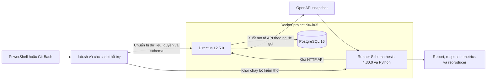

# BÁO CÁO CUỐI KỲ MÔN KIỂM THỬ PHẦN MỀM

## Kiểm thử API do Directus sinh ra bằng Schemathesis

**Trường Đại học Đà Lạt — Khoa Công nghệ Thông tin**  
**Giảng viên:** Nguyễn Thế Lâm  
**Tổ hợp đề tài:** R06 Directus + K05 Schema-Based API Testing/Fuzzing  
**Thành viên:** Đinh Thị Mai Lành, Trương Võ Trọng Nhân, Phan Thị Bảo Trâm  
**Ngày biên soạn:** 19/10/2026  
**Mốc kết quả nghiệm thu được dùng:** 18/10/2026

Báo cáo tổ chức theo phần A–H của mục 3 và đối chiếu các mốc, đầu ra ở mục 4 trong hướng dẫn môn học, trang 2–3. Những hướng dẫn bổ sung của giảng viên về đặc tả, sinh test từ API và tối ưu chi phí được đưa vào các phần D, E và G.

Báo cáo trình bày thiết kế, phương pháp kiểm thử, dữ liệu đầu vào, kết quả và phân tích nguyên nhân. Các request/response, phần đặc tả liên quan và số đo được trích ngay trong nội dung để làm căn cứ đánh giá kết luận. Số liệu thực tế được tổng hợp đến ngày 18/10/2026; ví dụ chỉ để giải thích được ghi rõ riêng.

## Tóm tắt đề tài

Directus là phần mềm cung cấp dịch vụ phía máy chủ cho ứng dụng. Khi có cơ sở dữ liệu và cấu hình phù hợp, Directus cung cấp API để ứng dụng tạo, đọc, cập nhật và xóa dữ liệu. Nhóm không viết lại các API đó. Nhiệm vụ của nhóm là kiểm tra chúng có hoạt động đúng trong phạm vi đã chọn hay không.

Nhóm xây dựng tình huống quản lý chuyên mục và bài viết bằng hai bảng dữ liệu `qa_categories` và `qa_articles`. Công cụ Schemathesis đọc mô tả API do Directus xuất ra, sinh yêu cầu kiểm thử và kiểm tra phản hồi. Bên cạnh đó, nhóm viết các ca kiểm thử có chủ đích để kiểm tra quy tắc dữ liệu, phân quyền và kết quả nghiệp vụ mà mô tả API chưa thể hiện đầy đủ.

Kết quả nghiệm thu ghi nhận sáu kịch bản nghiệp vụ đạt, cả 10 thao tác API chính có ca nghiệp vụ thành công, và bộ kiểm thử ngắn gồm 58 ca đạt ở hai lượt chạy. Tuy nhiên, hệ thống vẫn có phản hồi không khớp mô tả OpenAPI và trường hợp đầu vào bất thường gây lỗi máy chủ. Vì vậy, nhóm không kết luận toàn bộ Directus hoặc toàn bộ bộ kiểm thử đều đạt.

Nhóm cũng thực hiện thí nghiệm giảm số tổ hợp truy vấn từ 36 xuống 9 bằng pairwise. Trong mô hình nhỏ đã chọn, số yêu cầu mục tiêu giảm 75%, còn thời gian toàn lệnh giảm trung vị 19,54%. Đây là kết quả đo trên môi trường lab, không phải cam kết giảm tương ứng mọi loại chi phí kiểm thử.

## Các khái niệm dùng trong báo cáo

| Khái niệm | Giải thích dễ hiểu |
|---|---|
| API | Cách để một chương trình gửi yêu cầu cho chương trình khác. Ví dụ: yêu cầu lấy danh sách bài viết |
| Request và response | Request là yêu cầu gửi đi; response là phản hồi nhận lại, gồm mã trạng thái và dữ liệu nếu có |
| Endpoint và operation | Endpoint là địa chỉ API. Một operation là cặp phương thức và địa chỉ, ví dụ `GET /items/qa_articles` |
| CRUD | Bốn nhóm thao tác: tạo, đọc, cập nhật và xóa dữ liệu |
| OpenAPI, schema | OpenAPI mô tả các địa chỉ, tham số và phản hồi API; schema mô tả cấu trúc hoặc kiểu dữ liệu trong đặc tả đó |
| Test case — ca kiểm thử | Một phép thử có điều kiện ban đầu, dữ liệu đầu vào, cách thực hiện và kết quả mong đợi |
| Expected result | Kết quả mong đợi, được xác định trước từ yêu cầu và đặc tả để so với kết quả thực tế |
| Fixture và seed | Fixture là dữ liệu mẫu biết trước; seed là bước tạo hoặc đưa dữ liệu mẫu vào môi trường |
| Random seed | Số khởi đầu cho bộ sinh dữ liệu giả ngẫu nhiên, ví dụ 101/202/303. Đây là khái niệm khác với bước seed nạp dữ liệu mẫu; giữ random seed chưa đủ tái lập test nếu trạng thái DB khác |
| JSON | Cách biểu diễn dữ liệu bằng tên trường và giá trị. Object là một đối tượng trong dấu `{...}`; array là danh sách trong dấu `[...]` |
| Harness | Bộ mã hỗ trợ chuẩn bị môi trường, chạy test, kiểm kết quả và lưu báo cáo |
| Finding và reproducer | Finding là lỗi hoặc bất thường được ghi nhận; reproducer là thông tin cần thiết để chạy lại hiện tượng đó |
| Coverage | Mức độ đã kiểm tra so với một phạm vi xác định. Phải nêu rõ đang tính theo thao tác API, ca thiết kế hay loại dữ liệu |
| Pin, baseline | Pin là cố định phiên bản; baseline là bộ phiên bản, cấu hình và dữ liệu được chọn làm chuẩn cho các lần kiểm thử |
| Assertion, oracle, invariant | Assertion là phép kiểm một điều kiện; oracle là căn cứ xác định kết quả đúng; invariant là tính chất cần giữ đúng, ví dụ request bị từ chối không được làm thay đổi dữ liệu |
| Campaign | Một đợt công cụ tự sinh và chạy nhiều test trong ngân sách được đặt trước |

---

## A. Mục tiêu, người dùng, mã nguồn và luồng dữ liệu

### A.1. Directus giải quyết việc gì?

Một ứng dụng quản lý nội dung thường cần lưu chuyên mục, bài viết và quyền truy cập. Nếu tự xây dựng, lập trình viên phải viết các API tương ứng. Directus cung cấp sẵn lớp API làm việc với cơ sở dữ liệu SQL, cùng chức năng xác thực, phân quyền và kiểm tra dữ liệu.

Ví dụ, khi tạo collection `qa_articles`, ứng dụng có thể gọi `GET /items/qa_articles` để đọc bài viết hoặc `POST /items/qa_articles` để tạo bài. Collection trong tình huống này có thể hiểu là nhóm dữ liệu tương ứng một bảng trong cơ sở dữ liệu. API thực tế còn phụ thuộc vào cấu hình collection, quan hệ và quyền của người gọi.

Directus còn có giao diện quản trị Studio, SDK và nhiều chức năng khác. Đề tài giới hạn ở REST API của hai collection, phù hợp yêu cầu thu hẹp phạm vi của môn học. Hai collection này là dữ liệu lab do nhóm cấu hình, không phải module bài viết được viết riêng trong mã nguồn Directus.

### A.2. Người dùng và nhu cầu chính

| Vai trò | Nhu cầu và quyền trong lab |
|---|---|
| Editor — người quản lý nội dung | Tạo, đọc, cập nhật và xóa chuyên mục, bài viết; làm việc với cả bài nháp và bài công khai |
| Reader — người đọc được cấp tài khoản | Đọc chuyên mục và bài đã công khai; không đọc bài nháp, không nhận ghi chú nội bộ và không được ghi dữ liệu |
| Anonymous — người chưa đăng nhập | Không được truy cập dữ liệu của hai collection |
| Admin — người thiết lập lab | Tạo dữ liệu, tài khoản và quyền; kiểm tra trạng thái, khôi phục dữ liệu. Không dùng làm người gọi mặc định cho campaign sinh test |

Các yêu cầu người dùng được diễn giải từ phạm vi lab và cấu hình đã thống nhất, không phải kết quả phỏng vấn khách hàng thực tế. Những yêu cầu trọng tâm là quản lý nội dung đúng, đọc đúng dữ liệu theo truy vấn, ngăn thao tác ngoài quyền và phát hiện sai lệch giữa API với OpenAPI.

### A.3. Dữ liệu và quy tắc cần kiểm tra

| Collection/trường | Ý nghĩa và quy tắc chính |
|---|---|
| `qa_categories.id`, `name` | Mã chuyên mục tự tăng; tên chuyên mục không null, tối đa 80 ký tự theo cấu hình |
| `qa_articles.id`, `title` | Mã bài viết tự tăng; tiêu đề không null, tối đa 120 ký tự theo cấu hình |
| `status` | Trạng thái `draft` hoặc `published`; cấu hình mặc định là `draft` |
| `score` | Điểm đánh giá là số nguyên từ 0 đến 5 |
| `published_at` | Thời điểm xuất bản, cho phép null |
| `metadata` | Dữ liệu bổ sung dạng JSON, cho phép null |
| `internal_notes` | Ghi chú nội bộ; Reader không được nhận trường này |
| `category` | Tham chiếu chuyên mục hoặc null. Xóa chuyên mục thì bài viết còn lại và tham chiếu được đặt về null |

`null` nghĩa là không có giá trị. Không gửi một trường, gửi null và gửi chuỗi rỗng là các trường hợp khác nhau. Nhóm không tự đặt thêm quy tắc “chuỗi rỗng luôn sai” hoặc “bài công khai bắt buộc có thời điểm xuất bản” khi chưa có căn cứ từ baseline.

### A.4. Cây thư mục và dependency chính

Directus tổ chức nhiều gói trong cùng một kho mã nguồn. Cấu trúc có liên quan tới đề tài:

```text
directus/
├── api/src/
│   ├── controllers/    Tiếp nhận yêu cầu REST
│   ├── middleware/     Xác thực, chuẩn hóa truy vấn, xử lý phản hồi
│   ├── services/       Xử lý dữ liệu và sinh đặc tả API
│   ├── permissions/    Kiểm tra quyền và dữ liệu được phép
│   └── database/       Kết nối, truy vấn và làm việc với cơ sở dữ liệu
├── app/                Giao diện quản trị Studio
├── sdk/                Thư viện giúp ứng dụng gọi Directus
├── packages/           Các gói dùng chung, gồm schema, validation và specs
├── tests/              Kiểm thử của dự án Directus
└── pnpm-workspace.yaml Danh sách gói và phiên bản dependency
```

Backend sử dụng Node.js/TypeScript. Dependency là thư viện hoặc thành phần mà phần mềm cần để hoạt động. Các dependency liên quan trực tiếp gồm Express để xử lý HTTP, Knex để xây dựng truy vấn cơ sở dữ liệu, driver `pg` cho PostgreSQL, Joi cho kiểm tra dữ liệu và các gói schema/validation của Directus. Giao diện quản trị dùng Vue; phần này không được kiểm thử tự động trong đề tài.

Kho mã kiểm thử của nhóm nằm riêng trong `DAMH`: `lab.sh` là đầu vào lệnh, `scripts/` chứa mã chạy test, `scripts/data/` chứa dữ liệu và catalog, `tests/` kiểm tra harness, `docs/` chứa tài liệu, còn `artifacts/runs/` lưu kết quả từng lượt.

Cấu trúc và dependency nêu trên được đối chiếu với mã nguồn Directus ở phiên bản đã cố định. Khi phân tích nguyên nhân, nhóm dùng đúng source commit của bản chạy thay vì suy từ nhánh phát triển mới hơn.

### A.5. Bốn luồng dữ liệu trọng tâm

| Luồng | Đầu vào, đường đi và đầu ra |
|---|---|
| 1. Editor tạo và chỉnh sửa bài | Client gửi token cùng JSON bài viết; Directus xác định người gọi, kiểm quyền và dữ liệu, ghi PostgreSQL rồi trả kết quả. Test lấy ID trả về để đọc lại, cập nhật một trường, kiểm các trường khác còn nguyên và cuối cùng xóa bài tạm |
| 2. Lọc, sắp xếp và phân trang | Client gửi query như status, sort, limit và offset; Directus xử lý query cùng quyền đọc, tạo truy vấn SQL rồi trả danh sách. Test đối chiếu tập bài, thứ tự và lát cắt với fixture biết trước |
| 3. Reader đọc/ghi dữ liệu | Token xác định Reader; Directus áp điều kiện bài công khai và giới hạn trường. Thao tác ngoài quyền phải bị từ chối. Với thử ghi, Editor đọc lại để xác minh dữ liệu không đổi |
| 4. Xóa chuyên mục có bài tham chiếu | Editor tạo chuyên mục và bài tạm, sau đó xóa chuyên mục. Quan hệ trong DB đặt tham chiếu của bài về null; test đọc lại bài để kiểm tra bài vẫn tồn tại và dữ liệu khác được giữ |

Đăng nhập là bước hỗ trợ các luồng: client gửi thông tin tài khoản, nhận token rồi dùng token trong các request sau. Token có thể hiểu là thông tin chứng minh người gọi đã được xác thực. Các nhóm xử lý bên trong được giải thích ở B; cách kiểm tra và kết quả thực tế được trình bày ở E và G.

## B. Kiến trúc hệ thống kiểm thử

### B.1. Sơ đồ container và kết nối

Container là một môi trường đóng gói để chạy dịch vụ với phiên bản và các thư viện cần thiết. Trong sơ đồ dưới, Directus, PostgreSQL và runner là ba container riêng; runner là nơi thực hiện bộ kiểm thử.



Directus là phần mềm được kiểm thử, PostgreSQL lưu dữ liệu thật và runner thực hiện test. Docker Compose mô tả cách chạy ba dịch vụ cùng nhau. Từ máy cá nhân, API được truy cập qua `http://127.0.0.1:8055`; từ runner, địa chỉ là `http://directus:8055`. Cơ sở dữ liệu không mở cổng ra máy host.

### B.2. Năm nhóm module liên quan trực tiếp

| Nhóm module | Vai trò và liên hệ với test |
|---|---|
| Middleware xác thực và query | Đọc token, xác định người gọi, chuẩn hóa query. Liên quan tới ca token sai và query bất thường |
| REST controller `items.ts` | Chọn cách xử lý GET/POST/PATCH/DELETE, nhận object hoặc array. Liên quan tới 10 operation và finding POST |
| Item service và database | Đọc/ghi dữ liệu qua Knex, xử lý quan hệ. Liên quan tới CRUD, đọc lại, sắp xếp và khóa ngoại |
| Permissions và validation | Giới hạn thao tác, dòng dữ liệu, trường và giá trị. Liên quan tới Reader, score, status và request bị từ chối |
| Specification service và response middleware | Sinh OpenAPI và tạo phản hồi thực tế. So sánh hai phía giúp giải thích các sai lệch schema, status và content type |

Kiểm thử API thường đi qua nhiều nhóm module trong một request. Vì vậy, một response 400 hoặc 403 chưa đủ để kết luận đã kiểm tra đúng quy tắc: test còn cần biết request bị từ chối vì sai dữ liệu, thiếu quyền hay điều kiện ban đầu không đúng.

## C. Môi trường, cách chạy và bằng chứng hệ thống hoạt động

### C.1. Cấu hình đã dùng

| Thành phần | Cấu hình |
|---|---|
| Hệ thống | Directus 12.5.0, tag `v12.5.0`, source commit `4f77933bf9551cac6b289576078783e189b8f4e3` |
| Công cụ K05 | Schemathesis 4.30.0, chạy trong Docker image đã pin |
| Database | PostgreSQL 16; lượt xác minh ghi runtime 16.15 và collation `en_US.utf8` |
| Dữ liệu mẫu | Fixture `r06-k05-v2`: 3 chuyên mục, 12 bài, gồm 6 draft và 6 published |
| Project, volume | `r06-k05`, volume `r06-k05_db_data` |
| Cấu hình hỗ trợ | Cache ứng dụng, telemetry và rate limiter phía server tắt; thời hạn access token 2 giờ |
| Giới hạn runner chính | Một worker, khoảng 5 request/giây, timeout mỗi request 10 giây |
| Công cụ trên Windows | Docker Desktop, Git Bash, PowerShell; jq 1.8.2 do script chuẩn bị và kiểm checksum |

Collation là quy tắc so sánh và sắp xếp chuỗi trong DB. Nhóm lưu thông tin này vì test sắp xếp tiêu đề cần một chuẩn thứ tự rõ ràng.

Directus và runner được chạy bằng image có sẵn. Nhóm không cần build toàn bộ mã nguồn để thực hiện đường chạy Docker. Nếu chọn build source, manifest source pin yêu cầu Node.js 22, pnpm 10 và khóa package manager ở `pnpm@10.27.0`; lệnh build là `pnpm install --frozen-lockfile` rồi `pnpm build`. Đường build source này không được ghi là đã kiểm chứng trong nghiệm thu hiện tại.

### C.2. Các bước dựng và chạy bằng Docker

Các lệnh dưới mô tả cách người nhận vận hành hệ thống khi có bộ mã kiểm thử đi kèm. Chúng thực hiện từ thư mục `DAMH`. Kết quả đã chạy được trình bày riêng ở C.3 và G, để phân biệt hướng dẫn thực hiện với bằng chứng thực tế.

**Bước 1 — Chuẩn bị công cụ và cấu hình.** Mở Docker Desktop. Trên Windows, chạy `.\scripts\setup-windows.ps1` nếu chưa có jq đã pin. Trên máy mới, sao chép `config/lab.env.example` thành `config/lab.env`; nếu file thật đã tồn tại thì giữ nguyên, không ghi đè bằng bản mẫu.

Điền các nhóm biến sau trực tiếp trên máy:

| Nhóm biến | Nội dung cần cấu hình |
|---|---|
| `DIRECTUS_IMAGE`, `POSTGRES_IMAGE`, `SCHEMATHESIS_IMAGE` | Giữ nguyên phiên bản và digest trong file mẫu |
| `DB_DATABASE`, `DB_USER`, `DB_PASSWORD` | Thông tin kết nối DB của lab |
| `DIRECTUS_KEY`, `DIRECTUS_SECRET` | Giá trị riêng cho môi trường; thay toàn bộ giá trị `REPLACE_*` tương ứng |
| `ADMIN_*`, `EDITOR_*`, `READER_*` | Tài khoản và mật khẩu của ba vai trò |
| `LICENSE_KEY` | License hợp lệ đáp ứng điều kiện policy tùy chỉnh của baseline đã nghiệm thu |
| `API_URL`, `RUNNER_API_URL`, `LAB_FIXTURE_VERSION` | Giữ địa chỉ local/runner và fixture version như bảng cấu hình |

File cấu hình thật chỉ được người dùng phù hợp truy cập. Nếu `doctor` báo lỗi quyền file thì cần sửa quyền trước khi chạy tiếp; trên Unix dùng quyền 600, trên Windows dùng ACL riêng cho tài khoản hiện tại, SYSTEM và nhóm quản trị. Không đưa mật khẩu, token hoặc license value vào báo cáo và mã nguồn bàn giao.

Baseline hiện có chạy với license active và quyền cấu hình cần thiết. Máy mới thiếu điều kiện này có thể không thiết lập được policy Reader; trường hợp đó phải ghi chưa đủ điều kiện kiểm thử, không đổi policy để tạo kết quả đạt.

**Bước 2 — Khởi động và chuẩn bị dữ liệu.**

```powershell
.\scripts\run-lab.ps1 up
.\scripts\run-lab.ps1 doctor
.\scripts\run-lab.ps1 seed
.\scripts\run-lab.ps1 export-schema
```

`up` chạy dịch vụ; `doctor` kiểm tra công cụ, cấu hình và trạng thái hệ thống; `seed` tạo/xác minh dữ liệu và quyền; `export-schema` xuất OpenAPI theo từng vai trò. Seed có cơ chế chạy lại không nhân đôi fixture. ID thực được lưu vào map và dùng khi test, không giả định chúng luôn là 1, 2, 3.

**Bước 3 — Chạy kiểm thử ngắn và xem kết quả.**

```powershell
.\scripts\run-lab.ps1 test scenarios
.\scripts\run-lab.ps1 test designed --selection short
```

Linux hoặc Git Bash dùng `./lab.sh` với cùng tham số. Chạy các suite ghi dữ liệu lần lượt trên cùng lab. Khi dùng xong, lệnh `down` dừng dịch vụ và giữ volume; không cần reset DB để mở hệ thống hoặc demo.

### C.3. Bằng chứng chạy thành công và ba luồng nghiệp vụ

Đợt xác minh ngày 18/10/2026 hoàn tất bước kiểm môi trường, chuẩn bị dữ liệu và xuất OpenAPI trước khi chạy các suite. Bản ghi kiểm môi trường ghi `command=doctor`, `status=passed`, `exit_code=0`; bộ kiểm cũng xác minh image container khớp cấu hình, revision Directus đúng commit đã pin và API bind ở địa chỉ loopback.

| Luồng nghiệp vụ | Kết quả thực tế được ghi | Cơ sở đánh giá |
|---|---|---|
| Editor CRUD | Tạo và cập nhật trả 2xx; xóa trả 204; S1 PASS | Đọc lại dữ liệu, kiểm trường không cập nhật được giữ và bài tạm được xóa |
| Query dữ liệu | S2 trả sáu bài published, ID lịch sử `[3,4,7,8,11,12]`; S3 PASS | Đối chiếu danh sách và thứ tự với fixture biết trước, không lấy response đang thử làm đáp án |
| Quyền Reader | S4/S5/S6 đều ghi HTTP 403 và PASS | Không lộ draft/ghi chú nội bộ; Editor đọc lại xác nhận lần ghi bị từ chối không đổi dữ liệu |

Sáu kịch bản trong bảng kết quả gốc đều có trạng thái `passed`. HTTP 403 ở luồng Reader là kết quả đúng khi người đó yêu cầu thao tác ngoài quyền. Các ID trên thuộc lần chạy được trích; khi dựng mới, test dùng ID từ map/response thay vì cố định các số này. Mã nhận diện các lượt chạy được liệt kê trong phụ lục truy vết cuối báo cáo.

## D. Nguyên lý K05, phạm vi và tiêu chí đánh giá

### D.1. K05 được áp dụng như thế nào?

Schema-Based API Testing dùng mô tả API làm đầu vào để tự động tạo request và kiểm phản hồi. Fuzzing trong đề tài là sinh nhiều biến thể dữ liệu đầu vào để tìm hành vi không đúng hoặc xử lý lỗi chưa tốt.

Quy trình của nhóm gồm: chuẩn bị fixture và quyền; xuất OpenAPI từ Directus; chọn các operation cần kiểm tra; để Schemathesis sinh và gửi request; thực hiện các phép kiểm tra; lưu kết quả và thông tin chạy lại. Một số request có thể được rút gọn khi công cụ tìm lỗi để giúp xác định đầu vào nhỏ hơn vẫn gây hiện tượng.

Ví dụ, phần mô tả `score` trong OpenAPI xuất từ lab là:

```json
{"nullable": false, "type": "integer"}
```

Đoạn này chỉ yêu cầu số nguyên và không null, chưa có `minimum: 0` hoặc `maximum: 5`. Công cụ có thể sinh số 6 vì giá trị đó phù hợp mô tả kiểu nhưng lại sai quy tắc score của lab. Do đó, nhóm bổ sung test có expected lấy từ yêu cầu và cấu hình dữ liệu. Sự khác nhau giữa “hợp schema” và “đúng nghiệp vụ” là lý do cần cả hai cách kiểm thử.

### D.2. Vì sao chọn phạm vi này?

Hai collection có dữ liệu đơn giản nhưng đủ thể hiện kiểu chuỗi, số, thời gian, JSON, quan hệ và phân quyền. Mỗi collection có năm operation: GET danh sách, POST tạo, GET chi tiết, PATCH chi tiết và DELETE chi tiết, tổng cộng **10 cặp method–path**.

Phạm vi địa chỉ cụ thể như sau; `{id}` được thay bằng mã bản ghi thực tế:

| Thao tác | Chuyên mục | Bài viết |
|---|---|---|
| Đọc danh sách | `GET /items/qa_categories` | `GET /items/qa_articles` |
| Tạo | `POST /items/qa_categories` | `POST /items/qa_articles` |
| Đọc chi tiết | `GET /items/qa_categories/{id}` | `GET /items/qa_articles/{id}` |
| Cập nhật một phần | `PATCH /items/qa_categories/{id}` | `PATCH /items/qa_articles/{id}` |
| Xóa chi tiết | `DELETE /items/qa_categories/{id}` | `DELETE /items/qa_articles/{id}` |

Nhóm giữ POST object và array theo schema. Object là một đối tượng dữ liệu, ví dụ một bài viết; array là danh sách nhiều đối tượng. Bulk PATCH/DELETE, tức sửa/xóa nhiều bản ghi qua một operation, không nằm trong campaign chính. Query trọng tâm là `fields`, `filter`, `sort`, `limit`, `offset`, `page`, `search`. Campaign dựa trên schema vẫn có thể sinh các query khác được mô tả, như aggregate hoặc export. Không kiểm toàn bộ Directus, giao diện Studio, GraphQL, hiệu năng tải hoặc API quản trị.

### D.3. Bốn phép kiểm phản hồi nền tảng

| Phép kiểm | Câu hỏi cần trả lời |
|---|---|
| `not_a_server_error` | Máy chủ có trả 5xx hay không? |
| `status_code_conformance` | Mã trạng thái trả về có được khai báo trong OpenAPI không? |
| `content_type_conformance` | Kiểu nội dung thực tế có khớp mô tả, ví dụ JSON hay CSV không? |
| `response_schema_conformance` | Cấu trúc, kiểu dữ liệu phản hồi có khớp schema không? |

Campaign còn cấu hình các check `unsupported_method`, `negative_data_rejection`, `positive_data_acceptance`. Chúng kiểm các phương thức không được mô tả và cách API xử lý dữ liệu được công cụ gắn nhãn hợp lệ/không hợp lệ. Nhãn này phụ thuộc schema và điều kiện áp dụng của công cụ, không thay cho kiểm tra đúng nghiệp vụ.

HTTP 2xx thường biểu thị request được xử lý thành công; 4xx thường biểu thị request hoặc quyền truy cập không phù hợp; 5xx biểu thị lỗi phía máy chủ. Với test dữ liệu sai hoặc thiếu quyền, một phản hồi 4xx đúng nguyên nhân có thể là kết quả PASS. Ngược lại, HTTP 200 có thể FAIL nếu dữ liệu trả về sai hoặc khác schema.

### D.4. Giả định, rủi ro và nguyên tắc PASS/FAIL

Test chỉ có ý nghĩa khi đúng phiên bản, đúng actor, fixture và schema đã chuẩn bị, không có lượt ghi khác làm thay đổi dữ liệu. Các điều kiện này được kiểm tra trước khi chạy. Lỗi kết nối hoặc thiếu fixture không được tự coi là lỗi sản phẩm.

Một ca nghiệp vụ đạt khi kết quả và trạng thái dữ liệu đúng với expected. Với ca ghi bị từ chối, cần kiểm dữ liệu không thay đổi. Với ca xóa, cần kiểm tài nguyên không còn được trả như bản ghi tồn tại. Một lỗi mạng hoặc 5xx không chứng minh thao tác xóa đã thành công.

| Trạng thái | Ý nghĩa trong báo cáo |
|---|---|
| PASS | Ca đã chạy, đủ điều kiện và các assertion thuộc phạm vi ca đó đạt |
| FAIL | Ca đã chạy và có kết quả trái expected đã xác định |
| OPEN | Chưa đủ căn cứ chốt một chi tiết expected hoặc kết luận |
| NOT_RUN | Ca thiết kế chưa được thực thi trong bảng tổng hợp |
| BLOCKED / INCOMPLETE | Thiếu điều kiện để kiểm hoặc lượt chạy dừng trước khi hoàn tất; không quy thành PASS |

Rủi ro chính là schema thiếu ràng buộc, request sai nhiều yếu tố làm khó xác định nguyên nhân, test ghi làm thay đổi fixture và việc nhầm số failure thành số defect. Nhóm giảm rủi ro bằng positive control, thay riêng một yếu tố, dùng ID từ map/response, kiểm dữ liệu trước/sau và giữ nguyên report khi lỗi xảy ra.

## E. Đặc tả và thiết kế bộ kiểm thử

### E.1. Từ yêu cầu người dùng tới ca kiểm thử

Đặc tả lab có 10 yêu cầu người dùng ký hiệu UR, 26 quy tắc ký hiệu BR và các tiêu chí chấp nhận ký hiệu AC. Các mã giúp truy ngược lý do một test tồn tại; không bắt người đọc phải nhớ toàn bộ mã để hiểu báo cáo.

Ví dụ truy vết cụ thể:

| Bước | Nội dung |
|---|---|
| Yêu cầu người dùng | UR-07: dữ liệu bài viết phải tuân thủ ràng buộc đã cấu hình |
| Quy tắc | BR-05: score là số nguyên 0–5; BR-24: request bị từ chối không được làm thay đổi dữ liệu |
| Tiêu chí chấp nhận | AC-05/AC-24: số ngoài miền bị từ chối, không tạo bản ghi mới |
| Khoảng trống OpenAPI | `score` có kiểu integer nhưng thiếu minimum/maximum |
| Test bổ sung | `P3-SCORE-POST-6`: Editor tạo bài với score=6, các trường khác hợp lệ |
| Expected | Từ chối đúng lỗi validation; dữ liệu nghiệp vụ không đổi |
| Actual đã lưu | HTTP 400; các kiểm tra của ca đạt và cleanup đạt |

Dưới đây là request thực tế của ca score=6; thông tin xác thực không đưa vào báo cáo. Các trường còn lại là dữ liệu kiểm thử hợp lệ:

```http
POST /items/qa_articles
Content-Type: application/json
```

```json
{
  "title": "Probe 6604d999d5a79f68cb95fc04",
  "status": "draft",
  "score": 6,
  "published_at": null,
  "metadata": {
    "probe": "6604d999d5a79f68cb95fc04"
  },
  "internal_notes": "Private 6604d999d5a79f68cb95fc04",
  "category": 1
}
```

Phản hồi thực tế có HTTP status 400:

```json
{
  "errors": [
    {
      "message": "Validation failed for field \"score\". Value has to be less than or equal to \"5\".",
      "extensions": {
        "field": "score",
        "path": [],
        "type": "lte",
        "valid": 5,
        "code": "FAILED_VALIDATION"
      }
    }
  ]
}
```

Thông điệp phản hồi cho biết score phải nhỏ hơn hoặc bằng 5; mã lỗi là `FAILED_VALIDATION`. Bộ test còn so trạng thái dữ liệu trước/sau để xác nhận POST không tạo bài. Vì vậy, ca này PASS dù API trả 400. Giá trị category=1 là ID đã được map xác nhận ở lượt chạy đó; khi chạy mới, ID được lấy lại từ map.

Ca kiểm này đánh giá quy tắc dữ liệu và việc không trả 5xx. Check hợp đồng phản hồi không được chạy trong chính ca này; không suy kết quả nghiệp vụ PASS thành toàn bộ OpenAPI PASS.

### E.2. Dữ liệu, điều kiện và dọn dẹp chung

Ba chuyên mục mẫu là Alpha, Beta và Gamma. Mỗi chuyên mục có bốn bài: hai draft và hai published. Các tiêu đề/score sau là dữ liệu mẫu thực tế, được định nghĩa trước khi chạy test:

| Chuyên mục | Tiêu đề | Status | Score |
|---|---|---|---:|
| Alpha | Alpha 01 — bản nháp | draft | 1 |
| Alpha | Alpha 02 — bản nháp có Unicode | draft | 2 |
| Alpha | Alpha 03 — đã xuất bản | published | 4 |
| Alpha | Alpha 04 — xuất bản nullable metadata | published | 5 |
| Beta | Beta 01 — bản nháp | draft | 0 |
| Beta | Beta 02 — bản nháp & rỗng thời điểm | draft | 3 |
| Beta | Beta 03 — đã xuất bản | published | 3 |
| Beta | Beta 04 — publication spéciale | published | 4 |
| Gamma | Gamma 01 — bản nháp | draft | 2 |
| Gamma | Gamma 02 — bản nháp Unicode 漢字 | draft | 5 |
| Gamma | Gamma 03 — đã xuất bản | published | 1 |
| Gamma | Gamma 04 — đã xuất bản cuối | published | 5 |

Ví dụ, lọc published phải trả đúng các bài Alpha 03/04, Beta 03/04 và Gamma 03/04. Với thứ tự `title,id` và limit=3, trang đầu phải có Alpha 01/02/03; trang kế tiếp có Alpha 04, Beta 01/02 theo chuẩn sắp xếp đã xác minh trong DB. Đây là đáp án độc lập được xây từ fixture, không phải chép lại response rồi dùng nó tự kiểm chính nó.

Các bài mẫu có thêm thời điểm xuất bản, JSON chứa Unicode, metadata null và ghi chú nội bộ để kiểm các dạng dữ liệu và quyền. Tên hiển thị Alpha/Beta/Gamma trong bảng viết gọn tên chuyên mục; ID số được gắn theo map khi seed.

Với mỗi test cần ghi, nhóm tạo dữ liệu tạm hoặc chụp trạng thái cần bảo vệ. Các trường ngoài yếu tố đang thử được giữ hợp lệ để tránh lẫn nguyên nhân. Kết quả được kiểm trước khi dọn dẹp: đọc lại bản ghi tạo/cập nhật, kiểm dữ liệu không đổi nếu bị từ chối hoặc kiểm quan hệ sau xóa. Runner sau đó xóa dữ liệu tạm và khôi phục trạng thái cuối suite; kết quả khôi phục được ghi riêng.

### E.3. Sáu scenario nghiệp vụ

| ID | Input và tiền điều kiện | Expected chính |
|---|---|---|
| S1 — Editor CRUD | Editor hợp lệ; bài tạm có title, status, score và quan hệ hợp lệ | Tạo/đọc đúng; PATCH giữ trường không gửi; xóa và kiểm không còn tài nguyên |
| S2 — Filter status | Fixture chuẩn; query lấy published | Đúng sáu bài published theo map, không chỉ kiểm response 200 |
| S3 — Sort/phân trang | Fixture chuẩn; `sort=title,id`, limit/offset phù hợp | Thứ tự và các phần dữ liệu đúng theo oracle từ seed/map và DB |
| S4 — Reader không đọc draft | Biết một bài draft; có control Reader đọc published; chỉ yêu cầu trường công khai | Draft bị từ chối đúng quyền, không lộ dữ liệu |
| S5 — Ghi chú nội bộ | Reader đọc được bài published bằng trường công khai; sau đó yêu cầu `internal_notes` | Field kín không bị lộ; có thể bị loại hoặc request bị từ chối theo baseline |
| S6 — Reader ghi | Target tồn tại; payload PATCH hợp lệ nếu Editor gửi, có giá trị thay đổi thật | Reader bị từ chối; Editor đọc lại thấy dữ liệu không đổi |

### E.4. Phân vùng, biên và ca đại diện

Phân vùng tương đương chia dữ liệu thành những nhóm có cùng quy tắc xử lý, ví dụ score trong miền và ngoài miền. Kiểm thử biên tập trung vào các giá trị sát điểm chuyển giữa hợp lệ và không hợp lệ. Nhóm chọn cả hai để bổ sung cho test sinh tự động.

| Ca/nhóm đại diện | Input chính | Expected | Kết quả nghiệm thu |
|---|---|---|---|
| Score ngoài biên dưới | score=-1, còn lại hợp lệ | Từ chối và không tạo bài | PASS |
| Hai biên hợp lệ của score | score=0 và score=5 | Tạo được, đọc lại đúng giá trị | Hai ca PASS |
| Score ngoài biên trên | score=6 | Từ chối và không tạo bài | PASS |
| Độ dài title ở giới hạn | Title ASCII dài 120 ký tự | Tạo/đọc đúng, không cắt dữ liệu | PASS |
| Độ dài vượt giới hạn | Title ASCII dài 121 ký tự | Từ chối, không tạo bài | PASS |
| Quan hệ sau xóa category | Bài tạm trỏ category tạm, xóa category | Bài còn, category=null và field khác không đổi | PASS qua nhóm test quan hệ |
| POST response shape | POST object hợp lệ vào hai collection | Kiểm nghiệp vụ và schema riêng | Nghiệp vụ PASS, contract FAIL |
| Aggregate bất thường | `aggregate={"foo":1}`, kèm control hợp lệ | Không 5xx; không yêu cầu server thực hiện phép tính foo | FAIL robustness |

Các dòng score ở bảng trên tương ứng các ca riêng -1, 0, 5, 6; hai ca độ dài title cũng được chạy riêng. Chuỗi kiểm độ dài là ASCII để cô lập ràng buộc 120 ký tự; kết quả này không chứng minh đã kiểm đủ cách đếm mọi ký tự Unicode.

### E.5. Test sinh từ OpenAPI và test có chủ đích bổ sung nhau

| Điều cần kiểm | OpenAPI đã thể hiện gì? | Cách nhóm xử lý phần còn thiếu |
|---|---|---|
| Title/name | Kiểu string, thông tin nullable/required | Thử riêng các độ dài sát và vượt giới hạn |
| Status | Kiểu string, chưa đủ enum/default | Thử draft/published/archived và những trường hợp đủ expected |
| Score | Integer, thiếu miền 0–5 | Kiểm biên và từ chối ngoài miền |
| Quyền Reader | Một phần operation/field có thể bị lọc | Gửi request có chủ đích, dùng control và kiểm dữ liệu |
| Query | Mô tả tham số | So tập bản ghi, thứ tự, phân trang và trường trả về với dữ liệu chuẩn |
| Quan hệ | Có tham chiếu kiểu dữ liệu | Kiểm FK tồn tại, SET NULL và dữ liệu sau thao tác |

Một ví dụ do Schemathesis thực thi là case `qfqspn`, profile guided seed 101, dùng example POST article object có title “Guided Schemathesis article”, status=draft, score=3. API trả 200 với `data` object, nhưng check schema FAIL vì mô tả yêu cầu array. Ví dụ này đi qua đường schema/example của công cụ; không gán nó thành ca biên được nhóm viết riêng. Cách phân tích và replay cùng nhóm sai lệch được trình bày đầy đủ ở G.5.

Toàn catalog có 257 ID thiết kế. Chín query pairwise là tập con của 36 query tham chiếu trong catalog, không cộng thêm thành 266. Không phải tất cả ca đã chạy; số lượng thực thi được nêu ở G.

## F. Mã nguồn tự động hóa và cách dùng

### F.1. Các thành phần của bộ kiểm thử

| Tệp/thư mục | Công việc |
|---|---|
| lab.sh | Nhận lệnh, kiểm cấu hình và quản lý từng lượt chạy |
| scripts/lab-components.sh | Seed, policy, export schema, campaign và lifecycle dữ liệu |
| scripts/invariants.py | Các kiểm tra nghiệp vụ, quyền, invariant và replay có chủ đích |
| scripts/designed_cases.py | Chạy catalog theo ca, nhóm hoặc tập ngắn |
| scripts/contract_checks.py | Gọi các check phản hồi của Schemathesis cho ca được tích hợp |
| scripts/replay_cases.py | Chạy lại case Schemathesis, xử lý parent và ánh xạ ID khi có đủ nguồn |
| scripts/cost_query.py | Chạy và đo thí nghiệm query 36/9 |
| scripts/data | Catalog, fixture oracle và mô hình thí nghiệm |
| tests | Kiểm tra offline logic của harness, không thay cho test API thật |

Trên Windows, `run-lab.ps1` chuyển lệnh sang Git Bash và giữ mã thoát của `lab.sh`; `setup-windows.ps1` chuẩn bị jq. Tên tệp giúp nhận diện thành phần được cài đặt; logic chung của bộ kiểm thử có thể mô tả bằng mã giả dưới đây, không cần đọc các tệp để hiểu:

```text
Kiểm tra đúng phiên bản, tài khoản, dữ liệu và schema
Nếu thiếu điều kiện: ghi chưa kiểm được, không kết luận PASS
Lưu trạng thái dữ liệu cần bảo vệ
Với mỗi ca được chọn:
    Chuẩn bị bản ghi tạm và ID thực nếu cần
    Gửi request bằng đúng vai trò
    So status, dữ liệu và trạng thái sau request với expected
    Nếu ca có check OpenAPI: kiểm thêm status/content type/schema
    Ghi riêng kết quả nghiệp vụ và kết quả hợp đồng
    Dọn dữ liệu tạm, ghi nhận cả lỗi kiểm thử lẫn lỗi dọn dẹp
Khôi phục trạng thái cuối suite và ghi kết quả khôi phục riêng
Xuất report và mã thoát phản ánh kết quả thật
```

Ví dụ, ca Reader bị cấm ghi cần đồng thời có phản hồi từ chối đúng quyền và dữ liệu không đổi; chỉ thấy response 403 chưa đủ. Khi ngoại lệ xảy ra, runner vẫn cố ghi report/dọn dẹp trong phần xử lý cuối. Cơ chế này không bảo đảm khôi phục nếu mất điện hoặc dừng cưỡng bức toàn Docker.

README và dependency là phần đi kèm bộ mã nguồn khi bàn giao. Trong báo cáo, C.2 trình bày cấu hình cần thiết và F.3 liệt kê các lệnh theo mục đích.

### F.2. Raw và guided

Raw giữ mô tả hợp đồng gốc của các operation đã chọn. Guided dùng bản schema riêng, thêm ví dụ và ID hợp lệ để công cụ tiếp cận được nhiều đường xử lý hơn; profile này còn bật phần chạy chuỗi phụ thuộc trạng thái. Ví dụ, GET lấy một ID rồi DELETE dùng chính ID đó.

Nhóm không sửa raw schema, nới assertion hoặc tắt check để làm kết quả xanh. Vì raw và guided khác cả hướng dẫn đầu vào lẫn phần chạy chuỗi, so sánh giữa chúng chỉ mô tả hai chiến lược tổng thể, không tách riêng tác dụng của mỗi thay đổi.

### F.3. Các lệnh chính

```powershell
# Chạy sáu scenario và bộ 58 ca ngắn
.\scripts\run-lab.ps1 test scenarios
.\scripts\run-lab.ps1 test designed --selection short

# Kiểm riêng một ca hoặc chạy lại nhóm finding đã thiết kế
.\scripts\run-lab.ps1 test designed --case P3-SCORE-POST-6
.\scripts\run-lab.ps1 replay contract-schema-candidates
```

Các lệnh `test raw` và `test guided` chạy campaign theo cấu hình đã chốt trong file mẫu: random seed 101/202/303, tối đa 1.200 giây mỗi seed/profile, max-examples 100, một worker. Không cần chạy lại hai campaign dài để đọc báo cáo hoặc demo. `max-examples` không phải tổng số request của một campaign vì còn các giai đoạn sinh dữ liệu, rút gọn ca lỗi và chuỗi request.

Mỗi lượt tạo `artifacts/runs/<run_id>/`. Tệp thường gặp là `metadata.json` cho thông tin lượt chạy, `designed-report.json` hoặc `scenario-report.json` cho verdict, `component-outcomes.json` cho mã thoát runner/restore và các tệp response/reproducer để đối chiếu. Tùy loại run, tập tệp có thể khác nhau.

Các failure và lượt hết ngân sách vẫn được lưu. Replay báo `reproduced` nghĩa là tái hiện được hiện tượng cũ; không có nghĩa lỗi đã sửa. Đặc biệt, phải đọc status/report thay vì chỉ nhìn exit code 0.

## G. Kết quả, phát hiện và tối ưu chi phí

### G.1. Các đợt kiểm thử được tổng hợp

Báo cáo phân biệt ba nhóm kết quả: campaign chính raw/guided ngày 11/10/2026, thí nghiệm chi phí ngày 18/10 và đợt nghiệm thu ngày 18/10. Đợt nghiệm thu gồm test nghiệp vụ, test có chủ đích, replay và hai probe sinh test ngắn để kiểm đường chạy hiện hành. Probe là lượt kiểm tra ngắn, không thay cho campaign chính.

Các bảng và trích đoạn trong báo cáo lấy từ report đã lưu. Mỗi lượt có mã nhận diện để phân biệt thời điểm, phiên bản và cấu hình; danh mục ở phụ lục cung cấp căn cứ truy vết. Không cộng các lượt chạy lặp thành những ca thiết kế mới.

### G.2. Kết quả nghiệp vụ và bộ thiết kế

| Phạm vi | Kết quả | Cách hiểu |
|---|---|---|
| Sáu scenario | 6/6 PASS | Các luồng đã mô tả ở C/E chạy đạt trên lab |
| Bộ ngắn chạy hai lượt | Mỗi lượt 58/58 PASS | Đã kiểm lại tính lặp verdict của tập này; không cộng thành 116 ID khác nhau |
| Positive nghiệp vụ | 10/10 operation | Mỗi thao tác có dữ liệu hợp lệ và kiểm kết quả; không đồng nghĩa contract đều đúng |
| Suite 118 ca có expected rõ | 111 PASS, 7 FAIL | Đã chạy đủ tập này, giữ nguyên các failure |
| Invariant | 9 PASS, 2 FAIL | Hai nhóm không đạt là aggregate robustness và contract candidates |
| Toàn catalog 257 ID | 184 PASS, 7 FAIL, 1 OPEN, 65 NOT_RUN | Bảng hợp nhất theo ID, gồm nhiều lượt; không phải một run 257 ca |

Trong tám ca contract của suite 118, runner thực hiện tổng cộng 32 check phản hồi nền tảng: 26 PASS, 6 FAIL. Một test nghiệp vụ khác có thể không chạy các check đó, nên không suy mọi PASS ở bảng trên đều có cùng phạm vi assertion.

Bảy ca FAIL thiết kế gồm một ca aggregate 500; hai ca POST object ở hai collection; ba ca export CSV/XML/YAML; một ca projection chỉ lấy title. Đây là số ca thất bại, không phải bảy nguyên nhân độc lập.

### G.3. Kết quả schema testing và giới hạn so sánh

Campaign chính raw `20261011T085034Z-76481` và guided `20261011T095117Z-89079` có cùng ba seed và ngân sách 20 phút mỗi seed/profile. Mỗi lượt kiểm được 10/10 operation và dừng vì hết thời gian. Runner trả 1, restore trả 0; tìm kiếm vẫn được ghi INCOMPLETE.

| Profile/seed | Case công cụ ghi generated | HTTP interaction được recorder ghi | Unique check failure theo công cụ | Case errored |
|---|---:|---:|---:|---:|
| Raw 101 | 59 | 59 | 20 | 0 |
| Raw 202 | 65 | 65 | 18 | 0 |
| Raw 303 | 51 | 51 | 19 | 0 |
| Guided 101 | 5.770 | 5.659 | 63 | 111 |
| Guided 202 | 5.864 | 5.688 | 65 | 176 |
| Guided 303 | 5.894 | 5.694 | 62 | 200 |

`generated` là số ca công cụ ghi đã sinh; HTTP interaction là request/response recorder ghi được; một case có thể có nhiều check. `Case errored` là lỗi xử lý case được công cụ ghi, cần đọc chi tiết để phân loại. Không lấy các cột này làm số defect và không cộng unique failure giữa seed thành số lỗi sản phẩm duy nhất.

Trong bộ campaign này, công cụ báo raw phủ 28/48 tham số; guided phủ 41/48 hoặc 42/48 tùy seed. Mẫu số 48 là tập tham số của mô hình schema đang đo. Cả hai có response coverage 8/26, tức đã chạm 8 trong 26 mục phản hồi của chỉ số công cụ; không có nghĩa 8/26 response HTTP hoặc 8/26 phần mã nguồn đúng. Guided tiếp cận nhiều phần mô tả hơn nhưng cũng có case errored; số lượng lớn hơn không tự chứng minh chất lượng cao hơn hoặc ít lỗi hơn.

Hai probe mới, seed 101, ngân sách 60 giây và max-examples 10, đều kiểm 10/10 operation: raw generated 61, unique failure 22, case errored 0; guided generated 278, unique failure 32, case errored 2. Chúng cũng hết ngân sách và trả runner 1/restore 0. Dữ liệu này chỉ kiểm tính hoạt động của đường chạy hiện hành, không thay số đo campaign chính.

Các hàm chạy campaign đã được đối chiếu với nguồn trước đó, nhưng toàn bộ mã chưa commit của các lượt lịch sử chưa được lưu đầy đủ theo nội dung. Vì vậy, nhóm dùng số liệu cũ với đúng nhãn thời điểm, không tuyên bố sáu campaign đó đã được chạy lại trên bản mã nghiệm thu 18/10.

### G.4. Danh sách nhóm bất thường

Các mã P5/P8 trong bảng là mã hồ sơ nội bộ dùng để truy vết. Cột mô tả và kết luận thể hiện bản chất của từng nhóm bất thường.

| Mã | Quan sát thực tế | Kết luận và trạng thái |
|---|---|---|
| P5-F01 — aggregate | Input `aggregate={"foo":1}` trả 500, control empty/count trả 200 | Candidate robustness; có giải thích từ source, chưa chốt điểm phát sinh exception của đúng run; OPEN |
| P5-F02 — POST object | POST trả `data` object, raw schema khai báo array | Sai lệch schema đã đối chiếu runtime và source; nghiệp vụ tạo không bị chứng minh là sai; OPEN |
| P5-F03 — DELETE | Xóa thành công trả 204, raw schema không khai báo status này | Sai lệch status trong hợp đồng; OPEN |
| P5-F04 — export | CSV/XML/YAML trả media type tương ứng ngoài JSON mô tả | Nhóm sai lệch content type; chưa kết luận nội dung mọi file export sai; OPEN |
| P8-F05 — projection | `fields=title` trả title, schema dùng chung vẫn bắt buộc score | Sai lệch schema khi chỉ chọn một phần trường; đã chạy lại; OPEN |

Ngoài năm nhóm này, probe guided ghi 27 interaction 500, gồm 22 POST categories và 5 GET articles trong quá trình sinh, rút gọn và lặp lại dữ liệu lỗi. Công cụ báo hai unique ServerError, nhưng chưa cô lập đủ nguyên nhân để xác nhận số defect. Những quan sát này còn chưa kết luận; nhóm không gộp mọi 500 vào P5-F01 hoặc tính 27 response thành 27 lỗi độc lập.

Hai phân tích dưới là đại diện, không thay thế việc công bố các nhóm còn lại.

### G.5. Phân tích đại diện 1: POST thành công nhưng không khớp OpenAPI

**Điều kiện:** Editor hợp lệ, collection thường không phải singleton, payload object hợp lệ. Singleton là collection được cấu hình chỉ có một bản ghi nội dung; hai collection lab không thuộc loại này.

Trong case `P3-CONTRACT-QA_CATEGORIES-OBJECT`, request và response thực tế được lưu như sau:

```http
POST /items/qa_categories
Content-Type: application/json

{"name":"Probe b2a4eb6af9c9b1a23696a7e0"}
```

```json
{"data":{"id":6592,"name":"Probe b2a4eb6af9c9b1a23696a7e0"}}
```

HTTP status là 200, đọc lại đúng chuyên mục, nhưng `data` là một object, thể hiện bằng cặp dấu `{...}`. Phần OpenAPI mô tả phản hồi POST của collection này lại như sau; trích đoạn chỉ giữ nhánh cần đối chiếu:

```json
{
  "type": "object",
  "properties": {
    "data": {
      "type": "array",
      "items": {"$ref": "#/components/schemas/ItemsQaCategories"}
    }
  }
}
```

`type: array` yêu cầu `data` là danh sách, tức được bọc bằng dấu `[...]`; `$ref` trỏ tới kiểu của một chuyên mục. Vì response thực tế có object thay cho array, hai bên không khớp dù thao tác tạo/đọc lại thành công. ID 6592 là ID lịch sử của lượt trích, không phải ID phải dùng khi chạy mới.

| Phía runtime | Phía sinh schema | Nguyên nhân sai lệch |
|---|---|---|
| Controller thấy body object thì gọi `createOne/readOne`, body array thì gọi `createMany/readMany` | Generator chọn response object/array theo cấu hình singleton của collection | Collection thường được mô tả trả array dù runtime có nhánh POST object trả object |

Logic của hai nhánh có thể viết gọn bằng mã giả:

```text
Khi chạy API:
    Body là một object  -> tạo một bản ghi -> trả data object
    Body là một array   -> tạo nhiều bản ghi -> trả data array

Khi sinh OpenAPI:
    Collection singleton -> mô tả data object
    Collection thường    -> mô tả data array
```

Điểm quyết định ở runtime dựa trên dạng body, còn ở generator dựa trên loại collection. Hai collection lab đều là collection thường, nên body object tạo ra phản hồi object khác schema array. Đối chiếu này lấy từ controller `items.ts` và specification service của đúng source commit đã pin. Vì cùng cơ chế gây sai lệch nên hai ca FAIL được gom vào một nhóm nguyên nhân.

Case Schemathesis `qfqspn` cũng quan sát POST article trả object. Replay ngày 18/10 gửi lại request với credential hiện tại và ghi các trường kết quả sau; đây là trích chọn report, không phải một lượt vừa chạy khi viết báo cáo:

```json
{
  "case_id": "qfqspn",
  "status": "reproduced",
  "replay_scope": "single_request",
  "source_status": 200,
  "actual_status": 200,
  "reproduced": true
}
```

Ba check server error, status và content type đạt; `response_schema_conformance` FAIL với `JsonSchemaError`. Nghĩa là replay tái hiện được cùng loại sai lệch cấu trúc. Nó chỉ chạy lại một request, không phải toàn campaign; `reproduced=true` không có nghĩa sản phẩm đã được sửa.

**Kết luận:** có sai lệch hợp đồng API đã được tái hiện và giải thích từ source. Chưa sửa generator; trạng thái vẫn OPEN. Hướng xử lý là mô tả đủ các dạng response hợp lệ rồi kiểm lại cả POST object/array. Đây là đề xuất, không được ghi thành bản sửa đã thực hiện.

### G.6. Phân tích đại diện 2: aggregate bất thường gây HTTP 500

Aggregate là truy vấn tổng hợp như đếm số bài. Probe có ba request cùng actor và fixture; JSON dưới được viết dễ đọc, khi gửi thực tế được URL-encode:

```text
GET /items/qa_articles?fields=&aggregate={"foo":1}        => 500
GET /items/qa_articles?fields=&aggregate={}               => 200
GET /items/qa_articles?fields=&aggregate={"count":["id"]} => 200
```

Expected ở đây là máy chủ xử lý input không phù hợp một cách có kiểm soát, không trả 5xx. Nhóm không yêu cầu server thực hiện một phép tổng hợp tên `foo` và chưa đặt mã 4xx cụ thể cho một bản sửa chưa tồn tại. Hai control đạt giúp loại bớt khả năng toàn API, credential hoặc fixture đang hỏng.

Đối chiếu mã nguồn đúng pin cho thấy đường xử lý có thể giải thích như sau:

| Bước | Điều được đọc từ mã nguồn | Ý nghĩa với đầu vào thử |
|---|---|---|
| Chuẩn hóa query | Nhận aggregate dạng object, chuẩn hóa một số giá trị string/array | Giá trị số 1 có thể chưa bị loại bỏ |
| Kiểm query | Kiểm aggregate là object, chưa ràng buộc đủ từng tên phép tính và kiểu giá trị ở đây | Object có key foo và value=1 có thể đi tiếp |
| Áp truy vấn aggregate | Có đoạn duyệt các field như một danh sách | Số 1 không phải danh sách có thể duyệt, nên có khả năng phát sinh exception |
| Trả lỗi | Exception không được ánh xạ thành lỗi có kiểm soát đi về phản hồi 500 | Phù hợp loại response quan sát được |

Đây là giải thích có căn cứ cho khoảng trống kiểm tra đầu vào, không phải khẳng định mọi input sai đều đi cùng một đường lỗi.

Tuy nhiên, chưa có stack server gắn với đúng lượt này để xác định chính xác nơi exception đầu tiên phát sinh. Nhóm giữ phân loại candidate robustness OPEN, không khẳng định đã chứng minh đầy đủ nguyên nhân runtime hoặc đây là lỗi mất dữ liệu/vượt quyền.

Hướng xử lý đề xuất là kiểm tên phép tổng hợp và kiểu đầu vào trước khi thực thi; sau sửa cần thử lại input lỗi và hai control. Trong đề tài này chưa sửa Directus upstream, nên chỉ ghi nhận hiện tượng và mức độ phân tích đã đạt, không tuyên bố lỗi đã được khắc phục.

### G.7. Thí nghiệm tối ưu chi phí kiểm thử

#### Mô hình và cách đo

Nhóm chọn truy vấn GET articles với bốn yếu tố hữu hạn:

| Yếu tố | Các giá trị được chọn |
|---|---|
| Filter | Không filter, draft, published |
| Sort | `id`, `title,id`, `-score,id` |
| Fields | `id,title` hoặc `id,title,status,score` |
| Phân trang | `limit=3&offset=3` hoặc `limit=3&page=2` |

Có `3 × 3 × 2 × 2 = 36` tổ hợp. Pairwise chọn 9 ca sao cho mọi cặp giá trị thuộc hai yếu tố khác nhau đều xuất hiện ít nhất một lần. Tập này phủ đủ 37/37 cặp khả thi của mô hình; không phải phủ mọi đầu vào API.

Protocol được chốt trước khi đo. Nhóm chạy ba cặp so sánh, đổi thứ tự full/pairwise giữa các lượt, dùng cùng môi trường, fixture và oracle. Cả sáu lượt đều PASS; không loại lượt lỗi để chọn số đẹp. Tổng cộng có 135 request mục tiêu, tương ứng 36 ID thiết kế duy nhất được chạy lặp.

#### Kết quả đo

| Chỉ số | Tập đủ 36 ca | Tập pairwise 9 ca | Mức giảm |
|---|---:|---:|---:|
| Request mục tiêu mỗi lượt | 36 | 9 | 75,00% |
| Tổng request tới SUT mỗi lượt | 79 | 52 | 34,18% |
| Thời gian target, trung vị | 7,200 giây | 1,797 giây | 75,04% theo cặp |
| Thời gian toàn lệnh, trung vị | 26,893 giây | 21,638 giây | 19,54% theo cặp |
| Phủ cặp giá trị | 37/37 | 37/37 | Giữ mức phủ cặp trong mô hình |

Số đo thời gian toàn lệnh của ba cặp lượt:

| Cặp đo | Thứ tự chạy | Tập 36 ca | Tập 9 ca | Mức giảm theo cặp |
|---|---|---:|---:|---:|
| 1 | 36 ca trước, 9 ca sau | 26,893 giây | 21,638 giây | 19,54% |
| 2 | 9 ca trước, 36 ca sau | 26,827 giây | 21,645 giây | 19,31% |
| 3 | 36 ca trước, 9 ca sau | 27,200 giây | 21,438 giây | 21,18% |

Mức giảm tính cho từng cặp bằng `(1 - pairwise/full) × 100`, rồi lấy trung vị của ba tỷ lệ, được 19,54%. Các giá trị thời gian trong bảng đã làm tròn để dễ đọc. Thời gian target gồm cả khoảng chờ giới hạn 5 request/giây và xử lý phía runner, không phải độ trễ thuần của Directus.

Có 43 request ngoài target trong mỗi lượt cho đăng nhập, chuẩn bị, xác minh và khôi phục. Toàn job còn có 15 PATCH phục vụ restore dù các request mục tiêu chỉ là GET. Chi phí cố định này giải thích vì sao giảm 75% số ca không làm thời gian toàn lệnh giảm 75%.

**Điều rút ra:** dùng pairwise cho nhóm query nhỏ là một cách giảm công việc chạy lặp, có số đo và tiêu chí phủ rõ. Khi cần kiểm một lỗi đã biết, replay ca đó cũng phù hợp hơn việc luôn chạy lại campaign dài.

**Giới hạn:** chỉ ba cặp trên một máy, không ngẫu nhiên hóa thứ tự, không phát hiện lỗi mới trong thí nghiệm. Chưa chứng minh hai bộ tìm lỗi ngang nhau, chưa phủ tương tác ba/bốn yếu tố và chưa đo công thiết kế, bảo trì, triage hay chi phí tiền. Không chuyển số tiết kiệm runtime thành kết luận về mọi chi phí kiểm thử.

### G.8. Phạm vi chưa phủ và kết luận chất lượng

Danh mục còn 65 NOT_RUN và một ca search chuỗi chỉ có khoảng trắng OPEN vì chưa chốt đủ expected. Phạm vi biên có 33/34 điểm đạt, còn `page=0` chưa chạy; ma trận quyền có 54/69 luật với ca được chỉ định đạt, 15 luật chưa chạy qua các ID đó; 25/48 lớp tương đương có đại diện tập trung vào đúng trường dữ liệu cần thử đạt. Không suy PASS của một đại diện thành đúng mọi giá trị trong lớp.

Cả 26 BR đều có ít nhất một ca đã chạy, nhưng điều đó không chứng minh từng BR được phủ đầy đủ. Các trường hợp chuỗi rỗng, ép kiểu, Unicode, nested data và một số timestamp vẫn còn giới hạn. Schema coverage và 10/10 operation không phải line/branch coverage mã nguồn Directus; nhóm chưa đo loại coverage mã nguồn này.

Harness có 18 unit test đạt trên host và runner pin theo hồ sơ nghiệm thu. Việc này tăng căn cứ về logic report/oracle/replay, nhưng không thay thế kết quả test API. Lỗi harness từng gặp đã được ghi và sửa, như input category dùng nhầm field của article; không tính chúng thành defect Directus.

**Kết luận trong phạm vi đã chạy:** các luồng nghiệp vụ chính có bằng chứng hoạt động; K05 phát hiện được sai lệch mô tả phản hồi và candidate lỗi xử lý input. Hệ thống còn FAIL/open và không đạt tuyên bố “không còn 5xx”. Nhóm có cơ sở báo cáo phương pháp và kết quả, chưa có cơ sở kết luận toàn bộ sản phẩm đúng.

## H. Cố định phiên bản và khả năng chạy lại

### H.1. Những gì được cố định

| Thành phần | Mã nhận diện |
|---|---|
| Directus source | `v12.5.0`, commit `4f77933bf9551cac6b289576078783e189b8f4e3` |
| Directus image | `sha256:7de5d6898b955dab1672619aed590035dcade4f8d7396d913e55543e114d1331` |
| Schemathesis image 4.30.0 | `sha256:bb9cecfc9ac4058a15fcf9b505d9d9f972e2dde7c74c4e9289a35922f4cbc0a5` |
| PostgreSQL image 16-alpine | `sha256:721873c34ceb9f8d8fc265984940dc982404c105f19ad51be9fdc5970a6080ea` |
| Mã bộ kiểm thử tại nghiệm thu | Git HEAD `2e44fe7558cb4e3fc12e19b7d44af2421f81ed72`, còn thay đổi chưa commit |
| Fixture | `r06-k05-v2`, map ID lưu cùng đầu vào lượt chạy |
| Raw schema Editor | SHA-256 `bd32aa69ff3e7330030c5f25e4c98fd1441a55c4b7465de25e3f42a4465a7d26` |

Digest/SHA-256 có thể hiểu là dấu nhận diện nội dung: cùng tên phiên bản chưa đủ nếu nội dung khác nhau. Commit là một mốc lưu mã trong Git. Vì bộ kiểm thử còn thay đổi chưa commit, nhóm lưu thêm bản chụp 28 tệp trước test, bản nén và hash từng tệp để nhận diện chính xác đầu vào; không chỉ dựa vào tên commit. Schema raw/guided được giữ riêng.

### H.2. Điều kiện và trình tự tái lập

Người nhận bộ mã nguồn kiểm thử cần có các script ở F, Docker và công cụ host ở C.1, cùng cấu hình riêng phù hợp. Trình tự là khởi động dịch vụ, kiểm môi trường, seed, export schema theo actor, chạy scenario và bộ ngắn. Các lệnh cụ thể và nhóm biến cần điền đã được nêu ở C.2; không cần một bản mô tả quy trình khác để hiểu cách chạy.

Khi dựng DB mới, không dùng map ID cũ. Schema phải xuất sau seed và theo đúng vai trò; schema Admin không thay cho Editor/Reader. Khi replay, cần thêm request, schema nguồn, actor, điều kiện dữ liệu và parent nếu là chuỗi. Parent là bước trước đã tạo dữ liệu/ID cho bước sau; chỉ có seed ngẫu nhiên hoặc request cuối chưa đủ tái lập toàn bộ trạng thái.

Mã nhận diện của bản mã kiểm thử ở H.1 là HEAD Git kèm thay đổi chưa commit. Vì vậy, bản bàn giao cần chứa cả phần source chưa commit được dùng trong nghiệm thu, không chỉ dựa vào tên commit. Schema, map và cấu hình của từng lượt được lưu cùng report để phân biệt đầu vào.

### H.3. Mức độ đã xác minh

Hai lượt bộ ngắn 58 ca có cùng verdict và các replay đại diện đã được thực hiện trên lab hiện hữu. Chưa có bằng chứng đã dựng hoàn toàn từ đầu trên máy thứ hai. Các thư mục runtime profile chỉ tách file, không tách DB; không coi chúng là các môi trường độc lập.

Kết quả hiện có chứng minh đường chạy và khả năng tái hiện ở mức đó. Việc chuyển sang máy mới cần thực hiện các điều kiện trên và kiểm lại môi trường; báo cáo không gọi các lệnh hướng dẫn là bằng chứng đã chạy máy mới thành công.

Bộ bàn giao đầy đủ gồm mã kiểm thử, README, dependency, cấu hình mẫu, manifest phiên bản, schema, report và reproducer. Credential/license thật được cấu hình riêng. Báo cáo này trình bày các bằng chứng cần để đánh giá nội dung; việc nộp toàn bộ mã nguồn vẫn là đầu ra riêng theo yêu cầu môn học.

## I. Lịch trình và phương án bảo vệ theo yêu cầu môn học

### I.1. Các mốc và sản phẩm tương ứng

| Mốc theo đề bài | Nội dung cần trình bày hoặc nộp | Đầu ra liên quan của đề tài |
|---|---|---|
| 18/9 — đăng ký | Thành viên, repo/kỹ thuật, pin SHA/tag và công cụ quản lý công việc | Tổ hợp R06/K05, thành viên ở trang đầu, phiên bản cố định tại H. Hồ sơ này không xác nhận thời điểm gửi đăng ký hoặc thiết lập công cụ quản lý task |
| 20/10 — giữa kỳ | Hệ thống chạy được, kiến trúc, tài liệu cài đặt, phạm vi và kế hoạch kiểm thử | Các phần A–F và ba luồng đã có bằng chứng chạy ở C.3 |
| Cuối kỳ theo lịch nhà trường | Thuyết trình, demo automation, nộp toàn bộ mã test và báo cáo, đánh giá chéo | Phương pháp/kết quả tại D–G, tái lập tại H, kịch bản minh họa tại I.2; mã nguồn và phiếu đánh giá là đầu ra riêng |
| Trước bảo vệ một tuần | Nộp báo cáo tổng kết | Hạn cụ thể tính theo lịch bảo vệ chính thức. Ngày bảo vệ chưa được xác nhận trong hồ sơ này |

Các kết quả kỹ thuật được hình thành qua campaign ngày 11/10, xác minh môi trường và các bước phân tích trong tháng 10, thí nghiệm/kiểm thử bổ sung ngày 18/10 và tổng hợp báo cáo ngày 19/10. Đây là các mốc của bằng chứng kỹ thuật; không dùng chúng thay cho xác nhận đóng góp cá nhân hoặc biên bản báo cáo trước giảng viên.

### I.2. Nội dung minh họa khi bảo vệ

Buổi trình bày đi theo một tình huống quản lý bài viết: giới thiệu Directus và hai collection, giải thích bốn vai trò rồi chỉ ra sơ đồ. Tiếp đó dùng score 0–5 để chứng minh cách xác định expected và vì sao OpenAPI chưa đủ. Từ một case Schemathesis thực thi, nhóm giải thích request được sinh từ schema/example và từng check phản hồi.

Phần chạy thử minh họa ba luồng: Editor CRUD, query và quyền Reader. Lệnh `test scenarios` chạy cả sáu kịch bản; kết quả cần mở ra và giải thích theo input/expected/actual ở E.3, thay vì chỉ thông báo lệnh đã kết thúc. Với POST mismatch, trình bày response thực tế, phần schema array và report replay như G.5. Campaign dài dùng kết quả đã lưu, không phụ thuộc việc chạy hết trong thời gian trình bày.

Phần cuối nêu số đo 36/9, giải thích chi phí cố định khiến thời gian toàn lệnh chỉ giảm khoảng 19,54%, rồi công bố finding còn mở và phần chưa phủ. Cách trình bày này nối yêu cầu, phương pháp, kết quả và giới hạn trong cùng một lập luận.

### I.3. Nguyên tắc hoàn tất hồ sơ nộp

Báo cáo tổng kết, mã nguồn kiểm thử và tài liệu chạy lại là các đầu ra cần thống nhất phiên bản/kết quả khi nộp. Slide và demo dùng cùng số liệu trong báo cáo. Kết quả cũ được dùng minh họa phải ghi đúng thời điểm; không trình bày thành một lượt chạy trực tiếp vừa thành công.

Đánh giá chéo do các thành viên ghi nhận theo mức tham gia thực tế, kèm lịch sử công việc, commit và phần bàn giao. Phiếu đánh giá, trạng thái nộp hồ sơ và biên bản bảo vệ được ghi nhận riêng khi thực hiện; báo cáo này tổng hợp kết quả kỹ thuật tại mốc biên soạn 19/10/2026.

## Kết luận

Đề tài đã xây dựng được môi trường Directus với dữ liệu và quyền rõ ràng, áp dụng Schemathesis sinh test từ OpenAPI và bổ sung kiểm thử nghiệp vụ có expected xác định trước. Kết quả cho thấy các luồng chính hoạt động trong phạm vi đã thử, đồng thời còn sai lệch giữa API với schema và candidate lỗi xử lý đầu vào cần được giữ mở.

Giá trị chính của đề tài là nối được yêu cầu, đặc tả, test, bằng chứng và phân tích nguyên nhân. Thí nghiệm pairwise bổ sung một ví dụ tối ưu chi phí có mô hình và số đo cụ thể. Những kết quả này được trình bày cùng phạm vi chưa phủ, thay vì suy số test lớn hoặc mã 200 thành bảo đảm toàn bộ sản phẩm đúng.

## Phụ lục: thông tin nhận diện bằng chứng

Các mã dưới đây giúp đối chiếu với hồ sơ gốc nếu cần kiểm tra thêm. Những dữ kiện cần cho lập luận đã được trích trực tiếp vào nội dung; phụ lục không yêu cầu người đọc mở các tệp mới hiểu được kết quả.

| Nội dung đã trích | Lượt hoặc nguồn nhận diện | Kết quả/ý nghĩa |
|---|---|---|
| Kiểm môi trường 18/10 | `20261018T102730Z-1869` | Doctor PASS, exit 0 |
| Chuẩn bị dữ liệu và schema 18/10 | Seed `20261018T102856Z-1123`, export `20261018T102912Z-1456` | Hoàn tất trước các suite nghiệm thu |
| Sáu scenario | `p8-20261018-scenarios` | S1–S6 PASS |
| Hai lần bộ ngắn | `p8-20261018-short-r1`, `p8-20261018-short-r2` | Mỗi lượt 58/58 PASS |
| Suite expected rõ | `p8-20261018-assertable` | 111 PASS, 7 FAIL trên 118 ca |
| Ví dụ score=6 | `P3-SCORE-POST-6` trong suite trên | 400/FAILED_VALIDATION, không tạo bản ghi; PASS nghiệp vụ |
| Ví dụ POST category object | `P3-CONTRACT-QA_CATEGORIES-OBJECT` trong suite trên | 200, data object; nghiệp vụ PASS, contract FAIL |
| Replay case sinh từ Schemathesis | `p8-20261018-replay-qfqspn` | Một request; tái hiện JsonSchemaError |
| Campaign raw/guided | `20261011T085034Z-76481`, `20261011T095117Z-89079` | Mỗi profile đủ ba seed, hết ngân sách, restore đạt |
| Thí nghiệm chi phí | `p6-query-20261018-r1/r2/r3-all/pw` | Cách viết gộp của sáu lượt; mỗi cặp gồm một lượt 36 ca và một lượt 9 ca |

Mã P3/P5/P8 là quy ước đánh số hồ sơ của nhóm, không phải phân loại lỗi của Directus. Tổng hợp 257 ID và các phạm vi coverage trong báo cáo lấy từ bảng kết quả khóa ngày 18/10. Những trích đoạn JSON chỉ giữ trường cần giải thích được ghi rõ; không thay cho toàn bộ log gốc.

## Tài liệu tham khảo

1. Nguyễn Thế Lâm, *Hướng dẫn thực hiện đề tài môn Kiểm thử phần mềm*, Trường Đại học Đà Lạt: mục 3 A–H, mục 4 các mốc và K05 tại phụ lục danh sách kỹ thuật.
2. Tài liệu bài giảng môn Kiểm thử phần mềm: nhập môn và chi phí kiểm thử; kiểm thử hộp đen (phân vùng, biên, bảng quyết định, pairwise); kiểm thử tĩnh; kiểm thử hộp trắng. Phần hộp trắng hỗ trợ đọc luồng source, không phải số liệu coverage mã nguồn đã đo.
3. Mã nguồn Directus tại tag `v12.5.0`, commit `4f77933bf9551cac6b289576078783e189b8f4e3`: manifest workspace/dependency, REST item controller, specification service, kiểm query và xử lý response.
4. Report thực thi của Schemathesis 4.30.0 và bộ kiểm thử R06–K05: các lượt định danh trong phụ lục, schema và cấu hình đầu vào đã lưu.
5. Hồ sơ đặc tả, ma trận test, truy vết kết quả, phân tích nguyên nhân và thí nghiệm chi phí của nhóm, tổng hợp đến 18/10/2026.
