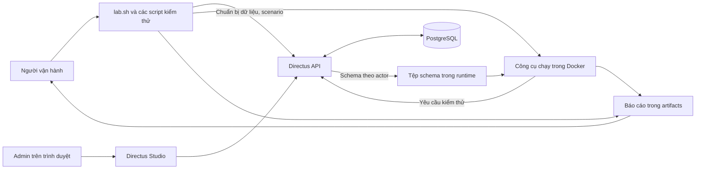
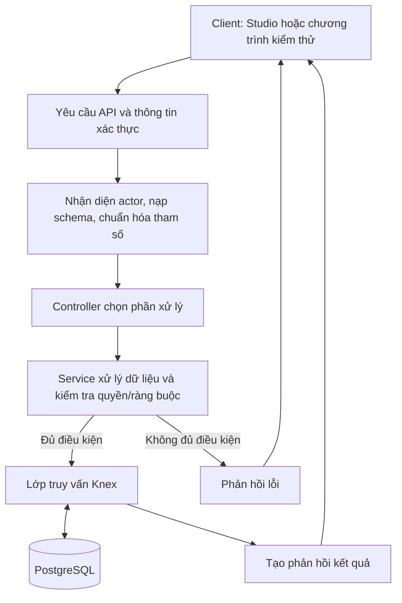

# MÔ TẢ HỆ THỐNG, ACTOR, USE CASE, MODULE, DEPENDENCY VÀ LUỒNG DỮ LIỆU

**Dự án:** R06 Directus + K05 Kiểm thử API dựa trên schema bằng Schemathesis  
**Ngày biên soạn:** 16/10/2026  
**Đối tượng đọc:** Người mới, chưa biết về dự án hoặc các công nghệ được sử dụng.

> Tài liệu mô tả cấu trúc và cách phối hợp của các thành phần dựa trên mã nguồn, cấu hình và tài liệu có trong workspace. Việc biên soạn không bao gồm chạy lại dịch vụ hoặc kiểm thử mới. Các thư mục trong cây được chọn theo vai trò, không liệt kê toàn bộ tệp.

## 1. Giới thiệu và các khái niệm cần biết

### 1.1. Có thể hình dung dự án như thế nào?

Hãy hình dung một hệ thống quản lý bài viết. Người biên tập được tạo và sửa bài; người đọc chỉ được xem nội dung đã công bố; người quản trị chuẩn bị tài khoản và quy định quyền truy cập.

Trong dự án này, **Directus** cung cấp hệ thống quản lý dữ liệu đó. **Bộ kiểm thử K05** đóng vai trò kiểm tra: gửi các yêu cầu như tạo bài, đọc bài hoặc sửa điểm, sau đó xem Directus có xử lý đúng không.

Dự án vì thế có hai phần liên quan:

| Phần | Vai trò | Cách hiểu đơn giản |
|---|---|---|
| **R06 — Directus** | Hệ thống được kiểm thử | Nơi nhận yêu cầu, kiểm tra quyền và quản lý dữ liệu |
| **K05 — Bộ kiểm thử** | Chuẩn bị và thực hiện kiểm thử API | Chương trình đặt các tình huống thử và đối chiếu kết quả |

Chuyên mục và bài viết là dữ liệu mẫu được nhóm chuẩn bị để thử nghiệm. Chúng không phải toàn bộ chức năng của sản phẩm Directus.

### 1.2. Giải thích thuật ngữ

| Thuật ngữ | Ý nghĩa trong tài liệu |
|---|---|
| **Actor — Tác nhân** | Người, vai trò hoặc chương trình tương tác với hệ thống |
| **Use case — Trường hợp sử dụng** | Một công việc actor muốn hoàn thành, ví dụ tạo bài viết |
| **API** | Nơi chương trình gửi yêu cầu và nhận kết quả từ hệ thống |
| **Module** | Một phần chương trình phụ trách một nhóm công việc |
| **Dependency — Thành phần phụ thuộc** | Công cụ, thư viện, dịch vụ hoặc đầu vào mà một phần chương trình cần để hoạt động |
| **Schema** | Bản mô tả cấu trúc; tùy ngữ cảnh có thể là cấu trúc dữ liệu hoặc mô tả API |
| **Fixture** | Bộ dữ liệu mẫu được chuẩn bị trước để làm căn cứ kiểm tra |
| **Token** | Thông tin xác thực được dùng sau khi đăng nhập để hệ thống nhận biết người gửi yêu cầu |
| **Artifact** | Tệp đầu ra của một lần chạy, như báo cáo hoặc log |
| **CRUD** | Bốn thao tác tạo, đọc, sửa và xóa dữ liệu |

## 2. Mục tiêu của hệ thống

### 2.1. Mục tiêu của phần quản lý dữ liệu

Trong phạm vi thử nghiệm, Directus cần:

- Lưu trữ và cung cấp dữ liệu chuyên mục, bài viết.
- Cho phép người có quyền tạo, đọc, sửa và xóa dữ liệu qua API.
- Hỗ trợ lọc, tìm kiếm, sắp xếp và chia danh sách thành từng trang.
- Kiểm tra người gửi yêu cầu là ai và được phép làm gì.
- Kiểm tra dữ liệu đầu vào theo các ràng buộc đã cấu hình.
- Cung cấp giao diện quản trị để Admin xem và quản lý dữ liệu.

### 2.2. Mục tiêu của phần kiểm thử

Bộ K05 cần kiểm tra hai nhóm vấn đề:

1. **API có phù hợp bản mô tả không?** Ví dụ mã phản hồi, kiểu nội dung và cấu trúc dữ liệu trả về có đúng OpenAPI hay không.
2. **Quy tắc sử dụng có được giữ đúng không?** Ví dụ Reader không sửa được bài, người đọc không thấy ghi chú nội bộ, sửa điểm không làm thay đổi tiêu đề.

Bộ kiểm thử cũng lưu lại dữ liệu cần thiết để điều tra và chạy lại một trường hợp: cấu hình, phiên bản schema, yêu cầu, phản hồi và báo cáo. Một kiểm tra không đạt được giữ lại để phân tích, không tự biến thành kết luận rằng đã tìm thấy một lỗi sản phẩm riêng biệt.

### 2.3. Phạm vi chính

Hai nhóm dữ liệu được chọn là `qa_categories` — chuyên mục và `qa_articles` — bài viết. Với mỗi nhóm, chiến dịch chính kiểm tra năm thao tác: đọc danh sách, tạo mới, đọc chi tiết, sửa chi tiết và xóa chi tiết. Tổng cộng là **10 cặp phương thức–đường dẫn API**.

GraphQL, WebSocket, kiểm thử giao diện tự động, tải lớn, nhiều hệ quản trị cơ sở dữ liệu và các dịch vụ bên ngoài không thuộc chiến dịch chính. Việc các module đó tồn tại trong mã Directus không có nghĩa dự án đã kiểm thử đầy đủ chúng.

## 3. Các actor chính

### 3.1. Actor của hệ thống dữ liệu

| Actor | Mục đích | Quyền trong lab | Ví dụ |
|---|---|---|---|
| **Admin — Quản trị viên** | Chuẩn bị và quản lý môi trường | Quản lý cấu trúc dữ liệu, tài khoản, quyền và dữ liệu; dùng Studio | Tạo hai nhóm dữ liệu mẫu, thiết lập quyền Reader |
| **Editor — Biên tập viên** | Quản lý nội dung qua API | Tạo, đọc, sửa và xóa cả chuyên mục lẫn bài viết | Tạo bài nháp rồi sửa điểm của bài |
| **Reader — Người đọc** | Đọc nội dung được phép | Đọc chuyên mục và bài đã công bố; không xem `internal_notes`; không ghi dữ liệu | Đọc danh sách bài published |
| **Anonymous — Người chưa đăng nhập** | Đại diện yêu cầu không có thông tin đăng nhập | Không được truy cập hai nhóm dữ liệu lab | Thử đọc bài mà không gửi token |

Editor và Reader của lab phục vụ API, không được cấu hình làm tài khoản sử dụng Studio. Tài khoản Admin được dùng cho chuẩn bị và đối chiếu; tài khoản mặc định của chiến dịch tự sinh yêu cầu là Editor.

### 3.2. Actor của bộ kiểm thử

| Actor | Công việc |
|---|---|
| **Người vận hành** | Chọn lệnh, khởi động lab, chuẩn bị dữ liệu, chạy kiểm thử và đọc kết quả |
| **Chương trình kiểm thử** | Gửi yêu cầu dưới vai trò được chọn, so sánh phản hồi và ghi báo cáo |

Người vận hành không phải một vai trò quyền mới trong Directus. Ví dụ, một sinh viên có thể chạy chương trình kiểm thử; chương trình lần lượt đăng nhập bằng Editor hoặc Reader tùy ca cần thực hiện.

## 4. Các use case chính

Các mã UC dưới đây được đặt trong tài liệu để tiện tra cứu. Chúng là cách mô tả các công việc hiện có, không phải tên lệnh hoặc mã ca mới được thêm vào chương trình.

| Mã | Use case | Actor thực hiện | Đầu vào chính | Kết quả cần có |
|---|---|---|---|---|
| UC01 | Chuẩn bị và khởi động lab | Người vận hành | Cấu hình cục bộ, image Docker | Directus và cơ sở dữ liệu sẵn sàng; có log của lần chạy |
| UC02 | Chuẩn bị dữ liệu mẫu và quyền | Người vận hành; chương trình dùng Admin | Cấu trúc mẫu, tài khoản, chính sách quyền | Hai nhóm dữ liệu, ba chuyên mục, 12 bài; ánh xạ ID và quyền phù hợp |
| UC03 | Đăng nhập và xác thực | Admin, Editor, Reader | Email và mật khẩu của actor | Có token hợp lệ để gửi các yêu cầu được phép |
| UC04 | Quản lý chuyên mục và bài viết | Editor qua API; Admin khi quản trị | Dữ liệu cần tạo/sửa hoặc ID cần đọc/xóa | Thực hiện CRUD đúng quyền và ràng buộc |
| UC05 | Truy vấn nội dung | Editor hoặc Reader theo quyền | Điều kiện lọc, từ tìm kiếm, thứ tự và số trang | Nhận dữ liệu phù hợp yêu cầu trong phạm vi được phép |
| UC06 | Ngăn truy cập trái quyền | Directus xử lý yêu cầu Reader/Anonymous | Yêu cầu đọc bài nháp, trường kín hoặc thử ghi | Không lộ dữ liệu cấm; thao tác bị từ chối không làm thay đổi dữ liệu mục tiêu |
| UC07 | Xuất bản mô tả API | Người vận hành; chương trình gọi theo actor | Hệ thống đã chuẩn bị dữ liệu và quyền | Schema OpenAPI được lưu riêng theo actor |
| UC08 | Chạy kiểm thử | Người vận hành và chương trình kiểm thử | Fixture, schema, cấu hình và ca kiểm tra | Báo cáo scenario, invariant hoặc campaign với trạng thái thực tế |
| UC09 | Điều tra và chạy lại trường hợp | Người vận hành và chương trình replay | Tên ca hoặc artifact nguồn, điều kiện dữ liệu | Kết quả chạy lại, thông tin khác biệt và phạm vi đã tái hiện |
| UC10 | Dừng môi trường | Người vận hành | Lệnh dừng lab | Dịch vụ dừng; dữ liệu PostgreSQL vẫn được giữ khi dùng `down` |

### Ví dụ một use case từ đầu đến cuối

Trong UC04, Editor muốn sửa điểm bài viết. Editor đăng nhập để nhận token, gửi ID bài và điểm mới, Directus kiểm tra quyền và dữ liệu, rồi lưu thay đổi vào PostgreSQL. Bộ kiểm thử sau đó đọc lại bài để xác nhận điểm đã đổi và tiêu đề vẫn giữ nguyên.

Nếu Reader thực hiện yêu cầu sửa tương tự, UC06 yêu cầu Directus từ chối. Chương trình dùng Editor đọc trước và sau yêu cầu của Reader để đối chiếu các trường mục tiêu.

## 5. Kiến trúc tổng thể



Sơ đồ thể hiện hai hướng sử dụng. Admin có thể mở Studio để xem dữ liệu. Người vận hành gọi các script để gửi yêu cầu API trực tiếp hoặc chạy công cụ kiểm thử trong Docker. Dữ liệu nghiệp vụ nằm trong PostgreSQL; schema và báo cáo được lưu thành tệp để công cụ và người vận hành sử dụng.

### 5.1. Các dịch vụ Docker

Tệp `DAMH/compose.yaml` khai báo ba service:

| Service | Vai trò | Phụ thuộc khi khởi động |
|---|---|---|
| `database` | Chạy PostgreSQL, lưu dữ liệu | Cấu hình cơ sở dữ liệu và vùng lưu trữ |
| `directus` | Chạy API và phục vụ ứng dụng quản trị | Chờ `database` đạt trạng thái healthy — sẵn sàng |
| `runner` | Duy trì container từ image Schemathesis và kiểm tra công cụ có sẵn | Chờ `directus` healthy |

Một điểm cần phân biệt: service `runner` trong Compose không tự sinh yêu cầu kiểm thử khi chạy `up`. Khi gọi campaign hoặc invariant, script tạo các container tạm từ image công cụ để thực hiện công việc rồi kết thúc. Vì vậy, “môi trường đã mở” và “đã chạy kiểm thử” là hai trạng thái khác nhau.

### 5.2. Kết nối và nơi lưu dữ liệu

- Các service dùng mạng Docker `r06-k05_network`.
- Directus được công bố tại `http://127.0.0.1:8055` trên máy chạy lab.
- Công cụ bên trong mạng Docker gọi `http://directus:8055`.
- PostgreSQL dùng cổng 5432 trong mạng nội bộ và không công bố cổng ra máy host theo Compose này.
- Dữ liệu PostgreSQL được giữ trong volume `r06-k05_db_data`.

Volume là phần lưu trữ do Docker quản lý. Nó khác với các file báo cáo trong thư mục `artifacts` của workspace.

## 6. Cây thư mục và module

### 6.1. Cấu trúc workspace

```text
D:\DAMH-full-recovery-2026-10-12\
├── DAMH\                         Mã và tài liệu của bộ kiểm thử
│   ├── README.md                 Tổng quan, cấu hình và cách tái lập
│   ├── lab.sh                    Điểm nhận lệnh và điều phối
│   ├── compose.yaml              Cấu hình dịch vụ Docker
│   ├── config\
│   │   ├── lab.env.example       Cấu hình mẫu, phiên bản image và budget
│   │   └── lab.env               Cấu hình riêng trên máy
│   ├── scripts\
│   │   ├── lab-components.sh     Seed, quyền, schema, scenario, campaign, replay
│   │   └── invariants.py         Các ca kiểm tra quy tắc và phản hồi API
│   ├── manifest\
│   │   └── baseline.yaml         Thông tin mốc môi trường và bằng chứng liên quan
│   ├── runtime\                  ID mẫu và schema được tạo khi chạy
│   ├── artifacts\runs\           Metadata, log và báo cáo theo lần chạy
│   ├── evidence\                 Các ghi nhận xác minh, phân tích kết quả
│   └── docs\                     Tài liệu kiến trúc, kiểm thử và hướng dẫn
├── directus\                     Mã nguồn tham khảo của sản phẩm Directus
└── tmp\lab-tools\                Các tệp hỗ trợ Windows trong workspace này
    ├── run-lab.ps1                Gọi bộ lab từ PowerShell qua Git Bash
    ├── jq                       Wrapper xử lý khác biệt Windows/Git Bash
    └── jq.exe                    Công cụ đọc và xử lý JSON
```

`config/lab.env`, `runtime/` và `artifacts/runs/` bị Git ignore theo cấu hình hiện có: chúng không tự đi kèm một bản clone mã nguồn mới. Các tệp Windows trong `tmp/lab-tools` cũng nằm ngoài repository `DAMH`.

### 6.2. Các module của bộ K05

| Tệp hoặc nhóm hàm | Công việc chính | Đầu vào | Đầu ra |
|---|---|---|---|
| `lab.sh` | Nhận lệnh, kiểm tra cấu hình, gọi Docker và module; tạo thông tin lần chạy | Lệnh người dùng, cấu hình | Metadata, log, mã kết thúc và lời gọi đến module |
| `ensure_schema`, `seed` trong `lab-components.sh` | Chuẩn bị cấu trúc và dữ liệu mẫu qua API | Mô tả collection, dữ liệu mẫu, quyền Admin | Collection, bản ghi, tài khoản và quyền |
| `write_fixture_map` | Lưu mã thật của bản ghi mẫu | ID từ hệ thống | `fixture-ids.json` |
| `export_schema` | Lấy OpenAPI theo actor và lưu bản mô tả | Token actor, API đã chuẩn bị | Các tệp schema, hash và danh sách thao tác |
| `scenario_*`, `scenarios` | Chạy sáu luồng nghiệp vụ có bước kiểm tra viết sẵn | Fixture, token, schema cần thiết | `scenario-report.json` |
| `campaign_build_schema`, `campaign_one`, `campaign` | Chuẩn bị schema trong phạm vi, gọi Schemathesis, thu kết quả | Schema Editor, ID mẫu, seed sinh dữ liệu, budget | Báo cáo raw/guided, coverage và số liệu |
| `campaign_snapshot`, `campaign_restore` | Lưu và khôi phục dữ liệu hai collection quanh lượt campaign | Dữ liệu hiện tại và snapshot | Snapshot cùng kết quả khôi phục, đối chiếu |
| `invariants.py` | Chạy 11 ca kiểm tra quy tắc, dữ liệu và phản hồi | Cấu hình, fixture map, schema | `invariant-report.json` và thông tin từng bước |
| `replay_case`, `replay_schemathesis_case` | Chạy lại ca ổn định hoặc ca từ báo cáo công cụ | Tên/ID ca, artifact nguồn, dữ liệu cần thiết | Báo cáo tái hiện hoặc lý do không tái hiện được |
| `run-lab.ps1` | Gọi Bash và bổ sung môi trường Windows | Tham số lệnh từ PowerShell | Kết quả của lệnh lab và mã kết thúc |

Một tệp có thể chứa nhiều module theo nghĩa chức năng. Ví dụ `lab-components.sh` chứa cả phần seed và campaign; chúng không phải hai dịch vụ chạy riêng.

### 6.3. Cấu trúc mã nguồn Directus

```text
directus\
├── package.json                  Công cụ và lệnh ở cấp toàn repository
├── pnpm-workspace.yaml           Danh sách package và catalog dependency
├── pnpm-lock.yaml                Khóa phiên bản dependency được giải quyết
├── directus\                     Gói đóng gói và lệnh CLI của sản phẩm
├── api\src\                     Backend: nhận yêu cầu và xử lý dữ liệu
│   ├── server.ts                 Tạo và mở HTTP server
│   ├── app.ts                    Đăng ký các bước xử lý và đường dẫn API
│   ├── controllers\             Tiếp nhận từng nhóm yêu cầu
│   ├── services\                Xử lý công việc và truy cập dữ liệu
│   ├── middleware\              Xác thực, chuẩn hóa yêu cầu, xử lý lỗi
│   ├── auth\                    Cơ chế đăng nhập
│   ├── permissions\             Quyền theo thao tác, bản ghi và trường
│   ├── database\                Kết nối, truy vấn và cấu trúc cơ sở dữ liệu
│   ├── storage\                 Tổ chức lưu trữ tệp
│   ├── extensions\              Cơ chế mở rộng
│   └── websocket\               Chức năng thời gian thực
├── app\src\                     Giao diện quản trị Studio
│   ├── components\              Các thành phần giao diện
│   ├── views\                   Các màn hình
│   ├── stores\                  Dữ liệu/trạng thái dùng chung trên giao diện
│   └── modules\                 Các khu vực chức năng của giao diện
├── sdk\                         Thư viện hỗ trợ chương trình gọi API
├── packages\                    Các thư viện dùng chung trong sản phẩm
└── tests\                       Các bộ kiểm thử của repository Directus
```

Backend là phần chạy trên máy chủ; frontend là giao diện trong trình duyệt. Controller có thể hiểu là nơi tiếp nhận đúng loại yêu cầu, còn service là nơi tổ chức xử lý công việc đó.

Hai collection `qa_categories` và `qa_articles` được tạo bằng script của lab qua API. Chúng không tương ứng với hai thư mục module nghiệp vụ có sẵn trong mã nguồn Directus. Các test sẵn có trong `directus/tests` cũng là phần khác với suite K05 trong `DAMH`.

## 7. Dependency — Những thành phần hệ thống cần

### 7.1. Thành phần để chạy lab

| Thành phần | Vai trò | Mốc/cách dùng của dự án |
|---|---|---|
| Docker và Docker Compose | Tạo môi trường chạy và kết nối các service | Docker Desktop trên Windows hoặc Engine/Compose trong môi trường phù hợp |
| Directus | Hệ thống được kiểm thử | Image 12.5.0 |
| PostgreSQL | Lưu dữ liệu và quan hệ | Image 16-alpine |
| Schemathesis | Tự sinh và kiểm tra yêu cầu API | Image 4.30.0 |
| Bash, `curl`, `jq` | Điều phối, gọi HTTP và xử lý JSON | Các script lab sử dụng trên host |
| Python trong image công cụ | Chạy `invariants.py` | Mã invariant dùng thư viện chuẩn Python; không yêu cầu cài Python riêng trên host theo đường Docker |
| PowerShell và Git Bash | Cầu nối chạy script trên Windows | `run-lab.ps1` gọi Git Bash tại vị trí đã cấu hình |
| Cấu hình và thông tin đăng nhập cục bộ | Kết nối đúng lab, đăng nhập đúng actor | Đọc từ `config/lab.env` và truyền cho các phần cần dùng |
| Tính năng license phù hợp | Cho phép chính sách Reader tùy chỉnh của lab | Phần này cần `custom_permission_rules_enabled` |

Các image được ghi kèm digest trong cấu hình mẫu. Digest là mã định danh nội dung image, giúp xác định môi trường cụ thể thay vì chỉ dựa vào tên phiên bản.

Việc thiếu quyền Reader hoặc tính năng license cần thiết có thể làm một số bước chưa hoàn tất, dù trang Directus vẫn mở được. Dependency về dữ liệu, quyền và cấu hình cũng quan trọng như dependency về công cụ.

### 7.2. Thư viện trong mã nguồn Directus

Các mục dưới đây được đối chiếu từ package manifest và mã nguồn đang có. Đây là thành phần bên trong Directus; người chạy lab bằng image không phải tự cài từng thư viện.

| Nhóm | Ví dụ thành phần | Vai trò dễ hiểu |
|---|---|---|
| Môi trường thực thi | Node.js; mã TypeScript được build thành JavaScript | Chạy phần máy chủ của Directus |
| HTTP | Express | Nhận yêu cầu và chuyển đến phần xử lý phù hợp |
| Cơ sở dữ liệu | Knex và driver PostgreSQL | Tạo/thực hiện truy vấn tới cơ sở dữ liệu |
| Đăng nhập | `argon2`, `jsonwebtoken` | Hỗ trợ kiểm tra mật khẩu và token |
| Kiểm tra dữ liệu | Joi, Zod, các package validation của Directus | Kiểm tra cấu trúc và điều kiện của dữ liệu ở những phần sử dụng chúng |
| Mô tả API | `openapi3-ts`, các module specs/schema | Hỗ trợ tạo, xử lý bản mô tả API |
| Giao diện | Vue, Vue Router, Pinia | Hiển thị màn hình, điều hướng và giữ trạng thái giao diện |
| Build giao diện | Vite | Phục vụ phát triển và tạo bản build frontend |
| Thư viện nội bộ | `@directus/types`, `@directus/utils`, `@directus/schema`, `@directus/storage` | Dùng chung kiểu dữ liệu, tiện ích, schema và lưu trữ |

Khi phát triển từ mã nguồn, manifest hiện có yêu cầu Node **22**, pnpm **>=10 và <11**, đồng thời ghi package manager `pnpm@10.27.0`. Đây là yêu cầu của đường phát triển source; Node chạy ứng dụng đã nằm trong image khi dùng lab Docker.

Trong các manifest, `workspace:*` chỉ dependency nội bộ cùng repository; `catalog:` lấy phiên bản từ `pnpm-workspace.yaml`. `pnpm-lock.yaml` giữ thông tin phiên bản cụ thể đã được giải quyết.

Mã nguồn tham khảo trong workspace không được mặc định là cùng checkout dùng để tạo image lab. Mô tả tổ chức mã nguồn và cấu hình runtime cần được đối chiếu theo đúng nguồn của chúng khi điều tra một lỗi cụ thể.

### 7.3. Phụ thuộc theo thứ tự công việc

```text
Công cụ và cấu hình
    → Cơ sở dữ liệu sẵn sàng
    → Directus sẵn sàng
    → Dữ liệu mẫu và quyền được chuẩn bị
    → Xuất schema theo actor
    → Chạy các bộ kiểm thử cần dữ liệu/schema đó
    → Đọc báo cáo, phân tích và replay khi cần
```

Ví dụ, nếu schema được xuất trước khi tạo collection mẫu, công cụ có thể không có mô tả của API cần kiểm tra. Nếu bản ánh xạ ID không khớp dữ liệu hiện tại, một yêu cầu đọc bản ghi có thể sai ngay từ điều kiện đầu vào.

## 8. Mô hình dữ liệu và nơi lưu trữ

### 8.1. Dữ liệu chuyên mục và bài viết

Bộ mẫu gồm ba chuyên mục và 12 bài viết, chia thành sáu bài nháp và sáu bài đã công bố. Mỗi chuyên mục có ID và tên. Bài viết có các thông tin chính:

| Trường | Ý nghĩa | Quy tắc chính trong lab |
|---|---|---|
| `id` | Mã bài | Hệ thống tự sinh |
| `title` | Tiêu đề | Bắt buộc, tối đa 120 ký tự |
| `status` | Trạng thái | `draft` hoặc `published` |
| `score` | Điểm | Số nguyên từ 0 đến 5 |
| `published_at` | Thời điểm công bố | Có thể chưa có giá trị |
| `metadata` | Thông tin bổ sung dạng JSON | Có thể chưa có giá trị |
| `internal_notes` | Ghi chú nội bộ | Reader không được đọc |
| `category` | Mã chuyên mục liên quan | Có thể để trống |

Quan hệ được hiểu như sau: **một chuyên mục có thể chứa nhiều bài; một bài có tối đa một chuyên mục**. Khi xóa chuyên mục, bài vẫn được giữ và `category` chuyển thành `null`, tức chưa có giá trị.

### 8.2. Phân biệt các nơi lưu dữ liệu

| Nơi lưu | Chứa gì? | Ai sử dụng? |
|---|---|---|
| PostgreSQL trong volume Docker | Bản ghi chuyên mục, bài, tài khoản và cấu hình hệ thống Directus | Directus |
| `runtime/fixture-ids.json` hoặc đường dẫn theo profile | Ánh xạ tên dữ liệu mẫu sang ID thật | Script scenario, invariant, campaign |
| `runtime/.../schemas/<fixture_version>/` | OpenAPI theo actor và thông tin liên quan | Bộ kiểm thử |
| `artifacts/runs/<run_id>/` | Log, metadata, snapshot phục vụ lượt chạy và báo cáo | Công cụ, người vận hành |
| `evidence/` | Bản ghi giải thích những lần xác minh và phát hiện đã có | Người đọc báo cáo, người bàn giao |
| `config/lab.env` | Thông tin cấu hình riêng, mật khẩu và license nếu có | Bộ điều phối và Docker |

Launcher Windows mặc định dùng `runtime/profiles/windows-20261013-oig/` thay cho thư mục runtime gốc. Profile giúp tách tệp runtime nhưng không tạo thêm một PostgreSQL riêng. Các suite có ghi dữ liệu vẫn cần chạy tuần tự khi dùng chung database.

## 9. Các luồng dữ liệu chính

### 9.1. Luồng khởi động và chuẩn bị dữ liệu

1. Người vận hành gọi `up` qua launcher hoặc `lab.sh`.
2. `lab.sh` đọc cấu hình và gọi Docker Compose để mở các service.
3. PostgreSQL sẵn sàng trước; Directus kết nối đến PostgreSQL và mở API.
4. Khi gọi `seed`, script đăng nhập Admin, kiểm tra/tạo collection, trường, quan hệ, dữ liệu và quyền qua API.
5. Directus xử lý yêu cầu, ghi dữ liệu vào PostgreSQL và trả kết quả cho script.
6. Script ghi ID thực tế của dữ liệu mẫu vào `fixture-ids.json` để các bước sau dùng lại.

Đường chuẩn bị dữ liệu của K05 gọi REST API. Nó không có nghĩa sinh viên tự chép bản ghi vào các file trong thư mục mã nguồn hoặc chỉnh trực tiếp bảng PostgreSQL.

### 9.2. Luồng đăng nhập và gửi yêu cầu

1. Client hoặc script gửi email và mật khẩu đến `POST /auth/login`.
2. Directus kiểm tra tài khoản và thông tin đăng nhập.
3. Khi đăng nhập thành công, client nhận token theo cách đăng nhập được sử dụng.
4. Các yêu cầu tiếp theo của script gửi token để Directus biết actor đang gọi.
5. Directus áp dụng quyền tương ứng, rồi trả dữ liệu hoặc lỗi phù hợp.

Thông tin mật khẩu/token phục vụ xác thực, không phải dữ liệu mẫu cần đưa vào báo cáo chia sẻ. Anonymous là trường hợp không gửi thông tin đăng nhập.

### 9.3. Luồng xử lý một yêu cầu đọc hoặc ghi



Đây là sơ đồ rút gọn. Quyền và validation có thể được kiểm tra ở nhiều điểm tùy thao tác. Các endpoint công khai như `/server/ping` cũng không đi qua toàn bộ luồng yêu cầu dữ liệu có bảo vệ này.

**Ví dụ đọc dữ liệu:** Editor yêu cầu lấy danh sách bài với điều kiện trạng thái published. Directus chuẩn hóa bộ lọc, kiểm tra quyền đọc, tạo truy vấn PostgreSQL và trả danh sách phù hợp. Với Reader, quy tắc quyền còn giới hạn bản ghi và trường có thể đọc.

**Ví dụ ghi dữ liệu:** Editor gửi `PATCH /items/qa_articles/{id}` với `{"score":5}`. Directus xác định bài cần sửa, kiểm tra quyền và giá trị điểm, cập nhật dữ liệu rồi trả kết quả. Bộ kiểm thử đọc lại để xác minh thay đổi.

### 9.4. Luồng xuất schema và tự sinh kiểm thử

1. Sau seed, script gọi `GET /server/specs/oas` bằng actor tương ứng.
2. Directus tạo bản mô tả API theo ngữ cảnh người gọi; script lưu riêng schema của từng actor.
3. Với campaign chính, script lấy schema Editor và chọn đúng 10 thao tác được phép trong phạm vi lab.
4. Chế độ `raw` giữ mô tả của các thao tác đã chọn. Chế độ `guided` tạo bản riêng có thêm ví dụ và ID hợp lệ, đồng thời bật kiểm tra chuỗi thao tác.
5. Schemathesis đọc bản schema của lượt chạy và sinh yêu cầu API.
6. Directus xử lý yêu cầu qua API và PostgreSQL, rồi trả phản hồi.
7. Schemathesis đối chiếu phản hồi với các kiểm tra được bật; ghi report, sự kiện và coverage vào thư mục lượt chạy.

Schema cho biết mô tả API mà công cụ nhìn thấy, chưa thay thế việc gửi yêu cầu thực tế để xác minh quyền. Một thao tác vắng trong schema không tự có nghĩa bộ kiểm thử đã gửi và kiểm tra thành công mọi tình huống bị cấm.

### 9.5. Luồng kiểm tra quy tắc nghiệp vụ

Scenario và invariant dùng các bước, dữ liệu và tiêu chí đã viết sẵn. Ví dụ Reader thử ghi:

```text
Đọc ID bài mẫu
    → Editor đọc dữ liệu trước thao tác
    → Reader gửi yêu cầu sửa với điểm hợp lệ
    → Kiểm tra yêu cầu bị từ chối
    → Editor đọc lại cùng các trường
    → So sánh trước/sau
    → Ghi trạng thái và chi tiết vào báo cáo
```

Luồng này kiểm tra điều bản mô tả API có thể chưa diễn đạt đầy đủ: một yêu cầu bị từ chối phải giữ nguyên dữ liệu mục tiêu ở các trường được đối chiếu. Bộ invariant hiện có 11 ca; sáu scenario nằm trong script Bash và được báo cáo riêng.

### 9.6. Luồng snapshot, khôi phục và replay

Trước lượt campaign, script lưu snapshot dữ liệu hai collection. Sau runner, script khôi phục và đối chiếu dữ liệu, rồi tổng hợp riêng kết quả runner với kết quả restore. Snapshot ở đây là dữ liệu phục vụ bộ kiểm thử, không phải cam kết sao lưu toàn bộ PostgreSQL hay toàn bộ hệ thống.

Người vận hành đọc báo cáo, chọn ca cần điều tra và gọi replay. Với ca phụ thuộc nhiều bước, script cần dữ liệu nguồn, quan hệ giữa các bước và ánh xạ ID. Nếu chỉ chạy lại được yêu cầu cuối, kết quả phải ghi đúng phạm vi đó; chưa thể khẳng định đã tái hiện cả chuỗi.

Restore đạt chỉ cho biết dữ liệu được khôi phục theo tiêu chí của lab. Nó không đổi một kiểm tra API không đạt thành đạt. Tương tự, replay tái hiện được một failure là thành công của việc tái hiện, không chứng minh hành vi API ban đầu là đúng.

## 10. Đầu vào và đầu ra của toàn bộ hệ thống kiểm thử

| Nhóm | Nội dung |
|---|---|
| Đầu vào môi trường | Image được pin, cấu hình Docker, URL, quyền và thông tin đăng nhập |
| Đầu vào dữ liệu | Fixture, ID map, schema theo actor, snapshot nếu cần |
| Đầu vào kiểm thử | Tên suite, tên/ID ca, seed sinh yêu cầu, ngân sách thời gian và số example |
| Đầu ra nghiệp vụ | Dữ liệu được tạo/đọc/sửa/xóa hoặc phản hồi từ chối theo quyền và ràng buộc |
| Đầu ra kiểm thử | Trạng thái từng ca, request/response, báo cáo, coverage, metrics và mã kết thúc |
| Đầu ra phục vụ giải thích | Evidence, phân loại phát hiện, điều kiện replay và các giới hạn chưa xác minh |

Phần **schema coverage** trong báo cáo nói về phạm vi kiểm tra theo mô tả API và hoạt động sinh dữ liệu. Nó không phải tỷ lệ dòng mã Directus đã chạy. Mười thao tác được gọi cũng chưa có nghĩa mọi trường hợp sử dụng của hệ thống đã được kiểm tra.

Tài liệu này mô tả những thành phần và luồng có trong workspace. Việc một lần chạy cụ thể có đạt hay không phải dựa trên báo cáo của lần đó; không suy ra chỉ từ sơ đồ kiến trúc hoặc sự tồn tại của mã kiểm thử.

## 11. Tài liệu và mã nguồn đối chiếu

| Nội dung | Nguồn |
|---|---|
| Tổng quan và giao diện lệnh | [README của DAMH](../README.md) |
| Dịch vụ, mạng và volume | [compose.yaml](../compose.yaml) |
| Phiên bản image và cấu hình mẫu | [lab.env.example](../config/lab.env.example) |
| Điều phối, metadata và Docker | [lab.sh](../lab.sh) |
| Seed, quyền, schema, scenario, campaign và replay | [lab-components.sh](../scripts/lab-components.sh) |
| HTTP client và 11 ca invariant | [invariants.py](../scripts/invariants.py) |
| Quyền các actor | [permissions.md](permissions.md) |
| Phạm vi thao tác và kịch bản | [test-matrix.md](test-matrix.md) |
| Công cụ phát triển mã Directus | [package.json](../../directus/package.json), [pnpm-workspace.yaml](../../directus/pnpm-workspace.yaml) |
| Thư viện API và giao diện | [api/package.json](../../directus/api/package.json), [app/package.json](../../directus/app/package.json) |
| Đăng ký đường dẫn và các bước xử lý API | [api/src/app.ts](../../directus/api/src/app.ts) |
| Xử lý dữ liệu item | [api/src/controllers/items.ts](../../directus/api/src/controllers/items.ts), [api/src/services/items.ts](../../directus/api/src/services/items.ts) |
| Launcher Windows của workspace | [run-lab.ps1](../../tmp/lab-tools/run-lab.ps1) |
| Cách chạy từng bước | [Báo cáo hướng dẫn chạy dự án](Bao_cao_Huong_dan_chay_du_an.md) |
| Thiết kế kiểm thử dễ hiểu | [Báo cáo thiết kế kịch bản kiểm thử](Bao_cao_Thiet_ke_kich_ban_kiem_thu.md) |
