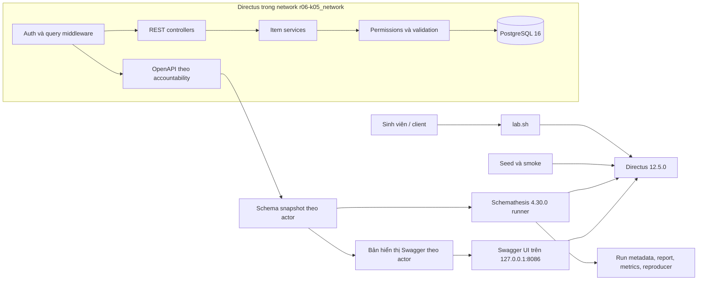

# Kiến trúc phòng kiểm thử R06 + K05

Luồng kiểm thử phải tách thành ba phần có thể kiểm tra riêng:

1. `lab.sh` xác minh URL, container, cấu hình và precondition.
2. Seed/scenario tạo dữ liệu biết trước, actor và oracle nghiệp vụ.
3. Schemathesis nhận schema đã xuất từ instance đã seed, chạy đúng allowlist rồi lưu metadata và report.

Compose mặc định tạo ba service `database`, `directus` và `runner` trong project `r06-k05`, cùng network `r06-k05_network` và volume `r06-k05_db_data`. Directus chỉ publish `127.0.0.1:8055`; PostgreSQL và runner không publish cổng host. Runner giữ container sống để các campaign dùng image digest đã pin và bind-mount schema/report theo từng run.

Service Swagger UI thuộc profile Compose `docs` tùy chọn, chỉ publish `127.0.0.1:8086`. Nó đọc bản sao schema Editor/Reader từ `runtime/swagger/` ở chế độ chỉ đọc; trình duyệt gửi “Try it out” tới Directus qua CORS giới hạn đúng origin Swagger. Bản sao chỉ phục vụ giao diện, có manifest/diff riêng và không làm đầu vào cho Schemathesis.

`lab.sh` tạo `artifacts/runs/<run_id>/` cho metadata/log. `scripts/lab-components.sh` là lớp API/seed/export/campaign; `scripts/invariants.py` là runner Python standard-library cho scenario, invariant và replay. Credential chỉ được đọc từ `config/lab.env`; login response và token không được ghi artifact.

Request REST đi qua xác thực và chuẩn hóa query, vào controller, qua service item, permission/validation rồi mới truy vấn PostgreSQL. Endpoint OpenAPI dùng accountability của người gọi nên schema của `admin`, `editor` và `reader` phải được lưu riêng.

Campaign chính có 10 method–path: GET/POST list và GET/PATCH/DELETE detail cho mỗi collection. Profile `raw` giữ contract operation gốc sau allowlist; `guided` dùng schema copy riêng với fixture ID/example hợp lệ và stateful phase. GraphQL, WebSocket, Studio, API quản trị, nhiều database, load testing và dịch vụ ngoài lab nằm ngoài campaign chính. Chi tiết allowlist và scenario nằm ở [`docs/test-matrix.md`](test-matrix.md).
