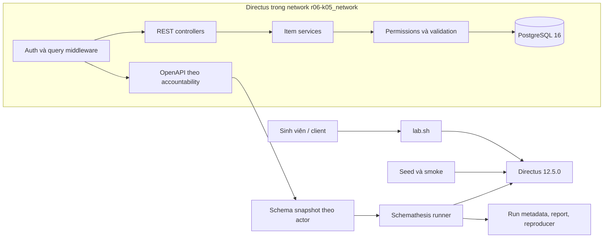

# Kiến trúc phòng kiểm thử R06 + K05

Luồng kiểm thử phải tách thành ba phần có thể kiểm tra riêng:

1. `lab.sh` xác minh URL, container, cấu hình và precondition.
2. Seed/scenario tạo dữ liệu biết trước, actor và oracle nghiệp vụ.
3. Schemathesis nhận schema đã xuất từ instance đã seed, chạy đúng allowlist rồi lưu metadata và report.

Request REST đi qua xác thực và chuẩn hóa query, vào controller, qua service item, permission/validation rồi mới truy vấn PostgreSQL. Endpoint OpenAPI dùng accountability của người gọi nên schema của `admin`, `editor` và `reader` phải được lưu riêng.

Phạm vi trước giữa kỳ là REST trên `qa_categories` và `qa_articles`, năm operation mỗi collection. GraphQL, WebSocket, Studio, API quản trị, nhiều database, load testing và dịch vụ ngoài lab nằm ngoài campaign chính.
