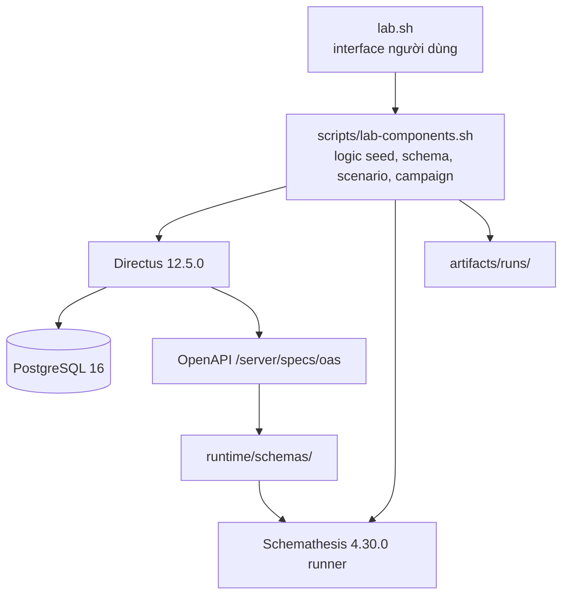
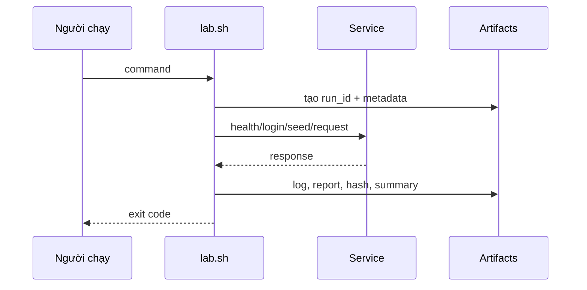

# Bài 3 — Kiến trúc lab và khả năng tái lập

## 3.1. Mục tiêu kiến trúc

Lab cần cho phép một người khác clone repository, điền `.env` cục bộ, chạy một interface thống nhất và thu lại đủ bằng chứng. Vì vậy, hệ thống tách bốn lớp:



- `lab.sh` giữ interface, validate config, tạo run metadata và exit code.
- `scripts/lab-components.sh` chứa logic nghiệp vụ/harness dùng chung.
- Compose cô lập network, container, volume và project name `r06-k05`.
- Artifact là bằng chứng theo run, không phải cache để xóa tùy tiện.

## 3.2. Thành phần runtime

| Thành phần | Vai trò |
|---|---|
| Directus | REST API, auth, policy, schema và OpenAPI export |
| PostgreSQL | Lưu collection, field, relation, fixture |
| Schemathesis runner | Sinh request từ schema và kiểm check |
| Host harness | Điều phối seed, actor, scenario, restore, replay |

API host mặc định là `http://127.0.0.1:8055`; runner gọi `http://directus:8055` trong network Compose. Database không cần publish cổng host. Không dùng database, volume, network hoặc container của project khác.

## 3.3. Baseline và pin version

Baseline mục tiêu:

```text
Directus:      12.5.0
PostgreSQL:    16-alpine
Schemathesis:  4.30.0
Compose:       r06-k05
```

Image hiện được digest-pin trong [`config/lab.env.example`](../../config/lab.env.example). Tag giúp đọc, digest giúp biết byte image nào đã chạy. Không thay bằng `latest`, không coi `info.version` của OpenAPI là bằng chứng Directus version.

Kế hoạch cũng tham chiếu Directus source commit `4f77933bf9551cac6b289576078783e189b8f4e3`. Đây là provenance của baseline được ghi trong quy tắc dự án; image digest/runtime evidence vẫn phải được kiểm tra riêng khi chạy, không suy ra một cái từ cái kia.

Mỗi run phải ghi ít nhất:

- harness commit SHA hoặc `no_commit` nếu chưa có commit;
- image version/digest;
- fixture version và seed;
- actor/profile/schema hash;
- config budget;
- thời điểm, thời lượng, exit/status;
- log và report liên quan.

## 3.4. Interface và ý nghĩa lệnh

```text
./lab.sh doctor
./lab.sh up
./lab.sh seed
./lab.sh smoke
./lab.sh export-schema
./lab.sh test smoke|schema-smoke|scenarios|invariants|raw|guided
./lab.sh replay <case-id>
./lab.sh reset
./lab.sh down
```

| Lệnh | Tác dụng | Rủi ro dữ liệu |
|---|---|---|
| `doctor` | Kiểm công cụ, config, image, health, license và map | Không chủ đích ghi dữ liệu |
| `up` | Khởi động Compose lab | Tạo/khởi động container lab |
| `seed` | Tạo/đồng bộ schema, role, actor và fixture | Ghi dữ liệu lab; phải idempotent |
| `smoke` | Kiểm các request cơ bản | Có thể tạo/xóa dữ liệu scenario |
| `export-schema` | Xuất OpenAPI theo actor | Tạo snapshot/artifact |
| `test ...` | Chạy suite tương ứng | Campaign có restore; vẫn phải đọc budget |
| `replay` | Tái hiện case đã lưu | Có thể tạo dữ liệu tạm, cần đọc precondition |
| `reset` | Reset đúng lab | Thao tác phá dữ liệu lab; xác minh project trước |
| `down` | Dừng stack, mặc định giữ volume | Không xóa dữ liệu |

`down` khác `reset`: dừng container không đồng nghĩa xóa database. Không dùng `docker system prune`, không dừng container ngoài project này.

## 3.5. Vòng đời một run



Một run `PASS` có nghĩa là command cụ thể hoàn thành theo oracle của command đó; không có nghĩa toàn bộ dự án không còn finding. Ngược lại, run `FAIL` vẫn có thể để lại artifact hữu ích cho triage.

## 3.6. Tự dựng từ máy sạch

1. Cài Docker Engine và Compose plugin; kiểm `docker --version`, `docker compose version`.
2. Clone repository và đọc `README.md`/`AGENTS.md`.
3. Sao chép `config/lab.env.example` thành `config/lab.env`, điền credential cục bộ, `chmod 600`.
4. Chạy `./lab.sh doctor`; xử lý từng `FAIL`, không bỏ qua.
5. Chạy `./lab.sh up`, chờ health.
6. Chạy `./lab.sh seed`; kiểm `fixture-map.json`.
7. Chạy smoke, schema export, scenarios, invariants theo thứ tự.
8. Chỉ sau precondition mới chạy raw/guided.

Nếu license hoặc service chưa sẵn sàng, ghi blocker vào run/evidence; không tắt cơ chế license để làm cho test “pass”.

## 3.7. Câu hỏi tự kiểm tra

- Vì sao runner dùng hostname `directus` còn host dùng `127.0.0.1`?
- Vì sao `down` phải giữ volume mặc định?
- Một artifact chứa token có thể vi phạm quy tắc nào dù file đã bị ignore?
- Khi campaign fail nhưng restore pass, những kết luận nào còn được phép đưa ra?

Đọc tiếp: [Bài 4 — OpenAPI và schema theo actor](04_openapi_schema.md).

