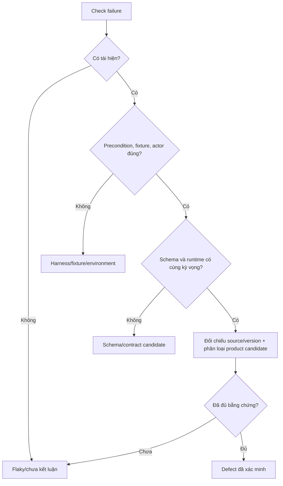

# Bài 7 — Phân loại failure, metrics và replay

## 7.1. Từ failure tới kết luận

Quy trình triage nên là:



Một failure chỉ là tín hiệu. Muốn gọi là defect cần request/sequence, expected/actual, version, precondition và tái hiện đủ.

## 7.2. Năm nhóm phân loại

| Nhóm | Dấu hiệu | Ví dụ/biện pháp |
|---|---|---|
| Product defect | Baseline đúng, schema/oracle đúng, tái hiện ổn định, hành vi sai yêu cầu | Cần reproducer và source/version comparison |
| Schema/contract gap | Runtime hợp lý nhưng OpenAPI thiếu/sai shape/status/media type | Lưu raw schema, response và diff; không gọi ngay product bug |
| Harness/fixture | Request sai actor/ID, expected sai, report ghi nhầm status, cleanup lỗi | Sửa harness bằng commit mới, chạy lại evidence |
| Environment | Docker/health/license/network/credential/image không đúng | Sửa môi trường hoặc ghi blocker, không đếm là product bug |
| Unresolved | Có tín hiệu nhưng thiếu bằng chứng hoặc stateful replay chưa tái tạo đủ | Giữ case, ghi giới hạn và bước tiếp theo |

## 7.3. Không đếm sai metrics

Báo cáo phải tách:

- số operation trong schema;
- số operation thực sự chạy;
- số request/case;
- số check failure;
- số unique failure sau grouping/shrinking;
- số scenario/invariant pass/fail/blocked;
- số defect đã xác minh;
- số candidate/chưa kết luận.

Ví dụ “1 case vi phạm status, content type và response schema” không tự động là 3 bug. Một root cause có thể tạo nhiều check failure.

Schema coverage cũng không phải line/branch coverage Directus. Có operation trong schema không có nghĩa đã có positive acceptance hoặc đã đi qua mọi nhánh policy.

## 7.4. Finding aggregate `500`

Trong invariant/replay, request aggregate với shape unknown `{"foo":1}` trên query có thể trả HTTP `500`, trong khi controls như `{}` hoặc `{"count":["id"]}` trả `200`. Đây là **product robustness candidate/aggregate finding**, nhưng chưa gọi là product defect cuối cùng nếu chưa hoàn thành đối chiếu contract và source baseline.

Khi học case này, ghi:

- actor và token source (không ghi token);
- URL/query/body đã làm sạch;
- schema hash và Directus image digest;
- response status/body đã redaction;
- controls;
- log server liên quan nếu không chứa secret;
- run ID và harness SHA.

## 7.5. Contract/schema candidates

Các candidate hiện được theo dõi gồm:

- POST object so với array response/request shape;
- export JSON/XML/YAML media type hoặc response shape;
- DELETE detail `204` so với schema;
- projection làm thiếu field mà response schema yêu cầu.

Để triage:

1. lấy raw schema bất biến;
2. gửi request tối thiểu với precondition đúng;
3. lưu actual response/status/content type;
4. so sánh source contract ở Directus commit pin;
5. kiểm tra đây có phải behavior được tài liệu hóa/cho phép không;
6. nếu chưa đủ, giữ `schema candidate` hoặc `unresolved`.

## 7.6. Replay không chỉ là gửi request cuối

Case stateful có thể có chuỗi:

```text
POST category -> POST article -> PATCH article -> GET article
```

Nếu replay chỉ gửi request cuối với ID cũ, có thể gặp `404` hoặc tạo precondition sai. Harness hiện phân biệt:

- `sequence_replayed=true`: artifact đủ parent transitions, tái dựng chuỗi;
- `sequence_replayed=false`, `replay_scope=final_interaction_only`: chỉ có final request hoặc không đủ parent artifact.

`final_interaction_only` vẫn có thể hữu ích để tái hiện HTTP response, nhưng không được gọi là tái hiện đầy đủ stateful bug nếu precondition không được dựng lại.

## 7.7. Hồ sơ reproducer tối thiểu

Một reproducer tốt chứa:

```text
case_id
run_id
profile / actor
Directus + runner version/digest
harness SHA
fixture version + relevant IDs
schema hash
precondition
request hoặc sequence đã redaction
expected
actual
cleanup/restore result
classification
limitations
```

Credential lấy từ config hiện tại khi chạy, không nhúng vào JSON reproducer. Nếu case cần ID fixture, dùng map hoặc tạo lại fixture; không ghi cứng ID chỉ có ý nghĩa trong một database cũ.

## 7.8. Học từ lỗi harness S6

Một run trung gian có report S6 `actual=HTTP 200`. Kiểm tra code cho thấy biến status của PATCH bị thao tác read-back ghi đè. Sau khi lưu `denied_status` trước read-back, run mới ghi:

```text
PATCH Reader: 403
Editor read-back: 200
target unchanged: true
```

Bài học: report sai có thể làm kết luận quyền sai. Vì vậy, khi một kết quả “quá tốt” hoặc mâu thuẫn với log, phải audit đường dữ liệu trong harness trước khi đổi expected.

## 7.9. Lệnh replay

```bash
./lab.sh replay <case-id>
```

Trước khi chạy:

1. xác định case nằm trong artifact nào;
2. đọc source interaction/sequence;
3. kiểm schema hash và fixture version;
4. xác định actor và precondition;
5. chắc chắn URL là lab local;
6. kiểm cleanup/restore.

Sau khi chạy, so sánh expected/actual và xem `replay-report.json`, response, log, reproducer. Replay `PASS` có thể nghĩa “reproduced expected response” hoặc “restore pass”; đọc field cụ thể, không chỉ nhãn tổng quát.

## 7.10. Câu hỏi tự kiểm tra

- Vì sao 3 check failure có thể chỉ là 1 root cause?
- Khi nào một schema candidate trở thành product defect?
- `sequence_replayed=false` giới hạn kết luận thế nào?
- Vì sao cần controls cho aggregate `500`?

Đọc tiếp: [Bài 8 — Thực hành tổng hợp và bảo vệ](08_thuc_hanh_va_bao_ve.md).

