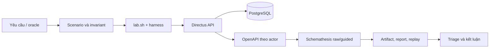

# Giáo trình tự học R06 + K05

Bộ tài liệu này giúp người thực hiện hiểu và tự làm lại đồ án **kiểm thử REST API Directus bằng Schemathesis**. Nội dung được viết theo trạng thái code, cấu hình và bằng chứng đang có trong repository; đây là tài liệu học tập riêng trong `mnhy/`, không phải một bản công bố kết quả mới.

## Cách học

Học theo thứ tự từ nền tảng đến thực hành. Với mỗi bài, hãy làm đủ bốn việc:

1. Đọc phần khái niệm và tự viết lại bằng lời của mình.
2. Mở file được dẫn ở phần “Đọc code/evidence” để nối lý thuyết với hệ thống thật.
3. Chạy một lệnh nhỏ trong phần thực hành, lưu `run_id` và đọc artifact.
4. Trả lời câu hỏi tự kiểm tra mà không nhìn đáp án trước.

Mục tiêu là **hiểu và tự làm**, không chỉ nhớ câu lệnh. Nếu một lệnh làm thay đổi dữ liệu, hãy đọc trước phần precondition, actor và cleanup; không chạy campaign dài khi chưa hoàn thành smoke test.

## Lộ trình

| Bài | Nội dung | Sản phẩm sau khi học |
|---|---|---|
| [01](01_nen_tang_kiem_thu.md) | Tư duy kiểm thử phần mềm | Biết biến yêu cầu thành oracle và test case |
| [02](02_http_rest_directus.md) | HTTP, REST và Directus | Tự tạo request, đọc response và hiểu quyền |
| [03](03_kien_truc_lab.md) | Kiến trúc lab và luồng chạy | Tự dựng, kiểm tra và thu artifact |
| [04](04_openapi_schema.md) | OpenAPI và schema theo actor | Biết schema mô tả gì, thiếu gì và hash để làm gì |
| [05](05_k05_schemathesis.md) | K05 và Schemathesis | Tự giải thích raw, guided, seed, budget và check |
| [06](06_scenario_invariant_harness.md) | Scenario, invariant và harness | Viết được oracle nghiệp vụ có precondition/cleanup |
| [07](07_failure_metrics_replay.md) | Failure, metrics và replay | Triage đúng, tái hiện có kiểm soát và không bịa defect |
| [08](08_thuc_hanh_va_bao_ve.md) | Bài thực hành tổng hợp và bảo vệ | Có thể demo và trả lời câu hỏi phản biện |

Phần luyện tập độc lập:

- [Bài tập](bai-tap.md)
- [Đáp án gợi ý](dap-an.md) — chỉ đọc sau khi đã tự làm
- [Thuật ngữ](glossary.md)
- [Câu hỏi bảo vệ](cau-hoi-bao-ve.md)

## Bản đồ nguồn trong repository

| Muốn học | Mở file |
|---|---|
| Sơ đồ thành phần và data flow | [`docs/architecture.md`](../../docs/architecture.md) |
| Ma trận 10 operation, budget và scenario | [`docs/test-matrix.md`](../../docs/test-matrix.md) |
| Vai trò và quyền | [`docs/permissions.md`](../../docs/permissions.md) |
| Demo/replay đã xác minh | [`docs/demo.md`](../../docs/demo.md), [`docs/replay-cases.md`](../../docs/replay-cases.md) |
| Truy vết từ yêu cầu tới bằng chứng | [`docs/traceability.md`](../../docs/traceability.md) |
| Kế hoạch, quy tắc và yêu cầu môn học | [`01_ke_hoach_trien_khai_R06_K05.md`](../../01_ke_hoach_trien_khai_R06_K05.md), [`AGENTS.md`](../../AGENTS.md), [`yeu_cau.pdf`](../../yeu_cau.pdf) |
| Script điều phối | [`lab.sh`](../../lab.sh), [`scripts/lab-components.sh`](../../scripts/lab-components.sh) |
| Invariant Python | [`scripts/invariants.py`](../../scripts/invariants.py) |
| Baseline và run evidence | [`manifest/baseline.yaml`](../../manifest/baseline.yaml), [`evidence/`](../../evidence/) |

`mnhy/05_huong_dan_doc_hieu_qua_trinh_xay_dung_2026-10-10.md` là hướng dẫn lịch sử. Khi nội dung của nó nói một lệnh chưa triển khai nhưng code hiện tại đã có lệnh đó, ưu tiên code và evidence mới hơn; không dùng tài liệu lịch sử để kết luận trạng thái hiện tại.

`yeu_cau.pdf` vẫn là nguồn yêu cầu cần đối chiếu khi viết báo cáo. Trong phiên tạo giáo trình này, môi trường không có bộ trích xuất PDF phù hợp nên tài liệu không tự nhận đã phân tích toàn văn PDF; các nhận xét trạng thái bên dưới chỉ dựa trên code, tài liệu Markdown và artifact đã đọc được.

## Trạng thái cần nhớ trước khi học

### Đã xác minh

| Hạng mục | Bằng chứng hiện tại |
|---|---|
| Baseline image | Directus `12.5.0`, PostgreSQL `16-alpine`, Schemathesis `4.30.0`, đều digest-pin trong [`config/lab.env.example`](../../config/lab.env.example) |
| Schema theo actor | Lần export gần nhất `20261011T171009Z-223973`, admin/editor `14` operation, reader `6`, anonymous `0` |
| Scenario nghiệp vụ | Lần cuối `20261011T171054Z-225602`, `S1–S6` đạt; S6 ghi đúng PATCH Reader `403`, đọc lại bằng Editor `200`, dữ liệu không đổi |
| Invariant | Lần cuối `20261011T171247Z-226528`: `9 passed / 2 failed / 0 blocked`, exit `1` |
| Raw/guided | Có thể chạy độc lập, nhưng các campaign/pilot hiện được ghi là `failed_or_incomplete`; không được gọi là PASS toàn bộ |

### Không được hiểu sai

- Một check failure không tự động là một product defect.
- `14` operation trong schema editor/admin không đồng nghĩa campaign chính có `14` operation: campaign chính chọn đúng `10` method–path.
- Schema coverage không phải line coverage của Directus.
- Hai container trên cùng máy không chứng minh tái lập trên hai máy.
- Không có bằng chứng peer review hay chạy máy thứ hai trong trạng thái hiện tại; đây là giới hạn bằng chứng, không được tự điền vào.
- Chưa có product defect được xác nhận chính thức. Các finding aggregate HTTP `500` và contract/schema chỉ là candidate cần triage.

## Quy trình chạy an toàn

```bash
cp config/lab.env.example config/lab.env
chmod 600 config/lab.env
# điền credential cục bộ, không in file này ra log
./lab.sh doctor
./lab.sh up
./lab.sh seed
./lab.sh test smoke
./lab.sh export-schema
./lab.sh test scenarios
./lab.sh test invariants
```

Chỉ chạy `raw`/`guided` sau khi health, seed, schema và precondition đạt. Với lần học đầu, dùng ngân sách ngắn được ghi rõ trong metadata:

```bash
LAB_CAMPAIGN_SEEDS=101 LAB_MAX_EXAMPLES=1 LAB_MAX_TIME=30 ./lab.sh test raw
```

Lệnh trên là pilot ngắn, không thay thế campaign kế hoạch `101,202,303`. Sau mỗi run, đọc thư mục `artifacts/runs/<run_id>/`; không chỉ nhìn exit code.

## Quan hệ giữa các lớp



Nếu chưa thể giải thích mũi tên từ yêu cầu đến oracle và artifact, chưa nên kết luận hệ thống đã hoàn thiện chỉ vì một lệnh trả exit `0`.

