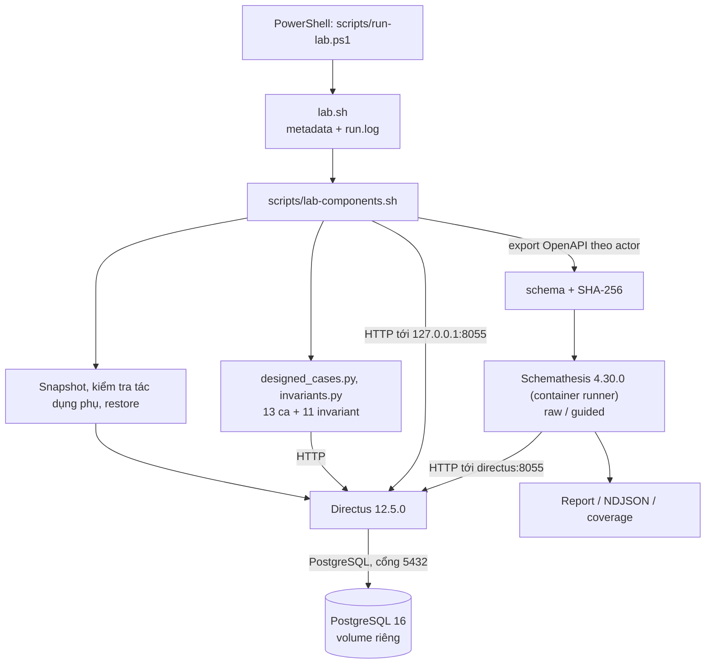

# BÁO CÁO CUỐI KỲ — KIỂM THỬ PHẦN MỀM

## R06 Directus + K05 Schema-Based API Testing / Fuzzing

**Môn học:** Kiểm thử phần mềm. **Nhóm:** 11. **Ngày tổng hợp:** 24/11/2026 (Asia/Bangkok).
**Hệ thống được kiểm thử (SUT):** Directus `12.5.0` (tag `v12.5.0`, commit `4f77933bf9551cac6b289576078783e189b8f4e3`).
**Kỹ thuật:** K05, Schemathesis `4.30.0`. Đúng một kỹ thuật theo [yêu cầu môn học](../yeu_cau.pdf).
**Phạm vi:** REST API do Directus sinh ra cho hai collection thử nghiệm `qa_categories`, `qa_articles`, cùng các endpoint hệ thống xuất hiện trong OpenAPI của ba actor (Editor, Reader, Anonymous).

> **Trạng thái tài liệu.** Đây là bản viết lại theo phạm vi K05 sau khi thu nhỏ dự án (kế hoạch: [KE_HOACH_THU_NHO_VA_BO_SUNG_K05.md](KE_HOACH_THU_NHO_VA_BO_SUNG_K05.md)). Hai báo cáo cuối kỳ cũ trong `docs/HoanThanhPlan/` đã bị xóa ngày 24/11/2026 vì được tài liệu này thay thế (vẫn còn trong lịch sử Git và bản sao lưu ngoài repo). Phần quản lý nhóm (bảng đóng góp, đánh giá chéo, slide) thuộc WP9 và **chưa nằm trong bản này**.

---

## Tóm tắt

Dự án kiểm thử REST API của Directus bằng cách đọc OpenAPI mà chính Directus xuất (`GET /server/specs/oas`) rồi dùng Schemathesis sinh request và kiểm phản hồi, trên một lab Docker cô lập (PostgreSQL 16, Directus 12.5.0). Kỹ thuật được kết hợp với bộ 13 ca nghiệp vụ có kết quả mong đợi rõ ràng (6 scenario S1–S6 và 7 ca thiết kế), dùng làm oracle và demo.

Kết quả chính (nguồn ở từng mục; các con số **không** được cộng gộp):

| Hạng mục | Kết quả | Mục |
|---|---|---|
| Mẫu số của khẳng định "đã kiểm thử đủ" | **62 cặp (actor, operation)** = Editor 30 + Reader 22 + Anonymous 10, trên **30 operation** khác nhau | [E.1](#e1-mẫu-số-62-cặp-actor-operation) |
| Bộ 13 ca nghiệp vụ | **12 PASS, 1 FAIL** (TC13: nội dung nghiệp vụ đạt, hợp đồng OpenAPI sai); chạy lại ngày 24/11/2026 cho cùng kết quả | [G.1](#g1-bộ-13-ca-nghiệp-vụ) |
| Chiến dịch Schemathesis | **18/18 run** (3 actor × raw/guided × 3 seed) kết thúc hoàn tất, khôi phục dữ liệu PASS, tác dụng phụ ngoài `qa_*` sạch | [G.3](#g3-chiến-dịch-schemathesis-18-run) |
| Phủ theo mẫu số | **62/62 cặp** có request và phản hồi; **10/10** operation CRUD của Editor có phản hồi 2xx | [G.4](#g4-phủ-62-cặp-actor-operation) |
| Phủ theo nội dung schema (tracecov) | operations 100% (30/30, 22/22, 10/10 theo actor); parameters 36–69%; keywords 17–48%; examples 91–100%; responses có trong schema 19–26% | [G.5](#g5-coverage-theo-schema) |
| Failure | 31.147 request; 1.356 lần check thất bại; 237 nhóm; **16 nguyên nhân gốc**, trong đó **9 lỗi sản phẩm** đã xác nhận bằng replay (đầu vào sai gây HTTP 500) | [G.6](#g6-failure-và-nguyên-nhân-gốc) |

**Điều báo cáo này khẳng định** (có mẫu số và nguồn):
- 62/62 cặp (actor, operation) trong OpenAPI của lab đã được Schemathesis thực thi với ba seed, ở cả raw và guided.
- Mọi failure được gom nhóm và phân loại; **số check thất bại không bằng số lỗi** (1.356 lần check thất bại ↔ 16 nguyên nhân gốc).
- Coverage theo schema được đo bằng tracecov 0.25.2 và báo riêng từng chiều ở G.5.

**Điều báo cáo này không khẳng định:** "Directus được kiểm thử 100%", "Directus không có lỗi", "100% coverage" không kèm mẫu số, hay coverage mã nguồn của Directus. Xem [G.9](#g9-các-giới-hạn-và-điều-không-được-suy-ra).

---

## Quy ước bằng chứng

- **Run ID** có dạng `YYYYMMDDTHHMMSSZ-n` (UTC). Thư mục `artifacts/runs/` bị Git bỏ qua, nên mọi số liệu quan trọng được **lưu gọn trong `docs/k05/`** (CSV, JSON, README của từng gói công việc) và được trích dẫn bằng liên kết tương đối. Run ID chỉ được ghi dạng chữ.
- Mỗi con số trong báo cáo có một trong các nguồn: file trong `docs/k05/`, `manifest/baseline.yaml`, hoặc run ghi rõ ID.
- Ba đại lượng khác nhau luôn được tách riêng: **số request** (tương tác HTTP), **số lần check thất bại** (một request có thể thất bại nhiều check) và **số nguyên nhân/lỗi**.
- Harness: các run WP5 chạy với commit `c7b559f` kèm thay đổi chưa commit lúc đó (đã commit sau thành `9def78a`); các run chạy lại ngày 24/11 dùng commit `fc089ce`, working tree có thay đổi chỉ-đổi-mode file `scripts/invariants.py` (metadata ghi `dirty`).
- Mọi thông tin đăng nhập, token và license nằm trong `config/lab.env` (Git bỏ qua) và **không** xuất hiện trong báo cáo hay artifact được lưu.

---

# PHẦN A — PHÂN TÍCH HỆ THỐNG DIRECTUS

## A.1. Giới thiệu

Directus là nền tảng quản lý dữ liệu và cung cấp API trên cơ sở dữ liệu SQL. Hệ thống có giao diện quản trị **Data Studio** để quản lý collection, nội dung, người dùng và quyền truy cập; ứng dụng bên ngoài dùng dữ liệu qua REST, GraphQL hoặc SDK. Directus **tự sinh** API CRUD cho mỗi collection và xuất mô tả OpenAPI của chính API đó ở `GET /server/specs/oas`, đã lọc theo quyền của người gọi. Đây là lý do K05 phù hợp: schema được sinh từ chính hệ thống chứ không do người kiểm thử viết tay.

Trong đồ án, Directus là SUT. Repository `DAMH` chứa cấu hình môi trường, dữ liệu mẫu và mã kiểm thử; hai collection bài viết/danh mục là fixture phục vụ thí nghiệm, không phải chức năng có sẵn trong mã nguồn upstream. Mô tả mở rộng về mã nguồn upstream: [phan1/01-phan-tich-he-thong.md](../phan1/01-phan-tich-he-thong.md).

## A.2. Chức năng và phạm vi được chọn

| Nhóm chức năng của Directus | Trong phạm vi K05 |
|---|---|
| CRUD collection (`/items/{collection}`) | Có: `qa_categories`, `qa_articles` |
| Truy vấn (filter, sort, fields, limit, offset, page, search, aggregate, groupBy, deep, export) | Có, qua tham số của các operation `GET /items/...` |
| Xác thực (`/auth/login`, `refresh`, `logout`, `password/*`, `oauth*`) | Có, các operation xuất hiện trong schema của actor |
| Tệp, tiện ích (`/assets/{id}`, `/utils/*`), hệ thống (`/server/*`) | Có, các operation xuất hiện trong schema của actor |
| GraphQL, WebSocket, Flows, extensions, Studio | **Ngoài phạm vi** (không thuộc K05) |

Phạm vi kiểm thử không phải "toàn bộ Directus" mà là **các operation REST có trong OpenAPI của ba actor trong lab**; mẫu số được định nghĩa chính xác ở [E.1](#e1-mẫu-số-62-cặp-actor-operation).

## A.3. Actor và quyền

| Actor | Quyền trong lab | Số operation trong OpenAPI của actor |
|---|---|---:|
| Admin | Bootstrap, quản lý schema/policy, seed, snapshot, kiểm tra trạng thái. **Không** là actor fuzz | không dùng làm mẫu số |
| Editor | CRUD hai collection bằng API; không có quyền Studio | 30 |
| Reader | Đọc category và article `published`; không đọc `internal_notes`; policy có quyền `update` với danh sách field rỗng (`fields=[]`) | 22 |
| Anonymous | Không truy cập hai collection; chỉ các endpoint công khai | 10 |

Số operation lấy từ [mau-so-30-operation.summary.json](mau-so-30-operation.summary.json) (export ngày 23/11/2026, run `20261123T111625Z-311`). Ma trận quyền chi tiết: [permissions.md](../permissions.md). Quyền tùy chỉnh theo policy cần license active với `custom_permission_rules_enabled=true`; `doctor` xác nhận điều kiện này trước mỗi đợt chạy.

## A.4. Mô hình dữ liệu fixture

| Thành phần | Ràng buộc |
|---|---|
| `qa_categories` | `id` số nguyên tự tăng; `name` bắt buộc, tối đa 80 ký tự |
| `qa_articles` | `id` tự tăng; `title` bắt buộc, tối đa 120 ký tự; `status` ∈ {`draft`, `published`}; `score` nguyên 0–5; `published_at` có thể null; `metadata` JSON; `internal_notes`; quan hệ nhiều–một tới category (xóa category đặt khóa ngoại về null) |
| Bộ seed (phiên bản `r06-k05-v2`) | 3 category, 12 article (6 `draft`, 6 `published`), có Unicode và giá trị null; seed chạy lại không nhân bản dữ liệu |

Ánh xạ tên fixture → ID thật nằm trong `runtime/fixture-ids.json` (id category 1–3, article 1–12). Test đọc ID từ ánh xạ này hoặc từ phản hồi `POST`, không hard-code.

## A.5. Nghiệp vụ trọng tâm

Năm nghiệp vụ dùng để thiết kế kiểm thử: đăng nhập và cấp token; CRUD bài viết và danh mục; truy vấn và phân trang; kiểm soát quyền Reader; xử lý quan hệ category–article khi xóa danh mục. Ba luồng demo là **CRUD Editor**, **truy vấn/sắp xếp/phân trang** và **quyền Reader** (xem [C.4](#c4-ba-luồng-demo)). Sơ đồ tuần tự của các luồng này nằm trong [báo cáo giữa kỳ, mục 6](../Bao_cao_giua_ky_R06_K05.md#6-luồng-hoạt-động-của-hệ-thống).

---

# PHẦN B — KIẾN TRÚC

## B.1. Kiến trúc môi trường kiểm thử



Compose project `r06-k05`; ba dịch vụ: `directus`, `database` (PostgreSQL 16, volume riêng), `runner` (Schemathesis). Directus chỉ mở cổng `8055` trên loopback `127.0.0.1`; PostgreSQL không mở cổng ra host; runner gọi API qua tên nội bộ `directus`. Cấu hình: [compose.yaml](../../compose.yaml). Chi tiết: [architecture.md](../architecture.md), [phan1/02-kien-truc-va-luong-du-lieu.md](../phan1/02-kien-truc-va-luong-du-lieu.md).

## B.2. Luồng xử lý một request của Directus

Request → xác thực token → xác định policy của actor → parse/sanitize query (`sanitizeQuery`) → dựng cây truy vấn và áp quyền (`processAst`) → `ItemsService` → Knex/SQL → PostgreSQL → phản hồi JSON. Lỗi cơ sở dữ liệu đi qua `translateDatabaseError` (chỉ dịch năm mã lỗi PostgreSQL); các mã khác thành HTTP 500. Nhiều phát hiện của WP7 nằm đúng ở hai điểm này (mục [G.7](#g7-phân-tích-nguyên-nhân-gốc-của-lỗi-http-500)).

## B.3. Quan hệ giữa kiến trúc và rủi ro cần kiểm thử

| Thành phần | Rủi ro | Cách kiểm |
|---|---|---|
| Sinh OpenAPI theo quyền | Schema lệch hành vi thật | Check `status_code_conformance`, `response_schema_conformance`, `content_type_conformance` |
| Parser query | Giá trị bất thường gây 500 | Fuzzing các tham số query (`aggregate`, `groupBy`, `fields`...) |
| Lớp dịch lỗi DB | Lỗi DB lọt ra thành 500 | Fuzzing body với kiểu/giá trị bất thường |
| Policy theo collection/field/item | Lộ dữ liệu hoặc cho ghi trái phép | S4–S6, P3-AUTHZ-DR-047, ma trận 3 actor |
| Token và phiên | Thao tác `logout`/`refresh`/đăng nhập sai ảnh hưởng actor khác | Kiểm tra tác dụng phụ (WP4, [F.4](#f4-bảo-vệ-trạng-thái-và-tác-dụng-phụ)) |

---

# PHẦN C — MÔI TRƯỜNG VÀ VẬN HÀNH

## C.1. Phiên bản và digest đã ghim

Nguồn: [manifest/baseline.yaml](../../manifest/baseline.yaml); `doctor` xác nhận ảnh có mặt trước mỗi lần chạy.

| Thành phần | Phiên bản | Digest (multiarch manifest) |
|---|---|---|
| Directus | `12.5.0` (tag `v12.5.0`, commit `4f77933bf9551cac6b289576078783e189b8f4e3`) | `sha256:7de5d6898b955dab1672619aed590035dcade4f8d7396d913e55543e114d1331` |
| PostgreSQL | `16-alpine` | `sha256:721873c34ceb9f8d8fc265984940dc982404c105f19ad51be9fdc5970a6080ea` |
| Schemathesis | `4.30.0` | `sha256:bb9cecfc9ac4058a15fcf9b505d9d9f972e2dde7c74c4e9289a35922f4cbc0a5` |
| tracecov (trong Schemathesis) | `0.25.2` (ghi trong từng file coverage) | n/a |

Docker Engine 29.7.2 trong lần chạy ngày 24/11/2026 (`docker info`); `lab.env.example` ghi image theo digest. API từ host: `http://127.0.0.1:8055`; từ runner: `http://directus:8055`.

## C.2. Cấu hình

`config/lab.env` được tạo từ `config/lab.env.example` và điền credential (Admin, Editor, Reader), khóa Directus và license; file này không được commit. Token TTL của lab là 2 giờ; cache ứng dụng tắt; rate limiter của Directus tắt, còn runner giới hạn 5 request/giây. Mặc định ngân sách: một worker, 5 request/giây, timeout 10 giây, 100 ví dụ fuzz cho mỗi operation, seed `101`, `202`, `303`.

## C.3. Khởi động và chạy

Trên Windows dùng launcher PowerShell (Git Bash và jq đã được kiểm tra checksum); trên Linux dùng `./lab.sh` với cùng tham số.

```powershell
.\scripts\run-lab.ps1 doctor           # kiểm tra môi trường, image, license
.\scripts\run-lab.ps1 up               # khởi động stack
.\scripts\run-lab.ps1 seed             # tạo schema, fixture, actor, policy
.\scripts\run-lab.ps1 export-schema    # xuất OpenAPI của từng actor (sau seed)
.\scripts\run-lab.ps1 test scenarios   # S1-S6
.\scripts\run-lab.ps1 test designed --selection course   # 7 ca còn lại của bộ 13
.\scripts\run-lab.ps1 test invariants  # 11 invariant
```

Trong lần chạy ngày 24/11/2026, `doctor` báo PASS (license active, `custom_permission_rules_enabled=true`).

## C.4. Ba luồng demo

| Luồng | Lệnh replay | Nội dung | Nguồn bằng chứng |
|---|---|---|---|
| CRUD Editor | `replay editor-crud` | POST article → GET → PATCH `score` (title không đổi) → DELETE (204) → GET lại (không còn dữ liệu) | S1; invariant `editor-crud`; run `20261124T064010Z-710` |
| Truy vấn | `replay query-fixture` | Lọc đúng 6 `published`; `sort=title,id`; hai trang `limit=3`; `page=2`; search Unicode | S2, S3; invariant `query-fixture` |
| Quyền Reader | `replay reader-visibility`, `replay reader-write` | Reader đọc `published`; projection `internal_notes` bị 403; `PATCH` của Reader bị 403, Editor đọc lại thấy dữ liệu không đổi | S4–S6; invariant `reader-visibility`, `reader-write` |

Ngày 24/11/2026, lệnh `replay editor-crud` chạy lại đạt (invariant 1/1 passed, restore PASS). Bốn hình minh chứng của lần chạy giữa kỳ ngày 13/10 (dựng từ log/JSON, **không phải ảnh chụp Studio**) nằm ở [docs/images/bao-cao-giua-ky](../images/bao-cao-giua-ky/); kết quả hiện hành là các run ghi ở Phần G.

---

# PHẦN D — KỸ THUẬT K05 VÀ TIÊU CHÍ ĐÁNH GIÁ

## D.1. Schema-Based API Testing và fuzzing

Kiểm thử dựa trên schema đọc mô tả API (ở đây là OpenAPI 3.0.1 do Directus xuất), tự sinh request từ mô tả đó và kiểm phản hồi có khớp hợp đồng đã công bố hay không. Fuzzing tạo nhiều biến thể đầu vào, gồm cả dữ liệu hợp lệ, không hợp lệ và bất thường, để phát hiện hành vi người viết test tay khó nghĩ tới. Hypothesis hỗ trợ sinh dữ liệu và **shrinking** (thu gọn ca lỗi thành đầu vào nhỏ nhất còn lỗi).

## D.2. Bốn pha của Schemathesis 4.30.0

| Pha | Nội dung |
|---|---|
| `examples` | Dùng ví dụ có trong schema |
| `coverage` | Sinh ca để phủ các nhánh của schema (hợp lệ và không hợp lệ) |
| `fuzzing` | Sinh ngẫu nhiên có điều khiển bằng Hypothesis, theo seed |
| `stateful` | Nối chuỗi request qua liên kết (ví dụ ID trả về của `POST` dùng cho `GET`/`DELETE`) |

**Raw** chạy `examples,coverage,fuzzing` trên schema gốc không sửa. **Guided** chạy thêm `stateful` và dùng overlay (E.4) bổ sung example. Overlay không sửa hợp đồng; kết quả guided không được trình bày như kết quả raw.

Các check được chọn tường minh: `not_a_server_error`, `status_code_conformance`, `content_type_conformance`, `response_schema_conformance`, `unsupported_method`, `negative_data_rejection`, `positive_data_acceptance`.

## D.3. Về tùy chọn `--max-time` (đính chính quan trọng)

Trợ giúp CLI của Schemathesis 4.30 ghi: khi đặt `--max-time`, fuzzing và stateful **lặp lại cho đến hết thời gian**. Các tài liệu trước đây coi `termination=max_time` là "chưa hoàn tất" là **không đúng**. Pilot ngày 24/11 (Editor raw): với `--max-time 1800` có 2.254 vòng fuzzing và chỉ 140 ca trong 30 phút; bỏ `--max-time` thì xong trong 27 giây với cùng 30/30 operation và cùng 66 failure duy nhất. Chiến dịch cuối kỳ vì thế chạy không đặt `--max-time` (mỗi pha một lượt) kèm trần cứng 5.400 giây mỗi seed; "hoàn tất" được định nghĩa ở [F.5](#f5-định-nghĩa-run-hoàn-tất). Chi tiết: [wp5/README.md, mục 3](wp5/README.md#3-đính-chính-về---max-time-quan-trọng-cho-báo-cáo).

## D.4. Tiêu chí đạt (C1–C6) và nghĩa của "đủ"

"Đã kiểm thử đủ trong phạm vi K05" được định nghĩa bằng sáu tiêu chí trên một **mẫu số hữu hạn** (62 cặp), không phải "100% Directus":

| Mã | Tiêu chí | Kết quả | Mục |
|---|---|---|---|
| C1 | 62/62 cặp (actor, operation) có request đã tới API và có phản hồi ghi lại | **Đạt** (62/62) | G.4 |
| C2 | 10 operation CRUD của Editor có ca thành công hợp lệ (2xx); operation khác có request hợp lệ tới được handler | **Đạt** phần CRUD (10/10); phần còn lại giải thích ở G.4 | G.4 |
| C3 | Cả 18 run kết thúc hoàn tất | **Đạt** (18/18) | G.3 |
| C4 | Restore dữ liệu sau mỗi run đạt | **Đạt** (18/18, mã thoát restore 0) | G.3 |
| C5 | Mọi failure được gom nhóm, phân loại, có reproducer | **Đạt** (237 nhóm, 16 nguyên nhân) | G.6 |
| C6 | Coverage tracecov (tham số, từ khóa, phản hồi, example) với danh sách phần chưa tới | **Đạt** phần đo và báo cáo; không đặt ngưỡng phần trăm | G.5 |

Phân loại failure theo năm nhóm: lỗi sản phẩm; lỗi/thiếu sót schema; lỗi harness/fixture; lỗi môi trường; chưa kết luận. Một nguyên nhân có nhiều check thất bại không tự thành nhiều lỗi.

## D.5. Giới hạn của kỹ thuật

- Schema chỉ mô tả một phần hành vi: ràng buộc nghiệp vụ (quyền theo item, quan hệ, `internal_notes`) không có trong schema, nên cần các ca nghiệp vụ (Phần E).
- Dữ liệu hợp lệ theo OpenAPI chưa chắc hợp lệ với cơ sở dữ liệu hay policy.
- Coverage theo schema **không** phải coverage mã nguồn; test đạt không chứng minh không có lỗi.
- Fuzzing phụ thuộc seed, trạng thái DB và thứ tự request.

---

# PHẦN E — PHÂN TÍCH VÀ THIẾT KẾ KIỂM THỬ

## E.1. Mẫu số 62 cặp (actor, operation)

Mẫu số được dựng từ OpenAPI **do chính lab đã ghim xuất ra** cho từng actor (không dùng schema admin thay thế): [mau-so-30-operation.csv](mau-so-30-operation.csv), sinh bằng [scripts/build_k05_denominator.py](../../scripts/build_k05_denominator.py).

| Actor | Số operation | Băm SHA-256 của schema |
|---|---:|---|
| Editor | 30 | `bd32aa69ff3e7330030c5f25e4c98fd1441a55c4b7465de25e3f42a4465a7d26` |
| Reader | 22 | `d7dc1393eb7e01514f0f8a4d3796ab71cf1f0fe70f5c8a3da5c0ae20259b47b8` |
| Anonymous | 10 | `2070c25c68193a4a42501935974bb3045697aceb1fe072bb3461f43c0a0342b3` |
| **Tổng (actor, operation)** | **62** | 30 operation khác nhau |

30 operation gồm: 10 operation CRUD chính (`MAIN_10`), 4 operation hàng loạt (`BULK`: `PATCH`/`DELETE` hàng loạt trên hai collection) và 16 operation bổ sung (`ADDED`); theo nhóm: `items` 14, `auth` 7, `utils` 6, `server` 2, `assets` 1. Người dùng duyệt mẫu số này ngày 23/11/2026; hash schema trùng bản export ngày 11/10/2026.

## E.2. Bộ 13 ca nghiệp vụ (oracle và demo)

Mười ba ca gồm 6 scenario S1–S6 và 7 ca thiết kế chọn bằng `--selection course`. Mỗi ca có kết quả mong đợi suy từ dữ liệu fixture hoặc từ quy tắc đã biết, **không** lấy từ chính phản hồi đang kiểm tra.

| Ca | Actor | Nội dung | Kết quả mong đợi |
|---|---|---|---|
| S1 CRUD | Editor | Tạo, đọc, sửa, xóa article bằng ID lấy từ `POST` | Field không sửa giữ nguyên; sau xóa không còn dữ liệu |
| S2 Lọc | Editor | `filter` theo `status` trên fixture 6/6 | Đúng tập 6 ID `published` |
| S3 Sắp xếp/phân trang | Editor | `sort=title,id`, `limit=3`, offset 0/3 | Các trang đúng thứ tự, không thiếu/thừa |
| S4 Reader không đọc draft | Reader | `GET` chi tiết một article `draft` | Không lộ dữ liệu (HTTP 403) |
| S5 Field kín | Reader | Đọc `published` hợp lệ, rồi projection `internal_notes` | Đọc được field cho phép; field kín bị từ chối (403) |
| S6 Reader ghi | Reader, Editor | Editor chụp target; Reader `PATCH`; Editor đọc lại | `PATCH` bị 403; dữ liệu target không đổi |
| P3-ST-01 | Editor | Chuỗi trên category: tạo → đọc → sửa → xóa → đọc lại → danh sách | Mỗi bước đúng; sau xóa đọc lại 403, danh sách không còn |
| P3-AUTHZ-DR-047 | Anonymous | `GET /items/qa_articles` có `fields` và `limit=-1` | 403 FORBIDDEN |
| P3-SCORE-POST-MINUS1 | Editor | `POST` article `score = -1` | 400 `FAILED_VALIDATION` |
| P3-SCORE-POST-0 | Editor | `POST` article `score = 0` | 2xx, `data` có ID |
| P3-SCORE-POST-5 | Editor | `POST` article `score = 5` | 2xx, `data` có ID |
| P3-SCORE-POST-6 | Editor | `POST` article `score = 6` | 400 `FAILED_VALIDATION` |
| P3-CONTRACT-QA_ARTICLES-OBJECT (TC13) | Editor | `POST` một đối tượng article hợp lệ; đối chiếu với schema raw | Nghiệp vụ đạt; hợp đồng: giữ nguyên chênh lệch nếu có |

Đặc tả đầy đủ của 7 ca thiết kế: [catalog v1, phụ lục](../HoanThanhPlan/03-test-case-catalog.md) (xem [PL.1](#pl1-catalog-v1-và-các-bảng-mở-rộng)). Bốn ca `score` là phân tích giá trị biên của `score` ∈ [0, 5] (hai giá trị biên trong, hai ngoài).

## E.3. Mười một invariant bổ trợ

`auth-invalid-token`, `anonymous-denied`, `editor-crud`, `positive-operations`, `query-fixture`, `aggregate-query-robustness`, `contract-schema-candidates`, `relation-nullification`, `invalid-field-rejection`, `reader-visibility`, `reader-write` (`scripts/invariants.py`). `positive-operations` kiểm đủ 10 operation CRUD có đường đi thành công hợp lệ; hai invariant `aggregate-query-robustness` và `contract-schema-candidates` được thiết kế để ghi nhận hai hành vi bất thường đã biết (HTTP 500 của `aggregate`, và chênh lệch hợp đồng) và nên báo FAIL khi hành vi đó còn tồn tại.

## E.4. Thiết kế guided (overlay)

Overlay (trong `scripts/lab-components.sh`, chỉ với profile guided) chỉ **thêm example** vào operation đã có trong schema của actor, có kiểm tra tập operation sau overlay đúng bằng tập mục tiêu. Nội dung chính: tham số `collection` của `utils/export|import|sort`; body mẫu cho `export`, `sort` và `PATCH` hàng loạt; ID UUID đúng định dạng cho `assets/{id}`; body của `auth/*` dùng **giá trị bịa, không tồn tại** (không có credential thật trong artifact). Example đặt ở cấp property vì Schemathesis ưu tiên example cấp property của schema Directus. Với Editor + phạm vi 10 operation, schema raw và guided mới giống từng byte bản cũ. Nguồn: [kế hoạch, WP2–WP3](KE_HOACH_THU_NHO_VA_BO_SUNG_K05.md).

## E.5. Thiết kế kiểm tra quyền

Schema của Reader (22 operation) và Anonymous (10) chỉ chứa operation mà actor được thấy. Vì vậy quyền được kiểm bằng hai cách: (i) fuzz **trên schema của từng actor** (G.4 cho biết mỗi cặp nhận 2xx, 401/403 hay 4xx khác); (ii) ca có chủ đích S4–S6 và P3-AUTHZ-DR-047. Một operation bị lọc khỏi schema của actor không được tính là đã kiểm thử quyền thành công.

## E.6. Truy vết

Yêu cầu → ca kiểm thử → bằng chứng: tham số/operation → hàng của mẫu số (E.1) → hàng trong [bảng 62 cặp](wp5/bang-phan-hoi-theo-cap.csv); nghiệp vụ → S1–S6 và 7 ca (E.2) → [bằng chứng 13 TC](bang-chung-13-tc/README.md); failure → nguyên nhân gốc → [failure-groups.csv](wp7/failure-groups.csv). Ma trận mở rộng: [traceability.md](../traceability.md).

---

# PHẦN F — TỰ ĐỘNG HÓA

## F.1. Cấu trúc mã

| Thành phần | Vai trò |
|---|---|
| `lab.sh`, `scripts/run-lab.ps1` | Giao diện lệnh (Linux và Windows); ghi metadata và `run.log` cho mỗi lệnh |
| `scripts/lab-components.sh` | Seed, xuất schema, scenario, campaign, replay, bảo vệ trạng thái |
| `scripts/designed_cases.py`, `invariants.py`, `replay_cases.py`, `contract_checks.py` | 7 ca thiết kế, 11 invariant, replay một ca, đối chiếu hợp đồng |
| `scripts/build_k05_denominator.py` | Dựng mẫu số 62 cặp từ schema đã xuất |
| `scripts/k05_reach_report.py` | Bảng phản hồi theo cặp (WP5) |
| `scripts/k05_coverage_report.py` | Tổng hợp coverage tracecov (WP6) |
| `scripts/k05_failure_triage.py`, `scripts/k05_wp7_replay.py` | Gom failure và replay xác nhận nguyên nhân (WP7) |
| `scripts/k05_side_effect_probe.py` | Đo tác dụng phụ của `logout`, `refresh`, đăng nhập sai, `cache/clear`, `import` (WP4) |
| `scripts/check_md_links.py` | Kiểm tra liên kết tương đối của tài liệu Markdown |
| `tests/` | 36 unit test (`python -m unittest discover -s tests -p "test_*.py"`) |

## F.2. Giao diện chiến dịch

```text
LAB_ACTOR=editor|reader|anonymous  LAB_CAMPAIGN_SCOPE=main10|full  ./lab.sh test raw|guided
```

Mặc định (không đặt biến) là Editor + `main10` (10 operation, hành vi cũ). `full` lấy mọi operation trong schema của actor và đối chiếu số lượng với mẫu số (lệch thì dừng, không chạy). Reader và Anonymous chỉ chạy với `full`; Anonymous không gửi header `Authorization`. Biến bổ sung: `LAB_CAMPAIGN_PHASES`, `LAB_MAX_TIME` (`0` = không đặt `--max-time`), `LAB_HARD_TIMEOUT` (mặc định 7.200 giây; WP5 dùng 5.400).

## F.3. Quy trình một seed

1. Kiểm health, seed và precondition; chụp trạng thái (`state-before`).
2. Xuất OpenAPI của actor, dựng schema raw hoặc guided, kiểm tập operation.
3. Chạy `schemathesis run` (một worker, 5 request/giây, timeout 10 giây, 100 ví dụ, `--generation-unique-inputs`) với báo cáo JSON, NDJSON và coverage JSON.
4. Khôi phục `qa_*` về baseline và kiểm tra tác dụng phụ ngoài `qa_*` (F.4).
5. Ghi `campaign-summary.json` (mã thoát, trạng thái kết thúc, `run_complete`, kết quả restore và tác dụng phụ).

Mã thoát của Schemathesis được bảo toàn: `status: failed` nghĩa là **tìm thấy lỗi** (mã thoát 1), không phải chạy dở. Các suite ghi dữ liệu chạy **tuần tự**, không chạy song song trên cùng DB.

## F.4. Bảo vệ trạng thái và tác dụng phụ

Một số operation (`auth/logout`, `refresh`, đăng nhập sai, `utils/cache/clear`, `utils/import`, `utils/export`) có thể đổi trạng thái ngoài hai collection. WP4 đo và xử lý:

- `auth/logout` chỉ vô hiệu refresh token tương ứng; access token vẫn dùng được. `utils/cache/clear` bị 403 với actor không phải admin.
- Khoảng 30 lần đăng nhập sai làm người dùng bị `suspended`; email admin của lab trùng email mẫu trong OpenAPI nên profile raw có thể làm admin bị tạm ngưng.
- Mỗi lần `POST /utils/export/{collection}` tạo một dòng trong `directus_notifications`.
- Bảo vệ trong harness: chụp trạng thái 21 nhóm ngoài `qa_*` trước/sau mỗi seed, tự đặt lại trạng thái tài khoản lab, tự xóa thông báo do `export` tạo, và **dừng các seed sau** nếu có thay đổi lạ.

Chi tiết, ba vòng đối chứng âm và giới hạn: [wp4/README.md](wp4/README.md).

## F.5. Định nghĩa "run hoàn tất"

`run_complete = true` khi: kết thúc tự nhiên (`termination: completed`), có đủ report và coverage, restore PASS và kiểm tra tác dụng phụ sạch. `all_runs_complete` của chỉ mục campaign đòi hỏi mọi seed đạt.

## F.6. Kiểm tra tài liệu

`python scripts/check_md_links.py` quét mọi file Markdown được Git theo dõi và báo liên kết tương đối hỏng (kể cả anchor). Kết quả sau WP8 ghi ở [PL.4](#pl4-kiểm-tra-liên-kết).

---

# PHẦN G — KẾT QUẢ VÀ PHÂN TÍCH

## G.1. Bộ 13 ca nghiệp vụ

**Chạy lại ngày 24/11/2026** trên lab đã ghim, sau khi thu nhỏ dự án (harness `fc089ce`, working tree `dirty` chỉ do mode file):

| Nhóm | Run | Kết quả |
|---|---|---|
| S1–S6 (`test scenarios`) | `20261124T063845Z-1883` | 6 passed, 0 failed, 0 blocked; restore PASS |
| 7 ca thiết kế (`test designed --selection course`) | `20261124T063913Z-1590` | 6 passed, **1 failed** (P3-CONTRACT-QA_ARTICLES-OBJECT); restore PASS; mã thoát 1 |
| 11 invariant (`test invariants`) | `20261124T064010Z-710` | 9 passed, 2 failed (`aggregate-query-robustness`, `contract-schema-candidates`), 0 blocked |

Tổng bộ 13: **12 PASS, 1 FAIL**, trùng với lần chạy ngày 16/11/2026 (run `P10-20261116-02`, bằng chứng đã trích tại [bang-chung-13-tc](bang-chung-13-tc/README.md)).

**TC13 (P3-CONTRACT-QA_ARTICLES-OBJECT).** Nội dung nghiệp vụ đạt: `POST` một đối tượng trả 200, `GET` đọc lại khớp, dọn dẹp đạt. Check `response_schema_conformance` thất bại (`JsonSchemaError`) vì schema khai báo `data` là **mảng** trong khi phản hồi là **đối tượng**; ba check hợp đồng còn lại đạt. Nguyên nhân gốc đã đối chiếu mã nguồn tại commit đã ghim: bộ sinh đặc tả (`services/specifications.ts`, dòng 220 đến 282) chỉ coi phản hồi là đối tượng cho collection singleton, nên với collection thường nó luôn khai báo `array` kể cả khi `POST` nhận đối tượng; request body chấp nhận cả đối tượng lẫn mảng. Phân tích: [rca-tc13](bang-chung-13-tc/rca-tc13/README.md). Đây là **chênh lệch hợp đồng được xác nhận** (nhóm RC09 ở G.6); không có bằng chứng việc tạo/đọc dữ liệu bị hỏng. Expected không bị sửa để ca đạt.

**Hai invariant FAIL** là hai hành vi bất thường đã biết: (i) `aggregate={"foo":1}` trả HTTP 500 trong khi hai control trả 200 (nguyên nhân gốc ở G.7, RC02); (ii) bốn chênh lệch hợp đồng (`POST` trả đối tượng thay vì mảng ở hai collection, CSV ngoài media type JSON, `DELETE` trả 204 ngoài bản đồ phản hồi).

## G.2. Cách đọc kết quả HTTP 403

`403` là kết quả **mong đợi** (PASS) của S4, S5, S6, P3-AUTHZ-DR-047 và bước đọc lại sau `DELETE`; nó chỉ là lỗi khi một ca positive đã đủ precondition mà lại không đọc được. `204` của `DELETE` là thành công thực tế; việc schema thiếu `204` là chênh lệch hợp đồng (RC06), không phải lỗi dữ liệu.

## G.3. Chiến dịch Schemathesis: 18 run

Ma trận: 3 actor × {raw, guided} × seed 101, 202, 303. Một worker, 5 request/giây, timeout 10 giây, 100 ví dụ/operation; raw chạy `examples,coverage,fuzzing`, guided thêm `stateful`; không đặt `--max-time`, trần cứng 5.400 giây mỗi seed. Nguồn: [wp5/README.md](wp5/README.md), [campaign-summaries.json](wp5/campaign-summaries.json).

| Nhóm | Run | Operation | Thời gian mỗi seed | Ca sinh ra | Failure duy nhất (Schemathesis) |
|---|---|---:|---|---:|---:|
| Editor raw | `20261123T174529Z-808` | 30 | 26–27 giây | 114–117 | 64–66 |
| Reader raw | `20261123T174820Z-1596` | 22 | 22–23 giây | 95–98 | 45–48 |
| Anonymous raw | `20261123T175055Z-893` | 10 | 9 giây | 32 | 21 |
| Anonymous guided | `20261123T175314Z-1627` | 10 | 9 giây | 33 | 22 |
| Reader guided | `20261123T175522Z-1525` | 22 | 221–778 giây | 1.056–3.722 | 65–72 |
| Editor guided | `20261123T182014Z-67` | 30 | 1.594–1.734 giây | 7.831–8.639 | 111–114 |

**Kết quả:** 18/18 seed `termination: completed`, `run_complete: true`, restore PASS (`restore_exit_code: 0`), kiểm tra tác dụng phụ sạch (mỗi seed của Editor và Reader còn tự xóa 1 thông báo do `utils/export` tạo). Tổng thời gian khoảng 1,8 giờ. Ba seed raw gần như giống nhau (chế độ chạy một lượt, đầu vào duy nhất); chỉ guided cho khác biệt rõ giữa các seed. Anonymous guided gần như không khác raw vì schema Anonymous không có liên kết để stateful khai thác.

**Raw so với guided.** Guided sinh nhiều ca hơn hẳn (Editor khoảng 70 lần) nhờ pha stateful, và phủ parameters/keywords cao hơn (G.5); số failure duy nhất tăng ít hơn nhiều (Editor 64–66 lên 111–114) vì phần lớn nhóm failure trùng nhau. Guided cũng lộ thêm các nguyên nhân 5xx (G.6) mà raw không chạm tới: **toàn bộ** phản hồi 5xx nằm ở các run guided.

## G.4. Phủ 62 cặp (actor, operation)

Nguồn: [bang-phan-hoi-theo-cap.csv](wp5/bang-phan-hoi-theo-cap.csv) (31.147 tương tác ghi trong NDJSON; bảng đếm 30.589 request cùng phương thức với operation). Nhãn là **mô tả** phản hồi quan sát được, không phải kết luận Directus đúng hay sai.

| Nhãn | Tổng | Editor | Reader | Anonymous |
|---|---:|---:|---:|---:|
| Có phản hồi 2xx | 34 | 18 | 12 | 4 |
| Chỉ 401/403 (tới tầng xác thực/phân quyền) | 18 | 7 | 7 | 4 |
| Chỉ 4xx khác | 10 | 5 | 3 | 2 |
| Không có request | 0 | 0 | 0 | 0 |

**C1: 62/62.** **C2:** 10/10 operation CRUD của Editor có 2xx. Các cặp không có 2xx tập trung ở `assets/{id}` (fixture không cấp quyền đọc file), `auth/login|refresh|password/reset` (dùng giá trị bịa, cần token qua email), `auth/oauth*` (không có provider), `DELETE` hàng loạt (schema không mô tả body), `utils/cache/clear` (chỉ admin), `utils/import` (cần multipart) và `utils/sort` (thiếu tham số bắt buộc; collection không có trường sắp xếp). Mỗi cặp vẫn có request tới được handler hoặc tầng xác thực/phân quyền. Reader nhận 2xx trên `PATCH /items/qa_articles/{id}` chỉ khi body rỗng, vì policy cấp quyền `update` với `fields=[]` (xem G.8).

## G.5. Coverage theo schema

Đo bằng tracecov 0.25.2 (đi kèm Schemathesis 4.30.0; cờ `--coverage-format json` và `--coverage-report-json-path` có sẵn trong bản đã ghim). **Đây là coverage theo schema OpenAPI, không phải coverage mã nguồn Directus.** Các chiều khác nhau về bản chất nên được báo riêng; **operations 100% không có nghĩa** mọi tham số hay phản hồi đã được kiểm. Trung bình ba seed, %:

| Actor / profile | operations | parameters | keywords | examples | responses có trong schema | response_keywords |
|---|---:|---:|---:|---:|---:|---:|
| Editor raw | 100 (30/30) | 51,7 | 26,2 | 92,6 | 24,6 (15/61) | 21,6 |
| Editor guided | 100 | 68,6 | 48,4 | 90,7 | 24,6 | 28,9 |
| Reader raw | 100 (22/22) | 51,4 | 26,6 | 93,7 | 23,8 (10/42) | 21,5 |
| Reader guided | 100 | 66,2 | 42,0 | 91,3 | 26,2 (11/42) | 30,0 |
| Anonymous raw | 100 (10/10) | 36,4 | 17,1 | 100 | 18,8 (3/16) | 12,1 |
| Anonymous guided | 100 | 36,4 | 17,1 | 100 | 18,8 | 12,1 |

Nguồn: [coverage-theo-nhom.csv](wp6/coverage-theo-nhom.csv); từng seed: [coverage-theo-seed.csv](wp6/coverage-theo-seed.csv); từng cặp: [coverage-theo-cap.csv](wp6/coverage-theo-cap.csv). Chạy thêm seed gần như không mở rộng coverage (phần hợp qua ba seed xấp xỉ trung bình: keywords Editor raw 27,3%, guided 51,6%).

**Phần chưa tới và lý do** (chi tiết: [wp6/README.md](wp6/README.md)): chiều responses thấp chủ yếu vì Directus trả mã **không có trong schema** (`204`, `403`, `400`, `500`) và vì actor có token hợp lệ không bao giờ nhận `401` mà schema mô tả; 33/62 cặp không gặp mã phản hồi nào trong số mã schema mô tả. Phần lớn từ khóa chưa đủ thuộc thân request dạng `oneOf` (đối tượng hoặc mảng). Chưa phân tích từng từ khóa để biết cái nào không thể tới.

## G.6. Failure và nguyên nhân gốc

Nguồn: [wp7/README.md](wp7/README.md), [failure-groups.csv](wp7/failure-groups.csv), [failure-stats.json](wp7/failure-stats.json).

| Đại lượng | Giá trị |
|---|---:|
| Request (tương tác HTTP trong NDJSON) | 31.147 |
| Lần check được chạy | 177.096 |
| **Lần check thất bại** | **1.356** |
| "Failure duy nhất" do Schemathesis gom (cộng 18 seed) | 1.011 |
| **Nhóm failure** | **237** |
| Tương tác có phản hồi 5xx | 932 |
| **Nguyên nhân gốc** | **16** (10 sản phẩm, 5 schema, 1 chưa kết luận) |

| Loại | Nguyên nhân gốc | Lần check |
|---|---|---:|
| **Sản phẩm (đã xác nhận, HTTP 500)** | RC01 ID ngoài `int4` trong đường dẫn; RC02 `aggregate` sai cấu trúc; RC03 `published_at` sai kiểu; RC04 ký tự NUL (body hoặc query); RC12 phần tử `null` trong mảng body; RC13 `id`/khóa ngoại sai kiểu hoặc ≥ 1e21; RC14 `export=csv` với `fields` không có thật; RC15 `page` × `limit` tràn `bigint`; RC16 `groupBy` có ngoặc sai thứ tự | 62 (RC01–RC04); RC12–RC16 chỉ thấy khi đếm trực tiếp 932 tương tác 5xx |
| Sản phẩm (mức thấp) | RC05 `TRACE`/`PUT` trả `404` thay vì `405` | 180 |
| **Schema** | RC06 mô tả `200`, thực tế `204` (134); RC07 không mô tả mã lỗi 4xx (653); RC08 `Content-Type` khác schema (51); RC09 response schema quá cứng, gồm TC13 (43); RC10 request hợp lệ theo schema bị từ chối (222) | 1.103 |
| Chưa kết luận | RC11 dữ liệu hoặc tham số sai được chấp nhận | 11 |
| Harness / môi trường | không có nhóm failure nào | 0 |

**Chín nguyên nhân sản phẩm giải thích 923/932 tương tác 5xx (99,0%)**; 9 tương tác còn lại chưa tái hiện được. Cả bốn mã RC01–RC04 là toàn bộ 13 cặp có phản hồi 5xx đã ghi ở WP5.

## G.7. Phân tích nguyên nhân gốc của lỗi HTTP 500

Mỗi nguyên nhân được xác nhận bằng một probe có chủ đích (67 probe, [replay-results.json](wp7/replay-results.json)); tài khoản admin nhận thông điệp lỗi gốc, cho thấy nguyên nhân; log server ở [server-log-excerpt.txt](wp7/server-log-excerpt.txt).

| Mã | Reproducer (Editor) | Mong đợi | Thực tế (admin thấy) |
|---|---|---|---|
| RC01 | `GET /items/qa_articles/9999999999` (cũng `PATCH`, `DELETE`) | 4xx; cùng giá trị trong body của `POST` được trả `400 VALUE_OUT_OF_RANGE` | 500; `value "9999999999" is out of range for type integer` |
| RC02 | `GET /items/qa_articles?aggregate={"foo":1}` | `400 INVALID_QUERY` (như `aggregate=[]`) | 500; `fields is not iterable` |
| RC03 | `POST /items/qa_articles` với `"published_at": false` | 400 | 500; `invalid input syntax for type timestamp with time zone: "false"` |
| RC04 | `POST /items/qa_categories` với `"name": "a\u0000b"`; hoặc `?search=a%00b` | 400 | 500; `invalid byte sequence for encoding "UTF8": 0x00` |
| RC12 | `POST /items/qa_categories` với body `[null]` | 400 | 500; `Cannot read properties of null (reading 'id')` |
| RC13 | `POST /items/qa_categories` với `"id": true` hoặc `1e21` | 400 | 500; `invalid input syntax for type integer: "1e+21"` |
| RC14 | `GET /items/qa_articles?fields=sections.item:headings.title&export=csv` | 4xx hoặc CSV | 500; `Data should not be empty or the "fields" option should be included` |
| RC15 | `GET /items/qa_articles?limit=897434&page=17592186044417` | 4xx | 500; `value "15787825890584429000" is out of range for type bigint` |
| RC16 | `GET /items/qa_articles?groupBy=a)b(` | 400 | 500; `Cannot read properties of null (reading '1')` |

**Cơ chế chung (đối chiếu mã nguồn tại commit đã ghim).** `translateDatabaseError` (`api/src/database/errors/translate.ts`) chỉ chuyển năm mã lỗi PostgreSQL (`23505`, `22003`, `22001`, `23502`, `23503`) thành lỗi Directus (`dialects/postgres.ts`) và chỉ được gọi ở hai chỗ trong `api/src/services/items.ts` (dòng 273 của `createOne` và dòng 849 của `updateMany`). Vì thế ID ngoài `int4` trong **body** được dịch thành `400 VALUE_OUT_OF_RANGE`, còn trong **đường dẫn** (các câu `SELECT` và `deleteMany`) lỗi `22003` không được dịch nên thành 500; các mã `22007`, `22021`, `22P02` không bao giờ được dịch. Với `aggregate`, `sanitizeAggregate` (`api/src/utils/sanitize-query.ts`, dòng 144 đến 164) chỉ xử lý giá trị chuỗi và mảng; giá trị khác lọt tới `extractPathsFromQuery` (`.../process-ast/utils/extract-paths-from-query.ts`, dòng 59 đến 61) và gây `TypeError`. Tôi chưa đọc mã nguồn tương ứng của RC12, RC14, RC16; kết luận dựa trên thông điệp lỗi gốc.

**Mức độ.** Dữ liệu không bị hỏng (kiểm tra `qa_*` sau mỗi lần replay không đổi); ảnh hưởng là máy chủ trả 500 cho đầu vào sai mà người gọi có quyền gửi. Editor và Reader chỉ thấy thông điệp chung `An unexpected error occurred.`; admin thấy cả câu SQL. Xếp mức trung bình về độ bền vững, chưa đánh giá ý nghĩa bảo mật. Các phát hiện chưa được báo cho Directus upstream.

## G.8. Các quan sát khác

| Quan sát | Kết luận | Nguồn |
|---|---|---|
| Reader nhận 200/204 trên `PATCH` article | Hành vi theo cấu hình fixture, không phải lỗi sản phẩm: policy Reader có quyền `update` với `fields=[]`; `PATCH {}` trả 204, `PATCH {"title": …}` trả 403 | replay nhóm H5 |
| ID không tồn tại trả `403` thay vì `404` | Xác nhận, kể cả với admin; Directus không để lộ việc ID có tồn tại hay không. Schema mô tả `404` nên đây là RC07 (schema) | replay nhóm H1 |
| `utils/sort` luôn `400` | Thiếu `item`/`to` bắt buộc; `qa_articles` không có trường sắp xếp. Không phải lỗi sản phẩm | replay nhóm H6 |
| "Ca lỗi chạy" của guided (Editor 257 đến 404, Reader 12 đến 31) | Bằng đúng số ca stateful đã sinh mà không có tương tác HTTP nào (khớp 18/18 seed, tổng 1.069); không liên quan tới phản hồi của Directus; nguyên nhân Schemathesis không gửi những ca này chưa xác định | `failure-stats.json` |
| `fields=sections.item:headings.title` trả 200 với danh sách khóa chính | Chưa kết luận: trường quan hệ không tồn tại nhưng không bị từ chối | replay nhóm H3 |

## G.9. Các giới hạn và điều không được suy ra

- **Không phải coverage mã nguồn** và **không chứng minh Directus không có lỗi**: chỉ các hành vi mà schema Directus xuất ra và bộ sinh của Schemathesis chạm tới trong ngân sách của chiến dịch.
- "100%" chỉ có nghĩa **62/62 cặp có request và phản hồi**, không phải mọi tham số, từ khóa hay mã phản hồi (G.5 cho các tỷ lệ riêng).
- Schemathesis chỉ giữ một failure cho mỗi (operation, loại, thông điệp) trong một seed, nên 237 nhóm che mất sự đa dạng: 31 check `ServerError` đại diện cho 932 tương tác 5xx. Số nhóm phụ thuộc cách chuẩn hóa thông điệp; số nguyên nhân gốc thì không.
- Phân loại 5xx dựa trên quy tắc suy từ chính request, theo thứ tự ưu tiên khi một request chứa hai nguyên nhân; mỗi quy tắc được xác nhận bằng một probe và có unit test.
- 9 tương tác 5xx chưa tái hiện được (một `fields` chứa ký tự điều khiển và tám `offset`+`export=xml`+`page=2`); có thể phụ thuộc trạng thái bảng lúc đó.
- Probe replay `POST` với `id=500000` làm dãy tự tăng (sequence) của `qa_articles` nhảy lên, nên bài viết tạo sau đó có ID rất lớn (từ khoảng 500.000 trở lên, ví dụ 500.014 ở run `20261124T063913Z-1590`). Fixture (ID 1 đến 12) không bị ảnh hưởng; tài liệu và test không giả định ID tạo mới.
- Tracecov là công cụ đo của Schemathesis; chưa so với công cụ coverage khác.
- Mới chạy trên một máy (Windows) và một lab; chưa ai khác tái hiện các reproducer.

---

# PHẦN H — CỐ ĐỊNH PHIÊN BẢN VÀ KHẢ NĂNG TÁI LẬP

## H.1. Phiên bản

Xem [C.1](#c1-phiên-bản-và-digest-đã-ghim). Fixture: `r06-k05-v2`. Hash schema của ba actor: [E.1](#e1-mẫu-số-62-cặp-actor-operation). Nguồn Directus được đối chiếu ở đúng commit `4f77933bf9551cac6b289576078783e189b8f4e3` (qua `git show` trên checkout upstream, không đổi checkout).

## H.2. Provenance của các run

| Nhóm run | Harness | Ghi chú |
|---|---|---|
| 18 run chiến dịch (23/11/2026) | `c7b559f`, working tree `dirty` | Thay đổi chưa commit lúc chạy là commit `9def78a` (`LAB_MAX_TIME=0`, `LAB_CAMPAIGN_PHASES`, `LAB_HARD_TIMEOUT`, `run_complete`) |
| Chạy lại 13 ca và invariant (24/11/2026) | `fc089ce`, `dirty` | `dirty` chỉ do `scripts/invariants.py` đổi mode file |
| Replay WP7 (24/11/2026) | nhánh `feat/k05-wp7-triage` | 67 probe; `qa_*` khôi phục sau mỗi lần |
| Lần chạy 13 ca ngày 16/11/2026 | khung kiểm thử cũ (đã bỏ khỏi phạm vi) | Chỉ còn bản trích bằng chứng ở `bang-chung-13-tc`; chưa chạy lại bằng khung đó |

## H.3. Chạy lại từ đầu trên máy mới

1. Cài Docker Desktop (hoặc Docker Engine + Compose) và Git Bash; trên Windows chạy `.\scripts\setup-windows.ps1` để có `jq` đã kiểm checksum.
2. Clone repository; tạo `config/lab.env` từ `config/lab.env.example`, điền credential và license riêng (license phải bật `custom_permission_rules_enabled`); giữ file này riêng tư.
3. Kéo image theo digest, rồi `doctor` → `up` → `seed` → `export-schema`.
4. Chạy bộ 13 ca: `test scenarios` và `test designed --selection course`.
5. Chạy chiến dịch từng cặp (actor, profile), tuần tự:

```powershell
$env:LAB_ACTOR='editor'; $env:LAB_CAMPAIGN_SCOPE='full'; $env:LAB_MAX_TIME='0'
.\scripts\run-lab.ps1 test raw       # rồi test guided; lặp cho reader, anonymous; seed 101, 202, 303
```

6. Dựng lại các bảng từ run đã có: `python scripts/k05_reach_report.py`, `python scripts/k05_coverage_report.py`, `python scripts/k05_failure_triage.py`.

Ước lượng thời gian: bộ 13 ca khoảng 1 phút; 18 run khoảng 1,8 giờ (không tính restore và kiểm tra giữa các seed).

## H.4. Điều chưa được xác minh

- Chưa dựng lại từ đầu trên **máy thứ hai**; mô tả H.3 là quy trình cần tái lập, không phải khẳng định đã chạy được ở mọi máy.
- Chưa có workflow CI chạy được (thư mục workflow rỗng sau khi thu nhỏ); mọi kết quả là chạy cục bộ.
- Ngưỡng khóa đăng nhập chính xác, hành vi `utils/import` ngoài `qa_categories` và các thay đổi ở mức cơ sở dữ liệu không đi qua API chưa được đo.
- `scripts/lab-components.sh` còn hàm `p10_scenarios` mồ côi; chưa gỡ vì là file dùng chung.

---

## KẾT LUẬN

Trong phạm vi K05, 62/62 cặp (actor, operation) của OpenAPI do lab Directus 12.5.0 xuất ra đã được Schemathesis thực thi với ba seed ở cả raw và guided; 18/18 run hoàn tất với dữ liệu được khôi phục; bộ 13 ca nghiệp vụ cho 12 PASS và 1 FAIL (chênh lệch hợp đồng của `POST`). Failure được gom thành 16 nguyên nhân: chín nguyên nhân sản phẩm khiến đầu vào sai gây HTTP 500 thay vì 4xx (đã xác nhận bằng replay và thông điệp lỗi gốc), năm nguyên nhân do schema OpenAPI lệch hành vi thực, một nguyên nhân chưa kết luận. Coverage theo schema cho thấy khoảng cách giữa "mỗi operation đều được chạm tới" (100%) và "mọi phần của schema đã được thử" (parameters 36–69%, keywords 17–48%, responses 19–26%); khoảng cách đó được báo riêng, không gộp.

Điều quan trọng cần nói lại: đây **không** phải chứng minh Directus không có lỗi, cũng không phải coverage mã nguồn. Kết quả là một bức tranh có mẫu số, có nguồn và có giới hạn rõ ràng.

---

## TÀI LIỆU THAM KHẢO

1. [Yêu cầu môn học](../yeu_cau.pdf).
2. Directus 12.5.0, mã nguồn tại commit `4f77933bf9551cac6b289576078783e189b8f4e3`.
3. Schemathesis 4.30.0: CLI (`schemathesis run --help`, nhóm *Coverage options* và `--max-time`).
4. [Kế hoạch thu nhỏ và bổ sung K05](KE_HOACH_THU_NHO_VA_BO_SUNG_K05.md); [báo cáo giữa kỳ](../Bao_cao_giua_ky_R06_K05.md).
5. Gói công việc: [WP4](wp4/README.md), [WP5](wp5/README.md), [WP6](wp6/README.md), [WP7](wp7/README.md); [bằng chứng 13 TC](bang-chung-13-tc/README.md).

---

## PHỤ LỤC

### PL.1. Catalog v1 và các bảng mở rộng

[Catalog v1](../HoanThanhPlan/03-test-case-catalog.md) chứa 257 mã thiết kế tay (giá trị biên, phân vùng, pairwise...), đều ở trạng thái `execution_status = NOT_RUN` trong chính tài liệu đó. Đây là **thiết kế mở rộng, không phải K05**: bảng không được nêu như "257 test case đã chạy", và 36 ca `pairwise-reference` thuộc kỹ thuật khác (đã bỏ khỏi phạm vi). Chỉ **7 ca** trong catalog (E.2) thuộc bộ 13 và đã chạy.

### PL.2. Phần đã loại khỏi phạm vi

Theo quyết định ngày 23/11/2026 (chi tiết và bản sao lưu: [kế hoạch, mục 4](KE_HOACH_THU_NHO_VA_BO_SUNG_K05.md)): bộ 170 ca v2 (G0–G10), thí nghiệm pairwise 36/9 và mô hình chi phí truy vấn, khung coverage/CI nhóm tự đặt (M1–M3, Verified Coverage, workflow), chuỗi P09/P10/P14 và các hồ sơ nội bộ liên quan. Bằng chứng của bộ 13 ca đã được trích trước khi xóa, mỗi file có hash đối chiếu bản gốc.

### PL.3. Đính chính so với các tài liệu trước

| Nội dung cũ | Đính chính | Nguồn |
|---|---|---|
| `termination=max_time` nghĩa là chưa hoàn tất | Sai: `--max-time` làm fuzzing/stateful lặp đến hết giờ | D.3 |
| `GET /utils/random/string` trả `ROUTE_NOT_FOUND` | Sai: phản hồi 404 là của request thăm dò `TRACE`; `GET` trả 200 | [kế hoạch, WP2](KE_HOACH_THU_NHO_VA_BO_SUNG_K05.md) |
| Số lỗi 5xx là số lỗi | 932 tương tác 5xx ↔ 9 nguyên nhân sản phẩm | G.6 |
| Reader nhận 2xx trên `PATCH` là lỗi phân quyền | Cấu hình fixture `fields=[]` | G.8 |
| 257 là số test case | Catalog thiết kế, chưa chạy; bộ chạy là 13 | PL.1 |

### PL.4. Kiểm tra liên kết

`python scripts/check_md_links.py` quét 99 file Markdown mà Git theo dõi. Báo cáo này và `README.md` không có liên kết hỏng. Các tài liệu cũ trong `docs/HoanThanhPlan/`, `docs/ARCHIVES.md`, `docs/coverage/oracles/` và `evidence/progress-*.md` đã được gỡ định dạng liên kết tới 62 file đã xóa (chữ giữ nguyên, thêm ghi chú) và sửa 12 anchor mục lục sai dấu; không đổi nội dung khác. **18 liên kết hỏng còn lại** nằm ngoài phạm vi sửa: 14 trong bản sao nguyên văn của bằng chứng 13 ca (`bang-chung-13-tc/`, giữ nguyên để khớp hash), 3 trong `01_ke_hoach_trien_khai_R06_K05.md` (đường dẫn tuyệt đối trên máy khác) và 1 trong `AGENTS.md` (thư mục riêng `mnhy/`, Git bỏ qua).

**Trong bản clone sạch** của `main` (không có `artifacts/`, `runtime/` và thư mục `tai-lieu-bo-tro/` không commit), cùng phép kiểm tra cho **144 liên kết hỏng**, 110 trong số đó trỏ tới `artifacts/runs/` (Git bỏ qua) ở các tài liệu cũ như báo cáo giữa kỳ. Báo cáo này, `README.md` và các file `docs/k05/` có 0 liên kết hỏng trong bản clone sạch. Chi tiết: [xac-minh-clone-sach.md](wp9/xac-minh-clone-sach.md).

### PL.5. Chỉ mục tài liệu K05

| File | Nội dung |
|---|---|
| [KE_HOACH_THU_NHO_VA_BO_SUNG_K05.md](KE_HOACH_THU_NHO_VA_BO_SUNG_K05.md) | Kế hoạch, quyết định, tiến độ WP1–WP9 |
| [mau-so-30-operation.csv](mau-so-30-operation.csv) | Mẫu số 62 cặp |
| [wp4/](wp4/README.md) | Tác dụng phụ và khôi phục |
| [wp5/](wp5/README.md) | 18 run, bảng 62 cặp |
| [wp6/](wp6/README.md) | Coverage tracecov |
| [wp7/](wp7/README.md) | Failure, nguyên nhân gốc, replay |
| [bang-chung-13-tc/](bang-chung-13-tc/README.md) | Bằng chứng gốc của bộ 13 ca (bản sao nguyên văn) |
| [KE_HOACH_COMMIT.md](KE_HOACH_COMMIT.md) | Kế hoạch commit và quy ước Git |
