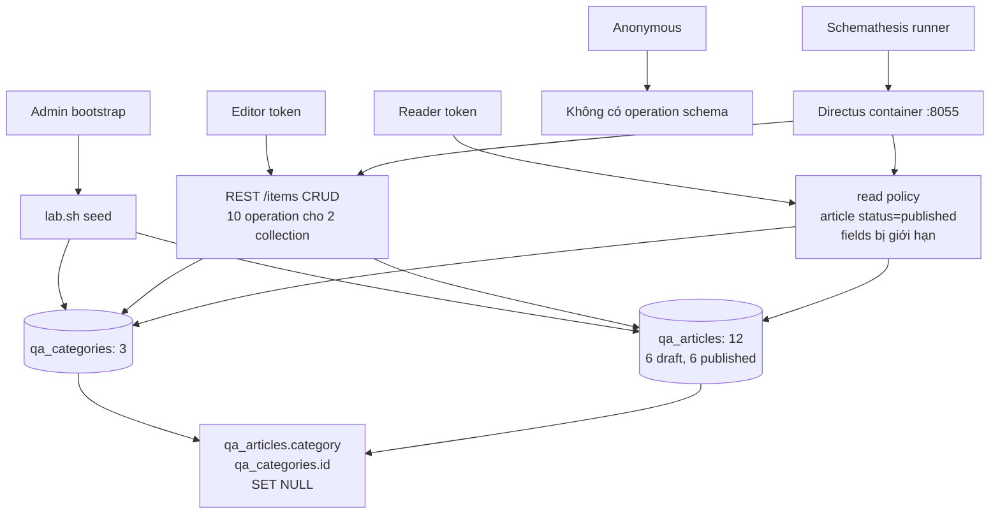
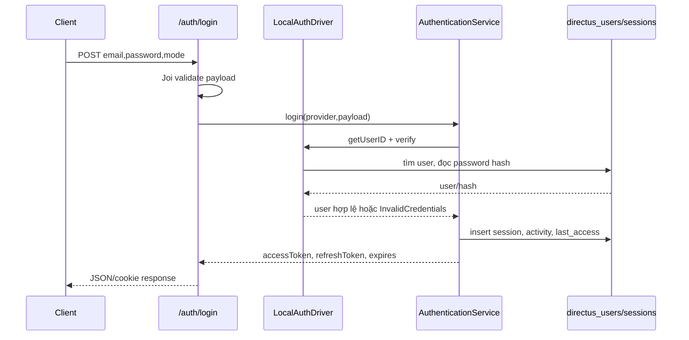
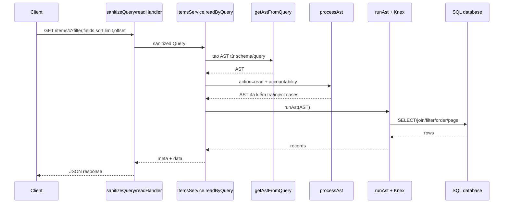
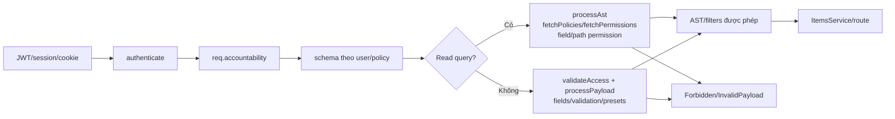
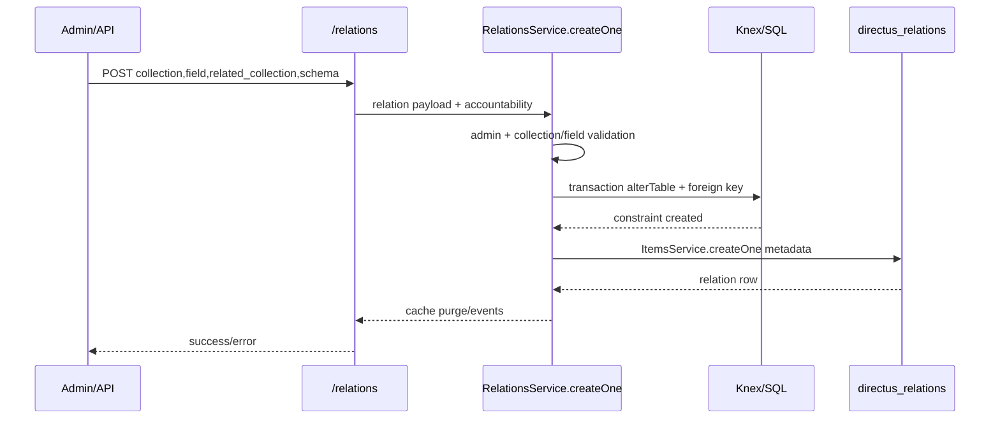

# 02 — Kiến trúc và luồng dữ liệu

## 1. Ranh giới kiến trúc

Directus hiện là một nền tảng lớn gồm API REST/GraphQL, dashboard, SDK, database abstraction, storage, extension, flow, authentication, permission, WebSocket và các package dùng chung. Lab R06/K05 chỉ dùng một cấu hình hẹp: image Directus `12.5.0`, PostgreSQL 16, hai collection `qa_categories`/`qa_articles`, các actor admin/editor/reader và các operation REST item. Vì vậy sơ đồ tổng thể dưới đây mô tả Directus; sơ đồ lab đánh dấu phần thực sự được K05 kiểm thử, không coi phạm vi lab là toàn bộ sản phẩm.

## 2. Sơ đồ kiến trúc tổng thể

```mermaid
flowchart LR
    U[Người dùng hoặc client] --> APP[Vue 3 Studio\napp/src/main.ts]
    U --> SDK[Directus SDK\nsdk]
    APP --> HTTP[HTTP REST/GraphQL]
    SDK --> HTTP
    HTTP --> SERVER[api/src/server.ts\ncreateServer/startServer]
    SERVER --> APPFACTORY[api/src/app.ts\ncreateApp]
    APPFACTORY --> PUB[/server/ping và webhook public]
    APPFACTORY --> AUTH[authenticate middleware]
    AUTH --> SCHEMA[schema middleware\nquery sanitize/cache]
    SCHEMA --> ROUTES[REST/GraphQL/module routers]
    ROUTES --> ITEMS[/items controller]
    ROUTES --> AUTHR[/auth controller]
    ROUTES --> SRV[/server, /schema, /permissions, /relations]
    ROUTES --> EXT[Extension endpoint router]
    ITEMS --> SERVICES[ItemsService, PayloadService,\nMetaService, ActivityService]
    AUTHR --> AUTHN[AuthenticationService\nLocalAuthDriver/OAuth/LDAP/SAML]
    SERVICES --> PERM[processAst / validateAccess / processPayload]
    AUTHN --> PERM
    SERVICES --> KNEX[Knex database layer]
    PERM --> KNEX
    SRV --> KNEX
    KNEX --> DB[(PostgreSQL/MySQL/SQLite/\nMSSQL/Oracle/CockroachDB)]
    SERVICES --> EVENTS[emitter hooks, revisions, activity]
    EXT --> EVENTS
    APPFACTORY --> STORAGE[storage drivers\nlocal/S3/Azure/GCS/...]
    SERVICES --> STORAGE
```

Bằng chứng chính: `directus/api/src/server.ts` tạo HTTP server và listen; `directus/api/src/app.ts` khởi tạo database/license/extensions, đặt middleware và đăng ký router; `directus/api/src/database/index.ts` tạo Knex theo `DB_CLIENT`; các router và thứ tự middleware nằm trong `api/src/app.ts` từ `app.get('/server/ping')`, `app.use(authenticate)` đến `app.use('/items', itemsRouter)` và `app.use('/schema', schemaRouter)`.

## 3. Sơ đồ phạm vi lab R06/K05



Collection, field, relation, fixture và policy trong sơ đồ này do `DAMH/scripts/lab-components.sh` tạo qua API. `directus/api/src` không chứa riêng `qa_categories` hoặc `qa_articles`; đây là dữ liệu kiểm thử của R06, không phải module nghiệp vụ upstream.

## 4. Nghiệp vụ 1 — Đăng nhập và cấp phiên

**Mục tiêu và tác nhân.** Người dùng gửi email/password tới local provider; client có thể yêu cầu mode `json`, `cookie` hoặc `session`. Các provider khác được đăng ký trong `registerAuthProviders`, nhưng luồng cụ thể dưới đây là local auth.

**Điểm bắt đầu và module.** `POST /auth/login` được gắn trong `directus/api/src/controllers/auth.ts`; local router được tạo bởi `createLocalAuthRouter` trong `api/src/auth/drivers/local.ts`.

**Dữ liệu và xử lý.** Payload phải có email hợp lệ, password và mode tùy chọn; Joi schema trong `LocalAuthDriver` kiểm tra trước. `getUserID` tìm `directus_users` theo email không phân biệt hoa thường. `verify` dùng `argon2.verify`. `AuthenticationService.login` đọc user, kiểm tra `status=active` và provider, kiểm tra giới hạn lần đăng nhập, tạo JWT access token, nanoid refresh token, ghi `directus_sessions`, activity login và `last_access`, rồi trả token/expiration. Controller chuyển token vào JSON hoặc cookie theo mode.



**Kiểm tra, lỗi và đầu ra.** Email thiếu hoặc sai định dạng → `InvalidPayloadError`; user không tồn tại, mật khẩu sai, user không active hoặc refresh hết hạn → `InvalidCredentialsError`/`UserSuspendedError`; vượt login attempts có thể cập nhật user sang suspended. Lỗi database/session hoặc provider cũng làm request thất bại. Middleware `api/src/middleware/authenticate.ts` chạy sau public ping, giải JWT/cookie qua `getAccountabilityForToken`, gắn `req.accountability` hoặc xóa cookie lỗi.

**Bằng chứng mã nguồn.** `api/src/auth/drivers/local.ts`: `getUserID`, `verify`, `createLocalAuthRouter`; `api/src/services/authentication.ts`: `login`, tạo JWT/session/activity và `refresh`; `api/src/controllers/auth.ts`: `/login`, `/refresh`, `/logout`; `api/src/middleware/authenticate.ts`: `handler`.

## 5. Nghiệp vụ 2 — CRUD item qua REST

**Mục tiêu và tác nhân.** Client có token phù hợp tạo, đọc, cập nhật hoặc xóa một hay nhiều item trong collection. K05 dùng Editor cho CRUD `qa_categories` và `qa_articles`, còn Directus hỗ trợ mọi collection hoạt động.

**Điểm bắt đầu và module.** `api/src/controllers/items.ts` đăng ký `POST /:collection`, `GET /:collection`, `GET /:collection/:pk`, `PATCH /:collection`, `PATCH /:collection/:pk`, `DELETE /:collection` và `DELETE /:collection/:pk`. Mỗi handler kiểm tra collection tồn tại/active, cấm system collection, tạo `ItemsService` với accountability và schema.

**Create.** Body có thể là object hoặc array. Controller gọi `ItemsService.createOne` hoặc `createMany`, sau đó đọc lại item vừa tạo bằng `readOne/readMany` và trả `{data}`. `createOne` bắt đầu transaction, chạy event hook, `processPayload` để áp permission/preset/validation, xử lý M2O/A2O, cast giá trị và ghi database; activity/revision được tạo khi phù hợp.

**Read/update/delete.** Read list gọi `readByQuery`; read detail thêm primary key vào query. PATCH có nhánh singleton, array, keys hoặc update-by-query; PATCH detail gọi `updateOne` rồi đọc lại. DELETE nhận array/keys/query hoặc primary key, `deleteMany/deleteOne` validate access, xóa trong transaction và ghi activity. Response có thể là item, danh sách, metadata hoặc HTTP `204` tùy middleware `respond` và route.

```mermaid
flowchart LR
    C[Client + token] --> R[/items/:collection]
    R --> M[collectionExists\ncollectionActive\nvalidateBatch\nsanitizeQuery]
    M --> I[ItemsService]
    I --> P[processPayload\nvalidation/preset/relations]
    I --> A[validateAccess]
    I --> T[Knex transaction]
    T --> DB[(collection table)]
    T --> LOG[activity/revision/events]
    DB --> RB[read-back]
    RB --> RESP[{data, meta}/204]
```

**Đầu vào/đầu ra và điểm lỗi.** Lỗi collection không tồn tại/không active, system collection, primary key sai kiểu, body batch không hợp lệ, field bị cấm, validation/preset không đạt, foreign key/unique constraint, database transaction hoặc event hook đều có thể làm request lỗi. `ItemsService.createOne` ghi rõ transaction tự rollback khi nhánh nested ném lỗi; `deleteMany` gọi `validateAccess` trước `trx(...).delete()`.

**Bằng chứng mã nguồn.** `api/src/controllers/items.ts`: route handlers; `api/src/services/items.ts`: `createOne`, `createMany`, `readByQuery`, `readOne`, `updateOne`, `updateBatch/updateMany`, `deleteOne/deleteMany`; `api/src/utils/transaction.ts`; `api/src/permissions/modules/process-payload/process-payload.ts`.

## 6. Nghiệp vụ 3 — Truy vấn, filter và phân trang

**Mục tiêu và tác nhân.** Client đọc danh sách/detail theo fields, filter, sort, limit, offset, page, search hoặc quan hệ. Input là query string đã parse bởi Express; output là danh sách item kèm metadata và HTTP status.

**Luồng xử lý.** `readHandler` trong `items.ts` chọn `readSingleton`, `readMany` hoặc `readByQuery`, rồi gọi `MetaService.getMetaForQuery`. `ItemsService.readByQuery` phát event query, gọi `getAstFromQuery`, chạy `processAst` để kiểm tra collection/field/permission, rồi `runAst` với Knex và accountability. Kết quả được event-filter lần nữa trước khi controller đặt `{meta,data}` vào response.



**Validation và lỗi.** Query parser bị giới hạn bởi `QUERYSTRING_MAX_PARSE_DEPTH`/`QUERYSTRING_ARRAY_LIMIT`; `sanitizeQuery` và AST builder có thể từ chối filter/field không hợp lệ. `processAst` kiểm tra mọi collection mà query đi qua, path tồn tại và field permission; `runAst`/database có thể lỗi do kiểu dữ liệu, join hoặc giới hạn query. Nếu records là `null`, `readByQuery` ném `ForbiddenError`.

**Bằng chứng mã nguồn.** `api/src/controllers/items.ts` (`readHandler`); `api/src/services/items.ts` (`readByQuery`); `api/src/utils/sanitize-query.ts`; `api/src/database/run-ast`; `api/src/permissions/modules/process-ast/process-ast.ts`; `api/src/services/meta.ts`.

## 7. Nghiệp vụ 4 — Authentication và authorization theo policy

**Mục tiêu và tác nhân.** Sau khi login, mọi route bảo vệ phải chuyển token thành accountability (user, role, admin, IP, origin), rồi quyết định collection/item/field/action. Reader trong lab là ví dụ: đọc category và article đã publish, không thấy `internal_notes`, không ghi.

**Luồng xử lý.** `authenticate` chạy trước router bảo vệ; `schema` middleware tạo schema theo accountability. Với query, `processAst` lấy policy và permission rồi kiểm tra path/field, inject filter/case. Với mutation, `validateAccess` xác nhận collection hoặc đọc item theo primary key dưới access rule; `processPayload` kiểm tra action, fields allowed, required/non-null và validation filter. Không đạt thì `ForbiddenError`/field forbidden; admin có nhánh bypass phù hợp.



`processAst` đặc biệt kiểm tra collection lồng nhau, field existence, field permission và inject cases; `validateAccess` nếu có primary keys sẽ đọc item thật để xác nhận access, nếu không chỉ kiểm tra collection/action. `processPayload` hợp nhất field validation, permission validation và presets trước khi `validatePayload`.

**Điểm lỗi.** Token thiếu/sai/hết hạn; role/policy không có permission; field không nằm trong allow-list; item không thỏa filter row-level; validation hoặc dynamic variable không hợp lệ; collection inactive; license không đủ entitlement cho policy custom. Khi một operation bị lọc khỏi schema theo accountability, client không được suy ra rằng mọi negative case đã được gửi.

**Bằng chứng mã nguồn.** `api/src/middleware/authenticate.ts`; `api/src/utils/get-accountability-for-token.ts`; `api/src/permissions/modules/process-ast/process-ast.ts`; `api/src/permissions/modules/validate-access/validate-access.ts`; `api/src/permissions/modules/process-payload/process-payload.ts`; lab policy được tạo trong `DAMH/scripts/lab-components.sh` (`ensure_permissions_and_users`).

## 8. Nghiệp vụ 5 — Tạo quan hệ và khóa ngoại

**Mục tiêu và tác nhân.** Admin tạo hoặc cập nhật relation giữa collection/field, ví dụ `qa_articles.category` tới `qa_categories.id`, để API và database biết quan hệ nhiều–một và hành vi xóa.

**Điểm bắt đầu và xử lý.** `api/src/app.ts` đăng ký `/relations`; controller tương ứng gọi `RelationsService`. `RelationsService.createOne` yêu cầu accountability admin, kiểm tra collection/field/related collection tồn tại, cấm primary key làm foreign key và cấm relation trùng. Trong một transaction, service alter table để tạo foreign key tới primary key collection đích, áp dụng `on_delete`/`on_update`, rồi tạo metadata trong `directus_relations`; cuối cùng purge system cache và phát action events.



Trong item mutation, `PayloadService.processM2O` và `processA2O` trong `ItemsService.createOne/updateMany` xử lý dữ liệu nested theo relation. Lỗi permission non-admin, field/collection không tồn tại, relation trùng, constraint DB hoặc nested mutation sẽ rollback transaction. K05 kiểm tra thêm `on_delete=SET NULL` bằng probe tạo category/article, xóa category, đọc lại `article.category` rồi cleanup; đó là kiểm tra fixture lab, không phải một migration upstream.

**Bằng chứng mã nguồn.** `api/src/controllers/relations.ts`; `api/src/services/relations.ts` (`createOne`, `updateOne`); `api/src/services/items.ts` (`processM2O`, `processA2O`); `DAMH/scripts/lab-components.sh` (`ensure_relation`, `check_relation_nullification`).

## 9. Tổng hợp phạm vi và rủi ro

Các luồng trên giao nhau ở database, schema cache, policy và event emitter. Một request có thể thất bại trước SQL (route/accountability/permission), trong khi lỗi SQL/foreign key/transaction xảy ra sau đó. K05 hiện kiểm tra sâu REST item, filter/sort/pagination, reader policy, field validation và quan hệ trên hai collection; chưa chứng minh toàn bộ Directus API, Studio, GraphQL, WebSocket, storage driver hay extension behavior.
