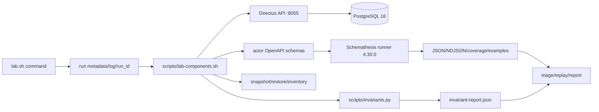

# 03 — Triển khai automation và cách thực thi

## Kiến trúc harness



Compose giữ Directus và database trong network `r06-k05`; runner dùng cùng network nhưng API chỉ publish loopback trên host. Credential lấy từ `config/lab.env`, log và metadata được redact. Mỗi lệnh tạo thư mục mới dưới `artifacts/runs/<run_id>` và không ghi đè run cũ.

## Thành phần được kiểm toán

- `lab.sh`: dispatch `doctor`, `seed`, `smoke`, `export-schema`, scenario, invariant, raw, guided và replay; tạo metadata/trap mã thoát.
- `scripts/lab-components.sh`: schema/fixture/policy, mười operation allowlist, snapshot/restore, campaign, inventory và replay.
- `scripts/invariants.py`: HTTP client standard library, fixture oracle, 11 case, response summary và cleanup.
- `config/lab.env.example`: Directus 12.5.0, Schemathesis 4.30.0, PostgreSQL 16, seed `101,202,303`, budget và rate.

Trong lần hoàn thiện này, `case_query_fixture` được mở rộng để kiểm tra `page=2` tương đương offset và search term Unicode `spéciale`. Vòng `campaign` được gia cố: runner/check failure vẫn cho chạy seed kế tiếp nếu `restore_exit_code=0`; setup/restore failure tạo summary `blocked` cho seed chưa chạy và dừng mutation tiếp theo.

Kiểm tra cú pháp sau thay đổi:

```text
bash -n lab.sh scripts/lab-components.sh          PASS
python3 -m py_compile scripts/invariants.py      PASS
git diff --check                                  PASS
```

## Quy trình thực thi an toàn

```text
./lab.sh doctor
./lab.sh seed
./lab.sh smoke
./lab.sh export-schema
./lab.sh test scenarios
./lab.sh test invariants
./lab.sh test raw
./lab.sh test guided
./lab.sh replay <case-id>
```

Các suite mutation chạy tuần tự trên cùng volume. `seed` kiểm tra collection/field/relation và đối chiếu fixture theo tên/title; không reset hoặc xóa volume. Campaign snapshot hai collection trước runner, restore article rồi category và so sánh lại toàn bộ trường snapshot. Restore PASS chỉ xác nhận integrity fixture, không biến check failure thành PASS.

## Metadata và artifact cần thu

Mỗi run cần giữ `metadata.json`, `run.log`, schema manifest/hash, fixture map, report, coverage, `campaign-summary.json`, `campaign-index.json`, metrics và restore status. Schemathesis raw/guided lưu report JSON, NDJSON events, coverage JSON và generation database. Khi chia sẻ báo cáo chỉ trích đường dẫn chọn lọc; không chép toàn bộ artifact hoặc secret.

Lần thực thi xác minh dùng raw run `20261012T112746Z-20300` và guided run `20261012T122826Z-22781`. Raw hoàn tất ba seed ở `max_time`; guided hoàn tất seed 101 và 303 ở `max_time`, còn seed 202 bị ngắt bởi tín hiệu tạm dừng trước đó và có restore PASS. Replay `q40gXE` và `n2R7IY` lần lượt trả `reproduced`, cả hai có restore 0. Do đó automation đã chạy thực tế, nhưng profile guided vẫn có một seed `INCOMPLETE` và toàn bộ campaign có check failure.

